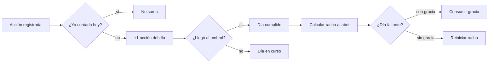
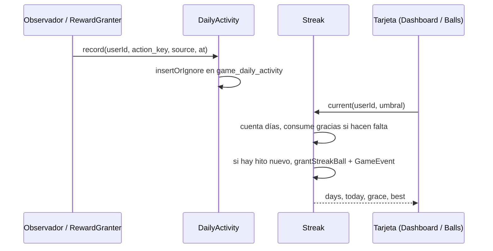

# CHG-066 · Racha de constancia con umbral diario y días de gracia
**Estado:** Descartado
**Nivel:** M
**Modelo sugerido:** estandar
<!-- Estados y nivel se cambian SOLO con node .claude/team.mjs. Modelo: un perfil de docs/TEAM_MODELS.md -->
**Creado:** 2026-11-11 · **Aprobado:** — · **Cerrado:** —
**Relacionado:** CHG-042 (constancia), CHG-049 (integrante del día), CHG-021 (equipo semanal)

## 0. En palabras simples
- Qué vas a ver distinto: una racha única, como la de Duolingo, que cuenta los días seguidos en que haces al menos N cosas en MiSo (por defecto 3, tú eliges el número). La racha aparece en el dashboard y en Colección, con lo que llevas hoy, tu mejor racha y los días de gracia que te quedan en el mes. Si un día no llegas, se gasta una gracia y la racha sigue; tienes 2 por mes.
- Cómo comprobarlo tú: completa 3 tareas hoy y mañana 3 hábitos → la tarjeta dice "Racha de 2 días". Deja pasar un día sin llegar al umbral → la racha sigue y se descuenta una gracia del mes. Cuando se acaben las 2 gracias de ese mes, la racha vuelve a empezar, pero tu mejor racha queda guardada.

## 1. Resumen
Una racha global de constancia que mide **acciones del día**, no módulos: cada tarea completada, hábito marcado, registro de bienestar, agua, ejercicio, foco, meta o constancia suma una acción. El umbral es configurable (1–10, por defecto 3) y hay **2 días de gracia automáticos por mes** para que un día flojo no borre la racha. Al alcanzar hitos (3, 7, 14, 30, 60, 100, 180 y 365 días) se recibe una ball especial y un aviso. La lógica es determinista, idempotente y nunca resta: si la racha se rompe, la mejor racha y todo lo ganado se conservan.

## 2. Producto (product-manager)
- Problema / usuario: hoy la constancia existe pero es invisible y fragmentada (rachas de agua, hábitos y ejercicio por separado, más un +1 de xp que no se ve). Alex quiere un indicador diario único que dé una razón concreta para abrir MiSo cada día, sin castigo.
- Incluye:
  - racha global de días consecutivos con ≥ umbral de acciones;
  - umbral configurable por el usuario entre 1 y 10 (por defecto 3);
  - 2 días de gracia automáticos por mes calendario (America/Bogota);
  - hitos con ball especial (fuera del límite diario) y aviso del juego;
  - tarjeta en el dashboard y bloque en Colección → Balls;
  - ajuste de umbral en Colección → Ajustes.
- No incluye: rachas separadas por módulo (las actuales de agua/hábitos se quedan como están); moneda, tienda ni compra de gracias; notificaciones push o correo; comparación con otras personas; penalizaciones de ningún tipo.
- Criterios de aceptación (Dado/Cuando/Entonces):
  1. Dado un umbral de 3 y 3 acciones registradas hoy, cuando abro el dashboard, entonces la tarjeta muestra la racha vigente y "Hoy: 3 de 3".
  2. Dado que ayer no llegué al umbral y tengo una gracia disponible, cuando abro la app, entonces la racha continúa, el día se marca como cubierto por gracia y el contador del mes baja en 1.
  3. Dado que ayer no llegué al umbral y no me quedan gracias ese mes, entonces la racha vuelve a 0 y "Tu mejor racha" conserva el valor anterior.
  4. Dado que la racha llega a 7 días por primera vez, entonces recibo 1 ball fuera del límite diario y un aviso; si la racha se reinicia y vuelve a 7, no se repite la recompensa.
  5. Dado que cambio el umbral de 3 a 5, entonces la racha se recalcula sobre los mismos días registrados sin perder datos.
  6. Dado que el juego está apagado o una fuente está apagada, entonces esa fuente no suma acciones y la tarjeta no se muestra con el juego apagado.
  7. Dado que son las 23:59 en America/Bogota, entonces el día sigue abierto; el día en curso nunca rompe la raza (solo cuenta cuando termina).
  8. La misma acción registrada dos veces (reintento, MCP y app) suma una sola vez.

## 3. UX/UI
### 3.1 Experiencia (ux-designer)
- Plantilla: tarjeta dentro del dashboard "Mi día" y bloque compacto arriba de la pestaña Balls; no hay pantalla nueva.
- Flujo y cantidad de pasos: 0 pasos para verla; 2 clics para cambiar el umbral (Colección → Ajustes → Racha).
- Qué contiene cada pantalla y qué es lo más importante:
  - Dashboard: número grande de días, estado de hoy ("2 de 3 acciones"), barra de progreso del día, días de gracia restantes y "Tu mejor racha".
  - Balls: el mismo resumen con los últimos 7 días en puntos (cumplido / gracia / sin actividad) y el enlace a Ajustes.
- Estados (vacío / carga / error / éxito / validaciones):
  - sin historial: "Empieza hoy: te faltan 3 acciones";
  - hoy cumplido: marca de check y el mensaje de que mañana sigue;
  - día cubierto por gracia: punto con anillo y "Gracia usada";
  - racha rota: "Tu mejor racha fue de N días; hoy empieza otra";
  - hito: aviso del juego con celebración y sonido ya existentes;
  - juego apagado: la tarjeta no se renderiza;
  - carga: el cálculo es síncrono y local, sin spinner.
- Información necesaria y momento de presentación: el umbral y las gracias solo se explican al tocar "¿Cómo funciona?" (texto breve en el bloque de Balls); el dashboard no se recarga con explicaciones.
- Accesibilidad de uso (teclado, foco, errores): tarjeta con `aria-label` que resume la racha; los 7 puntos llevan texto alternativo por día; el cambio de umbral es un `x-ui.field` numérico con rango validado y mensaje de error asociado.

```
┌─ Tu racha ───────────────────────────┐
│  🔥  12 días                          │
│  Hoy: 2 de 3 acciones                 │
│  ▓▓▓▓▓▓▓▓▓▓▓▓▓▓▓▓▓▓░░░░  67 %        │
│  Gracia: 1 de 2 en noviembre          │
│  Tu mejor racha: 21 días              │
└───────────────────────────────────────┘
```



### 3.2 Visual (ui-designer)
- Distribución: en el dashboard ocupa una tarjeta del grid existente; en Balls va en una franja a todo el ancho arriba de los contadores.
- Componentes existentes a reutilizar (ruta): `x-ui.card`, `x-ui.progress` (o la barra de misión de `_game.css`), `x-ui.badge` para las gracias, `x-ui.icon-action` para "¿Cómo funciona?".
- Jerarquía, color, tipografía y espaciado (tokens): número en `md-headline-medium`, etiquetas en `md-label-small`; llama/racha con `--game-accent` (ámbar) y las gracias con el color de `warning`; sin nuevos colores fuera de tokens. El punto de gracia usa el patrón de anillo de `game-rarity`.
- Responsive y contraste: 1 tarjeta por fila en móvil; la fila de 7 días se desplaza horizontalmente con `scroll-snap` si no cabe; texto sobre `surface-container` cumple contraste AA.

### 3.3 Escritura (ux-writer)
- Ubicación y estado: tarjeta del dashboard y bloque de Balls; ajuste en Ajustes.
- Textos finales (variables entre llaves):
  - `streak.title`: "Tu racha"
  - `streak.days`: "{days} días"
  - `streak.today`: "Hoy: {done} de {goal} acciones"
  - `streak.done_today`: "Hoy ya está: {done} de {goal} acciones"
  - `streak.start`: "Hoy empieza tu racha: te faltan {left} acciones."
  - `streak.grace_left`: "Gracia: {left} de {total} en {month}"
  - `streak.grace_used`: "Usaste una gracia el {date}."
  - `streak.broken`: "Tu mejor racha fue de {best} días. Hoy empieza otra."
  - `streak.best`: "Tu mejor racha: {best} días"
  - `streak.milestone`: "¡{days} días seguidos! Ganaste una ball."
  - `settings.threshold`: "Acciones para cumplir el día"
  - `settings.threshold_help`: "Entre 1 y 10. Cuenta cada tarea, hábito o registro del día."
  - `settings.help`: "Cada día necesitas {goal} acciones. Si un día no llegas, se usa una gracia (2 por mes)."
- Reglas de docs/UX-WRITING.md aplicadas: tuteo, cálido, sin culpa; nada de "perdiste", "fallaste" ni "obligatorio"; máximo 90 caracteres con valores típicos.
- Criterios de aceptación de los textos: prueba que valide que todas las plantillas existen, no usan palabras de `MissionProposalValidator::PENALTY_WORDS` y caben en 90 caracteres con valores de ejemplo.

## 4. Diseño técnico (software-architect)

- Archivos a crear / modificar:
  - `database/migrations/2026_11_11_000001_create_game_streak_tables.php`: `game_daily_activity` (`user_id`, `date`, `action_key` único por usuario, `source`, timestamps) y `game_streak_graces` (`user_id`, `date` única por usuario, `month` `YYYY-MM`, `created_at`).
  - `app/Models/Game/GameDailyActivity.php`, `GameStreakGrace.php` (con `BelongsToUser`).
  - `app/Services/Game/DailyActivity.php`: `record(int $userId, string $key, string $source, CarbonInterface $at)` con `insertOrIgnore` y fecha en America/Bogota. Sin lanzar excepciones al flujo principal.
  - `app/Services/Game/Streak.php`: `current()`, `best()`, `month()`, `awardMilestones()`; lee conteos agrupados por día, valida umbral 1–10 y consume gracias dentro de una transacción con bloqueo del usuario.
  - `app/Services/Game/RewardGranter.php`: llamar a `DailyActivity::record` justo después de crear el evento de actividad (con la misma `idempotency_key`); nuevo `grantStreakBall()` con clave `streak:{hito}`.
  - `app/Services/Game/ConsistencyXp.php`: registrar la acción `micro:{fuente}:{fecha}` (la misma clave del evento).
  - `app/Services/HabitGamificationService.php`: registrar cada hábito completado con `habit:{id}:{fecha}` (los grupos no se registran aparte para no contar doble).
  - `app/Services/Game/GameFeed.php`: nuevo tipo de aviso `streak` (título, días, ball) y color propio en el notificador.
  - `app/Services/Game/GameSettings.php`: `streak_threshold` (entero 1–10, por defecto `config('game.streak.threshold')`).
  - `app/Livewire/Home/Dashboard.php` + `resources/views/livewire/home/dashboard.blade.php`: propiedad `streak` en `mount()`/`render()` y tarjeta.
  - `app/Livewire/Game/GameBalls.php` + `resources/views/livewire/game/game-balls.blade.php`: bloque de racha con los 7 días.
  - `app/Livewire/Game/GameSettingsPage.php` + `resources/views/livewire/game/game-settings.blade.php`: campo de umbral.
  - `config/game.php`: bloque `streak` (`threshold`, `threshold_range`, `grace_days_per_month`, `milestones`, `timezone`).
  - `resources/css/m3/modules/_game.css`: tarjeta, barra y puntos de gracia.
  - Pruebas: `tests/Feature/Game/StreakTest.php`, `DailyActivityTest.php`.
- Enfoque y patrones a seguir:
  - **Contador explícito** (`game_daily_activity`) en vez de recalcular 15 tablas: O(1) por lectura y no duplica `game_events`.
  - Idempotencia por `action_key` igual a las claves que ya usa el juego (`task:{id}:{fecha}`, `micro:{fuente}:{fecha}`, etc.).
  - Zona horaria fija `America/Bogota` (la misma de `ConsistencyXp`), independiente de `config('app.timezone')`.
  - Gracias idempotentes: una fila por día cubierto; el límite de 2 se valida contra `month`.
  - Los hitos se pagan una vez en la vida con la clave `streak:{hito}` (no se repiten al reiniciar la racha).
  - Ninguna lectura debe romper la pantalla: `Streak` atrapa errores y devuelve un estado vacío.
- Riesgos y mitigación:
  - *Costo en dashboard*: 1 consulta agrupada de 60 días + 1 de gracias; se cachea en la propiedad del componente.
  - *Escritura al leer* (consumir gracias): se hace en una transacción corta con `lockForUpdate` del usuario y solo si el día ya terminó; si falla, la racha se calcula sin consumir.
  - *Doble conteo*: tareas recurrentes usan la misma clave de idempotencia del evento; un hábito y su grupo no suman dos veces porque el grupo no se registra.
  - *Datos históricos*: la racha empieza a contar desde la migración; no se inventan días anteriores.
- Qué NO tocar: cálculo de balls, xp, misiones, temporadas, rachas de agua/hábitos existentes, `GameNotifier` (solo se añade un tipo de aviso).

## 5. Pruebas (qa-tester)
| Caso | Tipo | Nivel | Test |
|---|---|---|---|
| Registrar la misma acción dos veces suma una sola vez | Feature | Alto | tests/Feature/Game/DailyActivityTest.php |
| Umbral 3 con 3 acciones de fuentes distintas cumple el día | Feature | Alto | StreakTest |
| Día sin umbral con gracia disponible continúa la racha y descuenta 1 | Feature | Alto | StreakTest |
| Sin gracias disponibles la racha se reinicia y conserva la mejor | Feature | Alto | StreakTest |
| Hito 7 paga una ball una sola vez, incluso tras reiniciar la racha | Feature | Alto | StreakTest |
| Cambiar el umbral recalcula sin borrar datos | Feature | Medio | StreakTest |
| Juego apagado: no se registran acciones ni se muestra la tarjeta | Feature | Medio | StreakTest |
| Día en curso nunca rompe la racha | Feature | Alto | StreakTest |
| Plantillas de texto sin palabras prohibidas y ≤ 90 caracteres | Feature | Bajo | StreakTest |
| Tarjeta del dashboard y bloque de Balls con datos y sin historial | Componente | Medio | tests/Feature/Game/GameDashboardTest.php |
- Comando para verificar: `php artisan test tests/Feature/Game/StreakTest.php tests/Feature/Game/DailyActivityTest.php`
- Regresión a vigilar: `GameFeedTest`, `ConsistencyXpTest`, `HabitGamificationTest`, `DashboardTest` y `GameSettingsTest`; el notificador no debe perder sus tipos actuales.

## 6. Documentación (tech-writer)
- Docs a actualizar: `docs/game.md` → nueva sección "Racha de constancia" (qué cuenta, umbral, gracias, hitos, zona horaria y datos); `docs/UX-DESIGN.md` solo si la tarjeta estrena patrón.

## 7. Tareas
- [ ] T1 · Contar las acciones del día y calcular la racha con umbral configurable — Resp: developer — Archivos: migración, app/Models/Game/GameDailyActivity.php, app/Models/Game/GameStreakGrace.php, app/Services/Game/DailyActivity.php, app/Services/Game/Streak.php, app/Services/Game/RewardGranter.php, app/Services/Game/ConsistencyXp.php, app/Services/HabitGamificationService.php, config/game.php, tests/Feature/Game/DailyActivityTest.php, tests/Feature/Game/StreakTest.php — Hecho cuando: criterios 1, 5, 6, 7 y 8 pasan
- [ ] T2 · Días de gracia automáticos e hitos con ball y aviso — Resp: developer — Archivos: app/Services/Game/Streak.php, app/Services/Game/GameFeed.php, resources/views/livewire/game/game-notifier.blade.php, config/game.php, tests/Feature/Game/StreakTest.php — Hecho cuando: criterios 2, 3 y 4 pasan y el aviso se ve sin romper los tipos existentes
- [ ] T3 · Tarjeta "Tu racha" en dashboard y Colección, y umbral en Ajustes — Resp: developer — Archivos: app/Livewire/Home/Dashboard.php, resources/views/livewire/home/dashboard.blade.php, app/Livewire/Game/GameBalls.php, resources/views/livewire/game/game-balls.blade.php, app/Livewire/Game/GameSettingsPage.php, resources/views/livewire/game/game-settings.blade.php, resources/css/m3/modules/_game.css, tests/Feature/Game/GameDashboardTest.php — Hecho cuando: la tarjeta y el ajuste funcionan en 390/768/1440 px y el build compila
- [ ] T4 · Verificar criterios de aceptación — Resp: qa-tester — Hecho cuando: los 8 criterios pasan y las suites afectadas están en verde (salvo fallas previas conocidas)
- [ ] T5 · Actualizar documentación — Resp: tech-writer — Archivos: docs/game.md — Hecho cuando: la sección de racha explica reglas, datos y zona horaria

## 8. Bitácora de implementación (developer)

## 9. Preguntas abiertas, decisiones e historial
- 2026-11-11 — Decisiones (Alex): cuenta el día al llegar a un **umbral configurable** de acciones (por defecto 3); **2 días de gracia automáticos por mes**; premios en balls y avisos, sin moneda nueva.
- 2026-11-11 — Creado en to-do/ (Borrador, nivel M)
- 2026-11-11 — Descartado: Duplicado por choque de numeración; renumerado a CHG-076..079
