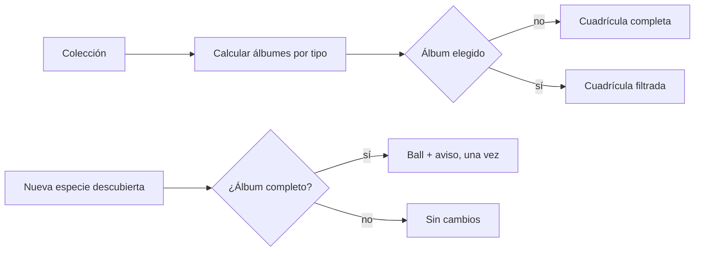
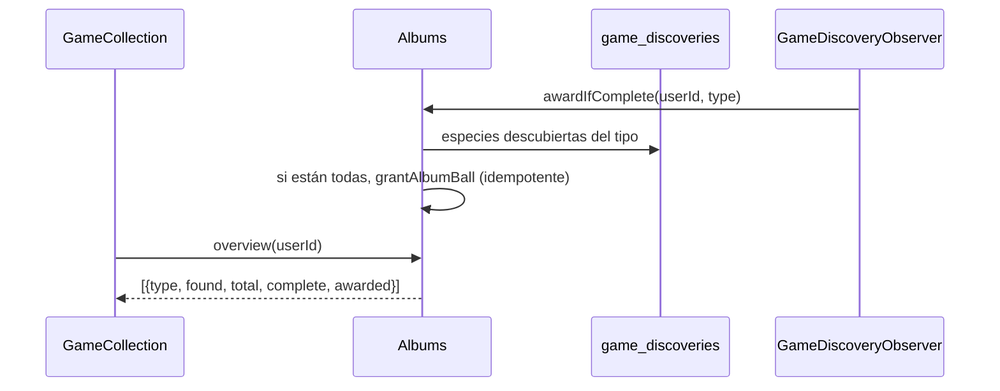

# CHG-067 · Álbumes de la colección por tipo
**Estado:** Descartado
**Nivel:** M
**Modelo sugerido:** estandar
<!-- Estados y nivel se cambian SOLO con node .claude/team.mjs. Modelo: un perfil de docs/TEAM_MODELS.md -->
**Creado:** 2026-11-11 · **Aprobado:** — · **Cerrado:** —
**Relacionado:** CHG-025 (rediseño de la colección), CHG-020 (descubrimientos), CHG-045 (tipos destacados de temporada)

## 0. En palabras simples
- Qué vas a ver distinto: arriba de la cuadrícula de la Colección aparece una fila de álbumes, uno por tipo (Agua, Fuego, Psíquico…), con cuántas especies llevas de ese tipo. Al tocar uno, la cuadrícula se filtra solo a esas especies. Cuando descubres la última especie de un tipo, el álbum queda completo y ganas una ball.
- Cómo comprobarlo tú: abre Colección → toca "Agua" → ves solo especies de agua y "7 de 14". Completa un álbum pequeño → llega la ball y el aviso "Álbum completo". Vuelve a "Todos" → la cuadrícula regresa completa.

## 1. Resumen
La Colección gana **álbumes por tipo** calculados sobre el catálogo activo y los descubrimientos del usuario (`game_discoveries`), sin datos nuevos de catálogo: el tipo ya vive en `game_species.types` y en `config('game.type_palette')`. El álbum se convierte en un filtro de la cuadrícula (`?album=agua`) y en una meta explícita de colección: al descubrir la última especie de un tipo se entrega **una ball especial** (fuera del límite diario) y un aviso, una sola vez por tipo. Si el catálogo crece después, el álbum vuelve a mostrar pendientes pero la recompensa no se retira ni se duplica.

## 2. Producto (product-manager)
- Problema / usuario: la colección es una lista larga de 60 por página con filtros; no hay metas de colección ni sensación de "completé algo". Alex quiere álbumes que den propósito a largo plazo y orienten qué buscar.
- Incluye:
  - un álbum por cada tipo con al menos una especie activa;
  - descubiertas / total por álbum y barra de avance;
  - filtro de la cuadrícula por álbum, conservado en la URL;
  - recompensa y aviso al completar un álbum, una sola vez por tipo;
  - estado vacío cuando el catálogo no tiene tipos.
- No incluye: álbumes por rareza o por línea evolutiva; recompensas por "casi completo"; moneda o cosméticos; cambios al catálogo, a la importación de especies ni a los pesos de rareza; recompensas retroactivas por álbumes ya completos antes del cambio (se entregan al abrir la Colección la primera vez, una sola vez).
- Criterios de aceptación (Dado/Cuando/Entonces):
  1. Dado un catálogo activo con especies de agua, cuando abro la Colección, entonces veo un álbum "Agua" con descubiertas y total.
  2. Dado que toco un álbum, entonces la cuadrícula muestra solo especies de ese tipo, el encabezado dice el nombre del álbum y la URL guarda `?album={tipo}`.
  3. Dado que quito el filtro ("Todos"), entonces vuelvo a la cuadrícula completa sin perder búsqueda ni rareza.
  4. Dado que descubro la última especie de un tipo, entonces recibo 1 ball fuera del límite diario y un aviso "Álbum {tipo} completo"; no se repite al abrir más balls ni al evolucionar.
  5. Dado que el catálogo suma especies después, entonces el álbum muestra pendientes de nuevo y conserva la recompensa ya entregada.
  6. Dado un tipo sin especies activas, entonces no aparece su álbum.
  7. Los conteos del álbum no cambian por la búsqueda ni por el filtro de rareza: miden el set completo del tipo.
- Los álbumes se ordenan según `config('game.type_palette')` y el nombre visible sale de esa misma lista (con acentos y mayúsculas).

## 3. UX/UI
### 3.1 Experiencia (ux-designer)
- Plantilla: lista con cuadrícula existente (Colección), sin pestaña nueva.
- Flujo y cantidad de pasos: 1 clic para entrar a un álbum; 1 clic en "Todos" para salir.
- Qué contiene cada pantalla y qué es lo más importante:
  - franja de álbumes: nombre del tipo, ícono/color del tipo, "7 de 14" y barra fina;
  - al elegir uno, la franja se mantiene y el álbum activo queda marcado;
  - el encabezado de la cuadrícula muestra "Álbum Agua · 7 de 14" y un chip para quitarlo.
- Estados (vacío / carga / error / éxito / validaciones):
  - sin catálogo: la franja no se renderiza y la cuadrícula muestra su vacío actual;
  - álbum completo: sello "Completo" y borde dorado;
  - álbum sin descubiertas: "0 de N" con el arte en silueta (patrón actual de "por descubrir");
  - recompensa: aviso del juego y celebración ya existentes;
  - filtro sin resultados (catálogo cambiado): estado vacío con "Quitar filtro".
- Información necesaria y momento de presentación: la explicación de la recompensa solo aparece en el tooltip/ayuda del álbum completo; no se explica antes.
- Accesibilidad de uso (teclado, foco, errores): cada álbum es un `button` con `aria-pressed`; la franja se recorre con Tab y flechas; el foco visible no se pierde al cambiar de filtro; los conteos se leen como "7 de 14 especies".

```
┌─ Álbumes ─────────────────────────────────────────────┐
│ [💧 Agua 7/14] [🔥 Fuego 4/12] [🌿 Planta 9/15] →     │
└───────────────────────────────────────────────────────┘
┌─ Álbum Agua · 7 de 14 ─────────────────── [Todos ×] ──┐
│  ┌────┐ ┌────┐ ┌────┐ ┌────┐ ┌────┐                   │
│  │ 🐟 │ │ 🐙 │ │ ░░ │ │ 🐚 │ │ ░░ │                   │
│  └────┘ └────┘ └────┘ └────┘ └────┘                   │
└───────────────────────────────────────────────────────┘
```



### 3.2 Visual (ui-designer)
- Distribución: franja horizontal a todo el ancho sobre los filtros actuales; en móvil se desplaza con `scroll-snap` y el álbum activo queda visible.
- Componentes existentes a reutilizar (ruta): `x-ui.card` o `x-game.species-card` como referencia; `x-game.rarity-tag` para el sello "Completo"; `x-ui.progress`; clases `game-type--{slug}` y `--game-type-{slug}` de `_game.css`; `x-ui.chip` para el filtro activo.
- Jerarquía, color, tipografía y espaciado (tokens): el color del borde y del ícono es el del tipo; el avance usa `surface-container-highest` de fondo y el acento del tipo; el sello "Completo" usa el dorado de legendaria. Texto en `md-label-medium` / `md-title-small`.
- Responsive y contraste: 2 columnas de álbum en 390 px, 4 en 768 px, todas en 1440 px; contraste AA sobre `surface-container`; el borde de tipo no es el único indicador (siempre hay nombre e ícono).

### 3.3 Escritura (ux-writer)
- Ubicación y estado: franja y encabezado de la Colección; aviso de álbum completo.
- Textos finales (variables entre llaves):
  - `albums.title`: "Álbumes"
  - `albums.count`: "{found} de {total}"
  - `albums.active`: "Álbum {type} · {found} de {total}"
  - `albums.all`: "Todos"
  - `albums.complete`: "Completo"
  - `albums.complete_notice`: "¡Álbum {type} completo! Ganaste una ball."
  - `albums.empty_filter`: "No hay especies para mostrar. Quita el filtro."
  - `albums.aria`: "Álbum {type}: {found} de {total} especies"
- Reglas de docs/UX-WRITING.md aplicadas: tuteo, sin culpa, sin "te falta" ni "casi"; los nombres de tipo van capitalizados.
- Criterios de aceptación de los textos: prueba que valide existencia de plantillas, ≤ 90 caracteres con valores típicos y ausencia de palabras de `MissionProposalValidator::PENALTY_WORDS`.

## 4. Diseño técnico (software-architect)

- Archivos a crear / modificar:
  - `database/migrations/2026_11_11_000002_create_game_album_awards_table.php`: `game_album_awards` (`user_id`, `album_key`, `species_total` al momento, `awarded_at`, unique `user_id+album_key`).
  - `app/Models/Game/GameAlbumAward.php` (`BelongsToUser`).
  - `app/Services/Game/Albums.php`: `overview(int $userId)` (una consulta de especies activas + una de descubrimientos; agrupa en PHP por `types`), `completeFor()`, `awardIfComplete()`. Nombre visible desde `type_palette`.
  - `app/Observers/Game/AlbumObserver.php` sobre `GameDiscovery::created` → `DB::afterCommit(fn () => Albums::awardIfComplete(...))`; registrar en `AppServiceProvider::boot()`.
  - `app/Services/Game/RewardGranter.php`: `grantAlbumBall()` (clave `album:{tipo}`, ball especial fuera del límite).
  - `app/Services/Game/GameFeed.php`: aviso `album` (tipo, encontradas, total) con color propio.
  - `app/Livewire/Game/GameCollection.php` + `resources/views/livewire/game/game-collection.blade.php`: propiedad `?album=`, `albumOverview` en `render()`, filtro en la consulta y franja.
  - `app/Livewire/Game/GameBalls.php` (opcional): contador "Álbumes completos" solo si no complica la vista; si no, se omite.
  - `config/game.php`: `album_reward` (1) y reutilizar `type_palette` / `type_labels` si hace falta un nombre con acentos.
  - `resources/css/m3/modules/_game.css`: franja, sello, chip activo.
  - Pruebas: `tests/Feature/Game/AlbumsTest.php`, `GameCollectionAlbumsTest.php`.
- Enfoque y patrones a seguir:
  - **Sin tabla de catálogo nueva**: el tipo es `game_species.types` (array) y el conjunto se calcula en memoria; el catálogo es pequeño (≤ 200 filas).
  - Una fila de recompensa por álbum evita duplicados y conserva la evidencia cuando el catálogo cambia.
  - El álbum es un filtro de la URL (`#[Url(as: 'album', except: '')]`), igual que `state`, `type` y `rarity`, para que se pueda compartir y volver atrás.
  - `overview()` se calcula una vez por render y se pasa a la vista; no se consulta por cada tarjeta.
- Riesgos y mitigación:
  - *JSON `types`*: MySQL y SQLite de pruebas soportan `whereJsonContains`; si el driver falla, el agrupamiento en PHP es el camino principal (no se depende del JSON en SQL).
  - *Recompensa al abrir/evolucionar*: el observador de `GameDiscovery` cubre ambos caminos y es idempotente por `album_key`.
  - *Catálogo que crece*: el álbum vuelve a estar incompleto, pero `game_album_awards` no se borra; el sello "Completo" se muestra solo si vuelve a estarlo.
  - *Rendimiento*: 2 consultas por render de Colección; sin N+1.
- Qué NO tocar: importación de especies, pesos de rareza, apertura de balls, misiones, temporadas, ficha de especie.

## 5. Pruebas (qa-tester)
| Caso | Tipo | Nivel | Test |
|---|---|---|---|
| `overview` cuenta descubiertas y total por tipo activo | Feature | Alto | tests/Feature/Game/AlbumsTest.php |
| Un tipo sin especies no genera álbum | Feature | Medio | AlbumsTest |
| Descubrir la última especie del tipo entrega 1 ball y no repite | Feature | Alto | AlbumsTest |
| Evolucionar una especie también evalúa el álbum | Feature | Alto | AlbumsTest |
| Catálogo que crece: vuelve a incompleto y no duplica la recompensa | Feature | Medio | AlbumsTest |
| Filtro por álbum en la URL y combinación con búsqueda/rareza | Componente | Medio | tests/Feature/Game/GameCollectionAlbumsTest.php |
| Conteos del álbum independientes de búsqueda y rareza | Componente | Medio | GameCollectionAlbumsTest |
| Plantillas de texto y nombres de tipo | Feature | Bajo | AlbumsTest |
- Comando para verificar: `php artisan test tests/Feature/Game/AlbumsTest.php tests/Feature/Game/GameCollectionAlbumsTest.php`
- Regresión a vigilar: `GameCollectionTest`, `EncounterOpenerTest`, `GameFeedTest` y las pruebas de evolución (`CompanionProgressTest`).

## 6. Documentación (tech-writer)
- Docs a actualizar: `docs/game.md` → "Colección": álbumes por tipo, recompensa, qué pasa si el catálogo crece y cómo se calcula; `docs/game.md` tabla de datos con `game_album_awards`.

## 7. Tareas
- [ ] T1 · Calcular álbumes por tipo y mostrarlos arriba de la cuadrícula con su avance — Resp: developer — Archivos: app/Services/Game/Albums.php, app/Livewire/Game/GameCollection.php, resources/views/livewire/game/game-collection.blade.php, resources/css/m3/modules/_game.css, tests/Feature/Game/AlbumsTest.php, tests/Feature/Game/GameCollectionAlbumsTest.php — Hecho cuando: criterios 1, 2, 3, 6 y 7 pasan
- [ ] T2 · Filtro por álbum conservado en la URL y chip para quitarlo — Resp: developer — Archivos: app/Livewire/Game/GameCollection.php, resources/views/livewire/game/game-collection.blade.php, resources/css/m3/modules/_game.css — Hecho cuando: criterios 2 y 3 pasan en 390/768/1440 px
- [ ] T3 · Recompensa y aviso al completar un álbum, una sola vez por tipo — Resp: developer — Archivos: migración, app/Models/Game/GameAlbumAward.php, app/Observers/Game/AlbumObserver.php, app/Providers/AppServiceProvider.php, app/Services/Game/RewardGranter.php, app/Services/Game/GameFeed.php, resources/views/livewire/game/game-notifier.blade.php, tests/Feature/Game/AlbumsTest.php — Hecho cuando: criterios 4 y 5 pasan
- [ ] T4 · Verificar criterios de aceptación — Resp: qa-tester — Hecho cuando: los 7 criterios pasan y las suites afectadas están en verde (salvo fallas previas conocidas)
- [ ] T5 · Actualizar documentación — Resp: tech-writer — Archivos: docs/game.md — Hecho cuando: la sección de colección y la tabla de datos incluyen los álbumes

## 8. Bitácora de implementación (developer)

## 9. Preguntas abiertas, decisiones e historial
- 2026-11-11 — Decisiones (Alex): los álbumes se agrupan **por tipo**; sin pestaña nueva (franja dentro de Colección); recompensa en balls, sin cosméticos.
- 2026-11-11 — Creado en to-do/ (Borrador, nivel M)
- 2026-11-11 — Descartado: Duplicado por choque de numeración; renumerado a CHG-076..079
