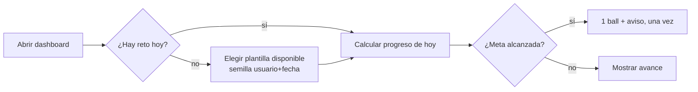
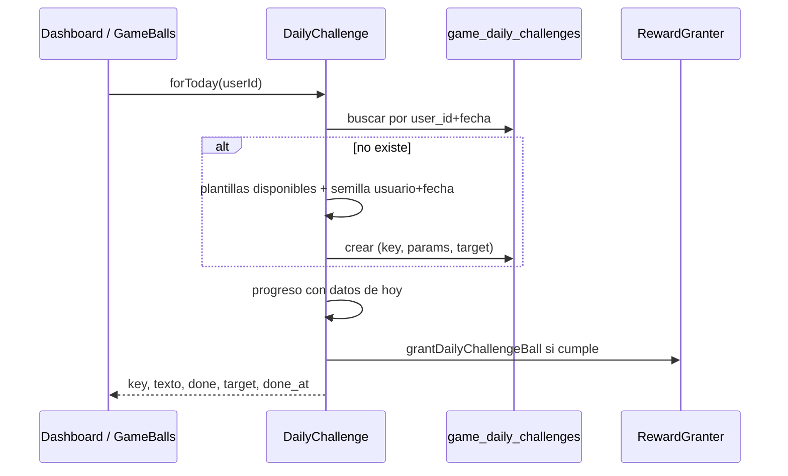

# CHG-069 · Reto del día
**Estado:** Descartado
**Nivel:** M
**Modelo sugerido:** estandar
<!-- Estados y nivel se cambian SOLO con node .claude/team.mjs. Modelo: un perfil de docs/TEAM_MODELS.md -->
**Creado:** 2026-11-11 · **Aprobado:** — · **Cerrado:** —
**Relacionado:** CHG-057/058/063/064 (consejos del guardián), CHG-021 (misiones), CHG-049 (integrante del día)

## 0. En palabras simples
- Qué vas a ver distinto: cada día hay **un solo reto pequeño** pensado para lo que de verdad tienes pendiente hoy ("cierra 2 tareas de Trabajo", "completa los hábitos de la mañana", "registra agua 2 veces"). Aparece en el dashboard y en Colección → Balls, muestra tu avance y al cumplirlo te da una ball. Si no lo haces, no pasa nada: mañana hay otro y el de ayer desaparece sin dejar rastro.
- Cómo comprobarlo tú: abre el dashboard en la mañana → ves "Reto de hoy" con su barra. Haz lo que pide → la barra avanza y al completarse llega la ball. Al día siguiente, el reto es otro.

## 1. Resumen
Un **reto diario determinista** (sin IA, sin scheduler) elegido entre plantillas medibles que ya tienen datos en MiSo: tareas, hábitos, agua, ánimo, diario, ejercicio, comidas, relaciones y foco. Se elige una vez por día y usuario con una semilla `usuario + fecha`, se guarda en `game_daily_challenges` y su progreso se calcula desde los datos del día. Al cumplirlo se entrega **una ball especial** (fuera del límite diario) una sola vez. Es la pieza de cadencia diaria que hoy falta entre el guardián (que aconseja) y las misiones semanales (que son grandes).

## 2. Producto (product-manager)
- Problema / usuario: el guardián dice qué hacer pero no hay una meta diaria concreta, y las misiones semanales son demasiado grandes para dar una razón de abrir MiSo hoy. Alex quiere un reto pequeño y contextual, con recompensa y sin culpa.
- Incluye:
  - 1 reto por día por usuario, elegido entre plantillas disponibles según sus datos;
  - progreso automático con las acciones de hoy (app y MCP);
  - 1 ball especial al cumplirlo, fuera del límite diario, con aviso;
  - tarjeta en el dashboard y bloque en Colección → Balls;
  - interruptor en Colección → Ajustes;
  - sin reroll ni costo: el reto del día no se cambia.
- No incluye: retos con IA generativa; cadena de varios retos al día; rachas de retos (eso es CHG-066); retos que creen, muevan o completen datos por sí solos; notificaciones push o correo; comparación con otras personas.
- Criterios de aceptación (Dado/Cuando/Entonces):
  1. Dado un día sin reto elegido, cuando abro el dashboard por primera vez, entonces se elige un reto entre las plantillas disponibles y se mantiene todo el día.
  2. Dado que el reto es "cierra 2 tareas", cuando completo 2 tareas hoy, entonces la barra llega al 100 % y recibo la ball una sola vez.
  3. Dado el mismo reto, cuando registro acciones por MCP o por otra pantalla, entonces el progreso también avanza.
  4. Dado el día siguiente, entonces hay un reto nuevo y el anterior ya no se muestra ni resta nada.
  5. Dado que no hay datos para una plantilla (sin hábitos de la mañana, sin plan de comidas hoy, sin relaciones), entonces ese reto no se elige.
  6. Dado que apago el reto en Ajustes, entonces la tarjeta no aparece y no se elige ni se premia.
  7. Un reto cumplido no se premia dos veces aunque se recargue o se abra en dos dispositivos.
- Plantillas (todas medibles con datos existentes):
  1. `tasks_done`: "Cierra {n} tareas" (n 2–3).
  2. `category_tasks`: "Cierra {n} de {categoría}" (categoría con ≥ n pendientes).
  3. `habit_period`: "Completa los hábitos de {momento}" (con hábitos en ese momento).
  4. `water_logs`: "Registra agua {n} veces" (n 2–3).
  5. `mood_entry`: "Anota cómo te sientes" (ánimo y energía).
  6. `journal_entry`: "Escribe en tu diario".
  7. `exercise_log`: "Registra tu ejercicio".
  8. `meal_check`: "Marca una comida de tu plan de hoy".
  9. `relationship_event`: "Anota un momento con alguien".
  10. `focus_session`: "Completa un pomodoro de 25 minutos".

## 3. UX/UI
### 3.1 Experiencia (ux-designer)
- Plantilla: tarjeta del dashboard "Mi día" y bloque en Colección → Balls; no hay pantalla nueva.
- Flujo y cantidad de pasos: 0 pasos para verlo; 1 clic en "Ir" para hacerlo (lleva a la pantalla del módulo).
- Qué contiene cada pantalla y qué es lo más importante:
  - título "Reto de hoy", el texto del reto y la barra "1 de 2";
  - el botón "Ir" hacia el módulo implicado;
  - al cumplirlo: check, "Cumplido" y la ball ya entregada;
  - en Balls, una línea dentro del resumen con el reto del día.
- Estados (vacío / carga / error / éxito / validaciones):
  - sin reto elegido todavía: se elige al renderizar; si no hay ninguna plantilla disponible, no se muestra la tarjeta;
  - en curso: barra y "te falta 1";
  - cumplido: check y "Mañana hay otro";
  - ayer sin cumplir: no se muestra (no hay estado de fallo);
  - juego apagado o reto apagado: no se renderiza;
  - error al calcular progreso: se muestra el reto sin barra y sin premio, nunca un error.
- Información necesaria y momento de presentación: sin explicación previa; una línea pequeña "Uno al día" bajo el título.
- Accesibilidad de uso (teclado, foco, errores): tarjeta con `aria-live="polite"` al cambiar de estado; el botón "Ir" es un enlace real con texto (no solo ícono); la barra tiene `role="progressbar"` con `aria-valuenow`.

```
┌─ Reto de hoy ─────────────────────────┐
│ Cierra 2 tareas de Trabajo            │
│ ▓▓▓▓▓▓▓▓▓░░░░░░░░  1 de 2            │
│                            [Ir →]     │
└───────────────────────────────────────┘
```



### 3.2 Visual (ui-designer)
- Distribución: tarjeta del grid del dashboard, misma altura que las tarjetas vecinas; en Balls, una línea bajo el resumen de racha.
- Componentes existentes a reutilizar (ruta): `x-ui.card`, `x-ui.progress`, `x-ui.badge`, `x-ui.button` (variante texto con icono `bi-arrow-right`), estilos `.game-*` de `_game.css`.
- Jerarquía, color, tipografía y espaciado (tokens): el texto del reto en `md-title-small`, la barra con `primary`, el estado cumplido con el verde de nivel; sin nuevos colores.
- Responsive y contraste: una tarjeta por fila en móvil; texto del reto hasta 2 líneas con elipsis y `title` completo; contraste AA.

### 3.3 Escritura (ux-writer)
- Ubicación y estado: tarjeta del dashboard, línea en Balls, interruptor en Ajustes.
- Textos finales (variables entre llaves):
  - `challenge.title`: "Reto de hoy"
  - `challenge.subtitle`: "Uno al día"
  - `challenge.tasks_done`: "Cierra {n} tareas"
  - `challenge.category_tasks`: "Cierra {n} de {category}"
  - `challenge.habit_period`: "Completa los hábitos de {period}"
  - `challenge.water_logs`: "Registra agua {n} veces"
  - `challenge.mood_entry`: "Anota cómo te sientes"
  - `challenge.journal_entry`: "Escribe en tu diario"
  - `challenge.exercise_log`: "Registra tu ejercicio"
  - `challenge.meal_check`: "Marca una comida de tu plan de hoy"
  - `challenge.relationship_event`: "Anota un momento con alguien"
  - `challenge.focus_session`: "Completa un pomodoro de 25 minutos"
  - `challenge.progress`: "{done} de {target}"
  - `challenge.left`: "Te falta {left}"
  - `challenge.done`: "Cumplido. Mañana hay otro."
  - `challenge.action`: "Ir"
  - `challenge.notice`: "¡Reto del día cumplido! Ganaste una ball."
  - `settings.challenge`: "Reto del día"
  - `settings.challenge_help`: "Un reto pequeño cada día, con una ball al cumplirlo."
- Reglas de docs/UX-WRITING.md aplicadas: tuteo, frases cortas, sin culpa ni "debes"; los nombres de categoría y momento del día se insertan escapados.
- Criterios de aceptación de los textos: prueba que valide plantillas, ≤ 90 caracteres con valores típicos y ausencia de palabras de `MissionProposalValidator::PENALTY_WORDS`.

## 4. Diseño técnico (software-architect)

- Archivos a crear / modificar:
  - `database/migrations/2026_11_11_000004_create_game_daily_challenges_table.php`: `game_daily_challenges` (`user_id`, `date`, `key`, `module`, `params` json, `target`, `completed_at` nullable, `rewarded_at` nullable, timestamps, unique `user_id+date`).
  - `app/Models/Game/GameDailyChallenge.php` (`BelongsToUser`).
  - `app/Services/Game/DailyChallenge.php`: `forToday()` (crea con `firstOrCreate`), `progress()`, `templates()` y `available()`; semilla `crc32(user_id.'|'.$date.'|'.config('app.key'))` para elegir sin `random_int` (estable y repetible).
  - `app/Services/Game/DailyChallengeTemplates.php` (o métodos privados): una función por plantilla con su consulta de disponibilidad y progreso, ≤ 2 consultas por render.
  - `app/Services/Game/RewardGranter.php`: `grantDailyChallengeBall()` (clave `daily-challenge:{fecha}`, ball especial fuera del límite).
  - `app/Services/Game/GameFeed.php`: aviso `challenge` con su color.
  - `app/Services/Game/GameSettings.php` + `app/Livewire/Game/GameSettingsPage.php` + vista: interruptor `daily_challenge`.
  - `app/Livewire/Game/DailyChallengeCard.php` + `resources/views/livewire/game/daily-challenge-card.blade.php` (nuevo): componente aislado con `wire:poll.60s.visible` para refrescar el avance; se incluye en `resources/views/livewire/home/dashboard.blade.php` y en `resources/views/livewire/game/game-balls.blade.php`.
  - `config/game.php`: `daily_challenge` (plantillas habilitadas, pesos, metas por plantilla, `reward_balls` = 1).
  - `resources/css/m3/modules/_game.css`: tarjeta y barra.
  - Pruebas: `tests/Feature/Game/DailyChallengeTest.php`, `DailyChallengeCardTest.php`.
- Enfoque y patrones a seguir:
  - **Plantillas medibles**: cada una sabe (a) si está disponible hoy y (b) cuánto progreso hay hoy, con las mismas consultas que ya usan los consejos del guardián y las misiones.
  - Elección con semilla estable y `firstOrCreate` por `user_id+date`: dos pestañas eligen el mismo reto.
  - El progreso se **deriva**, no se acumula: no hay eventos nuevos por cada acción; se cuenta lo del día con índices existentes.
  - `completed_at` se guarda cuando el progreso alcanza la meta; `rewarded_at` garantiza el premio único.
  - El componente es hijo y aislado (patrón `GuardianCard`) para que el poll no re-renderice el dashboard.
- Riesgos y mitigación:
  - *Consultas por render*: máximo 2 por plantilla y solo la elegida; `wire:poll` con la pestaña visible; cachear el resultado en la propiedad del componente por request.
  - *Cambio de datos a mitad del día*: si la meta deja de ser alcanzable (p. ej. se borra una tarea), el reto sigue con su objetivo original y no se premia; no se regenera.
  - *Zona horaria*: fecha en America/Bogota, igual que la racha y la constancia.
  - *Doble premio*: unique `user_id+date` + `rewarded_at` + clave de idempotencia del evento.
  - *Juego apagado*: `forToday()` devuelve null y la tarjeta no se renderiza.
- Qué NO tocar: misiones semanales, consejos del guardián, cálculo de balls existente, temporadas, `WeekPlanner`.

## 5. Pruebas (qa-tester)
| Caso | Tipo | Nivel | Test |
|---|---|---|---|
| Se elige un reto disponible y se mantiene el mismo durante el día | Feature | Alto | tests/Feature/Game/DailyChallengeTest.php |
| Plantillas no disponibles no se eligen (sin hábitos, sin plan, sin relaciones) | Feature | Alto | DailyChallengeTest |
| Progreso por tarea/hábito/agua/ánimo/diario/ejercicio/comida/relación/foco | Feature | Alto | DailyChallengeTest |
| Cumplir entrega 1 ball una sola vez y no consume el límite diario | Feature | Alto | DailyChallengeTest |
| Día siguiente genera otro reto y el anterior no resta | Feature | Medio | DailyChallengeTest |
| Interruptor apagado: sin reto, sin premio | Feature | Medio | DailyChallengeTest |
| La tarjeta muestra progreso, estado cumplido y enlace al módulo | Componente | Medio | tests/Feature/Game/DailyChallengeCardTest.php |
| Plantillas de texto sin palabras prohibidas y ≤ 90 caracteres | Feature | Bajo | DailyChallengeTest |
- Comando para verificar: `php artisan test tests/Feature/Game/DailyChallengeTest.php tests/Feature/Game/DailyChallengeCardTest.php`
- Regresión a vigilar: `GameNotifierTest`, `DashboardTest`, `GameBallsTest`, `GuardianAdviceTest` (los proveedores de consejo no cambian), `WaterDailyProgressTest` y `HabitGamificationTest`.

## 6. Documentación (tech-writer)
- Docs a actualizar: `docs/game.md` → nueva sección "Reto del día" (plantillas, elección, progreso, premio, zona horaria, ajuste y datos); tabla de datos con `game_daily_challenges`.

## 7. Tareas
- [ ] T1 · Elegir un reto disponible por día y calcular su progreso desde tus datos — Resp: developer — Archivos: migración, app/Models/Game/GameDailyChallenge.php, app/Services/Game/DailyChallenge.php, config/game.php, tests/Feature/Game/DailyChallengeTest.php — Hecho cuando: criterios 1, 2, 3, 5 y 7 pasan
- [ ] T2 · Premio de 1 ball al cumplirlo y aviso, una sola vez — Resp: developer — Archivos: app/Services/Game/DailyChallenge.php, app/Services/Game/RewardGranter.php, app/Services/Game/GameFeed.php, resources/views/livewire/game/game-notifier.blade.php, tests/Feature/Game/DailyChallengeTest.php — Hecho cuando: criterios 2, 4 y 7 pasan
- [ ] T3 · Tarjeta en el dashboard y en Balls, con interruptor en Ajustes — Resp: developer — Archivos: app/Livewire/Game/DailyChallengeCard.php, resources/views/livewire/game/daily-challenge-card.blade.php, resources/views/livewire/home/dashboard.blade.php, resources/views/livewire/game/game-balls.blade.php, app/Services/Game/GameSettings.php, app/Livewire/Game/GameSettingsPage.php, resources/views/livewire/game/game-settings.blade.php, resources/css/m3/modules/_game.css, tests/Feature/Game/DailyChallengeCardTest.php — Hecho cuando: criterio 6 pasa y la tarjeta se ve en 390/768/1440 px con el build compilado
- [ ] T4 · Verificar criterios de aceptación — Resp: qa-tester — Hecho cuando: los 7 criterios pasan y las suites afectadas están en verde (salvo fallas previas conocidas)
- [ ] T5 · Actualizar documentación — Resp: tech-writer — Archivos: docs/game.md — Hecho cuando: la sección del reto explica plantillas, datos y ajuste

## 8. Bitácora de implementación (developer)

## 9. Preguntas abiertas, decisiones e historial
- 2026-11-11 — Decisiones (Alex): un reto al día, elegido entre lo que de verdad hay disponible; sin reroll; premio en ball fuera del límite; sin culpa por no hacerlo.
- 2026-11-11 — Creado en to-do/ (Borrador, nivel M)
- 2026-11-11 — Descartado: Duplicado por choque de numeración; renumerado a CHG-076..079
