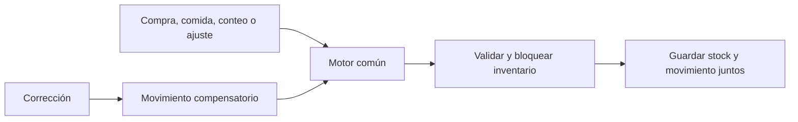
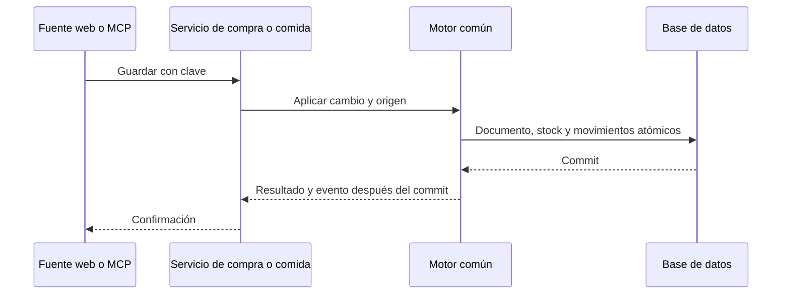

# CHG-001 · Motor unificado de movimientos de inventario
**Estado:** Cerrado
**Nivel:** M
**Modelo sugerido:** razonamiento
**Creado:** 2026-11-02 · **Aprobado:** 2026-11-02 · **Cerrado:** 2026-11-10
**Relacionado:** CHG-002

## 0. En palabras simples

Cada cambio de existencias dejará un comprobante: qué ingrediente cambió, cuánto había, cuánto entró o salió, cuánto quedó y por qué. Compras, comidas, conteos y ajustes usarán el mismo motor. Corregir añadirá otro movimiento, sin borrar el original.

Cómo comprobarlo: empezar con 6 huevos, comprar 4, consumir 2 y contar 7. Los saldos serán 10, 8 y 7; los movimientos +4, -2 y -1. Repetir una operación con igual clave no la vuelve a aplicar. CHG-002 permitirá consultarlo en pantalla.

## 1. Resumen

Primero de dos cambios M de una iniciativa transversal L, dividida en CHG-001 y CHG-002. Extender el libro existente y centralizar todas las escrituras de stock de ingredientes; preservar contratos web/MCP y reglas de comidas/compras. Desbloquea CHG-002.

Evidencia actual revisada:
- `app/Services/Meal/MealInventory.php`: operation/debit/reverse ya usan transacciones, idempotencia y movimientos para comidas/preparaciones.
- `app/Services/Meal/PurchaseRecorder.php`: crea/edita compras calculando diferencias de stock por otra vía.
- `app/Livewire/Meal/MealIngredients.php`: save escribe el stock desde el formulario.
- `app/Mcp/Tools/Shopping/UpdateShoppingItemTool.php` y `CreateInventoryItemTool.php`: reemplazo del total contado y alta con stock.
- `app/Services/Meal/IngredientMergeService.php`: suma stock, reasigna movimientos y elimina el origen.
- `database/migrations/2026_10_09_000002_connect_meals_to_inventory.php`: UUID, delta decimal(14,3), unidad histórica y FK restrictivas; no tiene saldos anterior/posterior.

## 2. Producto (product-manager)

Como usuario de MiSo quiero que cualquier alteración de mis existencias deje un movimiento enlazado con su causa, para poder explicar el saldo actual.

Incluye aperturas, altas con stock, conteos, ajustes, compras y sus correcciones, cocción/consumos y reversiones, fusiones, cambios de unidad y fuentes de importación existentes. Cubre web y MCP. Excluye valoración monetaria, lotes, nuevos almacenes, exportaciones y reconstrucción histórica especulativa.

Criterios de aceptación:
1. Cuando cambia stock, guardar movimiento y stock atómicamente: ingrediente/identidad histórica, usuario, unidad, delta, saldo anterior/posterior, fecha, orden, tipo, motivo, canal y origen.
2. Con stock 8 y conteo 7, guardar total 7 y delta -1. Conteo explícito igual deja evidencia de delta 0; guardar metadatos sin modificar stock no genera movimientos de cantidad.
3. Las existencias anteriores reciben una sola apertura con stock vigente, incluso cero; preservar historia disponible sin volver a sumarla ni inventar balances anteriores.
4. Las correcciones conservan cantidades, identidad, fecha, unidad y saldos originales; agregar movimientos enlazados. Editar compras conserva revisiones históricas aunque se borren sus líneas editables.
5. Igual clave/contenido devuelve el resultado previo; igual clave/diferente contenido se rechaza. Un fallo revierte documento origen, stock y movimientos.
6. Operaciones simultáneas encadenan saldos sin pérdidas, duplicados ni negativos; mantener precisión de tres decimales y límites compatibles con decimal(14,3).
7. Rechazar productos, orígenes y sucesiones de otro usuario, incluso con contexto sin sesión y userId explícito.
8. Planificar, reservar, generar lista de compras, comer fuera y editar precios/ubicación/metadatos no altera existencias; consumir porciones preparadas no descuenta ingredientes otra vez.

## 3. UX/UI (ux-designer)

Conservar pantallas actuales. En el editor de ingredientes, etiqueta «Existencias contadas» y ayuda «Reemplaza el total y registra la diferencia». Mostrar «Motivo del cambio» al cambiar stock; opcional con valor predeterminado «Conteo físico». MCP admite motivo opcional equivalente. Registrar canal web/MCP automáticamente. Una alta registra apertura, no una compra.

Reutilizar `resources/views/components/ui/field.blade.php`, `textarea.blade.php`, `form-dialog.blade.php`, `snackbar.blade.php` y `resources/views/livewire/meal/meal-ingredients.blade.php`. Mantener FAB/form-dialog canónicos para crear, sin nueva navegación al guardar.

Estados: validación inline, envío en curso sin doble guardado, error conservando borrador y éxito después del commit. Conservar labels, foco/teclado y funcionamiento a 375/768/1280 px. La consulta pertenece a CHG-002. Revisión UX desde código; navegador pendiente de implementación.

## 4. Diseño técnico (software-architect)

### Motor compartido

Añadir `app/Services/Meal/InventoryLedger.php` como única frontera de escritura de stock: apertura, variación firmada, fijar conteo, compensar y transferir fusión. Recibe userId explícito, productos, clave, origen estable, canal, motivo y datos normalizados. Reutilizar `MealInventoryOperation` y `MealInventoryMovement`; no crear un segundo libro ni observers genéricos que desconozcan el origen.

Una migración nueva `database/migrations/*_extend_inventory_ledger.php` amplía el contrato: saldos anterior/posterior nullable para legado, tipo/canal/motivo, UUID y nombre históricos inmutables del ingrediente, snapshot del origen y revisión/línea histórica, vínculo de compensación, tramo de unidad y orden monotónico por usuario/producto. Añadir índices de historial y unicidad de apertura por tramo/producto. No editar migraciones aplicadas. Movimientos de porciones/preparaciones siguen diferenciados del stock de ingredientes.

### Documento de inventario: cabecera y líneas

Cada operación de inventario tiene un documento propio, identificado por el UUID de MealInventoryOperation, visible y copiable en la consulta. No confundirlo con el ID de compra/comida origen. Cabecera histórica: id, tipo, usuario, fecha/hora de registro del sistema, fecha/hora efectiva del origen cuando esté disponible, canal, motivo y referencia al origen; vínculos al documento original si corrige otro. Si una fuente solo tiene fecha, conservar esa precisión sin inventar una hora efectiva; la hora de registro sí se conoce.

Conservar en la operación un snapshot inmutable document_lines, con identificador/posición de línea, ingrediente/variante históricos, cantidad/unidad y referencias a sus movimientos efectivos. Un documento puede abarcar varios productos. Guardar las líneas y referencias en la misma transacción; nunca reconstruir documentos pasados desde líneas editables actuales. El snapshot refleja las líneas efectivas de esa revisión del inventario, no una factura fiscal ni un documento con importes.

Una compra inicial con 32 líneas de 32 productos que cambian stock genera un documento con 32 líneas. Dos variantes del mismo ingrediente conservan sus líneas de origen y referencias, aunque el cálculo del stock se agrupe por producto. Contar productos distintos, líneas y movimientos técnicos por separado; no agregar cantidades de unidades diferentes. En una edición, el nuevo documento contiene las correcciones efectivas y vínculos al anterior, sin modificar sus snapshots.

Una llamada multiproducto al motor tiene un único documento; llamadas independientes no se agrupan por proximidad temporal. Una operación interna anidada no duplica el documento de inventario: asociar a una única operación documental externa. Las operaciones sin evidencia de inventario, como planificar, no son documentos del registro. Para legado, mostrar únicamente líneas/fechas realmente disponibles, sin inventar detalle faltante.

Bloquear primero usuario y luego productos en orden estable en todas las fuentes. Una sola transacción abarca documento origen, stock y movimientos. Reutilizar claves y huella canónica de operaciones existentes sin colisiones entre compras/comidas; agregar operation_key opcional a herramientas MCP de conteos/altas. UI conserva la clave entre reintentos. Operaciones múltiples son atómicas. Validar redondeo y límites, evitando acumulación de errores de float al persistir.

Llamadas al motor sincrónicas. Emitir `app/Events/Meal/InventoryMovementRecorded.php` después del commit, con user_id/operation_id/movement_id/origen para futuros consumidores. El evento informa: ningún listener vuelve a descontar. Sin cola/outbox ni garantía de entrega a servicios externos en este alcance.

### Apertura e historia

Añadir `app/Console/Commands/InitializeInventoryLedger.php`: previsualización por defecto, aplicación explícita. Inicialización por usuario/producto con bloqueo común e idempotencia; no depender del scope autenticado. En despliegue pausar escrituras durante apertura y activar adaptadores juntos. Primera escritura inicializa bajo bloqueo cualquier producto omitido antes de su cambio. No ejecutar sobre datos reales durante desarrollo.

Apertura usa stock vigente como entrada desde cero y fecha de inicio de cobertura completa; no modifica stock. Preservar movimientos anteriores como «Historial anterior a la apertura», saldos desconocidos y fuera del acumulado posterior. Nueva ejecución no duplica ni cambia existencias. Alta nueva recibe apertura con su total inicial; cero es válido.

### Unidades y fusiones

Cambiar base_unit conserva contrato actual, sin conversión implícita: cerrar el tramo anterior y abrir nuevo con el total explícito o número conservado por el contrato existente. Registrar reclasificación enlazada; nunca sumar g con ml. Reversiones incompatibles permanecen bloqueadas con aviso accionable. Documentar claramente que conservar el número no representa convertir cantidades físicas.

Fusión: salida del saldo del origen y entrada al destino, misma transacción/unidad compatible. No reasignar identidad histórica de movimientos. Conservar snapshot y UUID de origen antes de desligar su FK técnica nullable para permitir la eliminación actual. Añadir `app/Models/InventoryProductSuccessor.php` y tabla en la nueva migración para persistir sucesión origen/destino por usuario. Reversiones y revisiones de compras resuelven esta sucesión, también encadenada, validan unidad y evitan ciclos. Mantener variantes, alias, recetas y comportamiento de compras existente. No mezclar saldos históricos entre productos.

Mantener bloqueo de borrado de productos con movimientos. No exponer edición directa de evidencia; correcciones de documentos siguen sus flujos de compra/comida. Un ajuste independiente genera un nuevo movimiento con motivo.

### Archivos y operación

Además de los nuevos: `app/Models/MealInventoryOperation.php`, `MealInventoryMovement.php`; servicios `MealInventory.php`, `PurchaseRecorder.php`, `IngredientMergeService.php`, `IngredientImportService.php`, `RecipeIngredientData.php`; Livewire `MealIngredients.php`, `MealShopping.php`; herramientas Shopping `CreateInventoryItemTool.php`, `UpdateShoppingItemTool.php`, `AddShoppingItemTool.php`, `Concerns/InteractsWithInventory.php`; vista de ingredientes y pruebas de §5. Altas a cero se conectan solo donde corresponde; sin refactor ajeno.

Validar migración y carreras en MySQL desechable. Migración/inicialización real requiere autorización independiente. Recuperación operativa: pausar escrituras y restaurar versión compatible conservando libro; no borrar evidencia mediante rollback destructivo.

## 5. Pruebas (qa-tester)

Crear `tests/Feature/Meal/InventoryLedgerTest.php`, `InventoryLedgerInitializationTest.php` e `InventoryLedgerConcurrencyTest.php`. Extender `tests/Feature/MealInventoryTest.php`, `Meal/PurchaseHistoryTest.php`, `Meal/IngredientMergeTest.php`, `Mcp/InventoryMcpTest.php`, `Mcp/PurchaseMcpTest.php`, `Mcp/MealInventoryMcpTest.php` e `IngredientImportTest.php` según fuente.

Casos: 6/+4/-2/conteo7; apertura única cero/decimal; legado intacto; edición de compra con eliminación/cambio de producto; claves repetidas y huellas distintas; compensación sin mutar original; reversión de consumo anterior a apertura; fusión y posterior reversión/edición de compra; fusión encadenada; cambio de unidad; rollback multiproducto; dos usuarios; origen eliminado; operaciones sin efecto; límites y redondeo.

Comando: `php artisan test --filter='InventoryLedger|MealInventory|PurchaseHistory|IngredientMerge|InventoryMcp|PurchaseMcp|IngredientImport'`. PHPUnit declara SQLite en memoria; verificar destino efectivo. La prueba concurrente requiere dos conexiones/procesos sobre MySQL desechable, con barrera de inicio y aserciones de saldos/filas: compra-consumo, conteo-consumo y fusión-compra. SQLite no valida bloqueos de MySQL. Nunca usar BD personal.

UI: `npm run build`, `php artisan ui:conformance`; ampliar `tests/Browser/purchases.interaction.spec.js` y su soporte aislado `tests/Browser/support/purchase-fixture.php` para motivo, error/borrador, reintento, teclado y 375/768/1280 px. Ejecutar `npx playwright test --config=tests/Browser/purchases.config.js`, comprobando primero el destino aislado de la fixture. JS focalizado solo si se modifica JS. Revisar con rg todas las escrituras de stock y justificar cobertura.

Esta fase valida documentos, no implementación: `node .claude/team.mjs validate CHG-001` y `git diff --check`. Pruebas funcionales pendientes.

## 6. Documentación (tech-writer)

Actualizar `docs/integrations/meal-inventory.md`: motor, tipos, apertura, límites de historia, conteo/delta, compensaciones, claves MCP, unidades/fusiones, evento posterior al commit e inicialización/verificación/recuperación. Revisar guías de compras existentes solo por contradicciones con el contrato final. No crear lineamientos globales de rol por esta iniciativa.

## 7. Tareas

- [x] T1 · Guardar existencias y comprobante juntos — Resp: dev-implementer — Archivos: app/Services/Meal/InventoryLedger.php, app/Models/MealInventoryMovement.php, app/Models/MealInventoryOperation.php, app/Models/InventoryProductSuccessor.php, app/Events/Meal/InventoryMovementRecorded.php, database/migrations/*_extend_inventory_ledger.php, tests/Feature/Meal/InventoryLedgerTest.php — Hecho cuando: motor atómico/idempotente valida propiedad, precisión y límites, conserva evidencia y no modifica aún adaptadores existentes.
- [x] T2 · Empezar desde las existencias actuales — Resp: dev-implementer — Archivos: app/Console/Commands/InitializeInventoryLedger.php, app/Services/Meal/InventoryLedger.php, tests/Feature/Meal/InventoryLedgerInitializationTest.php — Hecho cuando: previsualización no escribe, aplicación aislada conserva stock y crea una apertura única, y legado no vuelve a sumarse.
- [x] T3 · Registrar compras y comidas mediante el motor — Resp: dev-implementer — Archivos: app/Services/Meal/MealInventory.php, app/Services/Meal/PurchaseRecorder.php, tests/Feature/MealInventoryTest.php, tests/Feature/Meal/PurchaseHistoryTest.php, tests/Feature/Mcp/PurchaseMcpTest.php, tests/Feature/Mcp/MealInventoryMcpTest.php — Hecho cuando: compras/consumos/reversiones y ediciones dejan evidencia enlazada, sin doble descuento ni regresión de contratos.
- [x] T4 · Registrar conteos, altas y cambios de unidad — Resp: dev-implementer — Archivos: app/Livewire/Meal/MealIngredients.php, app/Livewire/Meal/MealShopping.php, resources/views/livewire/meal/meal-ingredients.blade.php, app/Mcp/Tools/Shopping/CreateInventoryItemTool.php, app/Mcp/Tools/Shopping/UpdateShoppingItemTool.php, app/Mcp/Tools/Shopping/AddShoppingItemTool.php, app/Mcp/Tools/Shopping/Concerns/InteractsWithInventory.php, app/Services/Meal/IngredientImportService.php, app/Services/Meal/RecipeIngredientData.php, tests/Feature/Mcp/InventoryMcpTest.php, tests/Feature/IngredientImportTest.php, tests/Browser/purchases.interaction.spec.js — Hecho cuando: todas las entradas pertinentes usan el motor, stock omitido se conserva, motivo/claves funcionan y unidades mantienen tramos separados.
- [x] T5 · Conservar historia al combinar ingredientes — Resp: dev-implementer — Archivos: app/Services/Meal/IngredientMergeService.php, app/Services/Meal/InventoryLedger.php, app/Models/InventoryProductSuccessor.php, tests/Feature/Meal/IngredientMergeTest.php — Hecho cuando: transferencia única preserva identidad histórica y reversiones/ediciones posteriores resuelven sucesión con usuario y unidad correctos.
- [x] T6 · Verificar todas las fuentes y carreras — Resp: qa-tester — Archivos: tests/Feature/Meal/InventoryLedgerConcurrencyTest.php, tests/Feature/Meal/InventoryLedgerTest.php, tests/Browser/purchases.interaction.spec.js, tests/Browser/support/purchase-fixture.php — Hecho cuando: criterios pasan, migración y carreras se verifican en MySQL desechable, UI pasa build/conformance y responsive y rg no encuentra escrituras de stock sin cobertura.
- [x] T7 · Explicar inicio y mantenimiento del registro — Resp: tech-writer — Archivos: docs/integrations/meal-inventory.md — Hecho cuando: guía coincide con implementación y distingue validación local, inicialización y despliegue pendientes.

## 8. Bitácora

- 2026-11-02 — T6 completada para el alcance afectado: regresión final 107 pruebas pasan / 712 aserciones, más 1 omisión MySQL intencional en SQLite. La ejecución MySQL separada pasó de nuevo (55 aserciones) y el servidor desechable se detuvo después. Añadida comprobación específica de reversión de consumo legado tras apertura: conserva delta/saldos desconocidos del original y crea compensación desde el saldo actual.
- 2026-11-02 — Cierre de pruebas de navegador: 13/14 pasan; la única aserción pendiente es la geometría preexistente de filas del composer semanal a 390 px. Reejecución aislada con expect.soft termina compra/preparación/consumo/reversión/borrado y registra únicamente ese fallo, sin esconderlo ni tocar CSS/vista/Livewire ajenos. El formulario de conteo sí pasa interacción, accesibilidad y tamaños 375/768/1280 px. La suite general no se declara verde; 39 casos fuera del alcance se reprodujeron en la versión anterior y la regresión propia encontrada se corrigió.
- 2026-11-02 — Limpieza de carpetas temporales rechazada por revisión automática con motivo «blocked by policy»; no se intentó eludirla. Copiados JUnit de referencia a inventory-baseline-errors.xml e inventory-baseline-remaining.xml, comparación JSON conservada y servidor MySQL de pruebas detenido verificando antes su datadir. Carpetas de copia fuente y datos de MySQL permanecen bajo storage/framework/testing, ignoradas por Git. No quedan procesos de pruebas en ejecución.

- 2026-11-02 — Autorizado por el usuario completar T3–T7 como lote, sin pausas intermedias. No autoriza aplicar migraciones o inicializar inventario real.
- 2026-11-02 — T3 completada: PurchaseRecorder y MealInventory usan InventoryLedger. Las compras conservan ID/revisión/líneas históricas, claves/huellas y documentos compensatorios; una compra de 32 productos produce 32 líneas. Porciones preparadas y reversiones comparten documento de negocio sin volver a descontar ingredientes. Se preserva la planificación sin efecto de stock. Pruebas incluyen correcciones, borrado de líneas, claves con otros datos y transacciones.
- 2026-11-02 — T4 completada: altas y conteos de Ingredientes, Compras, recetas/importaciones y MCP pasan por saveProduct/InventoryLedger. Formulario con existencias contadas, motivo y clave estable; guardar metadatos conserva stock cambiado mientras estaba abierto. MCP admite reason/operation_key, conserva stock omitido y no duplica cantidades/precios al reintentar. Cambios de unidad cierran/abren tramos sin conversiones implícitas. Altas incompletas a cero sin unidad se conservan sin inventarla y difieren la apertura hasta definirla.
- 2026-11-02 — T5 completada: fusiones serializadas por usuario/productos, transferencia en un documento, identidad histórica intacta y FK viva desligada antes de borrar origen. Sucesión encadenada permite revertir comidas y corregir compras posteriores. Se corrigió la regresión del objetivo sugerido con columnas proyectadas: la propiedad se valida recargando los dos productos bajo bloqueo, no suponiendo user_id en la proyección. Hay prueba específica y regresión del catálogo MCP.
- 2026-11-02 — T7 completada: docs/integrations/meal-inventory.md documenta contrato, apertura/activación/recuperación, compensaciones, unidades/fusiones, eventos, claves MCP y exclusiones. Distingue el motor de las consultas pendientes de CHG-002.
- 2026-11-02 — Regresión focalizada final: php artisan test --filter='InventoryLedger|MealInventory|PurchaseHistory|IngredientMerge|InventoryMcp|PurchaseMcp|IngredientImport|LifeTrackerCatalogMcp' → 106 pasan / 706 aserciones; 1 omisión intencional de MySQL en la ejecución SQLite, comprobada separadamente. MySQL 8.4.3 desechable en loopback:13317: migración down/up con datos legados y carreras compra/consumo, conteo/consumo, fusión/compra → 1 prueba / 55 aserciones pasa. Se corrigió el soporte del índice de FK que InnoDB podía sustituir al retirar los índices compuestos. No se tocaron servidores/BD habituales.
- 2026-11-02 — Suite general Unit,Feature ejecutada: 1026 casos, 985 pasan, 29 fallos de aserción, 11 errores, 1 omisión; no se declara verde. Una regresión propia de fusión se corrigió y revalidó. Los otros 39 casos se reprodujeron contra HEAD anterior en copia aislada con SQLite en memoria, fuentes y vistas originales y autoload explícito. Comparación: storage/framework/testing/inventory-baseline-comparison.json; JUnit general: storage/framework/testing/inventory-full-suite.xml. Los fallos ajenos se conservan fuera de alcance (tareas/recordatorios, relaciones/planes, calendarios y contratos UI).
- 2026-11-02 — Navegador: actualizados selectores que aún apuntaban al editor semanal antiguo (sin editar el editor ni su CSS). Conteos/motivo, validación/borrador, reintento HTTP real y accesibilidad pasan a 375/768/1280 px, con capturas revisadas en purchase-previews/inventory-count-*.png. Ejecución amplia: 13 pasan y un fallo de geometría en el composer de comidas a 390 px. CSS, vista y componente MealWeekly no tienen diff frente a HEAD; el grid preexistente impone mínimos de 110+140+75+85+40 px. Este hallazgo de otra superficie no se corrige ampliando el alcance. Se mantiene una aserción soft explícita para terminar también los pasos funcionales y conservar el fallo visible.
- 2026-11-02 — npm run build y php artisan ui:conformance pasan (sin deuda visual nueva); Pint y git diff --check pasan. No hay JavaScript de producto modificado. Validación global conserva los fallos previos detallados; no se han realizado commits, publicación ni despliegue.

- 2026-11-02 — T2 completada tras autorización de continuar. Nuevo comando inventory:initialize-ledger, previsualización por defecto y aplicación solo con --apply; --user repetible permite acotar propietarios sin depender de auth. Informe por producto con saldo/unidad y estado pendiente/inicializado/bloqueado. Unidad ausente, saldo negativo, unidad cambiada o diferencia fuera del motor bloquean la selección sin inventar correcciones. Aplicación transaccional de toda la selección, con revalidación bajo bloqueo, conserva stock/historia y revierte aperturas/eventos si falla cualquier usuario.
- 2026-11-02 — T2: añadidos previewInitialization y validación compartida de apertura en InventoryLedger; prueba nueva InventoryLedgerInitializationTest con 10 casos. Base al retomar: 15 pruebas / 92 aserciones. Validación final php artisan test --filter='InventoryLedger' → 25 pruebas / 157 aserciones, todas pasan; Pint y sintaxis PHP pasan, git diff --check sin errores. Se corrigieron dos comparaciones iniciales de fixtures que no recargaban los valores predeterminados de BD antes de tomar el snapshot; no correspondían a escrituras del comando.
- 2026-11-02 — T2 solo se ejecutó con fixtures SQLite en memoria. No se invocó el comando sobre el inventario real ni se aplicaron migraciones habituales. MySQL/carreras siguen pendientes de T6. Sin cambios de UI/assets, no corresponde build/conformance en esta tarea. T3 es el siguiente paso; pausa por tarea conforme a la skill.

- 2026-11-02 — Inicio con dev-implementer; rama main y cambios previos de instalación/planificación preservados. Documentos globales ARCHITECTURE/UX-DESIGN/TESTING ausentes; se siguen AGENTS.md y patrones vigentes. Base focalizada: 66 pruebas, 465 aserciones, todas pasan. Inicio de estado mediante team start.
- 2026-11-02 — T1 completada. Nuevos InventoryLedger, InventoryProductSuccessor, InventoryMovementRecorded y migración 2026_11_02_000001_extend_inventory_ledger; ampliados MealInventoryOperation/Movement; añadido InventoryLedgerTest. Cálculos en milésimas enteras, bloqueo usuario/productos, apertura idempotente como primitiva, conteos/deltas, compensación, transferencia/sucesión, snapshots de cabecera/líneas y asociación a operación de negocio existente sin duplicar documento. La integración de adaptadores queda pendiente para T3/T4/T5.
- 2026-11-02 — Validación T1: php artisan test --filter='InventoryLedger|MealInventory|PurchaseHistory|IngredientMerge|InventoryMcp|PurchaseMcp|IngredientImport' → 81 pruebas / 557 aserciones, todas pasan (15 pruebas nuevas / 92 aserciones). Caso de 32 productos/líneas, variantes repetidas, precisión/límites, aislamiento sin sesión, reintentos, conservación de historia, rollback externo y evento posterior al commit cubiertos. Pint --test pasa en los siete PHP afectados; sintaxis PHP y git diff --check pasan.
- 2026-11-02 — Migración ejecutada solo por RefreshDatabase en SQLite de pruebas en memoria. No aplicada a MySQL habitual ni a datos reales; migración/carreras MySQL siguen pendientes de T6. Sin UI/assets modificados, no corresponde build/conformance todavía. Pausa al terminar T1 conforme a la regla por tarea de la skill; T2 siguiente.

2026-11-02 — Borrador preparado. Se cargaron y aplicaron secuencialmente product-manager, software-architect, ux-designer, qa-tester y tech-writer. Sin subagentes, implementación, pruebas funcionales ni migraciones. No existen lineamientos/backlogs previos de rol que referenciar; se usan código y design-system existentes.

2026-11-03 — Revisión técnica al retomar: suite focalizada conjunta InventoryHistory/InventoryDocuments/InventoryLedger/InventoryMcp/PurchaseHistory/MealInventory/IngredientMerge/PurchaseMcp/IngredientImport/LifeTrackerCatalogMcp: 125 pruebas, 124 correctas, 869 aserciones y 1 prueba MySQL omitida (sin servidor aislado activo). Evidencia: storage/framework/testing/inventory-qa-resume.log. Revisión de solo lectura del entorno habitual: migración extend_inventory_ledger pendiente en lifetracker-local; 226 ingredientes del usuario 1, sin unidades inválidas ni stock negativo. Esto no sustituye la previsualización completa del comando después de migrar. Activación pendiente de autorización explícita; no se cambiaron esquema ni existencias. Se conserva En verificación, sin cierre formal.

## 9. Preguntas, decisiones e historial

- Hallazgos fuera de alcance: 39 fallos generales confirmados en HEAD anterior; geometría móvil del composer semanal (CSS/vista/Livewire sin modificar). No se declara limpia la suite global ni se altera código ajeno para ocultarlos.

- Aclaración de alcance aprobada: cada documento tiene ID propio, fecha/hora, cabecera y líneas; una compra de 32 productos se consulta como un documento. Correcciones tienen ID propio y vínculo al original. Se explicita snapshot de líneas en el contrato del motor para habilitar CHG-002.

- 2026-11-02 — Usuario aprobó dos cambios M: cantidades sin valoración, saldo de apertura y compensaciones; confirmó entendimiento y preparación de especificaciones.
- Diseño propuesto pendiente de aprobar: tramos de unidad sin conversión, sucesión de fusiones e inicialización controlada. Son mecanismos para cumplir cobertura completa conservando contratos actuales.
- Riesgo de seguridad: userId explícito en consultas/escrituras y relaciones; BelongsToUser solo no cubre contextos sin auth.
- Revisión crítica recomendada por alcance transversal L; critique es opcional y no se ha ejecutado.
- TEAM_MODELS tiene perfiles sin proveedores; no elegir proveedores ni iniciar loop automáticamente.
- 2026-11-02 — Creado en to-do/ (Borrador, nivel M); pendiente aprobación del contenido. No iniciar desarrollo.
- 2026-11-02 — Aprobado por el usuario (Compuerta 2)
- 2026-11-02 — Movido a in-progress/ (En desarrollo)
- 2026-11-02 — Implementación terminada → En verificación
- 2026-11-10 — Cerrado por el usuario (Compuerta 3) → done/
