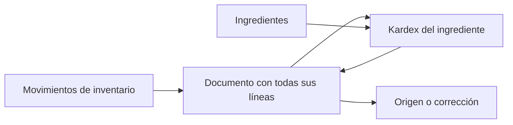
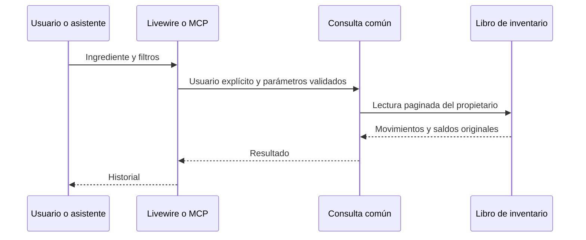

# CHG-002 · Consulta del Kardex de ingredientes
**Estado:** Cerrado
**Nivel:** M
**Modelo sugerido:** estandar
**Creado:** 2026-11-02 · **Aprobado:** 2026-11-02 · **Cerrado:** 2026-11-10
**Relacionado:** CHG-001

## 0. En palabras simples

Tendrás un registro general de documentos de inventario: compras, conteos, ajustes, consumos y correcciones. Al abrir uno verás todas sus líneas y, desde cada ingrediente, podrás consultar su Kardex. Podrás consultar el origen cuando esté disponible; ninguna corrección oculta el documento original.

Cómo comprobarlo: registrar una compra de 32 productos distintos; localizar un solo documento en Movimientos de inventario y abrir sus 32 líneas con entrada, unidad y saldo anterior/posterior. Desde una línea abrir el Kardex del ingrediente. Para apertura 6, compra +4, consumo -2 y conteo -1, comprobar saldo final 7 y que filtrar no cambia los saldos guardados.

## 1. Resumen

Segundo cambio M de la iniciativa dividida en CHG-001 y CHG-002. Depende de CHG-001 implementado y validado. Consulta web y MCP de solo lectura sobre el mismo contrato; sin nuevo motor ni escrituras desde esta pantalla.

Evidencia: `routes/web.php` declara Ingredientes; `config/modules.php` agrupa ese tab y comparación; acceso en `app/Livewire/Meal/MealIngredients.php` y su vista. Referencias de consulta actuales: `app/Livewire/Meal/MealPurchases.php`, `MealPurchaseShow.php` y herramientas MCP de lectura de compras. No hay hallazgos previos de roles que referenciar.

## 2. Producto (product-manager)

Como usuario quiero consultar todos mis documentos de inventario, abrir cada registro con sus líneas completas y seguir la historia de cada ingrediente. Como asistente autorizado quiero leer la misma evidencia mediante MCP sin modificar inventario.

Incluye registro general por documento, detalle de sus líneas, Kardex por ingrediente, filtros de fechas/tipo/canal/producto, paginación, origen/correcciones, tramos de unidad e historia de ingredientes fusionados. Excluye exportaciones, valoración, gráficos, dashboard de métricas, edición directa de movimientos y nuevo flujo de ajustes.

Criterios de aceptación:
1. Abrir Kardex desde un ingrediente y volver conservando búsqueda/filtros de la lista.
2. Mostrar fecha/hora, tipo, motivo, canal/origen, entrada/salida, unidad, saldo anterior/posterior; aperturas y compensaciones identificadas/enlazadas.
3. Mostrar stock actual separado del resultado filtrado; filtros/paginación no recalculan saldos usando solo filas visibles.
4. Cubrir sin movimientos, filtros sin resultados, carga/error y legado anterior a apertura con «Saldo no disponible», nunca cero inventado.
5. Usuario ajeno no puede consultar producto, referencias ni páginas; web/MCP dan evidencia equivalente y no escriben.
6. Mostrar procedencia de fusiones y consultar historia original sin sumar transferencias dos veces; separar unidades en tramos.
7. Teclado/foco y 375/768/1280 px utilizables; signos y texto distinguen movimientos sin depender del color.
8. Una compra que afecta 32 productos distintos aparece como un solo documento con 32 líneas; cada línea muestra ingrediente, unidad, variación y saldos. La misma regla de agrupación cubre todas las fuentes, no solo compras.
9. Cada revisión/corrección aparece como documento separado enlazado al original; ninguna vista reconstruye la evidencia usando solo las líneas actuales de la compra. Cambiar o eliminar una línea editable no cambia documentos ya registrados.
10. El registro muestra fecha efectiva y de registro, tipo, referencia, canal, motivo y contadores separados de productos y líneas. No suma cantidades de unidades diferentes. Una misma operación no aparece duplicada por llamadas internas anidadas.
11. Filtrar por producto selecciona documentos que lo contienen; al abrir el documento se ven todas sus líneas, sin heredar un filtro que oculte los demás ingredientes. Un conteo de varios productos enviado conjuntamente tiene un documento; llamadas independientes permanecen documentos independientes.
12. Cada documento muestra su ID propio, visible y copiable, fecha y hora de registro, tipo, origen y líneas numeradas. Su ID es distinto del documento origen; una corrección recibe ID propio y enlaza al original. La fecha efectiva conserva su precisión: si solo se conoce el día, no se inventa una hora.

## 3. UX/UI (ux-designer)

Añadir tab «Movimientos de inventario» al módulo Comidas, ruta `/meals/inventory`, listado de documentos. Detalle `/meals/inventory/{operation}` con cabecera y líneas completas; acción contextual de línea «Ver Kardex». Mantener además «Ver Kardex» en el menú de cada ingrediente, ruta `/meals/ingredients/{item}/inventory`, activa dentro de Ingredientes. Desde el Kardex, cada línea permite volver al documento. Retorno conserva filtros/página de la superficie de origen. Mantener shell y único layout responsive, sin rail añadido por defecto.

Reutilizar `resources/views/components/module-shell.blade.php` y componentes `ui/management-card.blade.php`, `list.blade.php`, `list-item.blade.php`, `popover.blade.php`, `applied-filters.blade.php`, `state.blade.php`, `badge.blade.php`; confirmar props vigentes al implementar. Seguir shell/filtros/listas de `docs/design-system.md`, sin componentes visuales alternativos.

Registro general: documentos recientes primero, con referencia, fechas, tipo, motivo, canal y número de productos/líneas; búsqueda por referencia o nombre histórico de ingrediente. Un botón Filtros abre desde/hasta, tipo, canal y producto; fechas filtran fecha efectiva y se indica en el control. Paginación por defecto 50 documentos. No mostrar un total global de gramos, mililitros y unidades.

Detalle: cabecera histórica de documento, origen y vínculos de corrección; lista de líneas por orden original, con nombre/variante histórica si existe, entrada/salida, unidad y saldos. Mostrar las 32 líneas completas en el ejemplo, sin truncar a un subconjunto; si supera 100 líneas, paginar con contador total y navegación explícita. No ocultar líneas por filtros de la lista general.

La cabecera siempre muestra «Documento» con ID completo copiable y fecha/hora de registro. En el listado se permite abreviar visualmente el UUID si el completo está accesible al abrir/copiar; nunca usar índice de fila como identidad. «Origen» indica separadamente compra/comida y su referencia. Mostrar fecha efectiva además del registro, con su precisión original. No usar numeración de factura fiscal ni agregar impuestos/importes.

Kardex: cabecera compacta con nombre y stock/unidad actuales y aviso de inicio de cobertura completa. Movimientos recientes primero; filtros desde/hasta, tipo y canal. Chips removibles y limpiar; cambio de filtros reinicia página. Mismos datos reordenados por CSS en móvil en las tres superficies.

Tipos legibles: Apertura, Compra, Corrección de compra, Consumo, Reversión, Conteo físico, Ajuste, Fusión y Cambio de unidad. Signo y texto para entrada/salida; delta 0 «Sin diferencia». Origen muestra snapshot y enlace solo si existe y pertenece al usuario. Origen eliminado conserva referencia sin enlace roto. Compensación enlaza al original. Legado separado con saldos desconocidos.

Las tres pantallas son de consulta sin FAB; ajustes continúan en el editor de Ingredientes. Error ofrece reintento sin perder filtros. Vacío y sin resultados tienen mensajes diferentes en listado, detalle y Kardex. Rango validado, labels, foco visible y teclado. Fechas según convención de zona horaria de usuario del proyecto, sin alterar instante almacenado. UX basada en código; navegador pendiente de implementación.

## 4. Diseño técnico (software-architect)

Añadir `app/Services/Meal/InventoryHistory.php`: tres consultas comunes con userId explícito: documentos filtrados/paginados, detalle por operation_id con líneas completas y Kardex por producto/tramo/sucesión. Encabezados provienen de operaciones con evidencia de inventario, no de todas las operaciones de planificación. Aperturas, correcciones, conteos sin diferencia y documentos anteriores disponibles se incluyen; planificación sin movimiento y acciones sin efecto de inventario no generan documentos ficticios. Orden de documentos por fecha de registro e identificador estable; mostrar también fecha efectiva del origen. Líneas por posición histórica; Kardex por orden del libro CHG-001. Legado con created_at/id y sin inferir evidencia ausente. Verificar propiedad antes de resolver referencias.

Añadir `app/Livewire/Meal/MealInventoryDocuments.php`, `MealInventoryDocumentShow.php`, `MealInventoryHistory.php` y vistas `resources/views/livewire/meal/meal-inventory-documents.blade.php`, `meal-inventory-document-show.blade.php`, `meal-inventory-history.blade.php`. Declarar rutas autenticadas en `routes/web.php`, tab/actividad en `config/modules.php` y acceso desde vista de ingredientes. Retorno conserva parámetros locales permitidos, no URL arbitraria. El detalle se lee desde snapshots históricos de CHG-001, no desde PurchaseLine actuales; distingue productos afectados, líneas de documento y movimientos técnicos cuando una corrección requiere varias filas.

Añadir `app/Mcp/Tools/Shopping/ListInventoryMovementsTool.php`, registrada en `app/Mcp/Servers/LifeTrackerServer.php`. Entradas: item_id requerido; from/to, type/channel opcionales; page >=1 y per_page 1..100, defecto 50. Rechazar fechas invertidas, filtros desconocidos y producto ajeno.

Añadir `ListInventoryDocumentsTool.php` (from/to/type/channel/item_id/search y page/per_page opcionales, máximo 100) y `GetInventoryDocumentTool.php` (operation_id requerido, paginación de líneas explícita con máximo 100). Registrar ambas junto con ListInventoryMovementsTool. Responder encabezado histórico, contadores, vínculos de origen/corrección y líneas con movimientos asociados, más paginación/next_page. Para 32 líneas, la página por defecto entrega las 32. Rechazar operación ajena/inexistente con el mismo mensaje y validar propietario en cada relación. Web y MCP reutilizan las tres consultas comunes.

Respuesta MCP: producto/stock actual/unidad/inicio de cobertura; movimientos con id/orden/fecha/tipo/canal/motivo/origen/snapshot/unidad/delta/saldos/compensación y condición de legado; paginación con next_page o null. No exponer modelos completos ni datos ajenos. No permisos de escritura nuevos.

Saldos se leen de evidencia persistida, no de acumulación filtrada. Legado sin saldo devuelve null. Historia del origen fusionado por UUID histórico: el destino muestra procedencia y permite consulta separada, sin mezclar balances entre productos/unidades. Cargar referencias por lotes/snapshots para evitar N+1, paginar antes de enriquecer y usar índices de CHG-001. Sin migración adicional salvo índice justificado.

Riesgos: referencias eliminadas, fusiones encadenadas, filas sin saldos, unidades y fechas límite. Cubrir sin inferir evidencia ni alterar motor/contratos de escritura de CHG-001. El scope auth no sustituye aislamiento explícito.

## 5. Pruebas (qa-tester)

Crear `tests/Feature/Meal/InventoryHistoryTest.php`, `InventoryDocumentsTest.php`, `tests/Feature/Mcp/InventoryHistoryMcpTest.php` e `InventoryDocumentsMcpTest.php`. Cubrir criterios: orden/paginación con timestamps iguales, filtros combinados y fechas límite, saldos invariantes al filtrar, apertura/compensación, legado null, fusión/unidades, origen eliminado y dos usuarios. Consultar nunca cambia stock ni crea movimientos.

Caso obligatorio web/MCP: compra de 32 productos distintos produce un documento y 32 líneas completas, retorno/Kardex funcionan y búsqueda/filtro por uno de los productos no oculta las otras 31 al abrir el detalle. Incluir dos variantes del mismo producto, edición que elimina una línea, compensaciones, conteo multiproducto recibido en una operación, llamadas independientes, más de 100 líneas, operaciones anidadas y planificación sin documento de inventario. Verificar separación de contadores y ausencia de totales de unidades incompatibles.

Comando: `php artisan test --filter='InventoryHistory|InventoryDocuments|InventoryLedger|InventoryMcp'`, SQLite de pruebas y fixtures sintéticas verificadas. La concurrencia del motor corresponde a CHG-001.

Extender `tests/Browser/purchases.interaction.spec.js` y `tests/Browser/support/purchase-fixture.php`: apertura/retorno, filtros/paginación, vacío/carga/error, teclado/foco y geometría a 375/768/1280 px. Verificar destino aislado antes de inicializar fixture. Ejecutar `npx playwright test --config=tests/Browser/purchases.config.js`, `npm run build` y `php artisan ui:conformance`. JS pertinente solo si se modifica JS.

En planificación no se ejecutan pruebas funcionales. Validar documento con `node .claude/team.mjs validate CHG-002` y `git diff --check`.

## 6. Documentación (tech-writer)

Actualizar `docs/integrations/meal-inventory.md` con registro general → documento → Kardex, ejemplo de 32 productos, campos/filtros, contadores de productos/líneas, agrupación por operación/revisión, interpretación de compensaciones/fusiones, legado sin saldo y contratos de las tres herramientas MCP. Una sola fuente para reglas del motor, sin nuevos documentos globales de rol ni duplicar su contenido.

## 7. Tareas

- [x] T1 · Consultar documentos e historia sin alterar existencias — Resp: dev-implementer — Archivos: app/Services/Meal/InventoryHistory.php, tests/Feature/Meal/InventoryHistoryTest.php, tests/Feature/Meal/InventoryDocumentsTest.php — Hecho cuando: consultas de registro general, documento y Kardex respetan usuario, filtros, orden/tramos/fusiones, snapshots y saldos originales sin escrituras.
- [x] T2 · Abrir Kardex desde cada ingrediente — Resp: dev-implementer — Archivos: app/Livewire/Meal/MealInventoryHistory.php, resources/views/livewire/meal/meal-inventory-history.blade.php, resources/views/livewire/meal/meal-ingredients.blade.php, routes/web.php, config/modules.php, tests/Feature/Meal/InventoryHistoryTest.php — Hecho cuando: todos los campos/estados, filtros y retorno funcionan usando shell y componentes canónicos, sin FAB de consulta.
- [x] T3 · Consultar documentos y movimientos mediante MCP — Resp: dev-implementer — Archivos: app/Mcp/Tools/Shopping/ListInventoryMovementsTool.php, app/Mcp/Tools/Shopping/ListInventoryDocumentsTool.php, app/Mcp/Tools/Shopping/GetInventoryDocumentTool.php, app/Mcp/Servers/LifeTrackerServer.php, tests/Feature/Mcp/InventoryHistoryMcpTest.php, tests/Feature/Mcp/InventoryDocumentsMcpTest.php — Hecho cuando: tres herramientas registradas validan filtros/paginación, coinciden con web, aíslan usuarios, solo leen y entregan documento de 32 líneas completo.
- [x] T4 · Verificar consulta y accesibilidad — Resp: qa-tester — Archivos: tests/Browser/purchases.interaction.spec.js, tests/Browser/support/purchase-fixture.php, tests/Feature/Meal/InventoryHistoryTest.php, tests/Feature/Meal/InventoryDocumentsTest.php, tests/Feature/Mcp/InventoryHistoryMcpTest.php, tests/Feature/Mcp/InventoryDocumentsMcpTest.php — Hecho cuando: criterios pasan en las tres superficies, compra de 32 productos muestra un documento/32 líneas, build/conformance pasan y hay evidencia de teclado/foco/estados y 375/768/1280 px con datos aislados.
- [x] T5 · Documentar cómo interpretar el Kardex — Resp: tech-writer — Archivos: docs/integrations/meal-inventory.md — Hecho cuando: guía/contrato MCP coinciden con implementación y explican límite de historia anterior a apertura.

- [x] T6 · Encontrar todos los documentos de inventario — Resp: dev-implementer — Archivos: app/Livewire/Meal/MealInventoryDocuments.php, resources/views/livewire/meal/meal-inventory-documents.blade.php, routes/web.php, config/modules.php, tests/Feature/Meal/InventoryDocumentsTest.php — Hecho cuando: tab Movimientos de inventario lista documentos con ID/fechas/tipo/origen/contadores y filtros/paginación, sin duplicados por operaciones internas ni datos ajenos.
- [x] T7 · Abrir cada documento con sus líneas completas — Resp: dev-implementer — Archivos: app/Livewire/Meal/MealInventoryDocumentShow.php, resources/views/livewire/meal/meal-inventory-document-show.blade.php, routes/web.php, tests/Feature/Meal/InventoryDocumentsTest.php — Hecho cuando: cabecera con ID copiable y fecha/hora abre snapshot completo de 32 líneas, correcciones/origen/Kardex enlazan correctamente, más de 100 líneas se paginan explícitamente y filtros del listado no ocultan detalle.

## 8. Bitácora

2026-11-02 — Implementación autorizada en lote por el usuario. T1: servicio InventoryHistory compartido, aislamiento explícito, filtros/paginación, snapshots completos, saldos persistidos, legado, fusiones y tramos. T6/T7/T2: registro general, documento con ID copiable y Kardex, rutas autenticadas/tab y retorno local con filtros conservados; componentes canónicos sin FAB. T3: tres herramientas MCP de solo lectura registradas. T5: guía actualizada con rutas, ejemplo de 32 líneas y contratos. Verificación focalizada de consultas/web/MCP: 15 pruebas y 143 aserciones correctas; incluye origen eliminado, ausencia de N+1, 101 líneas, correcciones, aislamiento y consultas sin escrituras. Build y ui:conformance pasan sin deuda nueva. T4 en curso: navegador responsive y suite general. No se aplicaron migraciones ni cambios de inventario a la base habitual.

Ampliación aprobada por el usuario: registro general, detalle por documento y Kardex. Roles aplicados con las skills ya consultadas; se conserva el nivel M y se amplían consultas, navegación, contratos MCP y pruebas, sin implementar.

2026-11-02 — Borrador preparado tras cargar/aplicar secuencialmente las cinco skills de rol. Sin implementación ni navegador. No existen backlogs globales previos de roles; evidencia desde código y design-system, sin inventar IDs de hallazgos.

2026-11-02 — T4 completada con limitaciones preexistentes explícitas. Pruebas focalizadas del conjunto: 122 correctas, 862 aserciones y 1 MySQL omitida (el motor ya se validó en MySQL aislado en CHG-001); después se añadieron/verificaron dos casos de error/reintento: consultas/web/MCP suman 17 pruebas y 157 aserciones correctas. El caso de 101 líneas se comprobó también por Livewire y MCP. Suite general Unit/Feature: 1041 pruebas, 1001 correctas, 39 problemas y 1 omitida; los 39 coinciden con el baseline anterior, sin problemas nuevos (storage/framework/testing/history-full-suite.xml y history-baseline-comparison.json).

Navegador: ejecución de los 17 escenarios seguida de repetición de los afectados tras corregir el harness; resultado combinado 16 correctos y 1 fallo preexistente del composer a 390 px. La última repetición dio 6/7, incluida consulta de 32 líneas, ID copiado, teclado, filtros, retorno y geometría a 375/768/1280 px. Capturas kardex-{registry,document,history}-{375,768,1280}.png en storage/framework/testing/purchase-previews; trazas y logs history-browser-{full,final}.log. AxE del contenido nuevo sin infracciones serias/críticas; la revisión amplia detectó deuda compartida de contraste en sidebar (4.49:1) y tab activo (3.88:1) de Comidas. Se limita la auditoría automatizada nueva al contenido y se conserva este hallazgo explícito; no se modificaron estilos compartidos fuera de alcance. El único fallo final de navegador corresponde a la geometría preexistente del composer, ya registrado en CHG-001; los flujos funcionales de compras/cocción/consumo/reversión pasan.

Build correcto; Pint aplicado a archivos nuevos; ui:conformance sin deuda nueva (345 inventariadas/259 desviaciones existentes); git diff --check correcto. Se validaron referencias de la guía. No se ejecutaron migraciones en la base habitual, aperturas reales, commits ni despliegue. La implementación queda preparada para verificación y activación autorizada, sin declarar verde la suite general ni el contraste de la navegación compartida.

2026-11-03 — Revisión técnica al retomar: suite focalizada conjunta InventoryHistory/InventoryDocuments/InventoryLedger/InventoryMcp/PurchaseHistory/MealInventory/IngredientMerge/PurchaseMcp/IngredientImport/LifeTrackerCatalogMcp: 125 pruebas, 124 correctas, 869 aserciones y 1 prueba MySQL omitida (sin servidor aislado activo). Evidencia: storage/framework/testing/inventory-qa-resume.log. Revisión de solo lectura del entorno habitual: migración extend_inventory_ledger pendiente en lifetracker-local; 226 ingredientes del usuario 1, sin unidades inválidas ni stock negativo. Esto no sustituye la previsualización completa del comando después de migrar. Activación pendiente de autorización explícita; no se cambiaron esquema ni existencias. Se conserva En verificación, sin cierre formal.

## 9. Preguntas, decisiones e historial

- 2026-11-02 — Usuario confirmó cantidades, apertura y compensaciones y aprobó preparar dos especificaciones.
- Usuario aprobó ampliar el alcance: registro general, detalle completo por documento y Kardex por ingrediente. Sustituye la exclusión anterior del registro global. Sin dashboard de métricas, exportación ni valoración.
- Seguridad: propiedad explícita en consultas, referencias y paginación; identificadores ajenos no revelan datos.
- Dependencia obligatoria: implementar y validar CHG-001 antes de empezar.
- Revisión crítica opcional sugerida para iniciativa transversal; no ejecutada sin autorización.
- 2026-11-02 — Creado en to-do/ (Borrador, nivel M); pendiente aprobación del contenido. No iniciar desarrollo.
- Ampliación: añadir tareas T6/T7 al desarrollo antes de QA T4 y documentación T5. Se conserva la numeración anterior para referencias; orden de ejecución T1 → T6 → T7 → T2 → T3 → T4 → T5.
- 2026-11-02 — Aprobado por el usuario (Compuerta 2)
- 2026-11-02 — Movido a in-progress/ (En desarrollo)
- 2026-11-02 — Implementación terminada → En verificación
- 2026-11-10 — Cerrado por el usuario (Compuerta 3) → done/
