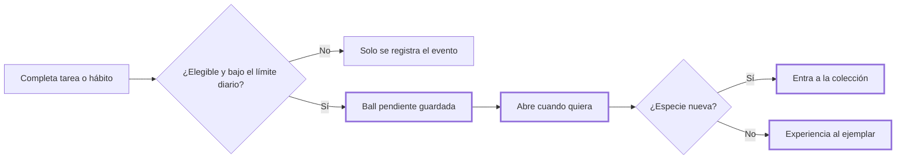

# CHG-019 · Núcleo de gamificación: actividades, balls y colección
**Estado:** Cerrado
**Nivel:** M
**Modelo sugerido:** estandar
<!-- Estados y nivel se cambian SOLO con node .claude/team.mjs. Modelo: un perfil de docs/TEAM_MODELS.md -->
**Creado:** 2026-11-09 · **Aprobado:** 2026-11-09 · **Cerrado:** 2026-11-10
**Relacionado:** CHG-020, CHG-021, CHG-022 (división del encargo L de gamificación)

## 0. En palabras simples
- Qué vas a ver distinto: al completar una tarea o marcar un hábito, MiSo te guarda una "ball" sin abrir. En el nuevo módulo **Colección** la abres cuando quieras y aparece una criatura. Si es nueva, entra a tu colección; si ya la tenías, suma experiencia. Las balls nunca caducan y nada se pierde si no juegas.
- Cómo comprobarlo tú: completa una tarea → abre Colección → la pestaña Balls muestra 1 pendiente → recarga la página (sigue ahí) → ábrela → la criatura aparece en la pestaña Colección.

## 1. Resumen
Primer incremento del encargo de gamificación (nivel L dividido en 4 CHG M). Crea el registro de eventos de juego, las balls pendientes, el catálogo de especies importable y la colección con un ejemplar por línea evolutiva. Las fuentes iniciales son tareas y hábitos. El catálogo de especies y las imágenes son configurables: el repo no incluye nombres ni arte de terceros, y Alex importa su catálogo autorizado por JSON. Principio: cada acción suma, ninguna ausencia resta.



## 2. Producto (product-manager)
- Problema / usuario: Alex quiere que sus avances reales se sientan recompensados, sin presión ni castigos.
- Incluye: balls por tarea completada y por hábito marcado; límite diario configurable; apertura diferida e idempotente; colección con siluetas; las repetidas suman experiencia (un número simple; los niveles llegan en CHG-020); importación del catálogo en JSON; URL base de imágenes configurable; activar y desactivar el juego y cada fuente.
- No incluye: niveles y evoluciones (CHG-020); equipo y misiones (CHG-021); director IA y temporadas (CHG-022); fuentes de salud, relaciones y diario (se evaluarán con consentimiento en CHG-021); variantes shiny.
- Criterios de aceptación:
  - Dado el juego activo, cuando completo una tarea, entonces se crea exactamente una ball pendiente con su origen registrado.
  - Dada una tarea completada, desmarcada y completada otra vez el mismo día, entonces sigue habiendo una sola ball por esa tarea y ese día.
  - Dado el límite diario (5) alcanzado, cuando completo otra actividad, entonces el evento se registra sin ball y no se muestra ningún error.
  - Dada una ball pendiente, cuando la abro (aunque sea semanas después), entonces revela la especie decidida al concederla; abrirla dos veces no da dos recompensas.
  - Dada una especie de una línea que ya tengo (incluso en otra etapa), entonces no se crea otro ejemplar y se suma experiencia.
  - Dado que borro la tarea de origen, entonces el historial conserva su nombre.
  - Desmarcar, no usar MiSo o desactivar el juego nunca elimina balls, ejemplares ni experiencia.

## 3. UX/UI
### 3.1 Experiencia (ux-designer)
- Plantilla: módulo con pestañas. No existe `## Anatomía` en docs/UX-DESIGN.md; se sigue el patrón de módulos de `config/modules.php`.
- Flujo y cantidad de pasos: menú → Colección → Balls → "Abrir" (1 clic) → revelación → "Ver en colección" o "Abrir otra".
- Qué contiene cada pantalla:
  - **Balls:** contador de pendientes y lista con origen, fecha y botón Abrir. Lo más importante es el botón Abrir.
  - **Colección:** progreso "N de M descubiertas" y cuadrícula por número, con siluetas para las no descubiertas.
  - **Ajustes:** juego activo, fuentes y límite diario.
- Estados: Balls vacía ("No tienes balls por abrir…"); catálogo vacío (indica que hay que importarlo); éxito de la revelación (nueva, o repetida con experiencia); error de apertura (la ball sigue pendiente).
- Información necesaria: el origen se ve antes de abrir; la especie, solo después.
- Accesibilidad: botones con foco visible y uso por teclado; el resultado se anuncia con `aria-live`; con `prefers-reduced-motion` la animación se reemplaza por un fundido corto.

```
Balls (3 por abrir)                        Colección  Ajustes
┌──────────────────────────────────────────────────────────┐
│ ● Tarea "Pagar arriendo"      hoy 9:10       [ Abrir ]   │
│ ● Hábito "Caminar"            hoy 7:30       [ Abrir ]   │
│ ● Tarea "Llamar a mamá"       ayer           [ Abrir ]   │
└──────────────────────────────────────────────────────────┘

Revelación (diálogo)
┌─────────────────────────────────┐
│           [ imagen ]            │
│   ¡Nueva en tu colección!       │
│   #004 Nombre                   │
│   Llegó por: Pagar arriendo     │
│ [Ver en colección] [Abrir otra] │
└─────────────────────────────────┘

Colección · 12 de 151 descubiertas
┌────┬────┬────┬────┬────┬────┐
│#001│#002│ ?  │#004│ ?  │ ?  │
│img │img │silu│img │silu│silu│
└────┴────┴────┴────┴────┴────┘
```

### 3.2 Visual (ui-designer)
- Distribución: pestañas del módulo; lista en Balls; cuadrícula responsive (auto-fill, mínimo 96px) en Colección.
- Componentes existentes a reutilizar: `resources/views/components/ui/` → `list`, `list-item`, `dialog`, `state`, `progress`, `badge`, `switch`, `field`, `snackbar` y las pestañas del módulo.
- Jerarquía y tokens: tokens M3 de `docs/design-system.md`, sin degradados. La silueta es la imagen con `filter: brightness(0)` y opacidad baja.
- Responsive y contraste: 3 columnas en móvil; imágenes con `loading="lazy"` y tamaño fijo; contraste AA en los textos.

### 3.3 Escritura (ux-writer)
- Ubicación y estado: Balls, revelación, Colección, Ajustes y estados vacíos.
- Textos finales:
  - Menú y título: "Colección". Pestañas: "Balls", "Colección", "Ajustes".
  - Cabecera de Balls: "{n} por abrir". Vacío: "No tienes balls por abrir. Llegan al completar tareas o hábitos."
  - Botón: "Abrir".
  - Revelación nueva: "¡Nueva en tu colección!". Repetida: "{nombre} ganó {xp} de experiencia". Origen: "Llegó por: {origen}".
  - Botones de la revelación: "Ver en colección", "Abrir otra".
  - Error: "No pudimos abrirla. Tu ball sigue guardada."
  - Colección: "{descubiertas} de {total} descubiertas". Sin catálogo: "Aún no hay especies. Importa tu catálogo para empezar."
  - Ajustes: "Juego activo", "Dar balls por tareas completadas", "Dar balls por hábitos", "Máximo de balls por día".
- Reglas aplicadas: tuteo, frases cortas, sin culpas ni urgencias.
- Criterios de aceptación de los textos: ningún texto menciona pérdidas, rachas ni castigos.

## 4. Diseño técnico (software-architect)
- Archivos a crear / modificar:
  - Migraciones: `game_species`, `game_events`, `game_encounters`, `game_companions`.
  - Modelos: `app/Models/Game/{GameSpecies,GameEvent,GameEncounter,GameCompanion}.php`. Los de usuario usan `BelongsToUser`.
  - Servicios: `app/Services/Game/{GameSettings,RewardGranter,EncounterRoller,EncounterOpener,SpeciesImageProvider}.php`.
  - Comando y configuración: `app/Console/Commands/ImportGameSpecies.php` (`game:import-species {file}`) y `config/game.php`.
  - Enganches: `app/Services/TaskGamificationService.php` y `app/Services/HabitGamificationService.php`.
  - UI: `app/Livewire/Game/{GameBalls,GameCollection,GameSettings}.php` con sus vistas, `routes/web.php`, `config/modules.php` y `resources/css/m3/modules/_game.css`.
- Enfoque y patrones a seguir:
  - `game_events` es polimórfico: `nullableMorphs('source')`, `source_label`, `kind`, `effect` (JSON), `config_snapshot` (JSON) e `idempotency_key` única por usuario.
  - `RewardGranter` corre dentro de `DB::transaction`. Valida que el juego y la fuente estén activos e inserta el evento; si choca con la clave única, no hace nada. Después cuenta las balls del día y, si hay cupo, crea el `game_encounter` con el `species_id` que decide `EncounterRoller`.
  - `EncounterRoller` elige por rareza ponderada y guarda la semilla. Protección: tras N balls sin novedad, fuerza una especie no descubierta.
  - `EncounterOpener` bloquea la fila con `lockForUpdate`. Si la ball ya está abierta, devuelve el resultado guardado. Si no, crea el ejemplar (único por `user_id + line_key`) o suma `xp`, y registra el evento `discovered` o `xp_gained`.
  - La configuración vive en `ModuleSetting` (módulo `game`), con valores por defecto en `config/game.php`: límite de 5 por día, protección de 10, pesos común 60 / poco común 30 / raro 9 / legendario 1.
  - `SpeciesImageProvider` arma la URL con `GAME_IMAGE_BASE_URL` + `image_key`. Sin URL configurada, muestra un marcador neutro.
- Riesgos y mitigación:
  - Doble otorgamiento → clave única y transacción.
  - Concurrencia al abrir → `lockForUpdate`.
  - Un fallo del juego no debe romper el completado de tareas → el enganche va en try/catch y registra el error en el log.
  - Fuente borrada → se conserva `source_label`.
- Qué NO tocar: la lógica de rachas existente, CalDAV y notificaciones. No se incluyen datos ni arte de terceros en el repo.

## 5. Pruebas (qa-tester)
| Caso | Tipo | Nivel | Test |
|---|---|---|---|
| Completar tarea crea 1 ball con origen | Feature | Servicio | tests/Feature/Game/RewardGranterTest.php |
| Completar/desmarcar/completar no duplica | Feature | Servicio | RewardGranterTest |
| Límite diario respetado sin error | Feature | Servicio | RewardGranterTest |
| Juego o fuente desactivados no dan ball | Feature | Servicio | RewardGranterTest |
| Fuente borrada conserva etiqueta | Feature | Modelo | RewardGranterTest |
| Abrir tarde revela la especie decidida | Feature | Servicio | tests/Feature/Game/EncounterOpenerTest.php |
| Abrir dos veces no duplica | Feature | Servicio | EncounterOpenerTest |
| Repetida de la misma línea (otra etapa) suma xp | Feature | Servicio | EncounterOpenerTest |
| Protección contra rachas sin novedad | Unit | Servicio | tests/Unit/Game/EncounterRollerTest.php |
| Importar catálogo JSON (válido / inválido) | Feature | Comando | tests/Feature/Game/ImportGameSpeciesTest.php |
| Aislamiento entre usuarios | Feature | Livewire | tests/Feature/Game/GameUiTest.php |
| Abrir desde la UI y recargar | Feature | Livewire | GameUiTest |
- Comando para verificar: `php artisan test --filter=Game`
- Regresión a vigilar: `php artisan test --filter="Habit|Task"`

## 6. Documentación (tech-writer)
- Docs a actualizar: crear `docs/game.md` con la mecánica, la configuración, el formato del JSON del catálogo, la variable `GAME_IMAGE_BASE_URL` y una nota sobre los derechos del arte.

## 7. Tareas
- [x] T1 · Guardar balls al completar tareas y hábitos, sin duplicar — Resp: developer — Archivos: database/migrations, app/Models/Game, app/Services/Game/GameSettings.php, app/Services/Game/RewardGranter.php, app/Services/Game/EncounterRoller.php, config/game.php, app/Services/TaskGamificationService.php, app/Services/HabitGamificationService.php, tests/Feature/Game/RewardGranterTest.php, tests/Unit/Game/EncounterRollerTest.php — Hecho cuando: los tests de otorgamiento y del roller pasan
- [x] T2 · Abrir una ball para sumar a la colección o dar experiencia, e importar el catálogo — Resp: developer — Archivos: app/Services/Game/EncounterOpener.php, app/Services/Game/SpeciesImageProvider.php, app/Console/Commands/ImportGameSpecies.php, tests/Feature/Game/EncounterOpenerTest.php, tests/Feature/Game/ImportGameSpeciesTest.php — Hecho cuando: los tests de apertura e importación pasan
- [x] T3 · Módulo Colección con pestañas Balls, Colección y Ajustes, y animación de apertura — Resp: developer — Archivos: app/Livewire/Game, resources/views/livewire/game, routes/web.php, config/modules.php, resources/css/m3/modules/_game.css, tests/Feature/Game/GameUiTest.php — Hecho cuando: GameUiTest pasa y el recorrido de §0 funciona en el navegador
- [x] T4 · Verificar criterios de aceptación — Resp: qa-tester — Hecho cuando: todos pasan y `php artisan test --filter="Game|Habit|Task"` está en verde
- [x] T5 · Crear docs/game.md — Resp: tech-writer — Archivos: docs/game.md — Hecho cuando: docs al día

## 8. Bitácora de implementación (developer)
- 2026-11-09 — Inicio con `start --force`, autorizado por Alex: CHG-003, 015, 016 y 017 siguen En desarrollo y conviven sin tocar los mismos archivos.
- 2026-11-09 — T1: migración `2026_11_09_000001_create_game_tables`, modelos `app/Models/Game/*`, `config/game.php`, `GameSettings`, `EncounterRoller` y `RewardGranter` (transacción, bloqueo de la fila del usuario, clave única de idempotencia, try/catch que nunca rompe el completado). Enganches en `TaskGamificationService::complete` y en `HabitGamificationService::toggle` (solo al marcar). Se registró `habit-completion` en `enforceMorphMap` (desviación aprobada, ver §9). Verificación: RewardGranterTest (10) y EncounterRollerTest (5) en verde.
- 2026-11-09 — T2: `EncounterOpener` (lockForUpdate; idempotente; repetida → +10 xp al ejemplar de la línea, sin importar su etapa), `SpeciesImageProvider` (GAME_IMAGE_BASE_URL + image_key; sin base → marcador neutro) y el comando `game:import-species` (valida todo antes de escribir y actualiza por número). Verificación: EncounterOpenerTest (5) e ImportGameSpeciesTest (2) en verde.
- 2026-11-09 — T3: módulo Colección (rutas `game.balls`, `game.collection` y `game.settings`; entrada en Productividad; pestañas en `config/modules.php`). Componentes `GameBalls`, `GameCollection` y `GameSettingsPage` (este nombre evita el choque con el servicio GameSettings), con sus vistas y `_game.css` (animación pop con alternativa de fundido para movimiento reducido). Import en `resources/css/app.css` y `npm run build` ejecutado. Verificación: GameUiTest (6) en verde y UiConformanceTest en verde tras quitar un estilo en línea. **No se pudo revisar en el navegador**: MySQL local (puerto 3307) apagado; la migración tampoco se aplicó en la base local. Queda para QA en T4.
- 2026-11-09 — Suite completa: 1099 pruebas, 31 fallas antes de corregir el estilo en línea (2 eran de CHG-019 y ya pasan) y 29 ajenas, ya presentes: inicio `/` sin shell, log-viewer, CSS de comidas, aislamiento en relaciones/planes/reflexiones, calendarios de agua y ejercicio, editor de tareas (otros CHG en curso). `php artisan test tests/Feature/Game tests/Unit/Game` → 28 pasan.
- 2026-11-09 — Corrección tras reabrir: el enganche de tareas pasa a `app/Observers/GameTaskObserver.php` (evento `saved` del modelo Task, registrado en AppServiceProvider) y se quita de `TaskGamificationService`. Cubre todas las vías: recurrentes (su copia de historial da la ball), kanban/cambio de estado, calendario, salud, relaciones, panel, CalDAV y MCP. Tests nuevos: recurrente (una ball por ocurrencia) y cambio a estado hecho. Game: 30 pasan; regresión Task/Habit/CalDav/Health/Relationship: 366 pasan, 11 fallas ya existentes antes de este cambio.
- (Resuelta por la corrección anterior) Sugerencia fuera de alcance: completar una tarea cambiando su estado (kanban, `Task::saving` con status done) no pasa por `TaskGamificationService::complete` y por eso no da ball. Conviene un CHG pequeño que enganche desde el modelo o el observer (la idempotencia ya lo permite).


- Revisión QA 2026-11-10 sobre HEAD 62351bb865ea8b1233ef8757b59feed2870a8c5e. Alex confirma funcionamiento en producción (aceptación funcional del usuario, no ejecución técnica contra producción). Suite focal PHP: 301/302; el fallo es CHG-027. Regresión adicional: 54/58, cuatro fallos existentes de shell/preview informados aparte. JS 44/44 y form-editor 3/3. Build correcto con aviso de chunk; conformance global falla por CHG-058 y deuda de CHG-054. CHG-059 concurrente excluido; no se alteró código funcional.
- Recorrido sintético juego/guardianes: 37 respuestas HTTP 200, sin errores JavaScript, guardianes visibles y 19 acciones Otro consejo respondieron. Geometría final 33/33 a 390/768/1440 tras estabilizar transiciones. Imágenes sustituidas por figuras sintéticas: no certifica arte externo. Ver logs closure-qa-game-browser-final.jsonl y closure-qa-geometry-final.json en storage/framework/testing.

## 9. Preguntas abiertas, decisiones e historial
- 2026-11-09 — Creado en to-do/ (Borrador, nivel M)
- 2026-11-09 — Decisión (Alex): el encargo L se divide en CHG-019 a CHG-022.
- 2026-11-09 — Decisión: el repo no incluye nombres ni arte de terceros; el catálogo y las imágenes son configurables por importación y URL base. Alex declara tener permiso y carga su propio catálogo.
- 2026-11-09 — Supuesto: MiSo no tiene rol admin, así que "administrable" significa ajustes del usuario vía ModuleSetting. Zona horaria fija America/Bogota hasta que exista una por usuario.
- 2026-11-09 — Nota: secciones de roles cubiertas por team con el criterio de cada rol. Faltan docs/ARCHITECTURE.md, docs/TESTING.md y docs/UX-DESIGN.md (deuda documental).
- 2026-11-09 — Aprobado por el usuario (Compuerta 2)
- 2026-11-09 — Movido a in-progress/ (En desarrollo)
- 2026-11-09 — DESVIACIÓN aprobada por Alex: se agregó `'habit-completion' => HabitCompletion::class` al `enforceMorphMap` de app/Providers/AppServiceProvider.php (archivo no listado en §4), necesario para el registro polimórfico. También se tocó `resources/css/app.css` (import de `_game.css`) y se recompilaron public/css y public/js.
- LECCIÓN: ninguna
- 2026-11-09 — Implementación terminada → En verificación
- 2026-11-09 — Reabierto: Las tareas recurrentes y el cambio de estado (kanban) no dan ball: el enganche debe cubrir todas las vías de completar tareas
- 2026-11-09 — Reabierto: las tareas recurrentes y el cambio de estado no daban ball. Alex aprueba engancharlo desde el modelo (archivo nuevo: app/Observers/GameTaskObserver.php, más su registro en AppServiceProvider). El aviso animado y la regla de hábitos por grupo pasan a CHG-023.
- 2026-11-09 — Implementación terminada → En verificación
- 2026-11-10 — Cerrado por el usuario (Compuerta 3) → done/
