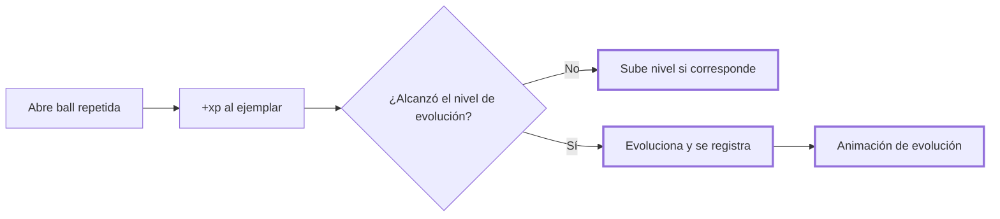

# CHG-020 · Colección: niveles, experiencia, evoluciones e historial
**Estado:** Cerrado
**Nivel:** M
**Modelo sugerido:** estandar
<!-- Estados y nivel se cambian SOLO con node .claude/team.mjs. Modelo: un perfil de docs/TEAM_MODELS.md -->
**Creado:** 2026-11-09 · **Aprobado:** 2026-11-09 · **Cerrado:** 2026-11-10
**Relacionado:** CHG-019, CHG-023

## 0. En palabras simples
- Qué vas a ver distinto: al tocar cualquier especie de la Colección se abre su **ficha** con la imagen grande, tipos, bio y estadísticas. Si la tienes, la ficha muestra además tu ejemplar: nivel, experiencia, cuándo lo conociste, el historial de qué lo hizo crecer y su cadena de evoluciones. Tu ejemplar sube de nivel con la experiencia y evoluciona solo al llegar al nivel indicado; al abrir la ball que lo hizo evolucionar ves la animación de evolución. Nada baja nunca.
- Cómo comprobarlo tú: abre Colección → toca una especie descubierta → aparece la ficha con su bio. Toca una no descubierta: se ve la silueta sin datos. Abre balls repetidas hasta subir de nivel y comprueba que el historial lo registra.

## 1. Resumen
Segundo incremento. Amplía el catálogo con la bio y los datos que ya trae el JSON de Alex (descripción, tipos, estadísticas, de qué evoluciona), agrega niveles calculados desde la experiencia, evolución automática configurable y el historial cronológico de crecimiento. La ficha es un modal desde la Colección. Las etapas previas quedan registradas como descubiertas tras evolucionar.



## 2. Producto (product-manager)
- Problema / usuario: Alex quiere conocer a cada especie y ver por qué su compañero se hizo más fuerte.
- Incluye:
  - El importador guarda `description`, `types`, `base_stats`, `evolves_from` y un `evolve_level` opcional.
  - La ficha en modal: imagen, número, nombre, tipos, bio, estadísticas y cadena evolutiva.
  - Para especies propias, la ficha suma nivel, xp, primer encuentro e historial de crecimiento.
  - Nivel calculado desde la xp con una curva configurable.
  - Evolución automática por nivel, con regla para las ramas.
  - Experiencia: una repetida sigue sumando +10 xp (CHG-019); además, el ejemplar recién descubierto recibe +5 xp de bienvenida.
- No incluye:
  - Condiciones especiales de evolución (piedras, intercambio, amistad): se dejarán como dato configurable para una fase posterior.
  - Equipo semanal y misiones (CHG-021).
  - Variantes shiny.
- Criterios de aceptación:
  - Dada una especie descubierta, cuando la toco, entonces se abre la ficha con su bio y sus tipos.
  - Dada una especie no descubierta, cuando la toco, entonces se ve la silueta, "Aún no la descubres" y ningún dato.
  - Dado un ejemplar con 3 ganancias de xp, cuando abro su ficha, entonces el historial lista las 3 con su origen y fecha, de la más reciente a la más antigua.
  - Dado un ejemplar que alcanza su nivel de evolución, cuando abro la ball que le dio la xp, entonces cambia a la siguiente etapa, se ve la animación y la etapa previa sigue como descubierta.
  - Dado un ejemplar evolucionado, cuando sale de nuevo una especie de su línea, entonces suma xp y no se crea otro ejemplar (regla de CHG-019).
  - El nivel y la xp nunca bajan; borrar la tarea de origen no borra el historial.

## 3. UX/UI
### 3.1 Experiencia (ux-designer)
- Plantilla: modal de detalle sobre la pestaña Colección (sin `## Anatomía` en docs/UX-DESIGN.md).
- Flujo: Colección → tocar una tarjeta → ficha (1 clic) → cerrar. En Balls: abrir → si evoluciona, revelación con la evolución.
- Contenido:
  - Arriba, identidad: imagen, número, nombre y tipos. Lo más importante es la bio.
  - Debajo, "Tu ejemplar" (solo si lo tienes): nivel, barra de xp hacia el siguiente nivel, "Lo conociste el …" y "Evoluciona en el nivel N".
  - Historial "Creció gracias a" con las últimas 20 entradas y el botón "Ver más".
  - Cadena evolutiva con las etapas descubiertas (●) y sin descubrir (○).
- Estados: no descubierta (silueta); descubierta sin ejemplar actual (etapa previa o hermana de rama: se ve su bio y "Tu ejemplar de esta línea es #…"); sin historial ("Aún no ha crecido. Cada ball de su línea suma.").
- Accesibilidad: las tarjetas son botones; el modal atrapa el foco y se cierra con Esc; la animación de evolución respeta movimiento reducido.

```
┌──────────────────────────────────────┐
│ #004 Nombre                     [×]  │
│        [ imagen grande ]             │
│ Tipos: fuego                         │
│ Bio: texto del catálogo…             │
│ PS 39 · Ataque 52 · Defensa 43 …     │
├──────────────────────────────────────┤
│ Tu ejemplar · Nivel 3                │
│ [██████░░░░] 24 / 40 xp              │
│ Lo conociste el 9 nov 2026           │
│ Evoluciona en el nivel 10            │
│ Creció gracias a:                    │
│ · Tarea «Pagar arriendo»   +10 xp    │
│ · Hábitos de la mañana     +10 xp    │
├──────────────────────────────────────┤
│ Evoluciones: ● #004 → ○ #005 → ○ #006│
└──────────────────────────────────────┘

Revelación con evolución (Balls)
┌─────────────────────────────────┐
│  [img A] ──✦──> [img B]         │
│  ¡Nombre A evolucionó a Nombre B!│
│  Llegó por: Pagar arriendo      │
└─────────────────────────────────┘
```

### 3.2 Visual (ui-designer)
- Distribución: `x-ui.dialog` tamaño `lg`; en móvil, pantalla completa.
- Componentes existentes: `dialog`, `progress`, `chip` (tipos), `list` / `list-item` (historial), `badge`, `.game-*` de CHG-019.
- Tokens: los del sistema. Los tipos van como chips neutros, sin colores por tipo en esta fase.
- Responsive: la cadena evolutiva se envuelve en varias filas.

### 3.3 Escritura (ux-writer)
- Textos finales: "Tu ejemplar", "Nivel {n}", "{xp} / {siguiente} xp", "Lo conociste el {fecha}", "Evoluciona en el nivel {n}", "Ya está en su última etapa", "Creció gracias a:", "Aún no ha crecido. Cada ball de su línea suma.", "Aún no la descubres", "Tu ejemplar de esta línea es {nombre}", "¡{A} evolucionó a {B}!", "Ver más", "Evoluciones".
- Etiquetas de estadísticas: PS, Ataque, Defensa, At. especial, Def. especial, Velocidad.
- Reglas: tuteo, sin culpas.
- Criterios: ningún texto sugiere pérdida o urgencia.

## 4. Diseño técnico (software-architect)
- Archivos:
  - Migración `add_profile_and_evolution_to_game_species` (`description` text, `types` json, `stats` json, `evolves_from_number` int null, `evolve_level` int null) y migración `game_companion_progress` (`level` en `game_companions`; tabla `game_discoveries` user + species unique, para registrar las etapas vistas).
  - `app/Console/Commands/ImportGameSpecies.php`: nuevos campos opcionales; `evolves_from` acepta un nombre, que se resuelve a número.
  - `config/game.php`: `xp_per_level` (40), `max_level` (100), `stage_evolve_levels` (etapa 2 → 10, etapa 3 → 25), `companion_xp_per_ball` (5) y `branch_rule`.
  - Servicios: `app/Services/Game/CompanionProgress.php` (xp → nivel y evolución, idempotente por evento) y `app/Services/Game/EncounterOpener.php` (delega xp y evolución, y devuelve `evolved_from` / `evolved_to`).
  - UI: `app/Livewire/Game/GameCollection.php` (acción `showSpecies`) y `resources/views/livewire/game/game-collection.blade.php`; parcial `resources/views/livewire/game/partials/species-sheet.blade.php`; `resources/views/livewire/game/game-balls.blade.php` (revelación con evolución); `resources/css/m3/modules/_game.css`.
  - Pruebas: `tests/Feature/Game/CompanionProgressTest.php`, `tests/Feature/Game/SpeciesSheetTest.php` y `tests/Feature/Game/ImportGameSpeciesTest.php`.
- Enfoque:
  - Nivel = min(max, 1 + floor(xp / xp_per_level)).
  - Siguiente etapa = especie de la misma `line_key` con `stage + 1` cuya `evolves_from_number` sea la actual (si falta, cualquiera de `stage + 1`).
  - Nivel requerido = `evolve_level` de la especie destino, o el valor por defecto de su etapa.
  - Ramas: si hay más de un destino posible, no evoluciona sola; `CompanionProgress::evolveTo($companion, $speciesId)` valida la línea, la etapa y el nivel, y registra el evento.
  - Cada cambio registra un `GameEvent` (`level_up` / `evolved`) con el origen de la ball, para alimentar el historial.
  - `game_discoveries` registra cada especie alcanzada; las etapas previas no se pierden.
- Riesgos: catálogos con cadenas incompletas → sin siguiente etapa = "Ya está en su última etapa". El historial se pagina para no cargar todo.
- Qué NO tocar: la idempotencia y los límites de CHG-019.

## 5. Pruebas (qa-tester)
| Caso | Tipo | Nivel | Test |
|---|---|---|---|
| Importa bio, tipos, stats, evolves_from | Feature | Comando | ImportGameSpeciesTest |
| Nivel calculado y nunca baja | Feature | Servicio | CompanionProgressTest |
| Evoluciona al nivel requerido y registra el evento | Feature | Servicio | CompanionProgressTest |
| Rama: no evoluciona sola; evolveTo valida el destino y el nivel | Feature | Servicio | CompanionProgressTest |
| Abrir la misma ball dos veces no da xp doble | Feature | Servicio | CompanionProgressTest |
| Etapa previa sigue como descubierta | Feature | Livewire | SpeciesSheetTest |
| Ficha: descubierta muestra bio; no descubierta no | Feature | Livewire | SpeciesSheetTest |
| Historial ordenado y conserva la etiqueta tras borrar el origen | Feature | Livewire | SpeciesSheetTest |
- Comando: `php artisan test tests/Feature/Game tests/Unit/Game`
- Regresión: pruebas de CHG-019 y CHG-023.

## 6. Documentación (tech-writer)
- `docs/game.md`: campos nuevos del JSON, curva de niveles, evolución y ramas.

## 7. Tareas
- [x] T1 · El catálogo guarda bio, tipos, estadísticas y de qué evoluciona — Resp: developer — Archivos: database/migrations, app/Models/Game/GameSpecies.php, app/Console/Commands/ImportGameSpecies.php, tests/Feature/Game/ImportGameSpeciesTest.php — Hecho cuando: reimportar pokemon.json guarda la bio y los tests pasan
- [x] T2 · Los ejemplares suben de nivel y evolucionan solos, con historial — Resp: developer — Archivos: database/migrations, app/Models/Game, app/Services/Game/CompanionProgress.php, app/Services/Game/EncounterOpener.php, config/game.php, tests/Feature/Game/CompanionProgressTest.php — Hecho cuando: los tests de progreso pasan
- [x] T3 · Ficha en modal desde la Colección y revelación con evolución — Resp: developer — Archivos: app/Livewire/Game/GameCollection.php, resources/views/livewire/game, resources/css/m3/modules/_game.css, tests/Feature/Game/SpeciesSheetTest.php — Hecho cuando: SpeciesSheetTest pasa y la ficha se ve en el navegador
- [x] T4 · Verificar criterios de aceptación — Resp: qa-tester — Hecho cuando: todos pasan
- [x] T5 · Actualizar docs/game.md — Resp: tech-writer — Archivos: docs/game.md — Hecho cuando: docs al día

## 8. Bitácora de implementación (developer)
- 2026-11-09 — Inicio con `start --force` (ya había otros CHG En desarrollo; trabajo aprobado por Alex).
- 2026-11-09 — T1: migración `2026_11_09_000002_add_profile_and_progress_to_game` (descripción, tipos, estadísticas, `evolves_from_number` y `evolve_level` en especies; `level` en ejemplares; tabla `game_discoveries`, con relleno desde los ejemplares existentes). El importador acepta `description`, `types`, `base_stats`, `evolves_from` (nombre o número) y `evolve_level`. Migración aplicada y `pokemon.json` reimportado en local: 1025 especies. ImportGameSpeciesTest: 3 pasan.
- 2026-11-09 — T2: `CompanionProgress` (nivel = 1 + xp/40, tope 100; evolución automática si hay un solo destino; ramas → `evolveTo` valida línea, etapa y nivel; eventos `level_up` / `evolved` con el origen de la ball; registro de descubrimientos). `EncounterOpener` delega en él: una línea nueva da +5 xp de bienvenida y una repetida +10 xp; el resultado incluye evolución y nivel. Se corrigió `level` en el fillable de GameCompanion. CompanionProgressTest: 8 pasan.
- 2026-11-09 — T3: ficha en modal desde la Colección (bio, tipos, estadísticas, tu ejemplar, barra de xp, historial "Creció gracias a" de 20 en 20, cadena evolutiva, botones "Evolucionar a …" en las ramas). Las tarjetas son botones accesibles (`md-btn-text`, por el contrato de UI). La revelación en Balls muestra la evolución (la imagen anterior se ilumina y aparece la nueva) y la subida de nivel. `npm run build` ejecutado. SpeciesSheetTest: 6 pasan; Game total: 49; UiConformance: verde (CssLayer: fallas ya existentes de comidas/text-fields).
- Sugerencia fuera de alcance: con 1025 especies, la cuadrícula carga todas a la vez (imágenes lazy). Si se siente lenta, conviene un CHG con paginación o filtros (descubiertas / generación).


- Revisión QA 2026-11-10 sobre HEAD 62351bb865ea8b1233ef8757b59feed2870a8c5e. Alex confirma funcionamiento en producción (aceptación funcional del usuario, no ejecución técnica contra producción). Suite focal PHP: 301/302; el fallo es CHG-027. Regresión adicional: 54/58, cuatro fallos existentes de shell/preview informados aparte. JS 44/44 y form-editor 3/3. Build correcto con aviso de chunk; conformance global falla por CHG-058 y deuda de CHG-054. CHG-059 concurrente excluido; no se alteró código funcional.
- Recorrido sintético juego/guardianes: 37 respuestas HTTP 200, sin errores JavaScript, guardianes visibles y 19 acciones Otro consejo respondieron. Geometría final 33/33 a 390/768/1440 tras estabilizar transiciones. Imágenes sustituidas por figuras sintéticas: no certifica arte externo. Ver logs closure-qa-game-browser-final.jsonl y closure-qa-geometry-final.json en storage/framework/testing.

## 9. Preguntas abiertas, decisiones e historial
- 2026-11-09 — Creado en to-do/ (Borrador, nivel M)
- 2026-11-09 — Decisión (Alex): incluir la ficha en modal con la bio que trae su JSON (1025 especies con descripción).
- 2026-11-09 — Decisión (Alex): ramas → el usuario elige en la ficha. Al alcanzar el nivel, la ficha muestra "Listo para evolucionar" con las opciones (botón "Evolucionar a {nombre}"); sin elegir no se pierde nada y la xp sigue sumando. Las líneas sin rama evolucionan solas.
- 2026-11-09 — Decisión (Alex): curva por defecto de 40 xp/nivel; etapa 2 en el nivel 10 y etapa 3 en el nivel 25 (configurable en config/game.php).
- 2026-11-09 — Aprobado por el usuario (Compuerta 2)
- 2026-11-09 — Movido a in-progress/ (En desarrollo)
- LECCIÓN(developer): en modelos nuevos, todo campo que se escriba con create/update debe estar en $fillable; probar el valor leído de la base, no solo el que se asignó — evidencia: `level` de GameCompanion se ignoraba en silencio y solo lo detectó SpeciesSheetTest · destino sugerido: docs/TESTING.md (cuando exista) → descartada: no relevante
- 2026-11-09 — Implementación terminada → En verificación
- 2026-11-10 — Cerrado por el usuario (Compuerta 3) → done/
