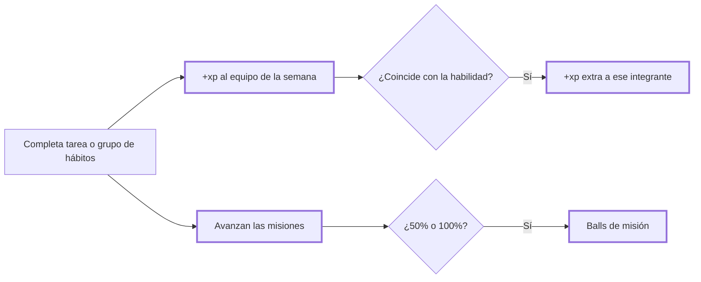

# CHG-021 · Equipo semanal, habilidades y misiones sin castigo
**Estado:** Cerrado
**Nivel:** M
**Modelo sugerido:** estandar
<!-- Estados y nivel se cambian SOLO con node .claude/team.mjs. Modelo: un perfil de docs/TEAM_MODELS.md -->
**Creado:** 2026-11-09 · **Aprobado:** 2026-11-09 · **Cerrado:** 2026-11-10
**Relacionado:** CHG-019, CHG-020, CHG-023

## 0. En palabras simples
- Qué vas a ver distinto: en Colección aparece la pestaña **Semana**. Cada semana tienes un equipo de hasta 6 de tus Pokémon, elegido solo y rotando para que todos participen. Cada integrante tiene una habilidad ligada a un ámbito (p. ej. "Afinidad: Hogar"). Cada tarea o grupo de hábitos les da experiencia, y más al integrante que comparte el ámbito. También verás 3 misiones de la semana: si llegas a la mitad recibes 1 ball y si la completas, 2 balls más. Si no las terminas, no pasa nada: la semana siguiente trae otras.
- Cómo comprobarlo tú: abre Colección → Semana: aparece el equipo con su habilidad y 3 misiones con su barra. Completa una tarea de la categoría de una misión y mira que la barra avance y que el equipo gane xp.

## 1. Resumen
Tercer incremento del juego. El equipo semanal se asigna de forma perezosa (la primera vez que se consulta en la semana, sin scheduler), con rotación aleatoria ponderada hacia los menos usados. Las habilidades son un catálogo configurable de afinidades. Las misiones semanales son de tres tipos: tareas por categoría, grupos de hábitos y variedad de ámbitos. Todo progreso cuenta y nada se descuenta.



## 2. Producto (product-manager)
- Problema / usuario: Alex quiere que todos sus Pokémon crezcan, no solo los que se repiten, y tener objetivos semanales amables que premien el equilibrio.
- Incluye:
  - **Equipo:** hasta 6 ejemplares descubiertos (menos si tiene menos), asignado la primera vez que se consulta la semana (lunes a domingo, zona America/Bogota), al azar ponderado hacia los menos usados y con semilla registrada.
  - **Habilidades:** catálogo configurable de afinidades. Cada integrante recibe una al azar entre las categorías de tarea del usuario y "Hábitos". Cada actividad elegible da +3 xp a todo el equipo y +6 extra al integrante con afinidad coincidente.
  - **Misiones:** 3 por semana, generadas al armar la semana a partir de los datos del usuario:
    - Tareas por categoría: "Completa {n} tareas de {categoría}".
    - Grupos de hábitos: "Completa tus hábitos de {momento} {n} días".
    - Variedad: "Avanza en {n} categorías distintas".
    - Metas modestas: n entre 2 y 4.
  - **Recompensas:** al 50 % de una misión, 1 ball; al 100 %, 2 balls más. Una sola vez cada umbral. No cuentan para el límite diario.
  - Historial: la xp de equipo queda en "Creció gracias a" con la etiqueta "Equipo de la semana · {origen}".
- No incluye: elegir el equipo a mano, combates, medallas, huevos, temporadas (CHG-022), scheduler.
- Criterios de aceptación:
  - Dado un usuario con 8 ejemplares, cuando abre Semana por primera vez en la semana, entonces ve 6 integrantes, cada uno con su habilidad. Al recargar, ve el mismo equipo.
  - Dado que la semana cambia, cuando abre Semana, entonces se arma un equipo nuevo, priorizando a quienes estuvieron menos veces. Los equipos anteriores quedan en el historial.
  - Dada una tarea completada de categoría Hogar y un integrante con afinidad Hogar, entonces ese integrante gana 9 xp y los demás 3.
  - Dada una misión "Completa 4 tareas de Hogar", cuando llego a 2, entonces recibo 1 ball; cuando llego a 4, entonces recibo 2 más. Reabrir y completar de nuevo la misma tarea no suma dos veces.
  - Dada una semana sin actividad, entonces no se pierde nada y la semana siguiente trae misiones nuevas. Una misión incompleta conserva la ball de mitad si la ganó.
  - Con menos de 1 ejemplar descubierto, Semana muestra el estado vacío y las misiones funcionan igual.

## 3. UX/UI
### 3.1 Experiencia (ux-designer)
- Plantilla: pestaña del módulo Colección (lista de secciones).
- Flujo: Colección → Semana (1 clic). Tocar un integrante abre su ficha (CHG-020).
- Contenido: arriba, el equipo (lo más importante); abajo, las misiones con su barra y sus recompensas.
- Estados: sin ejemplares ("Tu equipo se arma cuando descubras tu primer Pokémon"); misión a la mitad (marca "Ball recibida"); misión completa ("¡Misión cumplida!"); semana sin avance (sin mensajes de culpa).
- Accesibilidad: las barras con `aria-valuenow`; los integrantes como botones.

```
Semana del 9 al 15 nov
Tu equipo
┌──────┬──────┬──────┬──────┬──────┬──────┐
│[img] │[img] │[img] │[img] │[img] │[img] │
│Nombre│Nombre│Nombre│Nombre│Nombre│Nombre│
│Nv 3  │Nv 1  │Nv 5  │Nv 2  │Nv 1  │Nv 4  │
│Hogar │Salud │Hábit.│Trab. │Hogar │Estud.│
└──────┴──────┴──────┴──────┴──────┴──────┘
Misiones de la semana
● Completa 4 tareas de Hogar        [███░░░] 2/4  Ball recibida
● Completa tus hábitos de la mañana 3 días [█░░] 1/3
● Avanza en 3 categorías distintas  [██████] 3/3  ¡Misión cumplida!
```

### 3.2 Visual (ui-designer)
- Distribución: la cuadrícula del equipo reutiliza `.game-grid`; las misiones van en `x-ui.list` con `x-ui.progress`.
- Componentes: `list`, `list-item`, `progress`, `badge`, `state`, `.game-grid__item`.
- Tokens: los del sistema. La habilidad va como badge.
- Responsive: 3 columnas en móvil.

### 3.3 Escritura (ux-writer)
- Textos finales: pestaña "Semana"; "Semana del {inicio} al {fin}"; "Tu equipo"; "Afinidad: {ámbito}"; "Misiones de la semana"; "Completa {n} tareas de {categoría}"; "Completa tus hábitos de {la mañana|la tarde|la noche|cualquier momento} {n} días"; "Avanza en {n} categorías distintas"; "Ball recibida"; "¡Misión cumplida!"; vacío: "Tu equipo se arma cuando descubras tu primer Pokémon."; historial: "Equipo de la semana · {origen}"; etiqueta de ball: "Misión: {título}".
- Reglas: tuteo, sin urgencias ni conteos regresivos.
- Criterios: ningún texto menciona fallar, perder ni plazos vencidos.

## 4. Diseño técnico (software-architect)
- Archivos:
  - Migración `create_game_weeks_tables`:
    - `game_weeks`: user, `week_start`, seed, `config_snapshot`; unique (user, week_start).
    - `game_team_members`: week, companion, `ability_key`, `ability_label`, slot.
    - `game_missions`: week, type, `params` JSON, target, progress, `half_rewarded_at`, `full_rewarded_at`.
    - `game_mission_contributions`: mission, `idempotency_key` unique.
  - Modelos: `app/Models/Game/{GameWeek,GameTeamMember,GameMission}.php`.
  - Servicios: `app/Services/Game/WeekPlanner.php` (arma equipo y misiones de forma perezosa e idempotente con lock), `app/Services/Game/ActivityEffects.php` (xp del equipo y avance de misiones por actividad), `app/Services/Game/RewardGranter.php` (llama a ActivityEffects tras registrar una actividad elegible, aunque se haya alcanzado el límite diario; más `grantMissionBall`, sin límite diario y con clave `mission:{id}:{half|full}`).
  - `config/game.php`: `team_size` 6, `team_xp` 3, `affinity_bonus_xp` 6, `missions_per_week` 3, rango de metas 2–4, tipos de misión habilitados.
  - UI: `app/Livewire/Game/GameWeekView.php` con su vista, `routes/web.php` (`game.week`), `config/modules.php` (pestaña Semana) y `resources/css/m3/modules/_game.css`.
  - Pruebas: `tests/Feature/Game/WeekPlannerTest.php`, `tests/Feature/Game/ActivityEffectsTest.php` y `tests/Feature/Game/GameWeekViewTest.php`.
- Enfoque:
  - La rotación pesa `1 / (1 + veces_en_equipo)`; la afinidad sale de las categorías de tarea del usuario más `habits`. La semana se crea dentro de una transacción con bloqueo del usuario.
  - Una tarea aporta su categoría; un grupo de hábitos aporta `habits` y su momento.
  - La xp de equipo usa `CompanionProgress::addXp` (puede subir de nivel o evolucionar) con la clave `team:{activity_event_id}:{companion_id}`.
  - Las misiones avanzan solo si la actividad pertenece a la semana de la misión. La variedad cuenta categorías distintas; los hábitos cuentan días distintos.
- Riesgos: concurrencia al crear la semana (unique + lock); doble avance (unique por contribución); usuarios sin categorías (solo misiones de hábitos y variedad).
- Qué NO tocar: las reglas de CHG-019, CHG-020 y CHG-023.

## 5. Pruebas (qa-tester)
| Caso | Tipo | Nivel | Test |
|---|---|---|---|
| Equipo de hasta 6, estable en la semana, nuevo al cambiar de semana | Feature | Servicio | WeekPlannerTest |
| Rotación favorece a los menos usados (semilla fija) | Feature | Servicio | WeekPlannerTest |
| Creación concurrente/idempotente de la semana | Feature | Servicio | WeekPlannerTest |
| xp de equipo +3 y +6 por afinidad | Feature | Servicio | ActivityEffectsTest |
| Misión: ball al 50 % y 2 al 100 %, una vez | Feature | Servicio | ActivityEffectsTest |
| Reabrir/recompletar no duplica el avance | Feature | Servicio | ActivityEffectsTest |
| Semana sin actividad: no se pierde nada | Feature | Servicio | ActivityEffectsTest |
| Vista Semana: equipo, misiones, vacío, aislamiento | Feature | Livewire | GameWeekViewTest |
- Comando: `php artisan test tests/Feature/Game tests/Unit/Game`
- Regresión: pruebas del juego existentes.

## 6. Documentación (tech-writer)
- `docs/game.md`: equipo, habilidades, misiones y configuración.

## 7. Tareas
- [x] T1 · El equipo y las misiones de la semana se arman solos — Resp: developer — Archivos: database/migrations, app/Models/Game, app/Services/Game/WeekPlanner.php, config/game.php, tests/Feature/Game/WeekPlannerTest.php — Hecho cuando: WeekPlannerTest pasa
- [x] T2 · Las actividades dan xp al equipo y hacen avanzar las misiones, con balls de misión — Resp: developer — Archivos: app/Services/Game/ActivityEffects.php, app/Services/Game/RewardGranter.php, tests/Feature/Game/ActivityEffectsTest.php — Hecho cuando: ActivityEffectsTest pasa y las pruebas del juego siguen en verde
- [x] T3 · Pestaña Semana con equipo y misiones — Resp: developer — Archivos: app/Livewire/Game/GameWeekView.php, resources/views/livewire/game, routes/web.php, config/modules.php, resources/css/m3/modules/_game.css, tests/Feature/Game/GameWeekViewTest.php — Hecho cuando: GameWeekViewTest pasa
- [x] T4 · Verificar criterios de aceptación — Resp: qa-tester — Hecho cuando: todos pasan
- [x] T5 · Actualizar docs/game.md — Resp: tech-writer — Archivos: docs/game.md — Hecho cuando: docs al día

## 8. Bitácora de implementación (developer)
- 2026-11-09 — Inicio con `start --force` (ya había otros CHG En desarrollo; trabajo aprobado por Alex).
- 2026-11-09 — T1: migración `2026_11_09_000003_create_game_weeks_tables`, modelos GameWeek, GameTeamMember y GameMission, `WeekPlanner` (semana perezosa e idempotente con bloqueo; rotación ponderada con semilla; completa huecos del equipo; misiones según categorías y hábitos del usuario; variedad limitada a los ámbitos disponibles) y config del equipo y las misiones. WeekPlannerTest: 7 pasan.
- 2026-11-09 — T2: `ActivityEffects` (xp de equipo +3/+6 vía CompanionProgress, con evento de historial idempotente `team:{actividad}:{ejemplar}`; aportes a misiones únicos por actividad, día o ámbito; ball de mitad y de completado). En `RewardGranter`: el contexto de la actividad (categoría o momento), los efectos dentro de un savepoint que no impide la ball, `grantMissionBall` (sin límite diario) y el conteo diario solo de balls por actividad; la protección también mira las balls de misión. Las pruebas anteriores desactivan las misiones (`seedSpecies`) para conservar conteos deterministas, y dos de ellas aíslan la xp de equipo. ActivityEffectsTest: 8 pasan.
- 2026-11-09 — T3: pestaña Semana (`GameWeekView`, ruta `game.week`, tab en config/modules.php) con equipo, afinidad, nivel y misiones con su barra y estado. `npm run build` ejecutado. GameWeekViewTest: 3 pasan. Game total: 67; UiConformance, Habit y TaskGamification: verde.
- 2026-11-09 — Migración aplicada en la base local tras corregir el nombre del índice único (MySQL limita a 64 caracteres; SQLite de pruebas no lo detecta). Se borraron las 4 tablas vacías creadas a medias por el intento fallido.
- 2026-11-09 — T5: docs/game.md actualizado (sección Semana, tablas, configuración).


- Revisión QA 2026-11-10 sobre HEAD 62351bb865ea8b1233ef8757b59feed2870a8c5e. Alex confirma funcionamiento en producción (aceptación funcional del usuario, no ejecución técnica contra producción). Suite focal PHP: 301/302; el fallo es CHG-027. Regresión adicional: 54/58, cuatro fallos existentes de shell/preview informados aparte. JS 44/44 y form-editor 3/3. Build correcto con aviso de chunk; conformance global falla por CHG-058 y deuda de CHG-054. CHG-059 concurrente excluido; no se alteró código funcional.
- Recorrido sintético juego/guardianes: 37 respuestas HTTP 200, sin errores JavaScript, guardianes visibles y 19 acciones Otro consejo respondieron. Geometría final 33/33 a 390/768/1440 tras estabilizar transiciones. Imágenes sustituidas por figuras sintéticas: no certifica arte externo. Ver logs closure-qa-game-browser-final.jsonl y closure-qa-geometry-final.json en storage/framework/testing.

## 9. Preguntas abiertas, decisiones e historial
- 2026-11-09 — Creado en to-do/ (Borrador, nivel M)
- 2026-11-09 — Decisiones (Alex): el equipo gana xp por actividades (+3, +6 por afinidad); asignación perezosa al primer ingreso de la semana; los tres tipos de misión.
- 2026-11-09 — Supuesto: las balls de misión no cuentan para el límite diario (son semanales y de cantidad acotada: máximo 9 por semana).
- 2026-11-09 — Aprobado por el usuario (Compuerta 2)
- 2026-11-09 — Movido a in-progress/ (En desarrollo)
- LECCIÓN(developer): en migraciones con índices compuestos sobre tablas de nombre largo, define un nombre corto explícito; MySQL limita los identificadores a 64 caracteres y las pruebas en SQLite no lo detectan — evidencia: `game_mission_contributions_game_mission_id_contribution_key_unique` falló solo al migrar en local · destino sugerido: docs/ARCHITECTURE.md (cuando exista) → docs/ARCHITECTURE.md
- 2026-11-09 — Implementación terminada → En verificación
- 2026-11-10 — Cerrado por el usuario (Compuerta 3) → done/
