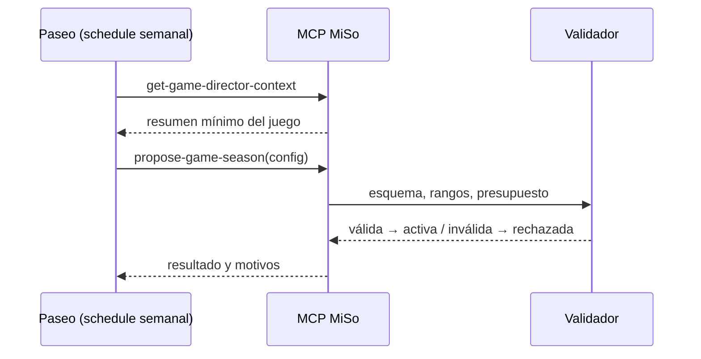

# CHG-022 · Director IA y temporadas del juego
**Estado:** Cerrado
**Nivel:** M
**Modelo sugerido:** razonamiento
<!-- Estados y nivel se cambian SOLO con node .claude/team.mjs. Modelo: un perfil de docs/TEAM_MODELS.md -->
**Creado:** 2026-11-09 · **Aprobado:** 2026-11-09 · **Cerrado:** 2026-11-10
**Relacionado:** CHG-019, CHG-020, CHG-021

## 0. En palabras simples
- Qué vas a ver distinto:
  - En Colección aparece la pestaña **Temporada**. Cada 4 semanas, un director (un agente de Paseo que tú programas) propone una temporada nueva: nombre, una historia corta, el enfoque de las misiones, bonos de experiencia para 1 o 2 ámbitos y rarezas o una línea destacada.
  - MiSo revisa que todo esté dentro de los límites. Si está bien, la activa sola; si no, la rechaza y el juego sigue igual.
  - Puedes pausar el director o revertir una temporada cuando quieras. Revertir solo deja de aplicar sus reglas desde ese momento: nunca toca balls, Pokémon ni experiencia ya ganados.
- Cómo comprobarlo tú: ejecuta una vez el schedule de Paseo (o pídele a Claude con el conector MiSo "propón la temporada del juego"). Abre Colección → Temporada: ves la temporada activa con su historia y sus bonos. Pulsa "Revertir" y comprueba que vuelve la configuración base.

## 1. Resumen
El director IA vive fuera de MiSo: es un schedule de Paseo que usa el MCP de MiSo. MiSo agrega dos herramientas MCP: una que entrega un contexto mínimo del juego y otra que recibe una propuesta de temporada. Un validador determinista revisa el esquema, los rangos, el presupuesto y la seguridad antes de activarla. Cada resultado del juego registra qué temporada lo produjo (`config_snapshot`). Si no hay una temporada válida, se usa la configuración base de `config/game.php`. La IA nunca modifica código, migraciones, datos personales ni progreso.



## 2. Producto (product-manager)
- Problema / usuario: Alex quiere variedad sin mantener el juego a mano y sin que la IA decida recompensas en tiempo real.
- Incluye:
  - **Contexto mínimo** (`get-game-director-context-tool`):
    - Participación de las últimas 8 semanas: actividades, balls, misiones al 50 % y al 100 %.
    - Actividad por ámbito, solo con conteos por categoría y momento de hábitos.
    - Tamaño de la colección.
    - La temporada actual y las anteriores.
    - Los límites permitidos y si toca proponer.
    - Nunca títulos de tareas, diario, salud ni contactos.
  - **Propuesta** (`propose-game-season-tool`). El JSON debe cumplir estos límites:
    - Nombre: hasta 60 caracteres. Narrativa: hasta 400.
    - Duración: de 2 a 6 semanas (4 por defecto). Empieza el lunes siguiente o ahora si no hay ninguna activa.
    - Misiones: tipos permitidos, metas de 2 a 5 y hasta 2 ámbitos a impulsar.
    - Bonos de xp de equipo: hasta 2 categorías existentes del usuario, ×1,0 a ×1,5.
    - Pesos de rareza: cada uno de 0 a 100; legendary ≤ 3; suma > 0.
    - Línea destacada opcional: una línea existente con su peso ×2 como máximo.
  - Solo se acepta si no hay temporada activa o si la activa termina en 7 días o menos. Las demás semanas la herramienta responde "aún no toca" y el agente solo observa.
  - **Activación automática** si la propuesta es válida. Una propuesta inválida queda registrada como rechazada, con sus motivos.
  - **Temporada aplicada en el juego:** las misiones de las semanas dentro de la temporada usan su configuración; la xp de equipo aplica los bonos; las balls usan sus pesos y la línea destacada.
  - **Pestaña Temporada:**
    - La temporada activa con nombre, historia, fechas y reglas en lenguaje simple.
    - El historial con estados (activa, terminada, revertida, rechazada) y sus motivos.
    - "Revertir temporada", que termina la activa ahora y vuelve a la base.
    - Interruptor "Director activo"; apagado, la herramienta rechaza propuestas.
    - "Juego de temporadas" para activar o desactivar eventos.
  - Documentación del schedule de Paseo con el prompt sugerido.
- No incluye: huevos, medallas, combates ni shiny. Las "novedades de software" que proponga el director se registran solo como observaciones de texto (`notes`) en la temporada, para revisarlas; nada se instala.
- Criterios de aceptación:
  - Dada una propuesta válida y ninguna temporada activa, cuando se llama la herramienta, entonces queda activa y la pestaña la muestra.
  - Dada una propuesta con un bono ×3 o una categoría inexistente, entonces se rechaza con motivos legibles y el juego sigue con la configuración anterior.
  - Dada una temporada activa con más de 7 días restantes, entonces la propuesta responde "aún no toca" sin crear nada.
  - Dada una temporada activa con bono ×1,5 en Hogar, cuando completo una tarea de Hogar, entonces el equipo gana su xp ×1,5 (redondeada), y el evento guarda el id de la temporada.
  - Dado que revierto una temporada, entonces termina ahora, las semanas siguientes usan la base y nada ganado se pierde.
  - El contexto no contiene títulos de tareas ni textos personales.
  - Con el director apagado, toda propuesta se rechaza con "El director está en pausa".
  - Solo el usuario autenticado del MCP ve y propone sobre su propio juego.

## 3. UX/UI
### 3.1 Experiencia (ux-designer)
- Plantilla: pestaña del módulo Colección.
- Flujo: Colección → Temporada (1 clic). Revertir pide confirmación (1 clic más).
- Contenido: arriba, la temporada activa (lo más importante); después, el interruptor del director; abajo, el historial.
- Estados:
  - Sin temporada: "Aún no hay temporada. El juego usa sus reglas base."
  - Activa.
  - Rechazada: aparece en el historial con sus motivos.
  - Director en pausa.
- Accesibilidad: la confirmación usa el diálogo estándar; los estados no se comunican solo con color.

```
Temporada
┌────────────────────────────────────────────┐
│ Temporada del Bosque · 16 nov – 13 dic     │
│ "Las criaturas del bosque despiertan…"     │
│ · Misiones: impulsa Salud y Hogar          │
│ · Bonos: Salud ×1,5 · Hogar ×1,2           │
│ · Destacada: línea #001                    │
│                         [Revertir temporada]│
└────────────────────────────────────────────┘
[■] Director activo — propone temporadas desde Paseo
Historial
· Temporada del Río · terminada · 19 oct – 15 nov
· (sin nombre) · rechazada · bono ×3 fuera de rango
```

### 3.2 Visual (ui-designer)
- Componentes: `card`, `switch`, `list`, `list-item`, `badge`, `dialog` (confirmación), `state`.
- Tokens: los del sistema; los estados van como badge con texto.
- Responsive: una columna.

### 3.3 Escritura (ux-writer)
- Textos finales: "Temporada"; "Aún no hay temporada. El juego usa sus reglas base."; "Misiones: impulsa {ámbitos}"; "Bonos: {ámbito} ×{n}"; "Destacada: línea {nombre}"; "Revertir temporada"; confirmación: "¿Revertir esta temporada? Sus reglas dejan de aplicarse desde ahora. No pierdes nada de lo que ganaste."; botones "Revertir" / "Cancelar"; "Director activo"; ayuda: "Propone temporadas desde tu schedule de Paseo."; estados: "Activa", "Terminada", "Revertida", "Rechazada"; "Historial"; "El director está en pausa".
- Reglas: tuteo, sin culpas.
- Criterios: los motivos de rechazo se muestran en español claro.

## 4. Diseño técnico (software-architect)
- Archivos:
  - Migración `create_game_seasons_table`: user, status, name, narrative, config JSON, notes, `starts_at`, `ends_at`, `proposed_at`, errors JSON, `reverted_at`, `source` (`mcp`/`manual`).
  - Modelo `app/Models/Game/GameSeason.php`.
  - Servicios:
    - `app/Services/Game/SeasonValidator.php`: esquema, rangos, categorías y líneas existentes, presupuesto.
    - `app/Services/Game/SeasonManager.php`: `context`, `propose`, `active`, `revert`.
    - `app/Services/Game/GameRules.php`: fusiona la base con la temporada activa en una fecha.
  - Integración:
    - `WeekPlanner`: misiones según la temporada.
    - `ActivityEffects`: multiplicador de xp.
    - `RewardGranter`: pesos, línea destacada y el id de la temporada en `config_snapshot`.
    - `EncounterRoller`: `featured_line` con peso.
  - MCP:
    - `app/Mcp/Tools/Game/GetGameDirectorContextTool.php` y `app/Mcp/Tools/Game/ProposeGameSeasonTool.php`.
    - Registro en `app/Mcp/Servers/LifeTrackerServer.php`.
  - UI: `app/Livewire/Game/GameSeasonView.php` con su vista, `routes/web.php` (`game.season`) y `config/modules.php` (pestaña).
  - Configuración: `config/game.php` (`season` con duración por defecto y límites), y `GameSettings` (`director_enabled`, `seasons_enabled`).
  - Pruebas: `tests/Feature/Game/SeasonValidatorTest.php`, `SeasonManagerTest.php`, `GameDirectorMcpTest.php` y `GameSeasonViewTest.php`.
  - Docs: `docs/game.md` (sección Director con el prompt del schedule).
- Enfoque:
  - Validación estricta: se rechazan claves desconocidas y todo se recorta a rangos fijos.
  - Concurrencia: crear o revertir bloquea la fila del usuario, y solo puede haber una temporada activa.
  - Las reglas solo se leen en el momento del cálculo, nunca de forma retroactiva.
  - El progreso histórico no se toca.
  - Errores del director (propuesta mal formada o la IA caída) → el juego sigue con la última válida o la base.
- Riesgos:
  - Propuestas maliciosas o absurdas → validador y presupuesto.
  - Exposición de datos → el contexto solo usa agregados.
  - Coste → la frecuencia y el modelo los decide el schedule de Paseo (fuera de MiSo); `notes` limitado a 1000 caracteres.
- Qué NO tocar: las reglas de no penalización, la idempotencia ni el progreso existente.

## 5. Pruebas (qa-tester)
| Caso | Tipo | Nivel | Test |
|---|---|---|---|
| Propuesta válida se activa | Feature | Servicio | SeasonManagerTest |
| Rangos/categorías/claves inválidas se rechazan con motivos | Feature | Servicio | SeasonValidatorTest |
| "Aún no toca" con temporada activa > 7 días | Feature | Servicio | SeasonManagerTest |
| Director en pausa rechaza | Feature | Servicio | SeasonManagerTest |
| Bono ×1,5 aplicado a xp de equipo y registrado | Feature | Servicio | SeasonManagerTest |
| Pesos y línea destacada usados en balls | Feature | Servicio | SeasonManagerTest |
| Revertir: termina ahora, base después, nada se pierde | Feature | Servicio | SeasonManagerTest |
| Contexto sin títulos ni datos personales; aislado por usuario | Feature | MCP | GameDirectorMcpTest |
| Pestaña Temporada: estados, revertir, interruptor | Feature | Livewire | GameSeasonViewTest |
- Comando: `php artisan test tests/Feature/Game tests/Unit/Game`
- Regresión: pruebas del juego y del MCP (`--filter=Mcp`).

## 6. Documentación (tech-writer)
- `docs/game.md`: director, esquema de la propuesta, límites y prompt sugerido para el schedule de Paseo.

## 7. Tareas
- [x] T1 · Temporadas con validación estricta y reglas aplicadas al juego — Resp: developer — Archivos: database/migrations, app/Models/Game/GameSeason.php, app/Services/Game/SeasonValidator.php, app/Services/Game/SeasonManager.php, app/Services/Game/GameRules.php, app/Services/Game/WeekPlanner.php, app/Services/Game/ActivityEffects.php, app/Services/Game/RewardGranter.php, app/Services/Game/EncounterRoller.php, app/Services/Game/GameSettings.php, config/game.php, tests/Feature/Game/SeasonValidatorTest.php, tests/Feature/Game/SeasonManagerTest.php — Hecho cuando: los tests de validador y manager pasan y el juego sigue en verde
- [x] T2 · Herramientas MCP para el director de Paseo — Resp: developer — Archivos: app/Mcp/Tools/Game, app/Mcp/Servers/LifeTrackerServer.php, tests/Feature/Game/GameDirectorMcpTest.php — Hecho cuando: GameDirectorMcpTest pasa y la regresión MCP sigue en verde
- [x] T3 · Pestaña Temporada con revertir e interruptor del director — Resp: developer — Archivos: app/Livewire/Game/GameSeasonView.php, resources/views/livewire/game, routes/web.php, config/modules.php, resources/css/m3/modules/_game.css, tests/Feature/Game/GameSeasonViewTest.php — Hecho cuando: GameSeasonViewTest pasa
- [x] T4 · Verificar criterios de aceptación — Resp: qa-tester — Hecho cuando: todos pasan
- [x] T5 · Documentar el director y el prompt del schedule — Resp: tech-writer — Archivos: docs/game.md — Hecho cuando: docs al día

## 8. Bitácora de implementación (developer)
- 2026-11-09 — Inicio con `start --force` (ya había otros CHG En desarrollo; trabajo aprobado por Alex).
- 2026-11-09 — T1: migración `2026_11_09_000004_create_game_seasons_table`, modelo GameSeason (estado visible: activa, programada, terminada, revertida, rechazada), `SeasonValidator` (estricto: sin recortes silenciosos), `GameRules` (base + temporada vigente, solo al calcular), `SeasonManager` (contexto agregado, propose con bloqueo y ventana de 7 días, revert), `director_enabled` y `seasons_enabled` en GameSettings y `season` en config. Integración: WeekPlanner (tipos, metas y enfoque), ActivityEffects (multiplicador y `season_id`), RewardGranter (overlay de pesos y línea destacada; `season_id` en el snapshot y el efecto) y EncounterRoller (`featured_line`). SeasonValidatorTest (11) y SeasonManagerTest (11) pasan.
- 2026-11-09 — T2: `GetGameDirectorContextTool` y `ProposeGameSeasonTool` en app/Mcp/Tools/Game, registradas en LifeTrackerServer. Se agregó el módulo `Game` al catálogo de `app/Mcp/Support/ToolCatalog.php` (archivo no listado en §4; una línea para que el catálogo las etiquete como "Colección"). GameDirectorMcpTest: 4 pasan; regresión MCP: 162 pasan.
- 2026-11-09 — T3: pestaña Temporada (`GameSeasonView`, ruta `game.season`, tab) con temporada activa y programada, reglas en lenguaje simple, revertir con confirmación, interruptores e historial con motivos. `npm run build` ejecutado. GameSeasonViewTest: 4 pasan. Game total: 97; UiConformance, MCP, Habit y TaskGamification: 245 pasan.
- 2026-11-09 — Migración aplicada en la base local. T5: docs/game.md con la sección Director y el prompt del schedule de Paseo.


- Revisión QA 2026-11-10 sobre HEAD 62351bb865ea8b1233ef8757b59feed2870a8c5e. Alex confirma funcionamiento en producción (aceptación funcional del usuario, no ejecución técnica contra producción). Suite focal PHP: 301/302; el fallo es CHG-027. Regresión adicional: 54/58, cuatro fallos existentes de shell/preview informados aparte. JS 44/44 y form-editor 3/3. Build correcto con aviso de chunk; conformance global falla por CHG-058 y deuda de CHG-054. CHG-059 concurrente excluido; no se alteró código funcional.
- Recorrido sintético juego/guardianes: 37 respuestas HTTP 200, sin errores JavaScript, guardianes visibles y 19 acciones Otro consejo respondieron. Geometría final 33/33 a 390/768/1440 tras estabilizar transiciones. Imágenes sustituidas por figuras sintéticas: no certifica arte externo. Ver logs closure-qa-game-browser-final.jsonl y closure-qa-geometry-final.json en storage/framework/testing.

## 9. Preguntas abiertas, decisiones e historial
- 2026-11-09 — Creado en to-do/ (Borrador, nivel M)
- 2026-11-09 — Decisión (Alex): la IA corre como schedule de Paseo usando el MCP de MiSo; MiSo no integra un cliente LLM ni usa el scheduler del servidor.
- 2026-11-09 — Decisiones (Alex): una propuesta válida se activa sola; el director puede ajustar nombre y narrativa, misiones, bonos de ámbito y rarezas o línea destacada; evaluación semanal con temporadas de 4 semanas.
- 2026-11-09 — Decisión (Alex): la lectura de datos de producción del director es exclusivamente por MCP (el agente de Paseo usa el conector MiSo de prod); nada accede a la base directamente.
- 2026-11-09 — Aprobado por el usuario (Compuerta 2)
- 2026-11-09 — Movido a in-progress/ (En desarrollo)
- LECCIÓN: ninguna nueva (se repitió la de las migraciones de CHG-021: se usó un nombre de índice corto desde el inicio). → descartada: no relevante
- 2026-11-09 — Implementación terminada → En verificación
- 2026-11-10 — Cerrado por el usuario (Compuerta 3) → done/
