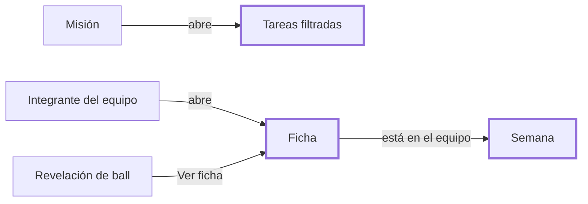

# CHG-024 · Navegación conectada del juego: contadores, filtros, ajustes unificados y enlaces
**Estado:** Cerrado
**Nivel:** M
**Modelo sugerido:** estandar
<!-- Estados y nivel se cambian SOLO con node .claude/team.mjs. Modelo: un perfil de docs/TEAM_MODELS.md -->
**Creado:** 2026-11-09 · **Aprobado:** 2026-11-09 · **Cerrado:** 2026-11-10
**Relacionado:** CHG-019, CHG-020, CHG-021, CHG-022 · sigue: CHG-025 (visual), CHG-026 (misiones contextuales)

## 0. En palabras simples
- Qué vas a ver distinto:
  - Las pestañas de Colección muestran números: "Balls 3", "Colección 12/1025", "Semana 1/3".
  - El menú lateral muestra cuántas balls tienes por abrir.
  - La Colección tiene búsqueda y filtros: descubiertas, por descubrir, mi equipo, tipo y rareza.
  - Todos los ajustes del juego quedan en una sola pestaña, **Ajustes**. Temporada queda solo para ver y revertir.
  - Todo está enlazado:
    - Cada misión te lleva a sus tareas.
    - Cada integrante del equipo abre su ficha.
    - Desde la ficha puedes ir a la Semana si está en el equipo.
    - Desde la revelación de una ball, "Ver ficha" abre la ficha de esa especie.
- Cómo comprobarlo tú:
  - Ten balls sin abrir: el número aparece en la pestaña y en el menú.
  - En Colección, filtra "Por descubrir" y busca por nombre.
  - En Semana, toca una misión de Hogar: abre Tareas filtrada por Hogar.
  - Toca un integrante: se abre su ficha.

## 1. Resumen
Este cambio conecta las pantallas del juego. No cambia las reglas. Primero va la navegación y luego el rediseño visual (CHG-025), que reutiliza esta estructura. Los contadores se calculan con consultas pequeñas e indexadas.



## 2. Producto (product-manager)
- Problema / usuario: Alex no sabe cuánto le falta, no puede filtrar y las pantallas del juego están desconectadas entre sí y de sus tareas.
- Incluye:
  - **Contadores en las pestañas:**
    - Balls: las que tienes por abrir.
    - Colección: descubiertas / total.
    - Semana: misiones cumplidas / total.
    - Temporada: días restantes, si hay una activa.
  - **Contador en el menú lateral:** el de balls por abrir, oculto si es 0.
  - **Filtros de la Colección** en la URL: búsqueda por nombre o número, estado (todas / descubiertas / por descubrir / mi equipo), tipo y rareza. Lleva el contador de resultados y "Limpiar filtros".
  - **Paginación** de la Colección, 60 por página: con 1025 especies hoy carga todo de una vez.
  - **Ajustes unificados** en la pestaña Ajustes, en tres grupos:
    - Juego: activo, fuentes y máximo diario.
    - Director: director activo.
    - Temporadas: juego de temporadas.
  - Temporada queda solo para ver, revertir y consultar el historial.
  - **Enlaces:**
    - Misión de categoría → `/tasks/list?category={clave}`.
    - Misión de hábitos → `/habits`.
    - Misión de variedad → `/tasks/list`.
    - Integrante → ficha (`/game/collection?species={id}`, que abre el modal).
    - Revelación → "Ver ficha".
    - Ficha → "En tu equipo esta semana" con enlace a Semana.
- No incluye: el rediseño visual (CHG-025) ni las misiones contextuales (CHG-026).
- Criterios de aceptación:
  - Con 3 balls sin abrir, las pestañas de Balls y del menú muestran 3; al abrir una, muestran 2 en la siguiente carga.
  - En Colección, con el filtro "Por descubrir" y la búsqueda "12", solo aparecen las no descubiertas cuyo número o nombre coincide; la URL conserva los filtros al recargar.
  - Ajustes contiene los cinco controles; Temporada ya no tiene interruptores.
  - Tocar una misión de categoría abre Tareas filtrada por esa categoría.
  - Abrir `/game/collection?species={id}` muestra la ficha de esa especie.
  - Los contadores de otro usuario nunca se mezclan.

## 3. UX/UI
### 3.1 Experiencia (ux-designer)
- Plantilla: módulo con pestañas; la Colección es una cuadrícula con barra de filtros (patrón `x-ui.filter-bar` / `management-card`).
- Flujo: desde cualquier misión o integrante, 1 clic al destino.
- Estados: la colección filtrada sin resultados muestra `x-ui.state` filtered-empty con "Limpiar filtros"; los contadores en 0 no se muestran.
- Accesibilidad: el contador forma parte del nombre accesible ("Balls, 3 por abrir"); los filtros se usan con teclado; la paginación usa el componente del sistema.

```
[ Balls 3 ] [ Colección 12/1025 ] [ Semana 1/3 ] [ Temporada 18 d ] [ Ajustes ]

Colección
┌──────────────────────────────────────────────────────────┐
│ 🔍 Buscar nombre o número   [Todas|Descubiertas|Por descubrir|Mi equipo] │
│ Tipo ▾   Rareza ▾                       240 resultados · Limpiar │
└──────────────────────────────────────────────────────────┘
 (cuadrícula 60 por página)          ‹ 1 2 3 … ›

Semana · Misiones
● Completa 4 tareas de Hogar   2/4   [Ver tareas →]

Ajustes
 Juego        [■] Juego activo  [■] Tareas  [■] Hábitos  Máximo por día [5]
 Director     [■] Director activo
 Temporadas   [■] Juego de temporadas
```

### 3.2 Visual (ui-designer)
- Componentes: `module-tabs` (con contador opcional), `app-navigation` (con contador opcional), `filter-bar` / `chip` / `select`, `state`, paginación del sistema, `switch`, `section`.
- Contador: badge pequeño con tokens del sistema, igual en pestañas y menú.
- Responsive: los filtros se colapsan en móvil y las pestañas mantienen su desplazamiento horizontal.

### 3.3 Escritura (ux-writer)
- Textos: "Buscar nombre o número"; estados "Todas", "Descubiertas", "Por descubrir", "Mi equipo"; "Tipo", "Rareza", "{n} resultados", "Limpiar filtros", "Ningún resultado con estos filtros"; "Ver tareas", "Ver hábitos", "Ver ficha", "En tu equipo esta semana", "Ver semana"; grupos de Ajustes: "Juego", "Director", "Temporadas"; contador accesible: "{n} por abrir"; Temporada: "{n} d" (visible) y "{n} días restantes" (accesible).
- Reglas: tuteo, etiquetas cortas.
- Criterios: los contadores no generan urgencia ("por abrir", nunca "pendientes" ni "atrasadas").

## 4. Diseño técnico (software-architect)
- Archivos:
  - Componentes compartidos (cambio aditivo y opcional, sin efecto en otros módulos):
    - `resources/views/components/module-tabs.blade.php`: clave opcional `counter` en la pestaña, una clase invocable que devuelve `?string`.
    - `resources/views/components/app-navigation.blade.php`: lo mismo para los ítems del menú.
  - Contadores: `app/Support/Game/TabCounters.php`, con métodos estáticos memorizados por petición para no repetir consultas.
  - Configuración: `config/modules.php` (añade `counter` en las pestañas y el ítem del juego).
  - Pantallas:
    - `app/Livewire/Game/GameCollection.php`: filtros con `#[Url]`, paginación y `species` en la URL para abrir la ficha.
    - `app/Livewire/Game/GameSettingsPage.php`: incorpora director y temporadas.
    - `app/Livewire/Game/GameSeasonView.php`: quita los interruptores.
    - `app/Livewire/Game/GameWeekView.php`: enlaces de misiones e integrantes.
    - `app/Livewire/Game/GameBalls.php`: Ver ficha.
  - Vistas en `resources/views/livewire/game/*` y estilos en `resources/css/m3/modules/_game.css`.
  - Pruebas: `tests/Feature/Game/GameNavigationTest.php` y ajustes a `GameSeasonViewTest`, `GameUiTest` y `GameWeekViewTest`.
- Enfoque: los filtros se aplican en la consulta (`where`/`whereIn` sobre las ids de descubiertas o del equipo), nada se filtra en PHP. Los tipos salen de la columna JSON `types` (`whereJsonContains`). Los contadores usan índices existentes (`user_id`, `opened_at`).
- Riesgos: tocar componentes compartidos. Mitigación: la clave es opcional y la regresión cubre `ModuleExperienceTest`, `SpaNavigationTest` y `UiConformanceTest`.
- Qué NO tocar: las reglas del juego y el módulo de Tareas (solo se enlaza con sus filtros de URL existentes).

## 5. Pruebas (qa-tester)
| Caso | Tipo | Nivel | Test |
|---|---|---|---|
| Contadores en pestañas y menú (balls, colección, semana) | Feature | HTTP | GameNavigationTest |
| Contador oculto en 0 y aislado por usuario | Feature | HTTP | GameNavigationTest |
| Filtros: estado, tipo, rareza, búsqueda, URL y paginación | Feature | Livewire | GameNavigationTest |
| `?species=` abre la ficha | Feature | Livewire | GameNavigationTest |
| Ajustes unificados guardan director y temporadas | Feature | Livewire | GameNavigationTest |
| Enlaces de misión e integrante | Feature | HTTP | GameNavigationTest |
| Otros módulos sin contador no cambian | Feature | HTTP | ModuleExperienceTest (regresión) |
- Comando: `php artisan test tests/Feature/Game tests/Unit/Game`
- Regresión: `php artisan test --filter="UiConformance|SpaNavigation|ModuleExperience"`. Las fallas que ya existían en `/` no cuentan.

## 6. Documentación (tech-writer)
- `docs/game.md`: pantallas, filtros y ajustes unificados.

## 7. Tareas
- [x] T1 · Contadores en las pestañas del juego y en el menú lateral — Resp: developer — Archivos: resources/views/components/module-tabs.blade.php, resources/views/components/app-navigation.blade.php, app/Support/Game/TabCounters.php, config/modules.php, resources/css/m3/modules/_game.css, tests/Feature/Game/GameNavigationTest.php — Hecho cuando: los tests de contadores pasan y la regresión de UI sigue igual
- [x] T2 · Colección con búsqueda, filtros, paginación y ficha por URL — Resp: developer — Archivos: app/Livewire/Game/GameCollection.php, resources/views/livewire/game/game-collection.blade.php, tests/Feature/Game/GameNavigationTest.php — Hecho cuando: los tests de filtros pasan
- [x] T3 · Ajustes unificados y Temporada solo de lectura — Resp: developer — Archivos: app/Livewire/Game/GameSettingsPage.php, app/Livewire/Game/GameSeasonView.php, resources/views/livewire/game/game-settings.blade.php, resources/views/livewire/game/game-season.blade.php, tests/Feature/Game/GameSeasonViewTest.php, tests/Feature/Game/GameNavigationTest.php — Hecho cuando: los tests de ajustes pasan
- [x] T4 · Enlaces entre misiones, tareas, equipo, ficha y revelación — Resp: developer — Archivos: app/Livewire/Game/GameWeekView.php, app/Livewire/Game/GameBalls.php, resources/views/livewire/game, tests/Feature/Game/GameNavigationTest.php — Hecho cuando: los tests de enlaces pasan
- [x] T5 · Verificar criterios de aceptación — Resp: qa-tester — Hecho cuando: todos pasan
- [x] T6 · Actualizar docs/game.md — Resp: tech-writer — Archivos: docs/game.md — Hecho cuando: docs al día

## 8. Bitácora de implementación (developer)
- 2026-11-09 — Inicio con `start --force` (ya había otros CHG En desarrollo; trabajo aprobado por Alex).
- 2026-11-09 — T1: contador opcional en `module-tabs` y `app-navigation`.
  - La clave `counter` (`'Clase@método'`) la resuelve el nuevo `app/Support/Ui/NavCounter.php`, genérico y con una instancia por petición.
  - Los contadores del juego están en `app/Support/Game/TabCounters.php`; el de la semana solo lee y no crea la semana.
  - Usa el badge del sistema (`x-ui.badge`) con su nombre accesible.
  - Los módulos sin `counter` no cambian (probado).
- 2026-11-09 — T2: Colección con `WithManagementCard`.
  - Búsqueda, chips de estado, selects de tipo y rareza, franja de filtros aplicados y paginación de 24, 60 o 120 (60 por defecto).
  - `?species=` abre la ficha.
  - La búsqueda por nombre y los tipos que se ofrecen solo consideran especies descubiertas, para no revelar las ocultas.
  - Se agregó `rarity_labels` a config/game.php.
- 2026-11-09 — T3: los interruptores de director y temporadas pasan a Ajustes, en las secciones Juego, Director y Temporadas. Temporada queda de solo lectura, con un enlace a Ajustes. GameSeasonViewTest ajustado.
- 2026-11-09 — T4: enlaces.
  - Misión de categoría → `/tasks/list?category[]=…` (el filtro de Tareas espera una lista).
  - Misión de hábitos → `/habits`; misión de variedad → `/tasks/list`.
  - Integrante del equipo → ficha; revelación → "Ver ficha".
  - La ficha muestra "En tu equipo esta semana · Ver semana".
- 2026-11-09 — Pruebas:
  - GameNavigationTest: 9 pasan. Total del juego: 101 en verde.
  - Regresión de UI (UiConformance, SpaNavigation, ModuleExperience, CssLayer, AppShell, ProtectedScreen, Habit, TaskViews, UrlState): 118 pasan y 8 fallan. Son las mismas fallas de antes: `/`, comidas, log-viewer, editor de tareas y UrlState.
  - `npm run build` ejecutado.
- 2026-11-09 — T6: docs/game.md actualizado.


- Revisión QA 2026-11-10 sobre HEAD 62351bb865ea8b1233ef8757b59feed2870a8c5e. Alex confirma funcionamiento en producción (aceptación funcional del usuario, no ejecución técnica contra producción). Suite focal PHP: 301/302; el fallo es CHG-027. Regresión adicional: 54/58, cuatro fallos existentes de shell/preview informados aparte. JS 44/44 y form-editor 3/3. Build correcto con aviso de chunk; conformance global falla por CHG-058 y deuda de CHG-054. CHG-059 concurrente excluido; no se alteró código funcional.
- Recorrido sintético juego/guardianes: 37 respuestas HTTP 200, sin errores JavaScript, guardianes visibles y 19 acciones Otro consejo respondieron. Geometría final 33/33 a 390/768/1440 tras estabilizar transiciones. Imágenes sustituidas por figuras sintéticas: no certifica arte externo. Ver logs closure-qa-game-browser-final.jsonl y closure-qa-geometry-final.json en storage/framework/testing.

## 9. Preguntas abiertas, decisiones e historial
- 2026-11-09 — Creado en to-do/ (Borrador, nivel M)
- 2026-11-09 — Decisiones (Alex): contadores en las pestañas, filtros en la colección, ajustes unificados y misiones enlazadas a tareas. El rediseño visual va directo en la app (CHG-025).
- 2026-11-09 — Supuesto: paginación de 60 por página en la Colección (hoy carga 1025 a la vez).
- 2026-11-09 — Aprobado por el usuario (Compuerta 2)
- 2026-11-09 — Movido a in-progress/ (En desarrollo)
- LECCIÓN: ninguna
- 2026-11-09 — Implementación terminada → En verificación
- 2026-11-10 — Cerrado por el usuario (Compuerta 3) → done/
