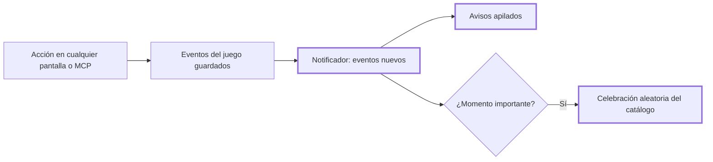

# CHG-034 · Celebraciones aleatorias y avisos de experiencia en toda la app
**Estado:** Cerrado
**Nivel:** M
**Modelo sugerido:** estandar
<!-- Estados y nivel se cambian SOLO con node .claude/team.mjs. Modelo: un perfil de docs/TEAM_MODELS.md -->
**Creado:** 2026-11-09 · **Aprobado:** 2026-11-09 · **Cerrado:** 2026-11-10
**Relacionado:** CHG-023 (aviso de ball, que este cambio corrige y amplía), CHG-021, CHG-027

## 0. En palabras simples
- Qué vas a ver distinto:
  - Cuando el juego te da algo, en cualquier pantalla de MiSo, aparecen **avisos** apilados abajo:
    - "¡Ganaste una ball! · Hábitos de la mañana";
    - "Tu equipo ganó experiencia: Brotelo +9 · Gotin +3";
    - "¡Brotelo subió al nivel 4!".
  - En los momentos importantes sale además una **celebración** elegida al azar de un catálogo: confeti, gatitos que cruzan la pantalla, estrellas fugaces, globos, fuegos artificiales, burbujas, lluvia de balls o pétalos. Son momentos importantes:
    - ganar una ball;
    - que un Pokémon suba de nivel o evolucione;
    - cumplir una misión o una meta.
  - En Ajustes puedes apagar las celebraciones o elegir cuáles salen.
  - El aviso que hoy se ve dañado queda corregido.
- Cómo comprobarlo tú:
  - Completa todos tus hábitos de la mañana: sale una celebración y los avisos con la ball y la experiencia del equipo.
  - Registra progreso en una meta: igual.
  - Activa "reducir movimiento" en tu sistema: solo salen los avisos, sin animación.

## 1. Resumen
Reemplaza el `BallNotifier` (CHG-023) por un notificador del juego, que sigue en el layout y persiste entre pantallas. Ese notificador:

- Lee los eventos nuevos del juego desde el último visto: balls, xp de equipo, niveles, evoluciones, recompensas de misión y metas cumplidas.
- Los muestra como avisos agrupados por actividad.
- Lanza una celebración aleatoria del catálogo en los momentos importantes.

Se entera de los cambios de tres formas:

- **De inmediato**, tras cualquier acción en la app: un hook de Livewire tras cada petición exitosa, que cubre tareas, hábitos, metas, foco, agua y ejercicio sin tocar esos módulos.
- **Al momento**, con los eventos que ya existen.
- **Cada minuto**, consultando, para lo que llega por MCP.

Corrige el aviso dañado: el snackbar quedaba dentro de un contenedor fijo con `transform`, que desplazaba su posición.



## 2. Producto (product-manager)
- Problema / usuario: la experiencia de juego se siente pobre: no hay celebración al completar hábitos, metas y demás, no se ve la experiencia ganada y el aviso actual está roto.
- Incluye:
  - **Avisos** (hasta 3 visibles, 5 s cada uno, se pueden cerrar):
    - ball ganada: "¡Ganaste una ball!" + origen + botón "Abrir";
    - xp de equipo, agrupada por actividad: "Tu equipo ganó experiencia" + integrantes con su +xp, marcando la afinidad;
    - subida de nivel: "¡{nombre} subió al nivel {n}!";
    - evolución: "¡{A} evolucionó a {B}!";
    - recompensa de misión: "Misión: {título} · ¡Ball recibida!" o "¡Misión cumplida!";
    - meta cumplida: "¡Meta cumplida! · {título}".
  - **Catálogo de celebraciones**, todas originales, en CSS/JS ligero y emoji:
    1. Confeti.
    2. Gatitos que cruzan la pantalla 🐈.
    3. Estrellas fugaces.
    4. Globos que suben.
    5. Fuegos artificiales.
    6. Burbujas.
    7. Lluvia de balls.
    8. Pétalos.
    - Se elige al azar entre las habilitadas, sin repetir la anterior. Una sola celebración a la vez, aunque lleguen varios eventos juntos. Dura unos 2,5 s y nunca bloquea clics.
  - **Momentos importantes:** ball ganada, nivel, evolución, misión cumplida y meta cumplida. La xp sola solo genera aviso.
  - **Ajustes:** sección "Celebraciones" con "Mostrar celebraciones" y la lista del catálogo para elegir cuáles salen (todas activas por defecto).
  - **Detección:** inmediata tras cualquier acción en la app; consulta cada 60 s con la pestaña visible (MCP o calendario externo). Al cargar una página no se repite lo ya visto.
  - **Corrección del aviso dañado de CHG-023.**
- No incluye: sonidos ni vibraciones nuevas. La celebración del panel de inicio (confeti de tareas) se mantiene; si coincide con una del juego, solo se muestra la del juego.
- Criterios de aceptación:
  - Completar los hábitos de un momento del día muestra el aviso de la ball, el de experiencia del equipo y una celebración, sin recargar.
  - Registrar progreso en una meta, cumplir la meta de agua o completar una tarea muestra los avisos correspondientes.
  - Con el máximo diario alcanzado, se muestra solo el aviso de experiencia del equipo, sin celebración.
  - Una subida de nivel o evolución muestra su aviso y una celebración.
  - El aviso aparece centrado abajo, entero y legible en móvil y escritorio (corrige el defecto).
  - Con las celebraciones apagadas, solo hay avisos; con algunas desactivadas, nunca salen esas.
  - Con movimiento reducido no hay animaciones, solo avisos.
  - Recargar la página no repite avisos ya mostrados; los eventos de otro usuario nunca aparecen.

## 3. UX/UI
### 3.1 Experiencia (ux-designer)
- Plantilla: no aplica una plantilla de página; es una capa global del layout (como CHG-023).
- Flujo: acción → menos de 1 s → avisos y, si corresponde, la celebración.
- Accesibilidad: avisos en `role="status"` y `aria-live="polite"`; botón de cerrar con nombre; la celebración es `aria-hidden` y `pointer-events: none`.

```
            🐈 ~ ~ ~ gatitos cruzando ~ ~ ~ 🐈            (celebración aleatoria, 2,5 s)

                ╭───────────────────────────────────────────╮
                │ (◓) ¡Ganaste una ball! · Hábitos de la mañana  [Abrir] ✕ │
                ├───────────────────────────────────────────┤
                │ ✦ Tu equipo ganó experiencia                 ✕ │
                │   Brotelo +9 (afinidad) · Gotin +3 · Rocon +3   │
                ├───────────────────────────────────────────┤
                │ ▲ ¡Brotelo subió al nivel 4!                 ✕ │
                ╰───────────────────────────────────────────╯

Ajustes · Celebraciones
[■] Mostrar celebraciones
[■] Confeti  [■] Gatitos  [■] Estrellas fugaces  [■] Globos
[■] Fuegos artificiales  [■] Burbujas  [■] Lluvia de balls  [■] Pétalos
```

### 3.2 Visual (ui-designer)
- Avisos: componente propio `game-toast` (sin anidar `md-snackbar`, que es `position: fixed`), con el aspecto del snackbar del sistema (`inverse-surface` / `inverse-on-surface`, esquinas medianas). Pila fija abajo y centrada sin `transform` en el contenedor; ancho máximo de 38 rem; en móvil, por encima de la barra inferior.
- Celebraciones: capa fija a pantalla completa, `aria-hidden`, `pointer-events: none`, `z-index` sobre el contenido y bajo los diálogos. Solo `transform` y `opacity`; partículas acotadas (40 como máximo).
- Colores: tokens del sistema y variables del juego. Los emoji son caracteres, no imágenes.

### 3.3 Escritura (ux-writer)
- Textos:
  - "¡Ganaste una ball!", "Abrir", "Tu equipo ganó experiencia", "{nombre} +{xp}", "(afinidad)", "¡{nombre} subió al nivel {n}!", "¡{A} evolucionó a {B}!", "Misión: {título}", "¡Ball recibida!", "¡Misión cumplida!", "¡Meta cumplida!", "Cerrar aviso".
  - Ajustes: "Celebraciones", "Mostrar celebraciones" y los nombres del catálogo (Confeti, Gatitos, Estrellas fugaces, Globos, Fuegos artificiales, Burbujas, Lluvia de balls, Pétalos).
- Reglas: tuteo, celebrar sin exagerar ni comparar.

## 4. Diseño técnico (software-architect)
- Archivos:
  - Sustituye a BallNotifier: `app/Livewire/Game/GameNotifier.php` (renombra y amplía) y `resources/views/livewire/game/game-notifier.blade.php`; `resources/views/layouts/app.blade.php` (cambia el componente).
  - `app/Services/Game/GameFeed.php` (nuevo): convierte los eventos con id mayor al último visto en avisos y decide la celebración.
  - `resources/js/game-celebrations.js` (nuevo): catálogo y `celebrate(name)`. Importado en `resources/js/app.js`, que además registra el hook `Livewire.hook('commit')` y lanza `game-check` con un retraso de 400 ms.
  - `resources/css/m3/modules/_game.css`: avisos y celebraciones.
  - `config/game.php`: `celebrations` (claves y etiquetas).
  - Ajustes: `app/Services/Game/GameSettings.php`, `app/Livewire/Game/GameSettingsPage.php` y su vista.
  - Pruebas: `tests/Feature/Game/GameFeedTest.php`; `tests/Feature/Game/BallNotifierTest.php` pasa a `GameNotifierTest.php`.
  - Docs: `docs/game.md`.
- Enfoque:
  - `lastSeenEventId` se inicializa al montar con el máximo actual, así que no se repite lo ya visto.
  - `check()` consulta `GameEvent` del usuario con `id > lastSeen` (hasta 50) y arma los avisos:
    - `activity` con ball → aviso de ball;
    - `xp_gained` con `team=true` → aviso de experiencia, agrupado por `activity_event_id`;
    - `level_up` y `evolved` → aviso propio;
    - `mission_reward` → aviso de misión;
    - `goal-done` → meta cumplida.
  - Si hay un momento importante y las celebraciones están activas, el notificador despacha `game-celebrate` con un nombre aleatorio de las habilitadas, distinto del anterior.
  - El JS respeta `prefers-reduced-motion`.
- Riesgos:
  - Ruido de peticiones: el hook solo actúa tras respuestas exitosas, con retraso y sin sí mismo (se ignora el commit del propio notificador).
  - Rendimiento: animaciones con un máximo de 40 elementos, eliminados al terminar.
- Qué NO tocar: las reglas del juego ni los módulos de origen.

## 5. Pruebas (qa-tester)
| Caso | Tipo | Nivel | Test |
|---|---|---|---|
| Feed: ball, xp de equipo agrupada, nivel, evolución, misión, meta cumplida | Feature | Servicio | GameFeedTest |
| Límite diario: solo aviso de xp, sin celebración | Feature | Servicio | GameFeedTest |
| No repite lo visto al montar; aislamiento por usuario | Feature | Livewire | GameNotifierTest |
| Celebración aleatoria solo entre las habilitadas, distinta de la anterior | Feature | Livewire | GameNotifierTest |
| Celebraciones apagadas: solo avisos | Feature | Livewire | GameNotifierTest |
| Ajustes guardan celebraciones | Feature | Livewire | GameNotifierTest |
| El aviso no se anida en un contenedor con transform | Feature | HTML | GameNotifierTest |
| Catálogo JS respeta movimiento reducido y limpia partículas | JS | Unit | tests/JavaScript (si existe el runner) |
- Comando: `php artisan test tests/Feature/Game`
- Regresión: `php artisan test --filter="UiConformance|CssLayer|AppShell|HomeDashboard"` (las fallas que ya existían no cuentan).

## 6. Documentación (tech-writer)
- `docs/game.md`: avisos, celebraciones, catálogo y cómo agregar una celebración.

## 7. Tareas
- [x] T1 · Feed de eventos del juego convertido en avisos — Resp: developer — Archivos: app/Services/Game/GameFeed.php, tests/Feature/Game/GameFeedTest.php — Hecho cuando: GameFeedTest pasa
- [x] T2 · Notificador global con avisos apilados (corrige el aviso dañado) y detección inmediata — Resp: developer — Archivos: app/Livewire/Game/GameNotifier.php, resources/views/livewire/game/game-notifier.blade.php, resources/views/layouts/app.blade.php, resources/js/app.js, resources/css/m3/modules/_game.css, tests/Feature/Game/GameNotifierTest.php — Hecho cuando: GameNotifierTest pasa
- [x] T3 · Catálogo de celebraciones aleatorias y su ajuste — Resp: developer — Archivos: resources/js/game-celebrations.js, resources/js/app.js, resources/css/m3/modules/_game.css, config/game.php, app/Services/Game/GameSettings.php, app/Livewire/Game/GameSettingsPage.php, resources/views/livewire/game/game-settings.blade.php, tests/Feature/Game/GameNotifierTest.php — Hecho cuando: los tests de celebraciones pasan y el build compila
- [x] T4 · Verificar criterios de aceptación — Resp: qa-tester — Hecho cuando: todos pasan
- [x] T5 · Actualizar docs/game.md — Resp: tech-writer — Archivos: docs/game.md — Hecho cuando: docs al día

## 8. Bitácora de implementación (developer)
- 2026-11-09 — Inicio con `start --force`.
- 2026-11-09 — T1: `GameFeed::since`, que convierte los eventos nuevos en avisos:
  - ball;
  - meta cumplida (ball especial);
  - xp de equipo agrupada por `activity_event_id`, con nombres de las especies actuales y la marca de afinidad;
  - nivel y evolución;
  - misión, una sola vez por etapa aunque la recompensa sean 2 balls.
  - Decide `celebrate`. Solo lee.
- 2026-11-09 — T2: `GameNotifier` reemplaza a `BallNotifier`; se eliminaron su clase y su vista, y la prueba se renombró a GameNotifierTest.
  - Pila `game-toasts` fija sin `transform`, con avisos propios `game-toast` y aspecto de snackbar. Esto **corrige el aviso dañado**: el snackbar fijo estaba dentro de un contenedor con `translateX(-50%)`.
  - Avisos de 5 s, máximo 3, con botón cerrar y "Abrir" hacia Balls.
  - `@persist('game-notifier')` en el layout.
- 2026-11-09 — T3: `resources/js/game-celebrations.js` con 8 celebraciones.
  - Capa decorativa `aria-hidden` sin clics, máximo 40 partículas, solo transform/opacity, se eliminan solas, una a la vez y nada con movimiento reducido.
  - `Livewire.hook('commit')` lanza `game-check` 400 ms después de cada petición exitosa, ignorando al propio notificador.
  - La paleta de tipos también aplica en `.game-celebration`, porque la capa se monta en `<body>`.
  - Config `celebrations`, `celebration_set` y `celebration_catalog`; GameSettings filtra contra el catálogo; Ajustes tiene la sección Celebraciones.
- 2026-11-09 — Pruebas: GameFeedTest (6) y GameNotifierTest (8). Total del juego: 163 en verde con `APP_URL=http://localhost`. La regresión de layout y UI solo tiene las 6 fallas que ya existían. Build OK. T5: docs/game.md actualizado.


- Revisión QA 2026-11-10 sobre HEAD 62351bb865ea8b1233ef8757b59feed2870a8c5e. Alex confirma funcionamiento en producción (aceptación funcional del usuario, no ejecución técnica contra producción). Suite focal PHP: 301/302; el fallo es CHG-027. Regresión adicional: 54/58, cuatro fallos existentes de shell/preview informados aparte. JS 44/44 y form-editor 3/3. Build correcto con aviso de chunk; conformance global falla por CHG-058 y deuda de CHG-054. CHG-059 concurrente excluido; no se alteró código funcional.
- Recorrido sintético juego/guardianes: 37 respuestas HTTP 200, sin errores JavaScript, guardianes visibles y 19 acciones Otro consejo respondieron. Geometría final 33/33 a 390/768/1440 tras estabilizar transiciones. Imágenes sustituidas por figuras sintéticas: no certifica arte externo. Ver logs closure-qa-game-browser-final.jsonl y closure-qa-geometry-final.json en storage/framework/testing.

## 9. Preguntas abiertas, decisiones e historial
- 2026-11-09 — Creado en to-do/ (Borrador, nivel M)
- 2026-11-09 — Pedido de Alex: celebraciones aleatorias de un catálogo (p. ej. gatitos, confeti), aviso de la experiencia ganada y revisar el aviso dañado.
- 2026-11-09 — Diagnóstico: el snackbar (`position: fixed`) estaba dentro de `.game-notifier__wrap`, fijo y con `transform: translateX(-50%)`; un ancestro con transform pasa a ser el bloque contenedor del hijo fijo, así que el aviso salía desplazado y estrecho.
- 2026-11-09 — Aprobado por el usuario (Compuerta 2)
- 2026-11-09 — Movido a in-progress/ (En desarrollo)
- LECCIÓN(developer): no anidar componentes `position: fixed` (como md-snackbar) dentro de un contenedor con `transform`, porque el transform crea un nuevo bloque contenedor y desplaza al hijo fijo — evidencia: aviso de CHG-023 corrido y estrecho · destino sugerido: docs/design-system.md → docs/design-system.md
- 2026-11-09 — Implementación terminada → En verificación
- 2026-11-10 — Cerrado por el usuario (Compuerta 3) → done/
