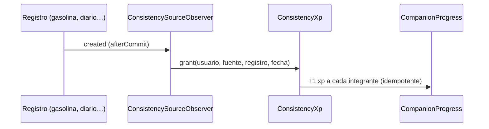

# CHG-042 · Micro-xp por constancia con interruptor por fuente
**Estado:** Cerrado
**Nivel:** M
**Modelo sugerido:** estandar
<!-- Estados y nivel se cambian SOLO con node .claude/team.mjs. Modelo: un perfil de docs/TEAM_MODELS.md -->
**Creado:** 2026-11-09 · **Aprobado:** 2026-11-09 · **Cerrado:** 2026-11-10
**Relacionado:** CHG-027 (fuentes del juego), CHG-038 (avisos)

## 0. En palabras simples
- Qué vas a ver distinto: registrar gasolina, escribir en el diario, anotar tu ánimo, registrar una visita o una compra le da **+1 xp** a cada integrante del equipo de la semana, una vez por día y por tipo de registro. Sale un aviso pequeño de experiencia, sin celebración. En Ajustes aparece un grupo "Constancia" con un interruptor por fuente.
- Cómo comprobarlo tú: registra una tanqueada → aviso "Constancia · Vehículo" con +1 por integrante. Registra otra el mismo día → nada. Apaga "Vehículo" en Ajustes → registrar no suma.

## 1. Resumen
Premiar la constancia de uso de MiSo sin inflar balls: 4 fuentes de "constancia" dan +1 xp de equipo una vez por fuente y día. No generan balls, no avanzan misiones ni variedad, no tienen afinidad ni multiplicador de temporada.

## 2. Producto (product-manager)
- Problema / usuario: el juego solo premia metas; los registros de rutina (vehículo, diario, personas, hogar) no se reconocen y no motivan a mantener MiSo al día. Usuario: Alex.
- Incluye: fuentes `vehicle` (gasolina/energía, gastos, mantenimiento), `wellbeing` (diario, ánimo, energía), `people` (eventos de relación, visitas a planes), `home` (preparaciones, consumo de comidas, compras). Interruptor por fuente, encendido por defecto. Aviso discreto.
- No incluye: balls, misiones, variedad, ámbitos nuevos para el director, afinidad, bono de temporada, lectura del contenido de los registros.
- Criterios de aceptación (Dado/Cuando/Entonces):
  1. Dado un equipo de la semana y la fuente activa, cuando hago el primer registro del día de esa fuente, entonces cada integrante gana +1 xp.
  2. Dado que ya sumé hoy en una fuente, cuando registro otra vez, entonces no se suma nada (clave `micro:{fuente}:{fecha}`).
  3. Dada la fuente o el juego apagados, cuando registro, entonces no se crea ningún evento.
  4. Cuando sumo por constancia, entonces no se crea ball, no avanza ninguna misión y no consume el máximo diario.
  5. Funciona igual desde la app y desde el MCP.
  6. Borrar el registro no resta nada.
  7. Sin equipo de la semana, no pasa nada y no hay error.

## 3. UX/UI
### 3.1 Experiencia (ux-designer)
- Flujo y cantidad de pasos: ninguno nuevo; el usuario registra como siempre. En Ajustes, 1 clic por interruptor.
- Qué contiene cada pantalla: Colección → Ajustes suma la sección "Constancia" debajo de "Juego".
- Estados: éxito = aviso de experiencia agrupado; sin equipo o fuente apagada = silencio (no es un error).
- Información necesaria: la línea de ayuda explica la regla una vez por día y por tipo.
- Accesibilidad: interruptores `x-ui.switch` con etiqueta; el aviso mantiene pausa con foco (CHG-038).

```
┌ Constancia ─────────────────────────────────────┐
│ Tu equipo gana +1 xp la primera vez que         │
│ registras algo de cada tipo en el día.          │
│ [●] Vehículo (gasolina, gastos, mantenimiento)  │
│ [●] Bienestar (diario, ánimo, energía)          │
│ [●] Personas (relaciones, visitas a planes)     │
│ [●] Hogar (comidas y compras)                   │
└─────────────────────────────────────────────────┘

Aviso:  ┌ ✦ EXPERIENCIA ──────────────────┐
        │ Constancia · Vehículo           │
        │ Gotin +1 · Pibi +1 · Lumo +1 …  │
        └─────────────────────────────────┘
```

### 3.2 Visual (ui-designer)
- Distribución: igual que las demás secciones de Ajustes.
- Componentes existentes: `md-card-elevated`, `x-ui.switch` (resources/views/livewire/game/game-settings.blade.php); tarjeta de experiencia de `game-notifier`.
- Jerarquía: título `md-title-medium`; ayuda `md-body-small` en color de texto secundario. Sin CSS nuevo.
- Responsive y contraste: los existentes.

### 3.3 Escritura (ux-writer)
- Ubicación y estado: Ajustes → sección nueva; aviso e historial de la ficha.
- Textos finales: título "Constancia"; ayuda "Tu equipo gana +1 xp la primera vez que registras algo de cada tipo en el día."; interruptores "Vehículo (gasolina, gastos, mantenimiento)", "Bienestar (diario, ánimo, energía)", "Personas (relaciones, visitas a planes)", "Hogar (comidas y compras)"; origen en aviso e historial "Constancia · {Fuente}".
- Reglas aplicadas: tuteo, sin culpa ni obligación (mismo criterio que misiones).
- Criterios de aceptación de los textos: aparecen literalmente así.

## 4. Diseño técnico (software-architect)

- Archivos a crear / modificar:
  - `config/game.php`: `consistency_xp => 1`; `consistency_sources => ['vehicle' => 'Vehículo', 'wellbeing' => 'Bienestar', 'people' => 'Personas', 'home' => 'Hogar']`; `defaults.sources` suma las 4 claves en `true`.
  - `app/Services/Game/ConsistencyXp.php` (nuevo).
  - `app/Observers/Game/ConsistencySourceObserver.php` (nuevo), registrado en `app/Providers/AppServiceProvider.php` junto a los demás observers del juego.
  - `app/Services/Game/GameSettings.php`, `app/Livewire/Game/GameSettingsPage.php`, `resources/views/livewire/game/game-settings.blade.php`.
  - `app/Services/Game/GameFeed.php`, `app/Livewire/Game/GameNotifier.php` (sin celebración para constancia).
- Enfoque:
  - `ConsistencyXp::grant(int $userId, string $source, Model $model, CarbonInterface $at)`: sale si el juego o la fuente están apagados (`GameSettings::for`); en transacción, `GameEvent::firstOrCreate` `kind = activity`, clave `micro:{source}:{fecha}`, `effect.consistency = true`, etiqueta "Constancia · {Fuente}"; si no es nuevo, termina. Para cada `GameTeamMember` de `WeekPlanner::forWeek`, `KIND_XP_GAINED` con clave `team:{evento}:{ejemplar}`, `effect.team = true`, `effect.consistency = true`, y `CompanionProgress::addXp` (mismo patrón que `ActivityEffects::teamXp`).
  - No llama `ActivityEffects::apply` ni `RewardGranter` (sin misiones, afinidad, multiplicador, ball ni límite diario).
  - Observer, solo `created` con `DB::afterCommit`, mapa modelo → fuente: vehicle = `VehicleEnergyLog`, `VehicleExpense`, `VehicleMaintenanceLog`; wellbeing = `JournalEntry`, `MoodEntry`, `EnergyEntry`; people = `RelationshipEvent`, `PlanVisit`; home = `MealPreparation`, `PreparedMeal`, `Purchase`. Fecha: campo de fecha propio del registro si existe; si no, `created_at` en America/Bogota. El developer confirma campo de fecha y `user_id` de cada modelo.
- Riesgos y mitigación: registros en lote por MCP → la clave diaria lo absorbe; modelos sin `user_id` directo → resolver por su relación o excluirlos y anotarlo en §8.
- Qué NO tocar: `RewardGranter`, `ActivityEffects`, misiones, director, temporadas.

## 5. Pruebas (qa-tester)
| Caso | Tipo | Nivel | Test |
|---|---|---|---|
| Primer registro → +1 xp por integrante | Feature | Alto | tests/Feature/Game/ConsistencyXpTest.php |
| Segundo registro mismo día → sin cambios; otro día → suma | Feature | Alto | ConsistencyXpTest |
| Fuente apagada / juego apagado → sin eventos | Feature | Alto | ConsistencyXpTest |
| Sin equipo → sin error ni xp | Feature | Medio | ConsistencyXpTest |
| No crea ball ni contribución de misión | Feature | Alto | ConsistencyXpTest |
| Un modelo real por fuente dispara la constancia | Feature | Alto | ConsistencyXpTest |
| Ajustes guarda los 4 interruptores | Feature | Medio | tests/Feature/Game/GameSettingsPageTest.php |
| Aviso de constancia sin celebración | Feature | Medio | tests/Feature/Game/GameNotifierTest.php |
- Comando para verificar: `php artisan test tests/Feature/Game tests/Unit/Game`
- Regresión a vigilar: xp de equipo por tareas/hábitos, límite diario de balls, avance de misiones.

## 6. Documentación (tech-writer)
- Docs a actualizar: `docs/game.md` → subsección "Constancia (micro-xp)" con tabla fuente/modelos/clave, más Ajustes y Configuración.

## 7. Tareas
- [x] T1 · El equipo gana +1 xp por el primer registro del día de cada fuente — Resp: developer — Archivos: config/game.php, app/Services/Game/ConsistencyXp.php, app/Services/Game/GameSettings.php, tests/Feature/Game/ConsistencyXpTest.php — Hecho cuando: los casos de idempotencia, apagado, sin equipo y sin ball pasan
- [x] T2 · Gasolina, diario, ánimo, relaciones, visitas, comidas y compras disparan la constancia (app y MCP) — Resp: developer — Archivos: app/Observers/Game/ConsistencySourceObserver.php, app/Providers/AppServiceProvider.php, tests/Feature/Game/ConsistencyXpTest.php — Hecho cuando: hay un test verde por fuente creando el registro real
- [x] T3 · Ajustes → Constancia con un interruptor por fuente y aviso discreto sin celebración — Resp: developer — Archivos: app/Livewire/Game/GameSettingsPage.php, resources/views/livewire/game/game-settings.blade.php, app/Services/Game/GameFeed.php, app/Livewire/Game/GameNotifier.php, tests/Feature/Game/GameSettingsPageTest.php, tests/Feature/Game/GameNotifierTest.php — Hecho cuando: los interruptores guardan y el aviso no lanza celebración
- [x] T4 · Verificar criterios de aceptación — Resp: qa-tester — Hecho cuando: los 7 criterios pasan y la suite Game está en verde
- [x] T5 · Actualizar documentación — Resp: tech-writer — Archivos: docs/game.md — Hecho cuando: docs al día

## 8. Bitácora de implementación (developer)
- 2026-11-10 — Inicio (start --force, mismo motivo que CHG-041).
- T1 — `config/game.php` (`consistency_xp`, `consistency_sources`, 4 fuentes en defaults), `ConsistencyXp` (actividad `micro:{fuente}:{fecha}` + `team:{evento}:{ejemplar}`, sin ActivityEffects ni RewardGranter).
- T2 — `ConsistencySourceObserver` (11 modelos, solo `created`, afterCommit) registrado en AppServiceProvider. Se agregaron alias al `enforceMorphMap` para los 8 modelos que no tenían (necesario para `source_type`).
- T3 — Ajustes → sección "Constancia" (propiedad `consistency[fuente]`); `GameFeed` antepone "Constancia · {Fuente}" al detalle del aviso. `GameNotifier` no necesitó cambios: la xp de equipo nunca celebra por sí sola.
- T5 — docs/game.md: subsección "Constancia (micro-xp)".
- Tests: tests/Feature/Game/ConsistencyXpTest.php → 9 pasan. Suite Game 184/185 (falla previa ajena). Suite completa: las demás fallas (Relationship/Plan/GuidedReflection/UrlState/Ui de hábitos…) se reproducen igual sin el observer: previas y ajenas al cambio.


- Revisión QA 2026-11-10 sobre HEAD 62351bb865ea8b1233ef8757b59feed2870a8c5e. Alex confirma funcionamiento en producción (aceptación funcional del usuario, no ejecución técnica contra producción). Suite focal PHP: 301/302; el fallo es CHG-027. Regresión adicional: 54/58, cuatro fallos existentes de shell/preview informados aparte. JS 44/44 y form-editor 3/3. Build correcto con aviso de chunk; conformance global falla por CHG-058 y deuda de CHG-054. CHG-059 concurrente excluido; no se alteró código funcional.
- Recorrido sintético juego/guardianes: 37 respuestas HTTP 200, sin errores JavaScript, guardianes visibles y 19 acciones Otro consejo respondieron. Geometría final 33/33 a 390/768/1440 tras estabilizar transiciones. Imágenes sustituidas por figuras sintéticas: no certifica arte externo. Ver logs closure-qa-game-browser-final.jsonl y closure-qa-geometry-final.json en storage/framework/testing.

## 9. Preguntas abiertas, decisiones e historial
- 2026-11-10 — Decisión de implementación: la "fecha" de la clave es el día en que se registra (no la fecha del registro), para que cargar días pasados no multiplique la xp. Coherente con "una vez por fuente y día"; revisable en QA.
- LECCIÓN(developer): un modelo nuevo como origen de `GameEvent` necesita alias en `Relation::enforceMorphMap` — falló con "No morph map defined" · destino sugerido: docs/game.md (Datos) → descartada: no relevante
- 2026-11-09 — Creado en to-do/ (Borrador, nivel M)
- 2026-11-09 — Decisiones (Alex): +1 xp a todo el equipo, una vez por fuente y día; 4 fuentes (Vehículo, Bienestar, Personas, Hogar); aviso discreto sin celebración; no cuenta para misiones ni variedad; interruptor por fuente.
- 2026-11-09 — Aprobado por el usuario (Compuerta 2)
- 2026-11-10 — Movido a in-progress/ (En desarrollo)
- 2026-11-10 — Implementación terminada → En verificación
- 2026-11-10 — Cerrado por el usuario (Compuerta 3) → done/
