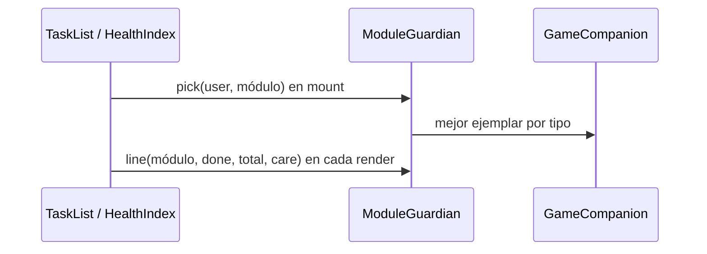

# CHG-055 · Guardianes de módulo en el panel lateral
**Estado:** Cerrado
**Nivel:** M
**Modelo sugerido:** estandar
<!-- Estados y nivel se cambian SOLO con node .claude/team.mjs. Modelo: un perfil de docs/TEAM_MODELS.md -->
**Creado:** 2026-11-10 · **Aprobado:** 2026-11-10 · **Cerrado:** 2026-11-10
**Relacionado:** CHG-043 (integrante del día), CHG-049 (reacciones del compañero)

## 0. En palabras simples
- Qué vas a ver distinto: en Tareas y en Salud, uno de tus Pokémon "cuida" el módulo. Asoma en la esquina de la tarjeta **Hoy** (Tareas) y de **Próximo cuidado** (Salud) con una frase corta que cambia según cómo vas: te saluda, te anima o celebra. Cada módulo tiene su guardián según el tipo (Tareas: Psíquico/Acero; Salud: Hada/Normal) y siempre es el mismo mientras no cambie tu colección.
- Cómo comprobarlo tú: abre Tareas → ves al guardián y una frase según tus completadas de hoy; completa una tarea → la frase puede cambiar. Abre Salud con un evento en seguimiento → te dice que te recuperes con calma; sin eventos → reacciona a tus pendientes de salud. Toca al guardián → se abre su ficha. Apaga el juego → desaparece.

## 1. Resumen
Componente reutilizable `x-game.module-guardian` que muestra, dentro de una tarjeta existente del panel derecho, al ejemplar del usuario con mejor afinidad de tipo para ese módulo, con una frase según su avance. Se entrega en Tareas (tarjeta Hoy) y Salud (tarjeta Próximo cuidado); los demás módulos quedan para cambios posteriores con el mismo componente.

## 2. Producto (product-manager)
- Problema / usuario: la colección solo se ve en `/game`, el panel de pared y el dashboard. Alex quiere a sus Pokémon integrados en los módulos de uso diario, con un papel claro y bonito, sin agregar más cajas.
- Incluye: guardián por módulo (Tareas, Salud) elegido por tipo; reacción a los datos del módulo; frases por módulo y estado; enlace a la ficha; oculto con el juego apagado o sin ejemplares.
- No incluye: elegir el guardián a mano; otros módulos (Hidratación, Ejercicio, Comidas, Hábitos, Pomodoro); XP o recompensas nuevas; frases del director para guardianes.
- Criterios de aceptación (Dado/Cuando/Entonces):
  1. Dado que tengo un ejemplar de tipo Psíquico o Acero, cuando abro Tareas, entonces el guardián es mi ejemplar de mayor nivel de esos tipos (empate: el más antiguo).
  2. Dado que no tengo ejemplares de los tipos del módulo, entonces el guardián es mi ejemplar de mayor nivel.
  3. En Tareas la frase depende de completadas/planificadas hoy: 0 planificadas → libre; ≥70 % → celebra; ≥30 % → contento; antes de las 15:00 → saluda; si no → anima.
  4. En Salud, si hay un evento en seguimiento (tipo de evolución sin fecha de fin), la frase es de cuidado; si no, reacciona a los pendientes de salud (completados en 7 días / completados + pendientes) con las mismas reglas del criterio 3.
  5. Al completar o reabrir una tarea en Tareas, la frase se actualiza sin recargar; el ejemplar no cambia.
  6. Sin ejemplares o con el juego apagado, no se muestra nada y las tarjetas quedan como hoy.
  7. Tocar al guardián abre `/game?species={id}`.

## 3. UX/UI
### 3.1 Experiencia (ux-designer)
- Plantilla: lista + panel lateral existente (no cambia la página; solo decora una tarjeta).
- Flujo y cantidad de pasos: 0 pasos para verlo; 1 clic para abrir la ficha.
- Qué contiene cada pantalla y qué es lo más importante: arte del Pokémon asomando en la esquina superior derecha de la tarjeta y un globo con la frase bajo el encabezado. Lo más importante sigue siendo el dato de la tarjeta; el guardián acompaña.
- Estados (vacío / carga / error / éxito / validaciones): con guardián; sin ejemplares u oculto por juego apagado (la tarjeta se ve igual que hoy). Sin carga visible: se resuelve en el render.
- Información necesaria y momento de presentación: ninguna adicional.
- Accesibilidad de uso (teclado, foco, errores): el arte es un enlace con `aria-label="Ver ficha de {nombre}"`; la frase es texto real con `aria-live="polite"` (cambia al completar). Foco visible en el enlace.

Versión final — franja de escenario al inicio de la tarjeta (Tareas: Hoy; Salud: Próximo cuidado):
```
┌─ ⚡ Hoy ───────────────────────┐
│░ (◕‿◕)  Ralts · Nv 4          ░│  ← degradado del escenario de su tipo
│░  ╱▔▔╲ ◂ "Hoy empezamos       ░│
│░          juntos."            ░│
│ 0  de 2 planificadas hoy       │
│ Progreso ░░░░░░░░░░░░░░        │
└────────────────────────────────┘
```
Menos de 1200 px (el panel baja debajo de la lista): la misma franja aparece arriba de la lista y se oculta la del panel.
```
┌ Tareas · (190) ───────────┐
│░ (◕‿◕) Ralts · Nv 4      ░│
│░        "Hoy empezamos…" ░│
├───────────────────────────┤
│ SGX-00165 Hablemos de…    │
```
Versión inicial (descartada: escondida en la esquina y oculta en móvil): arte de 72 px recortado en la esquina superior derecha.

### 3.2 Visual (ui-designer)
- Distribución: franja de borde a borde al inicio del cuerpo de la tarjeta; arte completo de 96 px (72 px < 768 px) a la izquierda con sombra en el piso; a la derecha "{Nombre} · Nv {n}" y globo con colita hacia el arte. < 1200 px: franja arriba de la lista (`game-guardian--top`) y oculta en el panel (`game-guardian--rail`).
- Componentes existentes a reutilizar (ruta): `x-panel`, `.health-card`, `SpeciesImageProvider`, escenarios `game-stage--{familia}` y `DailyBuddy::stageFamily` (resources/css/m3/modules/_game.css).
- Jerarquía, color, tipografía y espaciado (tokens): fondo degradado `--stage-top/--stage-bottom`; nombre blanco con sombra de texto; globo `--md-sys-color-surface-container-lowest` con texto `--md-sys-color-on-surface`; respiración solo con `prefers-reduced-motion: no-preference`.
- Responsive y contraste: nunca se oculta; texto del globo sobre superficie clara (AA); nombre blanco sobre escenarios oscuros.

### 3.3 Escritura (ux-writer)
- Ubicación y estado: globo del guardián en Tareas (Hoy) y Salud (Próximo cuidado).
- Textos finales (config `game.guardian_lines`):
  - tasks: free "Día libre, disfrútalo."; greet "Hoy empezamos juntos."; cheer "Un pasito y ya cuenta."; happy "Buen ritmo, sigue así."; celebrate "¡Vas volando hoy!"
  - health: care "Recupérate con calma, aquí estoy."; free "Todo en orden, cuídate."; greet "Hoy también te cuidamos."; cheer "Un cuidado a la vez."; happy "Te estás cuidando bien."; celebrate "¡Pendientes de salud al día!"
  - aria-label del enlace: "Ver ficha de {nombre}".
- Reglas de docs/UX-WRITING.md aplicadas: tuteo, cálido, sin culpa; ≤ 60 caracteres; sin palabras prohibidas de `MissionProposalValidator::penaltyWord`.
- Criterios de aceptación de los textos: todas las frases pasan `penaltyWord` y miden ≤ 60 caracteres (test).

## 4. Diseño técnico (software-architect)

- Archivos a crear / modificar:
  - `config/game.php`: `module_guardians` (`tasks` => ['psiquico','acero'], `health` => ['hada','normal']) y `guardian_lines`.
  - `app/Services/Game/ModuleGuardian.php` (nuevo): `pick(int $userId, string $module): ?array` (null si juego apagado o sin ejemplares; compara tipos con `Str::slug`; orden nivel desc, created_at asc; devuelve species_id, name, level, image, type_class) y `line(string $module, int $done, int $total, bool $care, CarbonInterface $now): string`, que reusa `DailyBuddy::mood` para la clave y toma el texto de `guardian_lines`.
  - `resources/views/components/game/module-guardian.blade.php` (nuevo): props `guardian`, `line`.
  - `app/Livewire/Task/TaskList.php` + `resources/views/livewire/task/task-list.blade.php`: propiedad pública `$guardian` en `mount()`; línea calculada en `render()` con `completedToday`/`plannedToday`.
  - `app/Livewire/Health/HealthIndex.php` + `resources/views/livewire/health/health-index.blade.php`: igual; `care` = existe `HealthEvent` del usuario con tipo en `EVOLUTION_TYPES` y `end_date` nula; done/total con conteos de tareas de salud (completadas en 7 días vs. esas + pendientes).
  - `resources/css/m3/modules/_game.css`: estilos `.game-guardian*`.
- Enfoque y patrones a seguir: mismo patrón que `DailyBuddy` (cálculo en mount guardado en propiedad pública para que no cambie con re-renders).
- Riesgos y mitigación: consultas extra mínimas (1 de ejemplar en mount; 2 conteos en Salud). Tipos con tilde → normalizar con `Str::slug`.
- Qué NO tocar: lógica de recompensas, `DailyBuddy::pick`, panel de pared y dashboard.

## 5. Pruebas (qa-tester)
| Caso | Tipo | Nivel | Test |
|---|---|---|---|
| Elige por tipo, desempate y fallback; null sin ejemplares / juego apagado | Feature | Alto | tests/Feature/Game/ModuleGuardianTest.php |
| Frase por umbrales y estado de cuidado | Feature | Alto | ModuleGuardianTest |
| Frases ≤ 60 y sin palabras prohibidas | Feature | Bajo | ModuleGuardianTest |
| Tareas y Salud muestran el guardián; se oculta con juego apagado | Feature | Alto | ModuleGuardianTest |
| Completar tarea actualiza la frase sin cambiar ejemplar | Feature | Medio | ModuleGuardianTest |
- Comando para verificar: `php artisan test tests/Feature/Game/ModuleGuardianTest.php tests/Feature/Game/DailyBuddyTest.php`
- Regresión a vigilar: lista de Tareas y página de Salud (tests existentes de Task y Health).

## 6. Documentación (tech-writer)
- Docs a actualizar: `docs/game.md` → sección "Guardianes de módulo" (asignación por tipo, reacciones, cómo agregar otro módulo).

## 7. Tareas
- [x] T1 · El juego sabe qué Pokémon cuida cada módulo y qué frase decir — Resp: developer — Archivos: config/game.php, app/Services/Game/ModuleGuardian.php, tests/Feature/Game/ModuleGuardianTest.php — Hecho cuando: criterios 1-4 y 6 pasan en tests del servicio y las frases validan
- [x] T2 · El guardián aparece en la tarjeta Hoy de Tareas y su frase sigue el avance — Resp: developer — Archivos: resources/views/components/game/module-guardian.blade.php, resources/css/m3/modules/_game.css, app/Livewire/Task/TaskList.php, resources/views/livewire/task/task-list.blade.php, tests/Feature/Game/ModuleGuardianTest.php — Hecho cuando: criterios 3, 5, 6 y 7 pasan y el build compila
- [x] T3 · El guardián aparece en Próximo cuidado de Salud y reacciona a eventos y pendientes — Resp: developer — Archivos: app/Livewire/Health/HealthIndex.php, resources/views/livewire/health/health-index.blade.php, tests/Feature/Game/ModuleGuardianTest.php — Hecho cuando: el criterio 4 pasa en la página
- [x] T4 · Verificar criterios de aceptación — Resp: qa-tester — Hecho cuando: los 7 criterios pasan y las suites están en verde
- [x] T5 · Actualizar documentación — Resp: tech-writer — Archivos: docs/game.md — Hecho cuando: docs al día

## 8. Bitácora de implementación (developer)
- 2026-11-10 — Inicio (start --force: había otros CHG En desarrollo).
- T1 — `config/game.php` (`module_guardians`, `guardian_lines`) y `ModuleGuardian` (`pick` por afinidad con `Str::slug`, nivel desc / created_at asc, fallback; `line` reusa `DailyBuddy::mood`, `care` con prioridad).
- T2 — `x-game.module-guardian` + estilos `.game-guardian*`/`.has-guardian` (arte 72 px recortado en la esquina, globo con color de tipo, respiración con reduced-motion, sin arte < 768 px). TaskList: `$guardian` en `mount()`, frase en `render()` con completadas/planificadas hoy. Build OK.
- T3 — HealthIndex: `$guardian` en `mount()`; `guardianLine()` con evento en seguimiento o pendientes de salud (7 días); guardián dentro de "Próximo cuidado".
- T5 — docs/game.md: sección "Guardianes de módulo".
- 2026-11-10 — Reabierto: franja de escenario. `pick()` agrega `stage`; componente con arte completo, nombre · Nv y globo; CSS `.game-guardian*` reescrito (sin recorte ni ocultamiento móvil); < 1200 px se muestra arriba de la lista (`--top`) y se oculta en el panel (`--rail`), porque ahí el panel baja al final de la lista. Tests ModuleGuardian+DailyBuddy 23/23; HealthModule y TaskViews solo con sus fallas previas. Build OK.
- Tests: ModuleGuardianTest 9/9; DailyBuddyTest en verde. Game + Task* + Health: 383/387; las 4 fallas existen igual sin este cambio (NewSources, HealthModule pendientes, TaskBulkEditor, TaskViews).

## 9. Preguntas abiertas, decisiones e historial
- 2026-11-10 — Verificado por Alex en el navegador (franja de escenario OK); cierre pedido por él. Lo contextual pasa a CHG-056.
- 2026-11-10 — Reabierto (Alex): el arte en la esquina queda escondido y en móvil no aparece. Decisión: franja de escenario con arte completo; en móvil igual, más compacta; y < 1200 px arriba de la lista porque el panel baja al final.
- LECCIÓN(developer): antes de decidir dónde vive un elemento del panel lateral, comprobar cómo se reacomoda el panel en < 1200 px (baja debajo de la lista completa) — evidencia: el guardián "no cargaba" en móvil por estar al final de 190 tareas · destino sugerido: docs/UI-DESIGN.md (responsive del panel lateral). → docs/UI-DESIGN.md
- 2026-11-10 — Decisiones (Alex): rol "guardián del módulo" por afinidad de tipo; integrado asomando en una tarjeta existente; Tareas en "Hoy"; Salud en "Próximo cuidado"; Salud reacciona a eventos en seguimiento y, si no hay, a pendientes de salud.
- 2026-11-10 — Creado en to-do/ (Borrador, nivel M)
- 2026-11-10 — Aprobado por el usuario (Compuerta 2)
- 2026-11-10 — Movido a in-progress/ (En desarrollo)
- 2026-11-10 — Implementación terminada → En verificación
- 2026-11-10 — Reabierto: Guardián escondido en la esquina y oculto en móvil; pasa a franja de escenario
- 2026-11-10 — Implementación terminada → En verificación
- 2026-11-10 — Cerrado por el usuario (Compuerta 3) → done/
