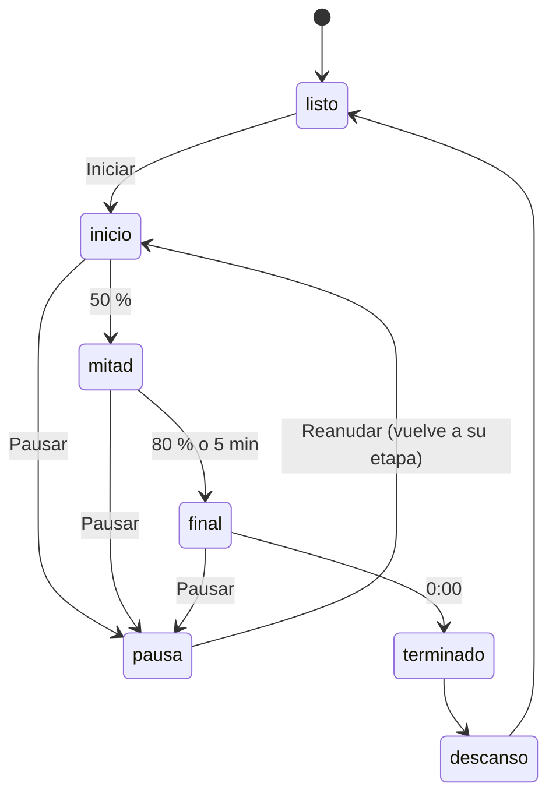

# CHG-059 · Guardián que acompaña la sesión de foco
**Estado:** Cerrado
**Nivel:** M
**Modelo sugerido:** estandar
<!-- Estados y nivel se cambian SOLO con node .claude/team.mjs. Modelo: un perfil de docs/TEAM_MODELS.md -->
**Creado:** 2026-11-10 · **Aprobado:** 2026-11-10 · **Cerrado:** 2026-11-10
**Relacionado:** CHG-046 (modo rutina inmersivo), CHG-057/058 (guardián con consejos en Pomodoro)

## 0. En palabras simples
- Qué vas a ver distinto: mientras corre el temporizador de foco (en la página Pomodoro y en la pantalla completa "Foco de hoy"), aparece junto al reloj el guardián de Pomodoro, pequeño y quieto, con una frase corta que cambia según la etapa de la sesión: al iniciar, a mitad, en el tramo final, al terminar y en la pausa. No se mueve ni suena mientras trabajas; solo cambia de frase unas pocas veces por sesión.
- Cómo comprobarlo tú: inicia un foco de 25 min → el guardián dice algo de arranque; pasada la mitad cambia la frase; en los últimos 5 min, otra; al terminar celebra (un pequeño salto) y en la pausa te invita a estirarte. Si pausas, dice que te espera. Puedes ocultarlo con un botón.

## 1. Resumen
Se agrega un "compañero de foco" al dial del temporizador (página Pomodoro) y al diálogo de pantalla completa "Foco de hoy" (panel y tareas). Usa el mismo ejemplar que el guardián de Pomodoro (afinidad eléctrico/psíquico, CHG-058) y muestra frases por etapa calculadas en el navegador a partir del progreso que ya lleva el temporizador (sin consultas durante la sesión). Diseño de baja distracción: imagen estática, cambios de frase solo en 5–6 momentos, sin sonido, y se puede ocultar.

## 2. Producto (product-manager)
- Problema / usuario: Alex quiere que la gamificación esté presente mientras se concentra, de forma interactiva (que reaccione al avance), sin romper el foco.
- Incluye: compañero en el dial de la página Pomodoro y en el diálogo "Foco de hoy"; frases por etapa (listo, inicio, mitad, tramo final, en pausa, terminado, descanso); un salto breve solo al terminar; botón para ocultarlo (se recuerda en el navegador).
- No incluye: XP o recompensas nuevas (la XP del foco ya existe, CHG-027/042); los consejos con datos del guardián del panel lateral (siguen igual); sonidos; animaciones continuas.
- Criterios de aceptación (Dado/Cuando/Entonces):
  1. Dado juego activo y al menos un ejemplar, cuando abro Pomodoro o "Foco de hoy", entonces veo junto al reloj al mismo ejemplar que el guardián de Pomodoro, con su nombre como texto alternativo.
  2. Dado el temporizador sin empezar, entonces la frase es la de "listo".
  3. Dado un ciclo de trabajo corriendo, la frase cambia solo al cruzar las etapas inicio (0–49 %), mitad (50–79 %) y tramo final (≥ 80 % o últimos 5 min); no cambia en otros momentos.
  4. Al pausar muestra "en pausa"; al reanudar vuelve a la frase de su etapa.
  5. Al completar el ciclo de trabajo muestra "terminado" con un único salto (≤ 1 s); con `prefers-reduced-motion` no hay salto.
  6. En descanso corto/largo muestra la frase de descanso.
  7. "Ocultar compañero" lo quita y queda oculto en ese navegador hasta "Mostrar compañero".
  8. Con el juego apagado o sin ejemplares no aparece nada y el temporizador se ve como hoy.
  9. Las frases se anuncian a lectores de pantalla (`aria-live="polite"`) solo cuando cambian, no cada segundo.

## 3. UX/UI
### 3.1 Experiencia (ux-designer)
- Flujo y cantidad de pasos: 0 pasos; 1 clic para ocultar/mostrar.
- Qué contiene cada pantalla y qué es lo más importante: el reloj sigue siendo lo principal; el compañero es secundario, al lado del dial (escritorio) o debajo (móvil).
- Estados (vacío / carga / error / éxito / validaciones): listo / corriendo por etapa / en pausa / terminado / descanso / oculto / sin juego (nada).
- Información necesaria y momento de presentación: ninguna; la frase llega sola en cada cambio de etapa.
- Accesibilidad de uso (teclado, foco, errores): botón ocultar accesible con teclado y etiqueta; región `aria-live="polite"`; respeta movimiento reducido.

Página Pomodoro (dentro de la tarjeta del temporizador):
```
┌────────────────────────────────────────────────┐
│ [Trabajo] [Descanso corto] [Descanso largo]    │
│                                                │
│     ╭─────────╮        ┌─────────────────────┐ │
│     │  12:31  │  (pk) ◂│ "Ya vas por la      │ │
│     │ Trabajo │        │  mitad; sigue a tu  │ │
│     ╰─────────╯        │  ritmo."            │ │
│                        └─────────────────────┘ │
│                   Pikachu · Nv 8   [ocultar]   │
│           [ ▶ Pausar ]  [↺]                    │
└────────────────────────────────────────────────┘
```
Diálogo "Foco de hoy" (pantalla completa):
```
┌─ Foco de hoy ──────────────────────────────────┐
│                    04:58                       │
│              Tiempo de enfoque                 │
│   (pk) "Último tramo. Cierra con calma."       │
│        Pikachu · Nv 8              [ocultar]   │
│   [Trabajo] [Pausa corta] [Pausa larga]        │
│   [Pausar] [Finalizar y guardar] [Reiniciar]   │
└────────────────────────────────────────────────┘
```


### 3.2 Visual (ui-designer)
- Distribución (rediseño tras la revisión de Alex: integrado al contador, sin tarjeta): "Foco de hoy": bajo el reloj, una barra del ciclo; el Pokémon (96 px; 72 px en móvil) camina sobre ella en el punto del avance y el globo (superficie del tema) lo sigue arriba, acotado a los bordes; nombre/nivel y ocultar al final de la barra. Con tarea, todo queda en la columna izquierda. Pomodoro: el Pokémon (64 px) se posa sobre el anillo del dial en el punto del avance y el globo va bajo el dial. — Versión anterior (descartada): el compañero es un "escenario" con el fondo de su tipo (`game-stage--*`, igual que el guardián del panel), el Pokémon grande sobre una plataforma (Pomodoro 128 px, "Foco de hoy" 168 px; 96 px en < 768 px) y el globo de diálogo saliendo de él. En Pomodoro, el temporizador pasa a dos columnas ≥ 992 px: dial a la izquierda y escenario a la derecha a la misma altura; debajo en pantallas angostas. En "Foco de hoy", el escenario va al lado del reloj (≥ 992 px) o debajo. Un anillo fino en el escenario refleja el avance del ciclo. Tranquilidad: sin respiración/partículas mientras el ciclo de trabajo corre; solo el salto al terminar.
- Componentes existentes a reutilizar (ruta): globo y arte de `.game-guardian*` (resources/css/m3/modules/_game.css); compañero de rutina `.habit-routine__bubble/__buddy` (resources/views/livewire/habit/partials/routine-overlay.blade.php, CHG-046) como referencia; `x-ui.icon-action` para ocultar.
- Jerarquía, color, tipografía y espaciado (tokens): globo `md-body-medium` sobre `surface-container`, sin colores de alerta; nombre/nivel `md-label-small` en `on-surface-variant`. Imagen sin animación salvo el salto de "terminado".
- Responsive y contraste: AA; no desplaza el reloj ni los botones.

### 3.3 Escritura (ux-writer)
- Ubicación y estado: globo del compañero de foco; 2 variantes por etapa elegidas al azar al entrar en ella (config `game.focus_companion`).
- Textos finales (variables y variantes):
  - ready: "Cuando quieras, empezamos." · "Elige una cosa y vamos por ella."
  - start: "Arrancamos. Yo vigilo; tú enfócate." · "Un paso a la vez; aquí estoy."
  - half: "Ya vas por la mitad; sigue a tu ritmo." · "Mitad lograda. Buen foco."
  - final: "Último tramo. Cierra con calma." · "Quedan pocos minutos; tú puedes."
  - paused: "Te espero aquí." · "Pausa tomada; seguimos cuando vuelvas."
  - done: "¡Bloque completo! Bien hecho." · "¡Lo lograste! Tómate un respiro."
  - break: "Estira, toma agua y mira lejos." · "Descansa; el siguiente bloque te espera."
  - Botones: "Ocultar compañero" / "Mostrar compañero".
- Reglas de docs/UX-WRITING.md aplicadas: tuteo, cálido, sin culpa; ≤ 60 caracteres; sin palabras de `MissionProposalValidator::penaltyWord`.
- Criterios de aceptación de los textos: el test de plantillas valida longitud y palabras prohibidas.

## 4. Diseño técnico (software-architect)
- Archivos a crear / modificar:
  - `config/game.php`: `focus_companion` con las frases por etapa.
  - Servicio que usa `GuardianCard` para elegir ejemplar (app/Services/Game/Guardian/): método reutilizable que devuelva `{name, level, image}` del guardián de un módulo, o `null` con juego apagado/sin ejemplares, sin duplicar la lógica de afinidad.
  - `app/Livewire/Pomodoro/PomodoroTimer.php` y `app/Livewire/Home/Panel/FocusTimer.php`: pasar `focusCompanion` (ejemplar + frases) a la vista, una vez al montar.
  - `resources/views/components/game/focus-companion.blade.php` (nuevo): bloque Alpine que lee `mode`, `isRunning`, `progress` y el tiempo restante del `pomodoroTimer` padre, calcula la etapa y cambia la frase solo al cambiar de etapa; ocultar en `localStorage` (`life-tracker:focus-companion-hidden:{userId}`).
  - Vistas: `resources/views/livewire/pomodoro/pomodoro-timer.blade.php`, `resources/views/livewire/home/panel/focus-timer.blade.php`.
  - `resources/css/m3/modules/_game.css`: `.focus-companion*` y el salto con `prefers-reduced-motion`.
- Enfoque y patrones a seguir: el cambio de etapa ocurre en el cliente sobre el estado que ya expone `pomodoroTimer` (verificar nombres reales en resources/js); sin polling ni requests durante la sesión.
- Riesgos y mitigación: si `pomodoroTimer` no expone segundos restantes, derivarlos de `progress` y la duración del modo; no alterar su lógica de guardado.
- Qué NO tocar: cálculo y guardado de sesiones, XP, guardián del panel lateral y sus consejos.

## 5. Pruebas (qa-tester)
| Caso | Tipo | Nivel | Test |
|---|---|---|---|
| Ambas vistas renderizan el compañero con el ejemplar afín (criterio 1) | Feature | Alto | tests/Feature/Game/FocusCompanionTest.php |
| Sin juego / sin ejemplares no se renderiza (criterio 8) | Feature | Alto | FocusCompanionTest |
| Frases ≤ 60 caracteres y sin palabras prohibidas | Feature | Bajo | FocusCompanionTest |
| Etapas, pausa, terminado, descanso, ocultar, aria-live (criterios 2–7, 9) | Manual en navegador | Medio | Demo |
- Comando para verificar: `php artisan test tests/Feature/Game/FocusCompanionTest.php`
- Regresión a vigilar: tests de Pomodoro y del panel (FocusTimer), ModuleGuardianTest.

## 6. Documentación (tech-writer)
- Docs a actualizar: `docs/game.md` → sección "Compañero de foco" (etapas y cómo ocultarlo).

## 7. Tareas
- [x] T1 · Mientras te enfocas, el guardián de Pomodoro aparece junto al reloj y cambia de frase por etapa (página Pomodoro y "Foco de hoy") — Resp: developer — Modelo: estandar — Archivos: config/game.php, app/Services/Game/Guardian/*, app/Livewire/Pomodoro/PomodoroTimer.php, app/Livewire/Home/Panel/FocusTimer.php, resources/views/components/game/focus-companion.blade.php, resources/views/livewire/pomodoro/pomodoro-timer.blade.php, resources/views/livewire/home/panel/focus-timer.blade.php, resources/css/m3/modules/_game.css — Hecho cuando: criterios 1–9 se cumplen y el build compila
- [x] T2 · Pruebas del compañero de foco — Resp: developer — Modelo: estandar — Archivos: tests/Feature/Game/FocusCompanionTest.php — Hecho cuando: pasa en verde
- [x] T3 · Verificar criterios de aceptación — Resp: qa-tester — Hecho cuando: los 9 criterios pasan (cerrada por el usuario sin verificar)
- [x] T4 · Actualizar documentación — Resp: tech-writer — Archivos: docs/game.md — Hecho cuando: docs al día

## 8. Bitácora de implementación (developer)
- Reapertura 2 — Se quitan `track`/`orbit`: `x-game.focus-companion` estático (variantes `wall` 112 px / `dial` 64 px, 80/56 px en móvil). `App\Support\Game\SpeciesCry::for()` genera el grito y se guarda en `focusCompanion['cry']`; `focus-companion.js` lo antepone a la frase. Modal con `focus-themed game-stage--{tipo}` (CSS `color-mix` sobre la superficie). Verificado en navegador (copia SQLite aislada, 1600 y 390 px): la posición del Pokémon no cambia en 4 s de ciclo corriendo. Tests: FocusCompanionTest 6, JS 3; filtro Pomodoro/Focus/Panel/Wall/StatusBar/ModuleGuardian en verde.
- Reapertura — Rediseño integrado: `x-game.focus-companion` con variantes `track` (modal) y `orbit` (dial), posición con la variable CSS `--p` = `progress` del temporizador; se quitan el escenario y las dos columnas de Pomodoro (`pomodoro-guard`). Test nuevo: con tarea se mantiene `has-task`/`wall-focus-task` y el compañero vive en la columna del reloj. Verificado con capturas reales (escritorio 1600 y 390 px) en una copia SQLite aislada.
- T1 — Se reutiliza `ModuleGuardian::pick(…, 'pomodoro')` (ya existía, no hubo que crear método) y se guarda en `PomodoroTimer::$focusCompanion` (Locked) al montar; `FocusTimer` lo hereda. Componente `x-game.focus-companion` + `resources/js/focus-companion.js` (Alpine `focusCompanion`, registrado en app.js): `x-effect` lee el estado de `pomodoroTimer` y cambia la frase solo al cambiar de etapa; "terminado" se mantiene hasta el siguiente inicio o cambio de modo. Escenario con fondo del tipo, Pokémon 128 px (Pomodoro, a la derecha del dial ≥ 992 px) / 168 px ("Foco de hoy", con anillo de avance propio); 96 px en móvil. Quieto mientras corre el trabajo; respira solo fuera del ciclo; salto único al terminar. `pomodoro-timer.js` no se tocó. Build OK; revisado en capturas de escritorio y móvil.
- T2 — `tests/Feature/Game/FocusCompanionTest.php` (3) y `tests/JavaScript/focus-companion.test.js` (3, agregado a `npm run test:js`). Pomodoro/Focus/Panel/Wall/StatusBar 61/61; ModuleGuardianTest en verde.
- T4 — docs/game.md: sección "Compañero de foco".

## 9. Preguntas abiertas, decisiones e historial
- 2026-11-10 — Revisión 2 (Alex): el Pokémon que se desplaza (barra/órbita) distrae. Decisión: guardián QUIETO junto al reloj; cada frase lleva su grito (onomatopeya desde el nombre, p. ej. "¡Ral-ral!", doble exclamación al terminar); "Foco de hoy" toma el tema de su tipo (lavado suave del fondo y chip de modo). Las frases cambian solo ~6 veces por ciclo (por etapa).
- 2026-11-10 — Revisión (Alex): "el modal ya no está partido" y "la tarjeta se ve aislada". Diagnóstico reproducido en navegador: el modal sí se divide al iniciar desde una tarea; sin división cuando ya había un ciclo activo sin tarea (el modal muestra ese ciclo; comportamiento previo a este CHG). Se rediseña: sin escenario/tarjeta, el guardián va sobre el indicador de avance (barra en el modal, anillo en Pomodoro).
- 2026-11-10 — Decisión (Alex): aprobado; la UI debe verse integrada y con protagonismo (escenario grande con el fondo del tipo, no un adorno pequeño).
- Decisión: mismo ejemplar que el guardián de Pomodoro (eléctrico/psíquico); frases fijas por etapa en lugar de consejos con datos, para no distraer.
- 2026-11-10 — Creado en to-do/ (Borrador, nivel M)
- 2026-11-10 — Aprobado por el usuario (Compuerta 2)
- 2026-11-10 — Movido a in-progress/ (En desarrollo)
- 2026-11-10 — Implementación terminada → En verificación
- 2026-11-10 — Reabierto: Modal sin dividir y compañero como tarjeta aislada
- 2026-11-10 — Implementación terminada → En verificación
- 2026-11-10 — Reabierto: Movimiento distrae; agregar onomatopeya y tema del Pokémon
- 2026-11-10 — Implementación terminada → En verificación
- 2026-11-10 — Cerrado por el usuario sin verificación (pendientes: T3): ya lo probé → done/ (desde el panel)
