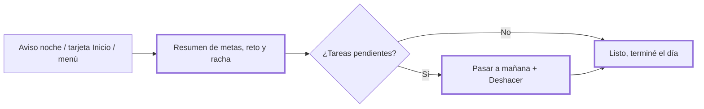
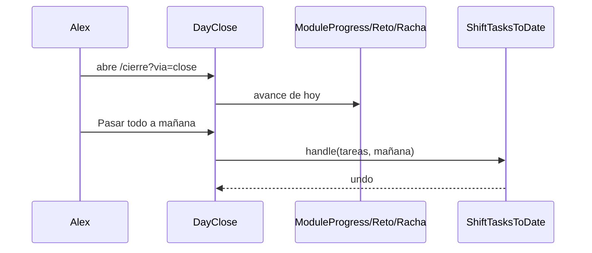

# CHG-070 · Cierre del día
**Estado:** Cerrado
**Nivel:** M
**Modelo sugerido:** estandar
<!-- Estados y nivel se cambian SOLO con node .claude/team.mjs. Modelo: un perfil de docs/TEAM_MODELS.md -->
**Creado:** 2026-11-11 · **Aprobado:** 2026-11-11 · **Cerrado:** 2026-11-11
**Relacionado:** CHG-068 (avisos push, cerrado), CHG-067 (días activos, canal `?via=close`), CHG-077 (reto del día), CHG-076 (racha), CHG-072 (bienvenida al volver: mover tareas con Deshacer)

## 0. En palabras simples
<!-- Para el usuario: sin jerga. Si no se entiende en 30 segundos, reescríbelo. -->
- Qué vas a ver distinto: una pantalla "Cerrar el día" donde en un vistazo ves cómo te fue hoy (agua, ejercicio, foco, hábitos, tareas, reto y racha). Si te quedaron tareas de hoy, las pasas a mañana con un toque, y puedes deshacerlo. Al final tocas "Listo, terminé el día" y la tarjeta de Inicio desaparece hasta mañana. No da premios ni regaña.
- Cómo comprobarlo tú: después de las 7 p. m. abre Inicio y toca la tarjeta "Cerrar el día", o ábrelo desde el menú (Vista general → Cerrar el día) o desde el aviso de la noche. Revisa el resumen, toca "Pasar todo a mañana" y comprueba en Tareas que quedaron para mañana.

## 1. Resumen
Un ritual nocturno corto que cierra el ciclo diario sobre las metas diarias que ya existen (`ModuleProgress`: agua, ejercicio, foco, hábitos, tareas). Tiene dos pasos: un resumen de solo lectura y pasar a mañana las tareas pendientes. Termina con el botón "Listo, terminé el día", que guarda `closed_at` en `user_active_days` y oculta la tarjeta de Inicio. Sin recompensa. Se entra por el aviso de la franja Noche, una tarjeta en Inicio desde las 19 h y un enlace fijo en el menú. Las tres entradas usan `?via=close`, el canal que ya reconoce `user_active_days` (CHG-067).



## 2. Producto
- Problema / usuario: Alex tiene metas diarias y avisos, pero nada cierra el día. Las tareas de hoy sin terminar quedan como vencidas al día siguiente y le generan culpa. Quiere ver en un minuto cómo le fue y dejar mañana ordenado.
- Alcance — incluye:
  - Pantalla nueva `Cerrar el día` con el resumen de las 5 metas diarias, el reto del día y la racha.
  - Lista de tareas pendientes de hoy (fecha límite hoy), con "Pasar todo a mañana", "Mañana" en cada tarea y "Deshacer".
  - Tres entradas: tarjeta en Inicio (19:00–23:59, America/Bogota), ítem fijo en el menú y aviso push de la franja Noche.
  - Botón "Listo, terminé el día" que guarda el cierre (`user_active_days.closed_at`) y oculta la tarjeta de Inicio.
- Alcance — NO incluye: diario, ánimo, recompensas o XP, cambios a la racha o al reto, ni tareas sin fecha.
- HU: Como Alex, al final del día quiero ver qué metas cumplí y pasar lo pendiente a mañana, para cerrar el día tranquilo y empezar mañana con la lista al día.
- Criterios de aceptación:
  - CA1: `/cierre` muestra agua, ejercicio, foco, hábitos y tareas con su avance `hecho/meta` y marca cumplida o pendiente. Los valores coinciden con `ModuleProgress::for()`. Un módulo con meta 0 o desactivado no aparece.
  - CA2: Muestra el reto del día (texto y si está cumplido) y la racha actual. Si no hay reto o no hay racha, ese bloque no aparece y no hay error.
  - CA3: Lista solo las tareas no completadas cuya fecha límite (`end_date ?? start_date`) cae hoy, sin historial de recurrencia. Las de días anteriores y las sin fecha no aparecen.
  - CA4: "Pasar todo a mañana" mueve todas esas tareas para que su fecha límite caiga mañana, conservando hora y duración. "Mañana" en una tarea mueve solo esa.
  - CA5: "Deshacer" devuelve las fechas anteriores de la última acción.
  - CA6: Sin tareas pendientes, se ve el estado "Nada pendiente para mañana". Con todas las metas cumplidas, se ve el mensaje de día completo.
  - CA7 (revisado): de 19:00 a 23:59 hora Bogotá el hero del compañero en Inicio pasa a noche. Si el día no está cerrado, muestra el botón "Cerrar el día" hacia `/cierre?via=close`. No hay tarjeta aparte.
  - CA11: "Listo, terminé el día" guarda `closed_at` del día de hoy (creando el día activo si no existe) y lleva a Inicio sin la tarjeta. Si se vuelve a `/cierre`, se ve "Ya cerraste el día" y el botón "Listo, terminé el día" no aparece; pasar tareas a mañana sigue disponible. Al día siguiente la tarjeta vuelve a aparecer desde las 19:00.
  - CA8 (revisado): el menú NO tiene "Cerrar el día"; Mi día ya cubre lo del día.
  - CA9: Un aviso push de la franja `night` abre `/cierre?via=close`, no el módulo, y no se le agrega `via=push`. Las franjas mañana y tarde no cambian.
  - CA10: Entrar con `?via=close` registra el día activo con canal `close`.

## 3. UX/UI
### 3.1 Experiencia
**Revisado 2026-11-11 (manda sobre los bocetos de abajo).** Escritorio:
```
┌ hero noche: [compañero 💤 zzz] fecha · "Buen trabajo hoy. Vamos cerrando." ┬ Racha ┬ Reto ┐
│ (burbuja) Revisa tu día y deja mañana listo. [Listo, terminé el día]      │ tile  │ tile │
└────────────────────────────────────────────────────────────────────────────┴───────┴──────┘
┌ (☾) Así te fue hoy  [0 de 4 metas] ────────────────┐ ┌ (📅) Quedó pendiente (2) ──┐
│ [guardián+💧] Agua ○  [guardián+⚡] Ejercicio ○    │ │ Llamar al banco  [Mañana]  │
│  ▓▓░ 0/2.500 ml       ░░░ 0/30 min                  │ │ Revisar informe  [Mañana]  │
│ [guardián+⏳] Foco ○   [guardián+☰] Tareas ○       │ │ [ Pasar todo a mañana ]    │
└─────────────────────────────────────────────────────┘ └────────────────────────────┘
```
Móvil: todo en una columna (hero, metas, pendientes). Inicio de 19 h a 23:59: el mismo hero pasa a noche y su burbuja ofrece "Cerrar el día". No hay tarjeta aparte ni ítem en el menú.

- Plantilla: página de una columna (como Mi día): cabecera, tarjetas en pila y acción principal al final de su bloque. `docs/UX-DESIGN.md` no define anatomía; se sigue el layout del shell con rail lateral.
- Flujo: entrada → resumen (solo lectura; cada meta enlaza a su módulo) → bloque de pendientes → acción. Después de mover, se ve un mensaje con "Deshacer" y el bloque pasa al estado vacío. Al final, "Listo, terminé el día" guarda el cierre y vuelve a Inicio, donde ya no está la tarjeta.
- Estados: (a) normal, con pendientes; (b) sin pendientes; (c) todas las metas cumplidas, con mensaje de felicitación sin premio; (d) recién movidas, con mensaje y Deshacer; (e) sin reto o sin racha, el bloque se oculta; (f) día ya cerrado, con aviso "Ya cerraste el día" en lugar del botón final.
- Clics: 1 para entrar, 1 para pasar todo a mañana y 1 para terminar.

Pantalla (móvil, ancho 360):
```
┌──────────────────────────────────────┐
│ ←  Cerrar el día                     │
│ Martes 11 de noviembre               │
├──────────────────────────────────────┤
│ Así te fue hoy                       │
│ ✓ Agua         2000/2000 ml        › │
│ ○ Ejercicio       0/30 min         › │
│ ✓ Foco            4/4 pomodoros    › │
│ ○ Hábitos         3/5              › │
│ ○ Tareas          2/4              › │
│ ┌──────────────┐ ┌─────────────────┐ │
│ │ Reto del día │ │ Racha           │ │
│ │ ✓ Cumplido   │ │ 🔥 6 días       │ │
│ └──────────────┘ └─────────────────┘ │
├──────────────────────────────────────┤
│ Quedó pendiente (2)                  │
│ • Llamar al banco        [Mañana]    │
│ • Revisar informe        [Mañana]    │
│        [ Pasar todo a mañana ]       │
├──────────────────────────────────────┤
│       [ Listo, terminé el día ]      │
└──────────────────────────────────────┘
```
Estado (f), día ya cerrado (en lugar del botón final):
```
│ ☾ Ya cerraste el día. Descansa.      │
```
Estado (d), recién movidas:
```
│ Listo, quedaron para mañana. [Deshacer] │
│ Nada pendiente para mañana.             │
```
Tarjeta en Inicio (19:00–23:59):
```
┌──────────────────────────────────────┐
│ 🌙 Cerrar el día                     │
│ Mira cómo te fue y deja mañana listo │
│                         [ Cerrar › ] │
└──────────────────────────────────────┘
```

### 3.2 Visual
- Componentes M3 existentes: `md-card` para cada bloque, filas de lista con ícono de estado (`bi-check-circle-fill` en color primario cuando está cumplida, `bi-circle` en `on-surface-variant` cuando está pendiente), `md-btn-filled` para "Listo, terminé el día" (acción principal, a ancho completo en móvil), `md-btn-tonal` para "Pasar todo a mañana" y `md-btn-text` para "Mañana" y "Deshacer".
- Reto y racha: dos tarjetas pequeñas en una fila de 2 columnas; en <360 px pasan a 1 columna.
- Tipografía Nunito (CHG-082); título `title-large`, filas `body-large`. Sin colores fijos: solo tokens. Escritorio: ancho máximo de contenido igual al de Mi día.
- Tarjeta de Inicio: `md-card` de superficie tonal con ícono `bi-moon-stars`.

### 3.3 Escritura
Voz de tú, sin culpa y sin hablar de "vencidas".

| Ubicación | Texto |
|---|---|
| Título de la página y del menú | Cerrar el día |
| Subtítulo | `{día de la semana} {d} de {mes}` (ej. "Martes 11 de noviembre") |
| Bloque resumen | Así te fue hoy |
| Bloque pendientes | Quedó pendiente ({n}) |
| Botón principal | Pasar todo a mañana |
| Botón por tarea | Mañana |
| Mensaje después de mover | Listo, quedaron para mañana. |
| Acción | Deshacer |
| Después de deshacer | Deshecho. Las tareas quedaron como estaban. |
| Sin pendientes | Nada pendiente para mañana. |
| Todas las metas cumplidas | Cumpliste todo lo de hoy. Descansa. |
| Reto | Reto del día · Cumplido / Pendiente |
| Racha | Racha · {n} días (1 día en singular) |
| Botón final | Listo, terminé el día |
| Día ya cerrado | Ya cerraste el día. Descansa. |
| Tarjeta Inicio | Cerrar el día · "Mira cómo te fue y deja mañana listo" · botón "Cerrar" |

Criterios: ningún texto usa "vencida", "fallaste" ni "perdiste".

## 4. Diseño técnico
- Ruta: `Route::get('/cierre', DayClose::class)->name('day.close')` en `routes/web.php`, dentro del grupo autenticado (el mismo de `home`). El middleware `TrackActiveDay` ya registra `?via=close`.
- Componente `app/Livewire/Home/DayClose.php` y su vista `resources/views/livewire/home/day-close.blade.php`:
  - Metas: `ModuleProgress::for($m)` para `config('game.nudges.modules')` más `pomodoro`. Se omiten los módulos con `total <= 0`. Cada fila enlaza a la ruta de su módulo (mismo `match` que `UserNotification::destination()`, más `pomodoro`).
  - Reto: `DailyChallenge::forToday($userId)`. Racha: `Streak::summary($userId)`. Si devuelven null, el bloque se oculta.
  - Pendientes: `Task::query()->where('completed', false)->where('is_recurrence_history', false)` con fecha límite (`end_date ?? start_date`) dentro de hoy (inicio a fin del día, `NotificationSource::TIMEZONE`).
- Reutilización: extraer de `WelcomeBack` la lógica de correr el bloque de fechas y del Deshacer a `app/Actions/Task/ShiftTasksToDate.php` (`handle(Collection $tasks, CarbonImmutable $target): array $undo` y `restore(array $undo)`). `WelcomeBack` pasa a usarla sin cambiar su comportamiento.
- Cierre guardado: migración nueva `database/migrations/2026_11_11_000010_add_closed_at_to_user_active_days.php`, que agrega `closed_at` (timestamp, nullable) a `user_active_days`. Sigue el patrón de `2026_11_11_000006_add_streak_columns_to_user_active_days.php` y tiene `down()` reversible. En `UserActiveDay`: `closeDay(int $userId, string $date)`, que llama a `markActive` y actualiza `closed_at` (idempotente), e `isClosed(int $userId, string $date): bool`. `DayClose::finish()` llama a `closeDay` con la fecha de hoy en `NotificationSource::TIMEZONE` y redirige a `home`. El cierre no toca `records_count`, la racha ni el reto.
- Tarjeta de Inicio: parcial `resources/views/livewire/home/partials/day-close-card.blade.php`, incluida en la vista de `Dashboard` cuando la hora en `NotificationSource::TIMEZONE` es ≥ 19 y `! UserActiveDay::isClosed(...)`.
- Menú: ítem en `config/modules.php` → `navigation.overview`: `['label' => 'Cerrar el día', 'route' => 'day.close', 'module' => 'home', 'icon' => 'bi-moon-stars', 'active' => ['day.close']]`. El menú se construye con `route()` sin query, así que entra sin `via` (canal `direct`); se acepta.
- Aviso noche: en `UserNotification::destination()`, si es del guardián y `occurrence_key` termina en `:night`, devolver `route('day.close').'?via=close'`. En `NotificationDispatcher::withVia()`, no agregar `via=push` si la URL ya trae `via=`.
- Riesgos: zona horaria (usar siempre `NotificationSource::TIMEZONE` para "hoy" y "19 h"). La migración solo agrega una columna nullable, sin borrar datos. El refactor de `WelcomeBack` lo cubren sus pruebas actuales.



## 5. Pruebas
- Feature/Livewire `tests/Feature/Home/DayCloseTest.php`: CA1 (sin módulos con meta 0), CA2 (con y sin reto o racha), CA3 (filtro de tareas), CA4 (todas y una, conservando hora y duración), CA5 (deshacer), CA6 (estados vacío y completo), CA7 (tarjeta a las 18:59 y a las 19:00 con `Carbon::setTestNow`), CA8 (ítem del menú), CA10 (`user_active_days` canal `close`), CA11 (terminar guarda `closed_at`, es idempotente, oculta la tarjeta, muestra el estado "ya cerrado" y al día siguiente la tarjeta vuelve).
- Pruebas existentes de avisos (destination o dispatcher) en `tests/Feature/Notifications`: CA9, `night` → `/cierre?via=close` sin `via=push`; `morning` sin cambios.
- Regresión: las pruebas de `WelcomeBack` (CHG-072) siguen pasando después de extraer `ShiftTasksToDate`.
- Browser: `tests/Browser/day-close.interaction.spec.js` (360 y 1280 px) abre `/cierre`, pulsa "Pasar todo a mañana" y ve el mensaje y Deshacer; luego pulsa "Listo, terminé el día" y llega a Inicio sin la tarjeta. Sin desbordes.
- Verificación: `php artisan test --filter='DayClose|WelcomeBack|Notification'` y `npx playwright test tests/Browser/day-close.interaction.spec.js`.

## 6. Documentación
- `docs/game.md` (sección Cierre del día y racha) y `docs/notifications.md` (aviso de la noche). `docs/PRODUCT.md` no existe en el repo.
- `docs/design-system.md`: no aplica; solo se usan componentes existentes.

## 7. Tareas
<!-- Primero lo que cambia para el usuario; el detalle técnico después. Formato:
- [ ] T1 · qué cambia (en simple) — Resp: developer — Modelo: perfil — Archivos: … — Hecho cuando: … -->
- [x] T1 · Mover tareas a otra fecha con Deshacer queda como pieza reutilizable; la bienvenida sigue igual — Resp: developer — Modelo: estandar — Archivos: app/Actions/Task/ShiftTasksToDate.php, app/Livewire/Home/WelcomeBack.php — Hecho cuando: las pruebas de WelcomeBack pasan sin cambios
- [x] T2 · Pantalla "Cerrar el día" con el resumen de metas, reto y racha, y pasar pendientes a mañana — Resp: developer — Modelo: estandar — Archivos: routes/web.php, app/Livewire/Home/DayClose.php, resources/views/livewire/home/day-close.blade.php, tests/Feature/Home/DayCloseTest.php — Hecho cuando: CA1–CA6 y CA10 pasan en DayCloseTest
- [x] T3 · "Listo, terminé el día" guarda el cierre; si ya cerraste, la pantalla lo dice — Resp: developer — Modelo: estandar — Archivos: database/migrations/2026_11_11_000010_add_closed_at_to_user_active_days.php, app/Models/UserActiveDay.php, app/Livewire/Home/DayClose.php, resources/views/livewire/home/day-close.blade.php, tests/Feature/Home/DayCloseTest.php — Hecho cuando: la migración corre y se revierte, y la parte de CA11 sobre `/cierre` pasa
- [x] T4 · Entrada en Inicio: el hero del compañero pasa a noche e invita a cerrar el día (sin tarjeta ni ítem de menú) — Resp: developer — Modelo: rapido — Archivos: resources/views/components/game/daily-buddy.blade.php, resources/css/m3/modules/_game.css, app/Livewire/Home/Dashboard.php, resources/views/livewire/home/dashboard.blade.php, config/modules.php, tests/Feature/Home/DayCloseTest.php — Hecho cuando: CA7, CA8 y CA11 completo pasan
- [x] T5 · El aviso de la noche abre el cierre del día — Resp: developer — Modelo: estandar — Archivos: app/Models/UserNotification.php, app/Services/Notifications/Push/NotificationDispatcher.php, tests/Feature/Notifications — Hecho cuando: CA9 pasa y las pruebas de avisos siguen en verde
- [x] T6 · Prueba de navegador del cierre en móvil y escritorio — Resp: developer — Modelo: rapido — Archivos: tests/Browser/day-close.interaction.spec.js — Hecho cuando: el spec pasa en 360 y 1440 px
- [x] T7 · Verificar criterios de aceptación — Resp: qa-tester — Hecho cuando: CA1–CA11 pasan
- [x] T8 · Actualizar documentación — Resp: tech-writer — Archivos: docs/game.md, docs/notifications.md — Hecho cuando: "Cerrar el día" descrito en game.md y el aviso de la noche en notifications.md

## 8. Bitácora de implementación (developer)
- 2026-11-11 — Inicio. Antes de empezar ya fallaba `HomeDashboardTest` (Inicio sin `md-module-shell`, por cambios previos sin confirmar). Hay 47 fallos ajenos al CHG en la suite.
- T1 — `app/Actions/Task/ShiftTasksToDate.php` (apply/handle/restore); `WelcomeBack` lo usa. WelcomeBack 9/9.
- T2 — Ruta `/cierre` (`day.close`), `DayClose` y vista dentro de `x-module-shell` (arquetipo guided-flow, back a Inicio).
  - Interpretación en tareas: `ModuleProgress` da como total solo las pendientes, así que la meta mostrada es hechas + pendientes.
- T3 — Migración `closed_at` (corre, se revierte y vuelve a correr en local); `UserActiveDay::closeDay/isClosed` (idempotente).
- Rediseño tras revisión de Alex (ver §9). La pantalla pasa a:
  - hero del compañero en modo noche ("se va a dormir", con zzz), con racha y reto reutilizando `streak-line` y `daily-challenge`, y "Listo, terminé el día" en la burbuja;
  - rejilla de escritorio: metas 2/3 y pendientes 1/3;
  - mosaicos de meta con guardián del módulo, ícono y tono de `home-tone`, y `x-ui.progress` canónico;
  - `card-head` en ambas tarjetas.
  - El reto «check-in» lleva a Inicio (`updatedCheckin`).
- T4 — Sin tarjeta ni ítem de menú. El hero de Inicio recibe `night` y `closeHref`; `day.close` agregado a los patrones del módulo home.
- T5 — `UserNotification::destination()`: el guardián en franja `:night` lleva a `/cierre?via=close`; `withVia` respeta un `via` existente.
- T6 — `tests/Browser/day-close.{config,interaction.spec}.js` + `support/day-close-fixture.php` (necesarios por el patrón del repo). Espera a que terminen las animaciones de entrada antes de medir el desbordamiento.
- Verificación:
  - `php artisan test --filter=DayCloseTest` → 12/12.
  - Avisos → 35/35.
  - `npx playwright test -c tests/Browser/day-close.config.js` → 3/3.
  - Suite completa: 1431/1479. Los 47 fallos restantes son preexistentes (mismo conjunto que al inicio) y ninguno menciona el cierre.
- Ajuste tras la segunda revisión de Alex:
  - En escritorio, "Quedó pendiente" pasa a la columna ancha izquierda y "Así te fue hoy" a la derecha, con mosaicos en una columna. Sin pendientes vuelve el resumen ancho. En móvil, el resumen sigue primero.
  - `streak-line` (compartido con Inicio): sin racha y con acciones hoy, dice "A N acciones de tu racha" y "Llevas X de Y hoy. Aún estás a tiempo." en vez de "Empieza hoy". Se actualizó `GameDashboardTest` a ese texto.
  - Resultados: cierre, juego, avisos y bienvenida → 76/77 (el fallo restante, `test_balls_page_shows_the_streak_card`, ya existía). Navegador → 3/3.
- Ajuste: cada meta toma el ícono de su módulo (`config('modules.<key>.icon')`) y su color (`data-module` → `--md-module-accent`), en el fondo del ícono y en el globito sobre el guardián. Foco usa ahora el mismo cronómetro que Pomodoro en el menú. DayCloseTest 12/12 y navegador 3/3.
- Fuera de alcance, a pedido de Alex: en el menú compacto (modo compacto), el contador de Colección (`x-ui.badge`) caía bajo la etiqueta como una píldora grande. `resources/css/m3/archetypes/_app-frame.css` ahora lo convierte en un globito sobre la esquina del ícono. Contratos CSS sin fallos nuevos.
- Fuera de alcance (sugerencias):
  - Inicio y otras pantallas incumplen los contratos de shell (`ProtectedScreenContract`, `ModuleExperience`, `SpaNavigation`).
  - `/statistics` desborda 4 px a 1280.

## 9. Preguntas abiertas, decisiones e historial
- 2026-11-11 — Decisión (usuario): queda en Borrador hasta que existan sus metas diarias.
- 2026-11-11 — Creado en to-do/ (Borrador, nivel S)
- 2026-11-11 — Nivel S → M
- 2026-11-11 — Decisión (usuario): las metas diarias ya existen; especificar. Nivel M.
- 2026-11-11 — Decisión (usuario): pasos = resumen de metas + pasar pendientes a mañana. Sin diario ni ánimo.
- 2026-11-11 — Decisión (usuario): sin recompensa; el cierre no toca el juego.
- 2026-11-11 — Decisión (usuario): entradas = aviso de la noche + tarjeta en Inicio de noche + enlace fijo en el menú.
- 2026-11-11 — Decisión (usuario): ocultar la tarjeta de Inicio al cerrar. Se guarda con el botón explícito "Listo, terminé el día", en `user_active_days.closed_at` (columna nueva nullable). Entrar a `/cierre` no cierra el día por sí solo. El aviso de la noche no cambia: se manda aunque ya hayas cerrado; si molesta, se ajusta en otro cambio.
- 2026-11-11 — Decisión (usuario): en "Quedó pendiente" solo entran las tareas con fecha límite hoy; las de días anteriores no. Se reutiliza la lógica de mover y Deshacer de CHG-072.
- LECCIÓN: ninguna
- 2026-11-11 — Aprobado por el usuario (Compuerta 2)
- 2026-11-11 — Movido a in-progress/ (En desarrollo)
- 2026-11-11 — Decisión (usuario, tras revisar la primera versión): la UI no estaba integrada.
  - Se mantiene la pantalla propia, rediseñada con el compañero que se va a dormir, un guardián por meta y el fondo nocturno del hero.
  - Se quitan el ítem del menú (duplica Mi día) y la tarjeta grande de Inicio: la entrada vive en el hero de noche.
  - Escritorio aprovecha el ancho (2 columnas).
- LECCIÓN(developer): antes de escribir §3 de un CHG con UI, abrir las vistas vecinas (hero del compañero, `card-head`, tonos) y bocetar escritorio y móvil; validar con captura antes de entregar — en CHG-070 la primera versión fue una columna de 720 px sin íconos ni temática y se rehízo · destino sugerido: docs/UI-DESIGN.md → docs/UI-DESIGN.md
- 2026-11-11 — Decisión (usuario): en escritorio, lo pendiente va en la columna ancha (textos largos) y el resumen a la derecha. La racha debe ser contextual: con acciones hoy no dice "Empieza hoy".
- 2026-11-11 — Pedido (usuario): corregir el contador del menú compacto dentro de este CHG, aunque es ajeno al cierre.
- 2026-11-11 — Decisión (usuario): el color y el ícono de cada módulo deben ser los mismos en toda la UI, para dar contexto.
- LECCIÓN(developer): cuando una UI represente un módulo, su ícono sale de `config/modules.php` y su color de `data-module` (`--md-module-accent`); nunca se eligen tonos ni íconos a mano — en CHG-070 Foco tenía otro ícono que Pomodoro y los tonos no coincidían con el menú · destino sugerido: docs/UI-DESIGN.md → docs/UI-DESIGN.md
- 2026-11-11 — Implementación terminada → En verificación
- 2026-11-11 — T7 (verificación):
  - CA1–CA6, CA10 y CA11 → `DayCloseTest` (14/14).
  - CA7 (revisado) y CA8 (revisado) → `DayCloseTest` (hero de noche y menú sin ítem).
  - CA9 → `NotificationDispatchTest`.
  - Regresión: WelcomeBack, avisos, racha y días activos → 60/61; el único fallo, `test_balls_page_shows_the_streak_card`, ya existía.
  - Navegador 360/1440 → 3/3.
  - Revisión visual de Alex: aprobada.
- 2026-11-11 — T8: documentado en docs/game.md y docs/notifications.md.
- 2026-11-11 — Lecciones CHG-070#1 y #2 incorporadas en docs/UI-DESIGN.md (team lessons accept).
- 2026-11-11 — Cerrado por el usuario (Compuerta 3) → done/
