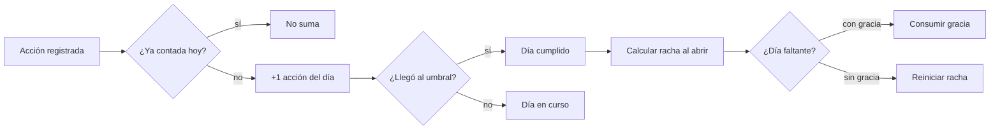
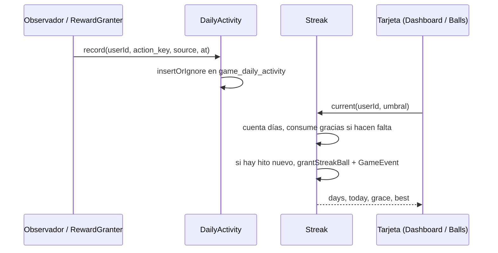

# CHG-076 · Racha de constancia con umbral diario y días de gracia
**Estado:** Cerrado
**Nivel:** M
**Modelo sugerido:** estandar
<!-- Estados y nivel se cambian SOLO con node .claude/team.mjs. Modelo: un perfil de docs/TEAM_MODELS.md -->
**Creado:** 2026-11-11 · **Aprobado:** 2026-11-11 · **Cerrado:** 2026-11-11
**Relacionado:** CHG-067 (días activos, fuente de datos), CHG-072 (volver sin culpa), CHG-075 (hero del Inicio), CHG-042 (constancia)

## 0. En palabras simples
- Qué vas a ver distinto: una racha única, como la de Duolingo, que cuenta los días seguidos en que haces al menos N cosas en MiSo (por defecto 3, tú eliges el número). La racha aparece como una línea dentro del bloque de bienvenida del Inicio y en Colección, con lo que llevas hoy, tu mejor racha y los días de gracia que te quedan en el mes. Si un día no llegas, se gasta una gracia y la racha sigue; tienes 2 por mes.
- Cómo comprobarlo tú: completa 3 tareas hoy y mañana 3 hábitos → la tarjeta dice "Racha de 2 días". Deja pasar un día sin llegar al umbral → la racha sigue y se descuenta una gracia del mes. Cuando se acaben las 2 gracias de ese mes, la racha vuelve a empezar, pero tu mejor racha queda guardada.

## 1. Resumen
Una racha global de constancia que mide **acciones del día**, no módulos: cada tarea completada, hábito marcado, registro de bienestar, agua, ejercicio, foco, meta o constancia suma una acción. El umbral es configurable (1–10, por defecto 3) y hay **2 días de gracia automáticos por mes** para que un día flojo no borre la racha. Al alcanzar hitos (3, 7, 14, 30, 60, 100, 180 y 365 días) se recibe una ball especial y un aviso. La lógica es determinista, idempotente y nunca resta: si la racha se rompe, la mejor racha y todo lo ganado se conservan.

## 2. Producto (product-manager)
- Problema / usuario: hoy la constancia existe pero es invisible y fragmentada (rachas de agua, hábitos y ejercicio por separado, más un +1 de xp que no se ve). Alex quiere un indicador diario único que dé una razón concreta para abrir MiSo cada día, sin castigo.
- Incluye:
  - racha global de días consecutivos con ≥ umbral de acciones;
  - umbral configurable por el usuario entre 1 y 10 (por defecto 3);
  - 2 días de gracia automáticos por mes calendario (America/Bogota);
  - hitos con ball especial (fuera del límite diario) y aviso del juego;
  - línea en el hero del Inicio (CHG-075) y bloque en Colección → Balls;
  - ajuste de umbral en Colección → Ajustes.
- No incluye: rachas separadas por módulo (las actuales de agua/hábitos se quedan como están); moneda, tienda ni compra de gracias; notificaciones push o correo; comparación con otras personas; penalizaciones de ningún tipo.
- Criterios de aceptación (Dado/Cuando/Entonces):
  1. Dado un umbral de 3 y 3 acciones registradas hoy, cuando abro el dashboard, entonces la tarjeta muestra la racha vigente y "Hoy: 3 de 3".
  2. Dado que ayer no llegué al umbral y tengo una gracia disponible, cuando abro la app, entonces la racha continúa, el día se marca como cubierto por gracia y el contador del mes baja en 1.
  3. Dado que ayer no llegué al umbral y no me quedan gracias ese mes, entonces la racha vuelve a 0 y "Tu mejor racha" conserva el valor anterior.
  4. Dado que la racha llega a 7 días por primera vez, entonces recibo 1 ball fuera del límite diario y un aviso; si la racha se reinicia y vuelve a 7, no se repite la recompensa.
  5. Dado que cambio el umbral de 3 a 5, entonces el nuevo umbral aplica desde hoy; los días ya cerrados conservan su resultado y no se pierden datos.
  6. Dado que el juego está apagado o una fuente está apagada, entonces esa fuente no suma acciones y la tarjeta no se muestra con el juego apagado.
  7. Dado que son las 23:59 en America/Bogota, entonces el día sigue abierto; el día en curso nunca rompe la racha (solo cuenta cuando termina).
  10. Dado que hoy registro 3 acciones de una sola área (p. ej., 3 vasos de agua), entonces el día no se cumple: se necesitan acciones en **al menos 2 áreas distintas** (`config('game.streak.min_areas')` = 2). La tarjeta lo dice: "Hoy: 3 de 3 · suma otra área".
  11. Dado que creo una tarea y la cierro hoy mismo, entonces no cuenta para la racha (solo cuentan las tareas si se crearon antes de hoy o tenían fecha (`due_date`/`scheduled`)).
  12. Dado que oculto la racha en Ajustes, entonces no se muestra en el Inicio ni en Balls y no se pagan hitos; los datos siguen guardándose.
  9. Dado que vuelvo tras una ausencia y veo la bienvenida de CHG-072, entonces no se muestra el mensaje de racha rota ese día.
  8. La misma acción registrada dos veces (reintento, MCP y app) suma una sola vez.

## 3. UX/UI
### 3.1 Experiencia (ux-designer)
- Plantilla: una línea dentro del hero del Inicio (CHG-075), no una tarjeta aparte; bloque compacto arriba de la pestaña Balls; no hay pantalla nueva.
- Flujo y cantidad de pasos: 0 pasos para verla; 2 clics para cambiar el umbral (Colección → Ajustes → Racha).
- Qué contiene cada pantalla y qué es lo más importante:
  - Inicio (hero): una línea "🔥 12 días · Hoy 2 de 3" que enlaza al bloque de Balls; el detalle (gracias, mejor racha) vive en Balls.
  - Balls: el mismo resumen con los últimos 7 días en puntos (cumplido / gracia / sin actividad) y el enlace a Ajustes.
- Estados (vacío / carga / error / éxito / validaciones):
  - sin historial: "Empieza hoy: te faltan 3 acciones";
  - hoy cumplido: marca de check y el mensaje de que mañana sigue;
  - día cubierto por gracia: punto con anillo y "Gracia usada";
  - racha rota: "Tu mejor racha fue de N días; hoy empieza otra";
  - hito: aviso del juego con celebración y sonido ya existentes;
  - juego apagado: la tarjeta no se renderiza;
  - carga: el cálculo es síncrono y local, sin spinner.
- Información necesaria y momento de presentación: el umbral y las gracias solo se explican al tocar "¿Cómo funciona?" (texto breve en el bloque de Balls); el dashboard no se recarga con explicaciones.
- Accesibilidad de uso (teclado, foco, errores): tarjeta con `aria-label` que resume la racha; los 7 puntos llevan texto alternativo por día; el cambio de umbral es un `x-ui.field` numérico con rango validado y mensaje de error asociado.

```
┌─ Tu racha ───────────────────────────┐
│  🔥  12 días                          │
│  Hoy: 2 de 3 acciones                 │
│  ▓▓▓▓▓▓▓▓▓▓▓▓▓▓▓▓▓▓░░░░  67 %        │
│  Gracia: 1 de 2 en noviembre          │
│  Tu mejor racha: 21 días              │
└───────────────────────────────────────┘
```



### 3.2 Visual (ui-designer)
- Distribución: en el Inicio es una línea dentro del hero de CHG-075; en Balls va en una franja a todo el ancho arriba de los contadores.
- Componentes existentes a reutilizar (ruta): `x-ui.card`, `x-ui.progress` (o la barra de misión de `_game.css`), `x-ui.badge` para las gracias, `x-ui.icon-action` para "¿Cómo funciona?".
- Jerarquía, color, tipografía y espaciado (tokens): número en `md-headline-medium`, etiquetas en `md-label-small`; llama/racha con `--game-accent` (ámbar) y las gracias con el color de `warning`; sin nuevos colores fuera de tokens. El punto de gracia usa el patrón de anillo de `game-rarity`.
- Responsive y contraste: 1 tarjeta por fila en móvil; la fila de 7 días se desplaza horizontalmente con `scroll-snap` si no cabe; texto sobre `surface-container` cumple contraste AA.

### 3.3 Escritura (ux-writer)
- Ubicación y estado: tarjeta del dashboard y bloque de Balls; ajuste en Ajustes.
- Textos finales (variables entre llaves):
  - `streak.title`: "Tu racha"
  - `streak.days`: "{days} días"
  - `streak.today`: "Hoy: {done} de {goal} acciones"
  - `streak.done_today`: "Hoy ya está: {done} de {goal} acciones"
  - `streak.start`: "Hoy empieza tu racha: te faltan {left} acciones."
  - `streak.grace_left`: "Gracia: {left} de {total} en {month}"
  - `streak.grace_used`: "Usaste una gracia el {date}."
  - `streak.broken`: "Tu mejor racha fue de {best} días. Hoy empieza otra."
  - `streak.best`: "Tu mejor racha: {best} días"
  - `streak.milestone`: "¡{days} días seguidos! Ganaste una ball."
  - `settings.threshold`: "Acciones para cumplir el día"
  - `settings.threshold_help`: "Entre 1 y 10. Cuenta cada tarea, hábito o registro del día."
  - `settings.help`: "Cada día necesitas {goal} acciones. Si un día no llegas, se usa una gracia (2 por mes)."
- Reglas de docs/UX-WRITING.md aplicadas: tuteo, cálido, sin culpa; nada de "perdiste", "fallaste" ni "obligatorio"; máximo 90 caracteres con valores típicos.
- Criterios de aceptación de los textos: prueba que valide que todas las plantillas existen, no usan palabras de `MissionProposalValidator::PENALTY_WORDS` y caben en 90 caracteres con valores de ejemplo.

## 4. Diseño técnico (software-architect)

- Archivos a crear / modificar:
  - **Sin tablas nuevas de actividad.** La fuente es `user_active_days.records_count` (CHG-067): se incrementa en `GameEvent::created` para eventos `activity`, que ya son idempotentes por `idempotency_key` (`firstOrCreate`), y la fecha usa `config('app.timezone')` = America/Bogota.
  - `database/migrations/2026_11_11_000001_add_streak_threshold_to_user_active_days.php`: columnas `streak_threshold` (tinyint nullable) y `streak_met` (bool nullable) para fijar el umbral de cada día cerrado; así cambiar el umbral no reescribe el pasado.
  - **Antifarmeo:** `user_active_days.records_count` no distingue áreas ni tareas de mentira, así que `Streak` cuenta el día de hoy desde `game_events` (`kind = activity`, fecha de hoy) agrupando por área (`source_type`/`effect.source`) y descartando tareas creadas el mismo día sin fecha. Al cerrar el día, guarda `streak_met` (bool) en `user_active_days` junto a `streak_threshold`; los días cerrados se leen de ahí.
  - `app/Services/Game/Streak.php`: `summary(int $userId)` → `days`, `today`, `goal`, `grace_left`, `best`, `last7`. Recorre hacia atrás los días (máx. 400) y **deriva** las gracias al vuelo (hasta 2 por mes calendario); no consume nada al leer. `best` sale del mismo recorrido. Solo `awardMilestones()` escribe.
  - `app/Services/Game/RewardGranter.php`: **nuevo método común** `grantBonusBall(int $userId, string $key, string $label, array $effect = [])` que generaliza `grantMissionBall` (lo reutilizan CHG-077, 078 y 079). Respeta un tope semanal `config('game.bonus_balls_per_week')` (por defecto 4); si se supera, el hito queda registrado sin ball. Hitos con clave `streak:{hito}`.
  - Ajuste `streak_visible` (por defecto activo) en `GameSettings` y Colección → Ajustes.
  - Textos de hito centrados en la vida, no en la ball: `streak.milestone`: "¡{days} días seguidos cuidándote! {summary}. Ganaste una ball." con `{summary}` = las 2 áreas más frecuentes (p. ej., "5 con agua, 4 con hábitos").
  - `app/Services/Game/GameFeed.php`: un solo tipo de aviso genérico `bonus` (ícono + texto), reutilizado por racha, reto, álbumes y camino; sin colores nuevos.
  - `app/Services/Game/GameSettings.php`: `streak_threshold` (entero 1–10, por defecto `config('game.streak.threshold')`).
  - `app/Livewire/Home/Dashboard.php` + variante `hero` de `resources/views/components/game/daily-buddy.blade.php` (CHG-075): propiedad `streak` y la línea de racha. Se oculta "racha rota" si `ReturnDetector` (CHG-072) muestra bienvenida.
  - `app/Livewire/Game/GameBalls.php` + `resources/views/livewire/game/game-balls.blade.php`: bloque de racha con los 7 días.
  - `app/Livewire/Game/GameSettingsPage.php` + `resources/views/livewire/game/game-settings.blade.php`: campo de umbral.
  - `config/game.php`: bloque `streak` (`threshold`, `threshold_range`, `grace_days_per_month`, `milestones`) y `bonus_balls_per_week`.
  - `resources/css/m3/modules/_game.css`: tarjeta, barra y puntos de gracia.
  - Pruebas: `tests/Feature/Game/StreakTest.php`, `BonusBallTest.php`.
- Enfoque y patrones a seguir:
  - Reutilizar el contador existente (`user_active_days`): 1 consulta por lectura y ningún hook nuevo en servicios de tareas o hábitos.
  - El umbral de un día cerrado es el guardado en `streak_threshold` (se fija la primera vez que se lee ese día ya cerrado); si es null, se usa el umbral actual.
  - Gracias derivadas, no persistidas: el mismo historial siempre da la misma racha.
  - Los hitos se pagan una vez en la vida con la clave `streak:{hito}` (no se repiten al reiniciar la racha).
  - Ninguna lectura debe romper la pantalla: `Streak` atrapa errores y devuelve un estado vacío.
- Riesgos y mitigación:
  - *Costo en el Inicio*: 1 consulta de `user_active_days` (≤ 400 filas, índice user_id+date).
  - *Qué cuenta*: solo eventos `activity` del juego; con el juego apagado no hay eventos y la racha no avanza (criterio 6).
  - *Datos históricos*: `user_active_days` existe desde CHG-067; la racha cuenta desde ahí, sin inventar días.
  - *Inflación de balls*: tope semanal común de bonos.
- Qué NO tocar: cálculo de balls, xp, misiones, temporadas, rachas de agua/hábitos existentes, el incremento de `records_count`, `GameNotifier` (solo se añade el tipo `bonus`).

## 5. Pruebas (qa-tester)
| Caso | Tipo | Nivel | Test |
|---|---|---|---|
| La misma acción (misma idempotency_key) suma una sola vez en `records_count` | Feature | Alto | StreakTest |
| `grantBonusBall` respeta el tope semanal y es idempotente por clave | Feature | Alto | tests/Feature/Game/BonusBallTest.php |
| Regreso con bienvenida (CHG-072) no muestra racha rota | Feature | Medio | StreakTest |
| Una sola área no cumple el día; dos áreas sí | Feature | Alto | StreakTest |
| Tarea creada y cerrada hoy sin fecha no cuenta | Feature | Alto | StreakTest |
| Racha oculta: sin línea, sin hitos | Feature | Medio | StreakTest |
| Umbral 3 con 3 acciones de fuentes distintas cumple el día | Feature | Alto | StreakTest |
| Día sin umbral con gracia disponible continúa la racha y descuenta 1 | Feature | Alto | StreakTest |
| Sin gracias disponibles la racha se reinicia y conserva la mejor | Feature | Alto | StreakTest |
| Hito 7 paga una ball una sola vez, incluso tras reiniciar la racha | Feature | Alto | StreakTest |
| Cambiar el umbral aplica desde hoy y no altera días cerrados | Feature | Medio | StreakTest |
| Juego apagado: no se registran acciones ni se muestra la tarjeta | Feature | Medio | StreakTest |
| Día en curso nunca rompe la racha | Feature | Alto | StreakTest |
| Plantillas de texto sin palabras prohibidas y ≤ 90 caracteres | Feature | Bajo | StreakTest |
| Línea del hero y bloque de Balls con datos y sin historial | Componente | Medio | tests/Feature/Game/GameDashboardTest.php |
- Comando para verificar: `php artisan test tests/Feature/Game/StreakTest.php tests/Feature/Game/BonusBallTest.php`
- Regresión a vigilar: `GameFeedTest`, `tests/Feature/Engagement/*` (días activos y regreso), `DashboardTest` y `GameSettingsTest`; el notificador no debe perder sus tipos actuales.

## 6. Documentación (tech-writer)
- Docs a actualizar: `docs/game.md` → nueva sección "Racha de constancia" (qué cuenta, umbral, gracias, hitos, zona horaria y datos); `docs/UX-DESIGN.md` solo si la tarjeta estrena patrón.

## 7. Tareas
- [x] T0 · Base común de bonos: `grantBonusBall` con tope semanal y aviso `bonus` — Resp: developer — Archivos: app/Services/Game/RewardGranter.php, app/Services/Game/GameFeed.php, resources/views/livewire/game/game-notifier.blade.php, config/game.php, tests/Feature/Game/BonusBallTest.php — Hecho cuando: `grantMissionBall` delega en `grantBonusBall` sin romper sus pruebas y el tope se respeta
- [x] T1 · Calcular la racha desde los días activos con umbral configurable — Resp: developer — Archivos: migración, app/Services/Game/Streak.php, config/game.php, tests/Feature/Game/StreakTest.php — Hecho cuando: criterios 1, 5, 6, 7, 8, 10 y 11 pasan
- [x] T2 · Días de gracia derivados e hitos con ball y aviso — Resp: developer — Archivos: app/Services/Game/Streak.php, config/game.php, tests/Feature/Game/StreakTest.php — Hecho cuando: criterios 2, 3, 4 y 9 pasan
- [x] T3 · Línea de racha en el hero del Inicio, bloque en Colección y umbral en Ajustes — Resp: developer — Archivos: app/Livewire/Home/Dashboard.php, resources/views/components/game/daily-buddy.blade.php, app/Livewire/Game/GameBalls.php, resources/views/livewire/game/game-balls.blade.php, app/Livewire/Game/GameSettingsPage.php, resources/views/livewire/game/game-settings.blade.php, resources/css/m3/modules/_game.css, tests/Feature/Game/GameDashboardTest.php — Hecho cuando: la tarjeta y el ajuste funcionan en 390/768/1440 px y el build compila
- [x] T4 · Verificar criterios de aceptación — Resp: qa-tester — Hecho cuando: los 12 criterios pasan y las suites afectadas están en verde (salvo fallas previas conocidas)
- [x] T5 · Actualizar documentación — Resp: tech-writer — Archivos: docs/game.md — Hecho cuando: la sección de racha explica reglas, datos y zona horaria

## 8. Bitácora de implementación (developer)
- 2026-11-11 — T0: `RewardGranter::grantBonusBall()` (nuevo `GameEvent::KIND_BONUS`, fuera del límite diario, idempotente, tope `game.bonus_balls_per_week` = 4; pasado el tope queda registrado con `reason = weekly_cap` y sin ball). `grantMissionBall` y el bono comparten `rewardBall()`. Aviso `bonus` en `GameFeed` y color `.game-toast--bonus`; etiqueta «Extra» en Balls. `BonusBallTest` 4/4; `GameFeedTest`, `RewardGranterTest`, `GameWeekViewTest` en verde.
- 2026-11-11 — T1/T2: migración `2026_11_11_000006` (`streak_met`, `streak_threshold` en `user_active_days`). `AppServicesGameStreak`: `records_count` sirve de prefiltro; el día se evalúa desde `game_events` `activity` (≥ umbral y ≥ 2 áreas por `effect.source`, sin tareas creadas y cerradas el mismo día sin fecha ni recurrencia), se fija al cerrar y las gracias se derivan en un recorrido hacia adelante (2/mes, solo si hay racha que proteger). Hitos con `grantBonusBall` (`streak:{n}`) y resumen «N días con X, M con Y». Ajustes `streak_threshold` (1–10) y `streak_visible`. `StreakTest` 11/11.
- 2026-11-11 — T3: `x-game.streak-line` en el hero (`daily-buddy` variante `hero`) y `x-game.streak-card` en Balls (con `x-ui.progress`, 7 días con texto por día, «¿Cómo funciona?»); sección «Racha» en Ajustes (`#racha`). `Dashboard::streak()` paga hitos al renderizar y oculta «racha rota» si `ReturnDetector` detecta regreso. `GameDashboardTest` 6/6; `npm run build` ok.
- 2026-11-11 — Suite completa: 1418 pruebas, 37 fallas, todas previas (mismo listado que antes de empezar; la de `HomeDashboardTest` es `md-module-shell`). Una falla nueva de `UiConformanceTest` (estilo en línea en la barra) se corrigió usando `x-ui.progress`.

- 2026-11-11 — QA (T4): criterios 1–12 cubiertos por `StreakTest` (11), `BonusBallTest` (4) y `GameDashboardTest` (6); con `HomeDashboardTest` y `Engagement`, 62/63 en verde. La falla es previa y ajena (`md-module-shell` en `/`, desde 3670cc2d).
- 2026-11-11 — Docs (T5): `docs/game.md` → «Balls extra» y «Racha de constancia»; tabla de datos y servicios actualizadas.

## 9. Preguntas abiertas, decisiones e historial
- 2026-11-11 — Nota de implementación: §4 decía leer la racha de `records_count`; como ese contador no distingue áreas ni tareas del mismo día (requisitos antifarmeo aprobados después), se usa como prefiltro y el día se evalúa desde `game_events`, como ya prevé la viñeta «Antifarmeo» de §4.
- LECCIÓN(developer): en vistas, los anchos de progreso van con `x-ui.progress` (o `--md-progress-value`), no con `style` propio — `UiConformanceTest` rechaza custom properties no listadas en `config/ui-conformance.php` · destino sugerido: docs/UI-DESIGN.md
- 2026-11-11 — Decisiones (usuario) antifarmeo: el día exige ≥ 2 áreas distintas; las tareas creadas y cerradas el mismo día no cuentan; la racha se puede ocultar; los avisos de hito resumen lo hecho. Antes de aprobar CHG-078 y CHG-079 se revisa `php artisan miso:retention` tras 1–2 semanas de racha y reto.
- 2026-11-11 — Revisión: se reutiliza `user_active_days.records_count` (CHG-067) en vez de una tabla nueva; gracias derivadas sin escritura; el umbral nuevo aplica desde hoy; la racha va en el hero de CHG-075; se crea la base común `grantBonusBall` + aviso `bonus` + tope semanal. Depende de: CHG-075 cerrado.
- 2026-11-11 — Decisiones (Alex): cuenta el día al llegar a un **umbral configurable** de acciones (por defecto 3); **2 días de gracia automáticos por mes**; premios en balls y avisos, sin moneda nueva.
- 2026-11-11 — Creado en to-do/ (Borrador, nivel M)
- 2026-11-11 — Renumerado de CHG-066 a CHG-076 (choque con CHG-066 cerrado).
- 2026-11-11 — Aprobado por el usuario (Compuerta 2)
- 2026-11-11 — Movido a in-progress/ (En desarrollo)
- 2026-11-11 — Implementación terminada → En verificación
- 2026-11-11 — Cerrado por el usuario (Compuerta 3) → done/
