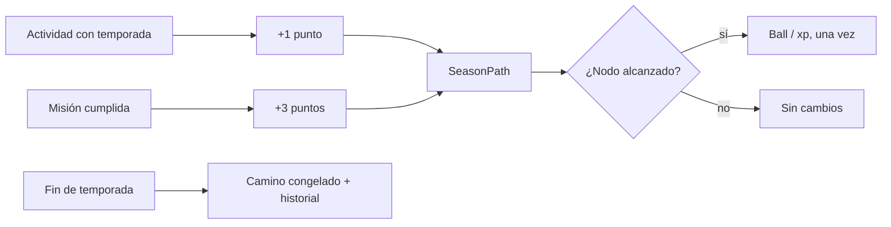
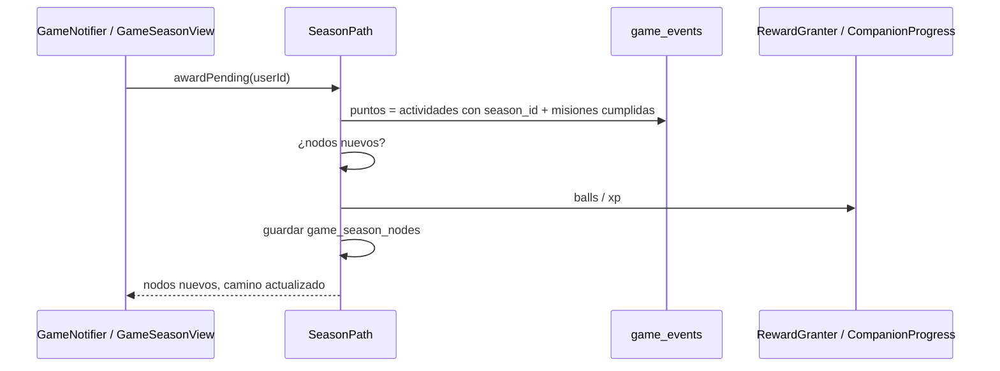

# CHG-079 · Camino de temporada con hitos y recompensas
**Estado:** Cerrado
**Nivel:** M
**Modelo sugerido:** razonamiento
<!-- Estados y nivel se cambian SOLO con node .claude/team.mjs. Modelo: un perfil de docs/TEAM_MODELS.md -->
**Creado:** 2026-11-11 · **Aprobado:** 2026-11-11 · **Cerrado:** 2026-11-11
**Relacionado:** CHG-076 (base de bonos), CHG-022 (temporadas), CHG-026 (misiones del director), CHG-045 (temporadas temáticas), CHG-021 (equipo)

## 0. En palabras simples
- Qué vas a ver distinto: la pestaña Temporada deja de ser solo una tarjeta de reglas y muestra un **camino de 7 paradas** que avanza con lo que haces durante la temporada. Cada parada da algo: balls o experiencia para tu equipo. Al terminar la temporada el camino se congela y queda en el historial; lo ganado no se pierde.
- Cómo comprobarlo tú: abre Colección → Temporada con una temporada activa → ves el camino, tu posición y la siguiente parada. Haz tus cosas de la semana → el camino avanza. Al llegar a una parada con ball, llega la ball.

## 1. Resumen
La temporada ya modifica misiones, bonos de xp y pesos de balls, pero no tiene **progreso visible**. Este cambio añade puntos de temporada (actividades elegibles + misiones cumplidas), un camino de 7 nodos con recompensas deterministas (balls y xp de equipo) en la pestaña Temporada. Todo es idempotente, no retroactivo y nunca resta: la temporada que termina conserva lo ganado y el nuevo camino empieza en cero.

## 2. Producto (product-manager)
- Problema / usuario: la temporada se siente como un fondo que cambia reglas, sin una meta visible ni recompensas propias. Alex quiere un camino con paradas que dé forma de progreso a las 2–6 semanas de la temporada.
- Incluye:
  - puntos de temporada calculados desde actividades elegibles y misiones cumplidas;
  - camino de 7 nodos con recompensas: balls y xp de equipo;
  - posición, siguiente parada y días restantes en la pestaña Temporada;
  - aviso del juego al alcanzar un nodo;
  - camino congelado y conservado en el historial al terminar la temporada.
- No incluye: títulos o distintivos (quedan para una iteración posterior); moneda, tienda ni cosméticos; nodos configurables por el usuario; reinicio o compra de progreso; cambios al validador de temporadas del director; backfill de temporadas anteriores al despliegue.
- Criterios de aceptación (Dado/Cuando/Entonces):
  1. Dado que hay una temporada activa, cuando abro Temporada, entonces veo el camino con 7 paradas, mi posición y la siguiente recompensa.
  2. Dado que hago una actividad elegible con temporada activa, entonces el camino suma 1 punto, con **tope de 5 puntos por día** por actividades (`config('game.season.path.daily_cap')`); una misión cumplida suma 3 puntos aparte del tope. Las tareas creadas y cerradas el mismo día no suman.
  3. Dado que alcanzo una parada, entonces recibo su recompensa una sola vez y aparece el aviso; las balls no consumen el límite diario.
  5. Dado que la temporada termina o se revierte, entonces el camino se congela, no se pierden puntos, balls ni xp, y la siguiente temporada empieza en 0.
  6. Dado que el director propone una temporada temática, entonces el camino usa el color e ícono del tema sin cambiar sus reglas.
  7. Dado que no hay temporada activa, entonces la pestaña muestra el estado actual (programada o historial) sin un camino vacío roto.
  8. Las recompensas no cambian el cálculo de misiones, balls ni pesos de rareza.
- Puntos objetivo: `semanas_de_la_temporada × points_per_week` (por defecto 20), con mínimo 20. Con 4 semanas el objetivo es 80 puntos; las paradas están al 5 %, 15 %, 30 %, 45 %, 60 %, 80 % y 100 %.

## 3. UX/UI
### 3.1 Experiencia (ux-designer)
- Plantilla: pestaña Temporada existente (tarjeta de temporada + historial), sin pantalla nueva.
- Flujo y cantidad de pasos: 0 pasos para ver el camino; 1 clic en una parada para ver su recompensa.
- Qué contiene cada pantalla y qué es lo más importante:
  - cabecera: nombre, narrativa corta, "semana X de Y" y días restantes (ya existe);
  - camino: 7 paradas en orden, con la actual destacada, las alcanzadas con check y las futuras atenuadas; cada parada muestra su recompensa en una línea;
  - barra de progreso y "N de M puntos";
- Estados (vacío / carga / error / éxito / validaciones):
  - temporada programada: camino no se muestra; se anuncia la fecha de inicio;
  - temporada activa sin puntos: primera parada a la vista y "Haz tu primera actividad para avanzar";
  - nodo alcanzado: check, aviso y celebración; si la temporada estaba en pausa, se entrega al abrir;
  - temporada terminada: camino congelado con "Terminada" y sin paradas futuras activas;
  - sin juego: la pestaña conserva su estado actual sin camino.
- Información necesaria y momento de presentación: las reglas de puntos se explican en una línea bajo el camino ("Cada actividad suma 1 (hasta 5 al día); cada misión cumplida, 3"), no en un modal.
- Accesibilidad de uso (teclado, foco, errores): el camino es una lista ordenada (`ol`) con texto por parada ("Parada 3 de 7: 1 ball, alcanzada"); no depende solo del color; foco visible en cada parada.

```
┌─ Temporada: Brisa de otoño ───────────────────────────┐
│ Semana 2 de 4 · quedan 16 días                        │
│                                                       │
│  ✓─────✓─────●─────○─────○─────○─────○               │
│  1     2     3     4     5     6     7                │
│  ball  +10xp ball  +15xp +20xp ball  2 balls          │
│                                                       │
│  26 de 80 puntos          Siguiente: parada 4          │
└───────────────────────────────────────────────────────┘
```



### 3.2 Visual (ui-designer)
- Distribución: el camino reemplaza la lista de reglas dentro de la tarjeta de temporada; las reglas pasan a una línea resumida y al detalle expandible actual.
- Componentes existentes a reutilizar (ruta): `x-ui.card`, `x-ui.progress`, `x-ui.badge`, `x-ui.chip`; clases `game-season--theme-{clave}` para color e ícono del tema.
- Jerarquía, color, tipografía y espaciado (tokens): parada actual con `primary`, alcanzadas con `--game-accent`, futuras en `on-surface-variant` atenuado; recompensa en `md-label-small`.
- Responsive y contraste: camino horizontal con `scroll-snap` en ≥ 768 px y vertical compacto en móvil (7 filas cortas); los estados siempre llevan ícono y texto además del color.

### 3.3 Escritura (ux-writer)
- Ubicación y estado: pestaña Temporada (camino y siguiente parada); aviso al alcanzar una parada.
- Textos finales (variables entre llaves):
  - `path.title`: "Camino de la temporada"
  - `path.progress`: "{points} de {target} puntos"
  - `path.rule`: "Cada actividad suma 1 (hasta 5 al día); cada misión cumplida, 3."
  - `path.next`: "Siguiente: parada {n} · {reward}"
  - `path.reached`: "Parada {n} · {reward}, alcanzada"
  - `path.locked`: "Parada {n} · {reward}, faltan {points} puntos"
  - `path.reward_ball`: "1 ball"
  - `path.reward_balls`: "{count} balls"
  - `path.reward_xp`: "+{xp} xp al equipo"
  - `path.notice`: "¡Parada {n} del camino! {reward}"
  - `path.frozen`: "Temporada terminada. Lo ganado queda contigo."
- Reglas de docs/UX-WRITING.md aplicadas: tuteo, sin culpa ni urgencia artificial; nada de "no llegaste" ni "pierdes"; máximo 90 caracteres con valores típicos.
- Criterios de aceptación de los textos: prueba que valide plantillas, longitudes y ausencia de palabras de `MissionProposalValidator::PENALTY_WORDS`.

## 4. Diseño técnico (software-architect)

- Archivos a crear / modificar:
  - `database/migrations/2026_11_11_000003_add_season_path_tables.php`:
    - solo `game_season_nodes` (`user_id`, `season_id`, `node`, `reward`, `awarded_at`, unique `user_id+season_id+node`). **Sin columna nueva en `game_events`**: los puntos se cuentan con `kind = activity` y `occurred_at` entre `starts_at` y `ends_at` de la temporada.
  - `app/Models/Game/GameSeasonNode.php` (`BelongsToUser`).
  - `app/Services/Game/SeasonPath.php`: `points()`, `nodes()`, `awardPending()`, `grantXp()`. Objetivo y porcentajes desde `config('game.season.path')`.
  - `app/Services/Game/RewardGranter.php`: usar `grantBonusBall()` de CHG-076 con clave `season:{id}:node:{n}:{k}`; las balls del camino no son `activity`, así que no suman puntos.
  - `app/Livewire/Game/GameNotifier.php`: llamar a `awardPending()` solo si hay temporada activa y como máximo una vez por minuto por usuario (`Cache::add`); emite el aviso `bonus` de CHG-076.
  - `app/Livewire/Game/GameSeasonView.php` + `resources/views/livewire/game/game-season.blade.php`: camino y siguiente parada.
  - `resources/css/m3/modules/_game.css`.
  - `config/game.php`: `season.path` (`points_per_week`, `min_target`, `nodes` con porcentaje y recompensa).
  - Pruebas: `tests/Feature/Game/SeasonPathTest.php`, `GameSeasonPathViewTest.php`.
- Enfoque y patrones a seguir:
  - Puntos = suma por día de `min(5, actividades elegibles del día)` dentro de la temporada (excluye tareas creadas y cerradas el mismo día sin fecha) + `3 × misiones cumplidas de semanas dentro de la temporada` (las misiones no guardan temporada; se ubican por `week_start` entre `starts_at` y `ends_at`).
  - Recompensas idempotentes por tabla (`game_season_nodes`) y por clave de evento.
  - `awardPending()` se ejecuta al abrir Temporada y en el chequeo del notificador (pestaña visible); nunca en el camino caliente de guardar una tarea.
  - Los nodos se evalúan en orden: si se cruzan dos de golpe, se entregan ambos.
  - Nada retroactivo: las temporadas anteriores no se recalculan; la activa suma desde el despliegue.
- Riesgos y mitigación:
  - *Doble entrega*: unique `user_id+season_id+node` + transacción con bloqueo del usuario al otorgar.
  - *Puntos inflados por las propias balls del camino*: las recompensas no son `kind = activity`, así que no suman puntos.
  - *Inflación de balls*: tope semanal común de bonos (CHG-076).
  - *Temporada revertida a mitad*: `awardPending` solo trabaja con la temporada `active`; al revertir, el camino se congela y no se evalúan nodos nuevos.
  - *Rendimiento*: 2 consultas de conteo como máximo una vez por minuto y solo con temporada activa.
  - *Migración*: una tabla nueva; no se altera `game_events`.
- Qué NO tocar: `SeasonValidator`, propuestas del director por MCP, pesos de rareza, misiones, `WeekPlanner`, cálculo de xp existente.

## 5. Pruebas (qa-tester)
| Caso | Tipo | Nivel | Test |
|---|---|---|---|
| Puntos = actividades + 3 por misión cumplida dentro de la temporada | Feature | Alto | tests/Feature/Game/SeasonPathTest.php |
| Tope de 5 puntos diarios por actividades; misiones fuera del tope | Feature | Alto | SeasonPathTest |
| Nodo alcanzado entrega su recompensa una sola vez | Feature | Alto | SeasonPathTest |
| Cruzar dos nodos de golpe entrega ambos en orden | Feature | Alto | SeasonPathTest |
| Las balls del camino no suman puntos | Feature | Alto | SeasonPathTest |
| Temporada revertida: no se otorgan nodos nuevos y se conserva lo ganado | Feature | Alto | SeasonPathTest |
| Temporada programada o sin temporada no muestra camino roto | Componente | Medio | tests/Feature/Game/GameSeasonPathViewTest.php |
| Textos y recompensas visibles por parada | Componente | Medio | GameSeasonPathViewTest |
- Comando para verificar: `php artisan test tests/Feature/Game/SeasonPathTest.php tests/Feature/Game/GameSeasonPathViewTest.php`
- Regresión a vigilar: `SeasonManagerTest`, `SeasonValidatorTest`, `GameWeekViewTest`, `GameNotifierTest`, `EncounterOpenerTest`.

## 6. Documentación (tech-writer)
- Docs a actualizar: `docs/game.md` → "Director y temporadas": camino, puntos, nodos, idempotencia y datos (`game_season_nodes`); actualizar la tabla de datos.

## 7. Tareas
- [x] T1 · La temporada sabe cuántos puntos llevas y qué parada sigue — Resp: developer — Archivos: migración, app/Models/Game/GameSeasonNode.php, app/Services/Game/SeasonPath.php, config/game.php, tests/Feature/Game/SeasonPathTest.php — Hecho cuando: criterios 1, 2, 7 y 8 pasan
- [x] T2 · Recompensas por parada: balls y xp de equipo, una sola vez — Resp: developer — Archivos: app/Services/Game/SeasonPath.php, app/Livewire/Game/GameNotifier.php, config/game.php, tests/Feature/Game/SeasonPathTest.php — Hecho cuando: criterios 3, 5 y 6 pasan
- [x] T3 · Camino visible en Temporada con sus estados — Resp: developer — Archivos: app/Livewire/Game/GameSeasonView.php, resources/views/livewire/game/game-season.blade.php, resources/css/m3/modules/_game.css, tests/Feature/Game/GameSeasonPathViewTest.php — Hecho cuando: el camino se ve bien en 390/768/1440 px y el build compila
- [x] T4 · Verificar criterios de aceptación — Resp: qa-tester — Hecho cuando: los 7 criterios pasan (el 4 se retiró con los títulos) y las suites afectadas están en verde (salvo fallas previas conocidas)
- [x] T5 · Actualizar documentación — Resp: tech-writer — Archivos: docs/game.md — Hecho cuando: temporadas, datos e idempotencia quedan documentados

## 8. Bitácora de implementación (developer)
- 2026-11-11 — T1: migración `2026_11_11_000009` (`game_season_nodes`), modelo `GameSeasonNode` y servicio `SeasonPath` (`points`, `target`, `state`). Puntos por día con tope 5, reutilizando `Streak::dayStats` (antes privado; ahora público para no duplicar la regla antifarmeo), más 3 por misión cumplida dentro de la temporada. Sin columna nueva en `game_events`. Config `season.path`.
- 2026-11-11 — T2: `awardPending` entrega las paradas en orden y una sola vez: balls con `grantBonusBall`, xp al equipo de la semana con `CompanionProgress::addXp` y un evento `bonus` sin ball para el aviso. Corre en `GameSeasonView` y en `GameNotifier::check` (`Cache::add` de 60 s), solo con temporada activa.
- 2026-11-11 — T3: `x-game.season-path` dentro del bloque temático (`game-season--theme-*`): 7 paradas en `ol` con texto por parada, barra de puntos, siguiente parada, regla y estado congelado. Vertical en móvil y horizontal desde 768 px. Sin temporada activa se muestra el último camino con paradas ganadas; si no hay ninguno, no se muestra.
- 2026-11-11 — T4 (QA): `SeasonPathTest` (6) y `GameSeasonPathViewTest` (2) en verde. Suite completa: ninguna falla nueva respecto al listado inicial.
- 2026-11-11 — T5: `docs/game.md` → «Camino de temporada»; tabla de datos y servicios.

## 9. Preguntas abiertas, decisiones e historial
- 2026-11-11 — Nota de implementación: §3.2 decía que el camino reemplazaba la lista de reglas. Las reglas se mantienen en su tarjeta (las usan otras pruebas y explican bonos y pesos) y el camino va como sección propia dentro del bloque temático, junto al recorrido de semanas.
- LECCIÓN: ninguna
- 2026-11-11 — Decisión (usuario) antifarmeo: tope de 5 puntos diarios por actividades; premia aparecer varios días, no registrar mucho en uno.
- 2026-11-11 — Revisión: se recortan los títulos (v1 solo balls y xp); sin columna `season_id` en `game_events` (conteo por fechas de la temporada); `awardPending` limitado a 1/min con temporada activa; premio con `grantBonusBall` de CHG-076. Depende de: CHG-076 (T0).
- 2026-11-11 — Decisiones (Alex): recompensas del camino en **balls + xp + títulos**, sin cosméticos ni moneda; 7 paradas; puntos por actividad y misión; títulos como distintivo, sin efectos en bonos.
- 2026-11-11 — Creado en to-do/ (Borrador, nivel L)
- 2026-11-11 — Renumerado de CHG-068 a CHG-079 (choque con CHG-068 cerrado).
- 2026-11-11 — Nivel L → M
- 2026-11-11 — Aprobado por el usuario (Compuerta 2)
- 2026-11-11 — Movido a in-progress/ (En desarrollo)
- 2026-11-11 — Implementación terminada → En verificación
- 2026-11-11 — Cerrado por el usuario (Compuerta 3) → done/
