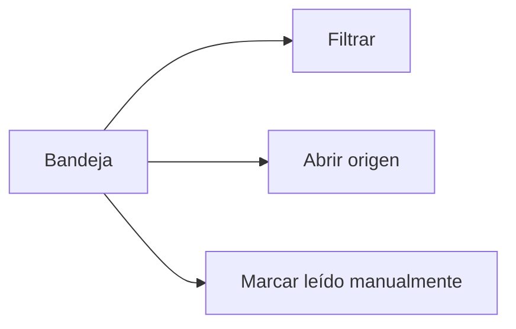

# CHG-085 · Bandeja de notificaciones útil y compacta
**Estado:** Cerrado
**Nivel:** M
**Modelo sugerido:** estandar
**Creado:** 2026-11-11 · **Aprobado:** 2026-11-11 · **Cerrado:** 2026-11-11

## 0. En palabras simples
Avisos con nombre real, fechas legibles y filas compactas. Abrir no marca leído. Comprobar desde la campana y sus filtros.

## 1. Resumen
Plan aprobado explícitamente por el usuario el 2026-11-11: toda la bandeja, más recientes primero, lectura manual y sin cambios en BD. Implementación autorizada en el mensaje siguiente al plan.

## 2. Producto (product-manager)
Identificar el elemento y cuándo requiere atención. Incluye todos los tipos actuales y avisos históricos. Excluye esquema, migraciones, backfills, generadores, canales externos y datos personales.
Dado un aviso existente, al abrir la bandeja se identifica su origen y fecha; al abrirlo no cambia read_at; al marcarlo cambia solo para el propietario.

## 3. UX/UI
### 3.1 Experiencia (ux-designer)
Plantilla: panel lateral con lista compacta, aprobado en conversación. Un clic abre el origen; otro control independiente marca leído. Filtros lectura/tipo con borrador separado, aplicar, limpiar y chips removibles. Cabecera y pie accesibles, scroll del contenido. Vacío, sin resultados, carga y error recuperable. Teclado, Escape y retorno de foco.

### 3.2 Visual (ui-designer)
Boceto aprobado; separadores sin tarjetas gigantes. x-ui.sheet, popover, select, chip, action e icon-action. Tokens existentes, iconos bi por tipo, objetivos táctiles 44 px. Punto sin leer independiente de urgencia: danger vencido, warning hoy, neutral próximo. Campana con tono de atención según pendientes sin leer. Misma estructura responsive.
```text
Notificaciones · 8 sin leer                 ×
Más recientes primero              [Filtros]
● ☑ Preparar propuesta comercial         [✓]
    Tarea · Vence mañana, 12 nov
    Aviso: hoy, 9:00
-------------------------------------------
● ◷ Reunión de seguimiento               [✓]
    Plan · Hoy, 11 nov · 15:00
    Aviso: ayer, 9:00
-------------------------------------------
[Marcar todas leídas]               [Ajustes]
```
### 3.3 Escritura (ux-writer)
Nombre real del origen, fecha de evento separada de «Aviso:». «Marcar como leída», «Marcar todas leídas», «Marcar filtradas leídas», «Elemento no disponible», «Reintentar». Español y tratamiento actual. Fecha relativa calculada en Bogotá; mes abreviado, año si distinto, hora solo cuando corresponde. No perder nombres largos.

## 4. Diseño técnico (software-architect)
Archivos: app/Services/Notifications/NotificationPresentation.php (nuevo), app/Livewire/Notifications/NotificationBell.php, resources/views/livewire/notifications/bell.blade.php, resources/css/m3/modules/_notifications.css; pruebas en tests/Feature/NotificationsTest.php, tests/Feature/NotificationPresentationTest.php, tests/Browser/notifications.interaction.spec.js y tests/Browser/support/notifications-fixture.php. Documentos de §6. Corrección mínima demostrada en resources/views/components/ui/popover.blade.php: role="presentation" en su header para evitar un landmark banner duplicado dentro del diálogo (axe con filtros abiertos).
Capa interna de presentación sin APIs públicas. Resolver orígenes por lotes, explícitamente por propietario. Usar ocurrencia para task_due/plan_due/birthday y fecha vigente etiquetada para reminder; no usar fechas sintéticas como hora real. Tareas enlazan tasks.list con edit=id. Otros tipos conservan sus destinos. Origen ausente: contexto no disponible y módulo de respaldo. No consultas por fila. Campana calcula urgencia en el conjunto sin leer, incluso con panel cerrado.
No tocar BD real, esquema, migraciones, generadores, preferencias, envíos, dependencias ni cambios ajenos. Pruebas en SQLite aislado. Correcciones de superficies compartidas solo si se demuestra necesidad.

## 5. Pruebas (qa-tester)
| Caso | Tipo | Nivel | Test |
|---|---|---|---|
| Tipos, fechas, históricos, origen ausente, aislamiento, consultas por lote | PHP | Feature | NotificationPresentationTest |
| Lectura manual, filtros y marcado masivo entre páginas | PHP | Feature | NotificationsTest |
| Navegación, filtros, responsive y accesibilidad | Navegador | E2E | notifications.interaction.spec.js |
Comandos: php artisan test --filter="NotificationsTest|NotificationGenerationTest|NotificationPresentationTest"; npx playwright test --config=tests/Browser/notifications.config.js; npm run build; php artisan ui:conformance; git diff --check.
Regresión: generadores intactos, filtros estables tras Livewire, apertura sin escritura, objetivos táctiles y navegación por subruta.

## 6. Documentación (tech-writer)
Actualizar docs/notifications.md y sección pertinente en docs/design-system.md. Registrar evidencia y límites en este CHG.

## 7. Tareas
- [x] T1 · Avisos con contexto y fecha real — Resp: developer — Archivos: app/Services/Notifications/NotificationPresentation.php, tests/Feature/NotificationPresentationTest.php — Hecho cuando: pruebas de presentación pasan sin escrituras al mostrar. (cerrada por el usuario sin verificar)
- [x] T2 · Bandeja compacta, filtros y destinos concretos — Resp: developer — Archivos: app/Livewire/Notifications/NotificationBell.php, resources/views/livewire/notifications/bell.blade.php, resources/css/m3/modules/_notifications.css, tests/Feature/NotificationsTest.php — Hecho cuando: lectura manual, filtros, paginación y aislamiento pasan. (cerrada por el usuario sin verificar)
- [x] T3 · Verificar interacción y presentación responsive — Resp: developer — Archivos: tests/Browser/notifications.interaction.spec.js, tests/Browser/support/notifications-fixture.php — Hecho cuando: navegador aislado, assets y conformance verificados y desviaciones preexistentes identificadas. (cerrada por el usuario sin verificar)
- [x] T4 · Documentar el resultado — Resp: developer — Archivos: docs/notifications.md, docs/design-system.md — Hecho cuando: referencias y diff comprobados. (cerrada por el usuario sin verificar)

## 8. Bitácora de implementación (developer)
- 2026-11-11 — Base previa: 11 pruebas, 77 aserciones, correctas. SQLite en memoria. Se preservan cambios locales ajenos.

## 9. Preguntas abiertas, decisiones e historial
- 2026-11-11 — Plan y boceto aprobados explícitamente. Sin preguntas abiertas. Autorización de implementar incluye registrar y aprobar este mismo contenido sin otra confirmación.
- LECCIÓN: ninguna.
- 2026-11-11 — Aprobado por el usuario (Compuerta 2)
- 2026-11-11 — Movido a in-progress/ (En desarrollo)
- 2026-11-11 — Cerrado por el usuario sin verificación (pendientes: T1, T2, T3, T4): ya lo probé → done/ (desde el panel)
