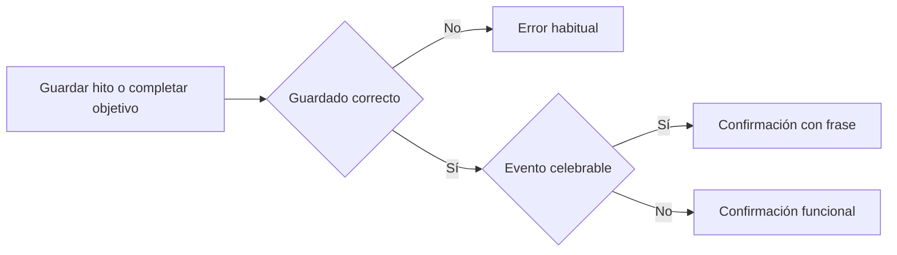

# CHG-090 · Voz del compañero y celebraciones con humor contextual
**Estado:** Cerrado
**Nivel:** M
**Modelo sugerido:** estandar
<!-- Estados y nivel se cambian SOLO con node .claude/team.mjs -->
**Creado:** 2026-11-11 · **Aprobado:** 2026-11-11 · **Cerrado:** 2026-11-11
**Relacionado:** CHG-043, CHG-046, CHG-063, CHG-070, CHG-072; docs/UX-WRITING.md

## 0. En palabras simples
- Qué vas a ver distinto: el compañero tendrá humor y reacciones propias. Al completar hábitos, registrar hitos y completar objetivos habrá frases variadas, incluidas las cuatro referencias elegidas en entrevista. Las instrucciones y los errores seguirán siendo claros.
- Cómo comprobarlo tú: abre Mi día y el panel, solicita otra frase en el panel, completa hábitos y una rutina, registra un hito de hoy y completa un objetivo. Las felicitaciones corresponden a lo que hiciste y no cambian por un refresco.
- Catálogo completo y ejecución aprobados por el usuario; implementación local en curso. No se autoriza despliegue.

## 1. Resumen
Actualizar la voz del compañero en Mi día/panel y las celebraciones de Hábitos y Objetivos con 60 variantes locales, más mensajes funcionales acotados. Reutilizar los mecanismos existentes, sin llamadas nuevas a IA ni migraciones. Evitar repeticiones inmediatas dentro de la sesión y corregir cuatro afirmaciones que exceden los datos consultados.

Evidencia revisada: código local, sin comprobación visual en ejecución. Las preferencias de voz y el alcance M fueron confirmados por el usuario. El usuario aprobó el catálogo completo de §3.3 antes de iniciar desarrollo.

## 2. Producto (product-manager)
- Problema / usuario: personas que combinan trabajo y metas personales necesitan acompañamiento comprensible. Los mensajes actuales son poco variados o genéricos; algunos afirman más progreso del que comprueban.
- Incluye: catálogo local, compañero de Inicio/panel, feedback de hábitos, etapas de rutina, hitos y finalización desde el detalle de Objetivos, cuatro correcciones de precisión, pruebas y revisión responsive.
- No incluye: nueva gamificación, nuevas recompensas, sonidos, nuevos modales, revisión de todos los módulos, avisos push/Telegram/email, cambios MCP, generación automática de frases, cambios en datos existentes, commits o despliegue. No celebrar por MCP ni por editar el estado en formularios alternos en esta primera entrega.
- Criterios de aceptación:
  1. Dado un usuario con juego activo y compañero, cuando abre Inicio/panel, entonces puede recibir una frase del catálogo nuevo sin esperar al director ni actualizar filas de la base de datos.
  2. Dado un hábito de hoy, cuando se completa, entonces conserva la prioridad vigente de feedback (día, bloque, racha, hábito) y muestra únicamente una frase elegible para ese estado.
  3. Dada una rutina, cuando se inicia otro hábito o cambia una etapa del temporizador, entonces muestra la variante de esa etapa y la mantiene entre ticks.
  4. Dado un nuevo hito con fecha de hoy, cuando se guarda correctamente en el detalle, entonces aparece una confirmación persistente con una frase de hito. Editar un hito existente o registrar uno histórico no activa celebración.
  5. Dado un objetivo activo, cuando pasa a completado desde el detalle, entonces aparece una sola celebración. Repetir el mismo estado, reabrir, abandonar o guardar una medición no equivale a completar.
  6. Dada una sesión autenticada, cuando ocurre un nuevo evento elegible o se solicita otra frase, entonces no se repite la plantilla anterior del mismo grupo si existe alternativa; un refresco pasivo no selecciona otra.
  7. Dadas variables con acentos, comillas, HTML o nombres largos, entonces se muestran como texto seguro, conservan su significado y no desbordan la pantalla.

## 3. UX/UI
### 3.1 Experiencia (ux-designer)
Se mantienen pantallas, navegación y acciones. No hay pasos nuevos. El feedback de Objetivos aparece tras guardar, debajo del encabezado y antes de los indicadores, sin desplazar el foco ni abrir un diálogo. Permanece hasta otra acción de edición/guardado/cambio de estado en ese componente o salir de la página. Un render pasivo no lo borra. Errores de guardado conservan la prioridad informativa y limpian feedback de éxito anterior al iniciar una nueva acción.

Los estados vacío, carga, error, validación y desmarcado mantienen tono funcional; el regreso conserva acogida sin reproches. Sin juego o sin compañero, conservar los estados vacíos y visibilidad actuales; las confirmaciones de acciones siguen disponibles, pero con redacción funcional y sin personaje. No impedir ninguna acción por falta de frases o sesión de historial.

Flujo de feedback nuevo:


### 3.2 Visual (ui-designer)
Conservar hero del compañero, feedback de hábitos y globo de rutina. Objetivos usa un bloque de estado en el contenido principal, reutilizando el patrón `role="status"` y las clases de tarjeta/tipografía existentes del módulo; no crear un componente visual global ni un segundo toast flotante. Sin nuevos tokens ni assets. Acotaciones como texto con asteriscos literales, sin negrita ni interpretación Markdown.

Boceto de las zonas afectadas (mismo orden en móvil y escritorio; texto puede envolver):
```text
MI DÍA / PANEL
[compañero] ¿Empezamos? Yo ya me emocioné
            y todavía no hacemos nada.
[acciones actuales sin cambios]

HÁBITOS · confirmación actual
[icono] Hábito completado
        ¡Hecho! *gritito de celebración*

RUTINA · globo actual
[compañero] Vamos con {habit}.
            *se pone en modo apoyo moral*
[temporizador y acciones actuales]

OBJETIVO · después del encabezado
[icono] Objetivo completado
        ¡COMPLETASTE {goal}!
        *gritito nada discreto*
[indicadores, historial y acciones actuales]
```

No truncar nombres ni acotaciones. Mantener colores e iconos del módulo desde `config/modules.php` y tokens vigentes. Comprobar 375, 768 y 1280 px, texto largo, teclado, nombres accesibles y anuncio único por evento. No añadir animaciones. Hábitos conserva su duración actual; Objetivos mantiene texto persistente para lectura. Captura de la implementación pendiente: no se declara validada la apariencia del boceto.

### 3.3 Escritura (ux-writer)
Reglas: `docs/UX-WRITING.md`; español latinoamericano, tú, entrenador cómplice, humor inmediatamente comprensible, acotaciones ocasionales, Spanglish y emojis puntuales. No convertir cada intervención en un chiste ni introducir frases descartadas. Las frases son propuestas completas para aprobación, no instrucciones para que developer invente variantes.

Variables: `{habit}` nombre del hábito, `{period}` etiqueta existente del bloque, `{goal}` título del objetivo. Sustitución literal y escapada. Los asteriscos de los ejemplos son caracteres visibles. Los grupos sin variable van acompañados del título funcional del evento o del hábito/objetivo visible en la pantalla. Ningún texto del usuario se transforma a mayúsculas: las mayúsculas son solo de la plantilla.

#### A · Compañero e inicio de rutina (10)
Frases sin supuestos de progreso; A01 es referencia aprobada. A01–A10 pueden usarse en el compañero de Inicio/panel. Para iniciar un hábito en rutina usar además las dos variantes contextuales de la tabla de etapas.
- A01: ¿Empezamos? Yo ya me emocioné y todavía no hacemos nada.
- A02: Tú empieza. *busca una canción que esté a la altura*
- A03: ¿Qué hacemos primero? Yo vine a acompañarte.
- A04: *se acomoda a tu lado* A ver, ¿por dónde empezamos?
- A05: No prometo hacer tus pendientes, pero sí darte apoyo moral.
- A06: Estoy listo. Bueno, listo para acompañarte. Lo otro te toca a ti.
- A07: ¿Vamos con una cosa? *ya está asintiendo*
- A08: Hoy también puedes empezar pequeño. Yo igual voy a celebrar.
- A09: ¿Necesitas una porra? Dame una señal. 🙌
- A10: Podemos ir paso a paso. Yo me encargo de emocionarme.

#### B · Hábito de hoy completado (10)
Título funcional: «Hábito completado». B01 es referencia aprobada.
- B01: ¡Hecho! *gritito de celebración*
- B02: ¡{habit}, completado! *aplaude desde la esquina*
- B03: *se levanta a aplaudir* ¡Un hábito más, hecho!
- B04: ¿Hacemos un pequeño baile? Porque {habit} ya está.
- B05: {habit}, completado. Yo dije que iba a celebrar.
- B06: *intenta aplaudir bajito* ¡Bien hecho!
- B07: ¡Uno más! *levanta los brazos como si también lo hubiera hecho*
- B08: {habit}, hecho. Date un momento para reconocerlo.
- B09: ¡Hábito completado! 🙌
- B10: ¡Listo! Puedes quedarte con este avance o seguir con otro hábito.

#### C · Bloque de hábitos completado (10)
Mantener el título existente por bloque. Siempre limitar el logro a la rutina de `{period}`; no afirmar que terminó el día.
- C01: ¡Rutina de {period}, completada! *aplausos para este momento*
- C02: Terminaste tus hábitos de {period}. ¿Un pequeño baile?
- C03: *se asoma a la lista* Sí, la rutina de {period} está completa.
- C04: ¡Todo lo de la rutina de {period}, hecho! Eso merece celebrarse.
- C05: Rutina de {period}, completada. Yo ya estoy preparando los aplausos.
- C06: *levanta un cartel imaginario* ¡Rutina de {period} completada!
- C07: Completaste tu rutina de {period}. Reconoce ese avance.
- C08: ¡Bloque de {period} completo! 🙌
- C09: Cerraste tu rutina de {period}. Puedes hacer una pausa.
- C10: Rutina de {period}, hecha. *se queda sonriendo*

#### D · Todos los hábitos de hoy completados (10)
Título: «Hábitos de hoy completos», reemplaza «Día completo». D01 es referencia aprobada. No equivale a terminar todas las tareas ni compromisos.
- D01: ¿Todos los hábitos? *no sabe cómo manejar tanto orgullo*
- D02: ¿Todos? ¿TODOS? *procede a sacar el confeti*
- D03: ¡Todos tus hábitos de hoy completos! *aplaude de pie*
- D04: Todos los hábitos hechos. Yo necesito un momento para celebrar.
- D05: ¡Completaste tus hábitos de hoy! ¿Baile de victoria?
- D06: *vuelve a revisar* Sí. Todos tus hábitos de hoy están hechos.
- D07: ¡Hábitos de hoy completos! 🎉
- D08: Hoy completaste todos tus hábitos. Disfruta ese logro.
- D09: Todos tus hábitos de hoy, hechos. *se le escapa otro aplauso*
- D10: ¡Rutina diaria completa! Puedes descansar o elegir qué sigue.

#### E · Nuevo hito de hoy registrado (10)
Título: «Hito registrado». No usar al registrar un avance normal o medición, editar un hito o importar datos. El título identifica el hecho aunque la reacción sea juguetona.
- E01: Un hito más en {goal}. *intenta mantener la calma*
- E02: ¡Hito registrado en {goal}! *aplausos de este lado*
- E03: Esto merece un pequeño festejo: registraste un hito en {goal}.
- E04: *se acerca a leer* ¡Un hito en {goal}!
- E05: Hito registrado en {goal}. Okay, esto sí emociona.
- E06: ¡Un hito más en {goal}! ¿Cómo lo celebramos?
- E07: Hito registrado en {goal}. *levanta un cartel de aplausos*
- E08: ¡Registraste un hito en {goal}! 🙌
- E09: Un hito en {goal}. Date un momento para reconocerlo.
- E10: Hito registrado en {goal}. Yo venía a acompañar y terminé celebrando.

#### F · Objetivo completado (10)
Título: «Objetivo completado». F01 es referencia aprobada. Solo al pasar de activo a completado desde el detalle; no al guardar mediciones, editar un completado, reabrirlo o abandonarlo.
- F01: ¡COMPLETASTE {goal}! *gritito nada discreto*
- F02: *procede a llorar de orgullo* ¡Completaste {goal}!
- F03: ¡{goal}, completado! *se olvida de actuar con normalidad*
- F04: Dame un segundo. ¿Completaste {goal}? ¡COMPLETASTE {goal}!
- F05: ¡Objetivo completado! *busca más confeti*
- F06: Completaste {goal}. Este aplauso va en serio.
- F07: ¡Lo marcaste como completado! {goal} ya es un logro.
- F08: ¡Completaste {goal}! 🎉
- F09: {goal}, completado. Date un momento para disfrutarlo.
- F10: ¡{goal}, completado! Yo dije apoyo moral, pero esto ya es una celebración.

#### Etapas y mensajes funcionales adicionales
Estas variantes no cuentan dentro de las 60 anteriores.

| Lugar / condición | Texto final |
|---|---|
| Inicio de cada hábito de rutina, con o sin temporizador | «Vamos con {habit}. Si quieres, le ponemos alfombra roja.» / «Turno de {habit}. *se pone en modo apoyo moral*» |
| Mitad de temporizador | «Ya vas por la mitad. *sigue aquí acompañándote*» / «Mitad del tiempo. Vamos paso a paso.» |
| Últimos 15 segundos | «Queda poco tiempo. *se acerca a animarte*» / «Últimos segundos. Sigue a tu ritmo.» |
| Temporizador a cero | «Tiempo terminado. Márcalo cuando termines.» / «El reloj terminó su parte. Marca el hábito cuando tú termines la tuya.» |
| Pausado | «En pausa. Continúa cuando quieras.» |
| Tras pulsar Hecho en rutina | «¡Hecho! *gritito de celebración*»; mantener la confirmación breve actual, no alargar automáticamente la transición |
| Rutina finalizada | Conservar «Rutina terminada» y «Hiciste {done} de {total}»; no afirmar que todos están hechos si se saltó alguno |
| Racha, en su prioridad actual | Conservar mensajes y valores actuales de racha; ampliar su catálogo queda para otro cambio |
| Histórico/desmarcar/recuperación | Conservar tono neutral y sin reproche; no usar los grupos B–F |
| Objetivo sin juego o sin compañero | «Hito registrado en {goal}.» / «Objetivo completado: {goal}.» |
| Avance normal o histórico, tras guardarse | «Avance registrado.» / «Hito registrado.» según dato, sin frase celebratoria |
| Edición de avance, hito o medición | «Registro actualizado.» |
| Nueva medición | «Medición registrada.»; no celebrar objetivo completado automáticamente |
| Estado distinto de completar | «Estado del objetivo actualizado.» |

La etapa inicial del temporizador conserva su frase hasta alcanzar la mitad; luego finales, cero y pausa. Prioridad: pausa, cero, últimos 15 s, mitad, inicio; temporizadores de 30 s o menos pueden saltarse la mitad. Sin duración no se simulan etapas. El estado «Hecho» solo se activa por la acción del usuario.

#### Cuatro correcciones de precisión
| Evidencia actual | Sustitución |
|---|---|
| `config/habit_gamification.php`: day/complete afirma «cada compromiso», «todo lo que te propusiste», «todo lo de hoy» | day usa D; coach complete usa «Completaste todos tus hábitos de hoy. Puedes descansar o elegir qué sigue.»; título «Hábitos de hoy completos» |
| `home/partials/checkin-sheet`: sin pendientes filtrados dice «Hábitos de hoy completos» | «No hay hábitos pendientes para este momento.»; válido también sin catálogo |
| `home/day-close`: «Nada pendiente para mañana» | «No quedan tareas pendientes en este cierre.»; quote allMet en `DayClose.php`: «Completaste las metas de este resumen. Descansa.» |
| `config/game.php` goals.idle: «{goal} lleva {days} días sin avances» | «No hay avances escritos en {goal} desde hace {days} días. ¿Quieres registrar alguno?»; mantener la consulta de entradas escritas |

#### Ampliación aprobada · seis estados vacíos
El usuario aprobó los seis textos propuestos y pidió incorporarlos a este mismo CHG. Es una tanda fija por contexto, sin añadir selector ni variantes nuevas no revisadas. Títulos, iconos, FAB, acciones y consultas existentes se conservan. Los textos se muestran como texto plano y las acotaciones llevan asteriscos literales.

| Vista | Texto aprobado |
|---|---|
| Hábitos / Ajustes, sin hábitos | Crea un hábito o agrega los predeterminados. Yo me encargo de los aplausos. |
| Objetivos, catálogo vacío | ¿Qué quieres lograr? Crea tu primer objetivo. *ya se emocionó* |
| Tareas, sin resultados y sin filtros/búsqueda activos | ¿Algo dando vueltas por tu cabeza? Crea una tarea y lo ponemos por escrito. |
| Planes, catálogo vacío | Un café, una caminata, un viaje… Guarda tu primer plan. *ya está buscando qué ponerse* |
| Recetas, sin filtros/búsqueda activos | Todavía no hay recetas. *se pone el delantal* Agrega la primera para tenerla a mano. |
| Vehículos | Mantener título «Tu garaje está vacío»; descripción «*reserva sitio* Añade tu vehículo para programar sus cuidados.» |

Los estados filtrados mantienen sus textos de búsqueda/recuperación; no invitan a crear el primer registro por falta de resultados. Ánimo, diario y salud permanecen sin modificaciones. No se reforma el componente global ni se cambian acciones de creación.

## 4. Diseño técnico (software-architect)
### Archivos previstos
- Ampliación aprobada: `resources/views/livewire/habit/habit-settings.blade.php`, `resources/views/livewire/goal/goal-index.blade.php`, `resources/views/livewire/task/task-list.blade.php`, `resources/views/livewire/plan/plan-index.blade.php`, `resources/views/livewire/meal/meal-recipes.blade.php`, `resources/views/livewire/vehicle/vehicle-index.blade.php`. Pruebas en los archivos existentes de CHG-090: `tests/Feature/CompanionVoiceTest.php`, `tests/Browser/companion-voice.interaction.spec.js` y su fixture. Sin cambios de modelos ni consultas.
- Crear `config/companion_voice.php` (grupos A–F y etapas) y `app/Support/CompanionVoice.php` (selección y sustitución); crear `tests/Unit/CompanionVoiceTest.php` y `tests/Feature/CompanionVoiceTest.php`.
- Modificar `app/Services/Game/DailyBuddy.php`, `app/Services/HabitGamificationService.php`, `config/habit_gamification.php`, `config/game.php`.
- Modificar `app/Livewire/Home/DayClose.php`, `resources/views/livewire/home/day-close.blade.php`, `resources/views/livewire/home/partials/checkin-sheet.blade.php`.
- Modificar `app/Livewire/Habit/HabitTracker.php`, `resources/views/livewire/habit/partials/routine-overlay.blade.php`, `app/Livewire/Goal/GoalDetail.php`, `resources/views/livewire/goal/goal-detail.blade.php`.
- Ajustar pruebas afectadas existentes (ampliación de GuardianAdviceTest aprobada por el usuario): `tests/Feature/Game/GuardianAdviceTest.php`, `tests/Feature/Game/DailyBuddyTest.php`, `tests/Feature/HabitGamificationTest.php`, `tests/Feature/HabitRoutineTest.php`, `tests/Feature/GoalDetailTest.php`, `tests/Feature/Home/DayCloseTest.php`.
- Crear prueba de interacción `tests/Browser/companion-voice.interaction.spec.js`, config dedicada `tests/Browser/companion-voice.config.js` y fixture `tests/Browser/support/companion-voice-fixture.php` siguiendo las fixtures del repo. Prueba local con usuarios ficticios, sin datos reales.
- Documentación: `docs/UX-WRITING.md` (reglas ya actualizadas), `docs/game.md` y este CHANGE.md. No se requiere crear un backlog paralelo ni un nuevo índice documental.

### Selección y compatibilidad
- Contrato interno: `CompanionVoice::pick(int $userId, string $group, array $variables = [], ?string $exceptId = null): array{id: string, text: string}`. ID estable A01–F10 o identificador de etapa; texto plano, sustitución mediante `strtr`, sin ejecutar contenido. Grupo vacío/desconocido devuelve ID `fallback` y texto funcional «Registro actualizado.»; consumidores solo solicitan grupos conocidos.
- Historial en sesión, clave por usuario y grupo, como máximo últimas tres plantillas; escoger al azar fuera de ellas, liberando las más antiguas si faltan alternativas. Sin sesión disponible, selección aleatoria que respete `exceptId`, sin persistencia. No escribir modelos personales ni crear tablas. No garantizar historial entre dispositivos o sesiones.
- Un render no llama a pick para un mensaje ya mostrado. Guardar frase de hábitos/objetivos en estado Livewire del evento. Rutina recibe las variantes y fija la elegida en estado Alpine por hábito/etapa, sin cambiar cada tick; conservar la anterior al salir y volver de una pausa.
- DailyBuddy mantiene su contrato público `quote(userId, exceptText)` y arreglo de pick. Para que el catálogo sea visible sin alterar datos existentes, reemplazar las semillas globales como fuente de lectura por A01–A10 en código; conservar filas existentes sin borrarlas. Las frases del director de ese usuario con source=director y vigencia actual siguen siendo elegibles, deduplicadas con el catálogo local y excluyendo exceptText. Excluir sus últimas tres frases en sesión cuando haya alternativas. La selección no invoca generación ni cambia límites de QuoteValidator, MCP u OAuth.
- `DayClose` hoy llama a pick en render: mover solo la selección del compañero a mount/estado del componente para conservarla entre acciones; no mover las consultas de progreso que sí deben actualizarse.
- Mantener GameQuote::SEED y sus filas como legado sin mutarlas; DailyBuddy usa el catálogo nuevo como base y fallback. La selección local no depende de reejecutar seeders.
- Hábitos conserva prioridad, requisitos de entrada y efectos/recompensas actuales; usar B, C o D solo para sus ramas actuales. No crear un segundo evento ni cambiar la semántica de `habit-feedback`. En `coachCard` conservar el último feedback válido y corregir el grupo complete. No seleccionar otra frase al solicitar un consejo basado en ese feedback existente.
- Objetivos: añadir propiedad pública de feedback (título/texto) al componente. En saveEntry distinguir creación/edición y fecha de hoy con la zona horaria vigente de la app. En updateStatus leer el estado previo autorizado y celebrar solo active → completed tras éxito. Mantener una clave de evento en memoria de componente para que el render no repita la selección. No añadir observers ni nuevas recompensas. Cambios a otros canales no están incluidos.
- Mostrar feedback persistente en la vista con role=status, aria-live=polite y aria-atomic=true. Título y mensaje escapados mediante Blade; no usar x-html/Markdown. Mismo patrón seguro en acotaciones de rutina y frases del compañero. Nombres muy largos envuelven sin recorte.
- Las confirmaciones funcionales de objetivos funcionan con juego desactivado o sin compañero. Reutilizar `GuardianCard::visibleFor`/estado ya disponible para determinar personaje sin inventar una preferencia nueva. No mostrar celebraciones del personaje si no está disponible.
- Riesgos: cambios locales ajenos en Home/Game y CSS. Revisar diff antes de implementar y conservarlos. No ampliar el selector a todos los módulos ni usar refactors globales para este cambio.
- No tocar: auth, permisos, esquemas, aislamiento, recompensas, datos reales, notificaciones externas, assets de personajes, contratos públicos/API/MCP. Únicos contratos nuevos: helper interno y propiedad de feedback del componente.

## 5. Pruebas (qa-tester)
| Caso | Tipo | Nivel | Test |
|---|---|---|---|
| 60 IDs únicos, grupos correctos, cuatro referencias, variables válidas y nombres con HTML/Unicode | Contrato y seguridad de salida | Unit/Feature | CompanionVoiceTest |
| Historial por usuario/grupo, últimas tres, pool corto, exceptId y fallback sin sesión | Selección | Unit | CompanionVoiceTest |
| Catálogo nuevo sin reseed, director vigente del propio usuario, exclusión ajena y no cambiar en render | Integración | Feature | DailyBuddyTest / CompanionVoiceTest |
| Prioridad día/bloque/racha/hábito, desmarcar, históricos, prompts y ausencia de recompensas duplicadas | Regresión | Feature | HabitGamificationTest / HabitRoutineTest |
| Etapa estable entre ticks, pausa/reanudar, duración corta, cero sin auto-completar | Interacción | Browser | companion-voice.interaction.spec.js |
| Hito nuevo de hoy, histórico, edición, medición, active→completed, repetición, reabrir, error y usuario ajeno | Integración | Feature | GoalDetailTest / CompanionVoiceTest |
| Sin compañero/juego, cuatro correcciones y cierre con tareas de mañana fuera de consulta | Regresión | Feature | CompanionVoiceTest / DayCloseTest |
| Texto largo, asteriscos literales, anuncio único, foco conservado, 375/768/1280 px | Accesibilidad y responsive | Browser | companion-voice.interaction.spec.js |

Comandos para verificar:
```text
php artisan test --filter="CompanionVoiceTest|DailyBuddyTest|HabitGamificationTest|HabitRoutineTest|GoalDetailTest|DayCloseTest"
npm run build
php artisan ui:conformance
npx playwright test --config=tests/Browser/companion-voice.config.js
```
La fixture de navegador prepara solo datos ficticios aislados de testing y limpia lo que creó. Adjuntar capturas de las zonas afectadas a los resultados de QA sin exponer datos personales. Si una limitación del entorno impide navegador, dejarlo pendiente explícito; no declarar implementación verificada visualmente.

Regresión a vigilar: no sumar XP/balls extra, no perder acciones de hábitos, no interpretar datos como HTML, no cambiar frases por polling ni saturar al lector de pantalla.

## 6. Documentación (tech-writer)
Reglas editoriales en `docs/UX-WRITING.md`; catálogo final en §3.3 de este cambio y su implementación en configuración. `docs/game.md` documentará selección local, compatibilidad del director, historial limitado a sesión y puntos donde ver el resultado. Marcar separado lo preparado, implementado y probado. No crear documentación vacía ni afirmar despliegue.

## 7. Tareas
- [x] T1 · Dar al compañero frases nuevas y variadas sin esperar a la IA — Resp: developer — Archivos: config/companion_voice.php, app/Support/CompanionVoice.php, app/Services/Game/DailyBuddy.php, app/Livewire/Home/DayClose.php, tests/Unit/CompanionVoiceTest.php, tests/Feature/CompanionVoiceTest.php, tests/Feature/Game/DailyBuddyTest.php — Hecho cuando: catálogo de 60 frases disponible, historial por sesión/usuario/grupo probado, director compatible sin mutar datos y frase estable ante render.
- [x] T2 · Celebrar hábitos y acompañar la rutina con la nueva voz — Resp: developer — Archivos: app/Services/HabitGamificationService.php, config/habit_gamification.php, app/Livewire/Habit/HabitTracker.php, resources/views/livewire/habit/partials/routine-overlay.blade.php, tests/Feature/HabitGamificationTest.php, tests/Feature/HabitRoutineTest.php — Hecho cuando: grupos B–D y etapas correctos, sin cambios en recompensas, prioridades ni compleción automática.
- [x] T3 · Reconocer hitos y objetivos completados sin confundirlos con otros registros — Resp: developer — Archivos: app/Livewire/Goal/GoalDetail.php, resources/views/livewire/goal/goal-detail.blade.php, tests/Feature/GoalDetailTest.php, tests/Feature/CompanionVoiceTest.php — Hecho cuando: E/F aparecen solo en eventos elegibles, feedback persistente seguro y funcional sin personaje, errores y estados alternos cubiertos.
- [x] T4 · Hacer que los resúmenes digan exactamente lo que comprueban — Resp: developer — Archivos: config/game.php, resources/views/livewire/home/partials/checkin-sheet.blade.php, resources/views/livewire/home/day-close.blade.php, app/Livewire/Home/DayClose.php, tests/Feature/CompanionVoiceTest.php, tests/Feature/Home/DayCloseTest.php, tests/Feature/Game/GuardianAdviceTest.php — Hecho cuando: cuatro correcciones de §3.3 comprobadas sin modificar el alcance de consultas.
- [x] T5 · Comprobar legibilidad, interacción y regresiones de la entrega — Resp: qa-tester — Archivos: tests/Browser/companion-voice.interaction.spec.js, tests/Browser/companion-voice.config.js, tests/Browser/support/companion-voice-fixture.php — Hecho cuando: comandos de §5 pasan, capturas e interacción verificadas en los tres anchos y limitaciones documentadas.
- [x] T6 · Documentar el resultado real y cómo comprobarlo — Resp: tech-writer — Archivos: docs/game.md, docs/backlog/to-do/CHG-090-voz-del-companero-y-celebraciones-con-hu/CHANGE.md — Hecho cuando: documentación coincide con implementación y bitácora distingue verificación local de despliegue; usar la ruta vigente del CHG después de que el CLI lo mueva.

- [x] T7 · Dar una bienvenida más cercana en seis estados vacíos — Resp: developer — Archivos: las seis vistas de la ampliación en §4, tests/Feature/CompanionVoiceTest.php, tests/Browser/companion-voice.interaction.spec.js, tests/Browser/support/companion-voice-fixture.php, docs/game.md — Hecho cuando: textos aprobados visibles en vacío real, estados filtrados preservados, acciones existentes utilizables y lectura responsive comprobada. (cerrada por el usuario sin verificar)

## 8. Bitácora de implementación (developer)
Implementación iniciada tras autorización del usuario para conservar los fallos preexistentes como línea base.

- 2026-11-11 — Preparación de developer: rama main; cambios locales iniciales limitados a docs/PRODUCT.md, docs/UX-WRITING.md, este CHG y docs/TEAM_PLAN.md. No se modificó código ni se inició el CHG mientras se comprobaba la base.
- 2026-11-11 — Base `php artisan test --compact`: 1483 pruebas, 1435 pasan, 38 fallos, 9 errores y 1 omitida; 324761 ms. Son anteriores a CHG-090. Incluye error en GoalDetailTest::test_detail_creates_and_links_a_new_task: «La categoría de la tarea no pertenece a su propietario», originado en TaskCodeService y la creación de tarea de GoalDetail. También hay fallos de rendimiento del editor, expectativas de UI y fechas, entre otros.
- 2026-11-11 — Base `php artisan ui:conformance`: exit 1, deuda inventariada 345 y desviaciones encontradas 235; reporta infracciones no inventariadas en componentes del juego, registro rápido y lista de tareas. No corregidas ni inventariadas artificialmente: son ajenas a la implementación de voz.
- 2026-11-11 — Confirmación aislada `php artisan test --compact --filter="DailyBuddyTest|HabitGamificationTest|HabitRoutineTest|GoalDetailTest|DayCloseTest"`: 49 pruebas, 48 pasan y 1 error (9989 ms), el mismo rechazo de categoría al crear la tarea vinculada. El fallo es reproducible en las pruebas afectadas antes de modificar código.

- 2026-11-11 — T1: catálogo local de 60 variantes y etapas, selector con historial de tres IDs por sesión/usuario/grupo, director filtrado por propietario/fuente/vigencia, sin reseed; DayClose fija compañero en mount. Pruebas CompanionVoiceTest/DailyBuddyTest/DayCloseTest: 34 pasan, 152 aserciones.

- 2026-11-11 — T2: hábitos usan B/C/D con compañero, fallback funcional sin él, prioridad y eventos conservados. Rutina guarda variantes por hábito/etapa y conserva la frase al pausar/refrescar/volver. Pruebas HabitGamificationTest/HabitRoutineTest/CompanionVoiceTest: 24 pasan, 107 aserciones.

- 2026-11-11 — T3: confirmación persistente y escapada en Objetivos; E solo para hito nuevo de hoy y F solo active→completed. Históricos, edición, mediciones y ausencia de personaje mantienen texto funcional; refresh no reelige. Pruebas CompanionVoiceTest/GoalDetailTest: 17 pasan y solo persiste el error de categoría documentado en la base.

- 2026-11-11 — T4: resúmenes de hábitos/check-in/cierre y consejo de objetivos describen solo los datos consultados. CompanionVoiceTest/DayCloseTest: 29 pasan, 146 aserciones. Build Vite aprobado; no cambió contenido de assets publicados.

- 2026-11-11 — Navegador: 4 pruebas pasan (47.6 s), tres anchos 375/768/1280, teclado, Axe sobre la confirmación y rutina (pausa/reanudación, etapas, cero sin auto-completar, duración corta y sin duración). Capturas en storage/framework/testing/playwright/companion-voice. Los avisos globales existentes pueden tapar transitoriamente la confirmación; se está ajustando la toma de captura tras cerrarlos. UI conformance conserva deuda 345/desviaciones 235 y los mismos hallazgos iniciales.

- 2026-11-11 — T6: docs/game.md documenta catálogo local, historial, compatibilidad, puntos visibles y límites de la entrega; UX-WRITING refleja aprobación del catálogo. Sin despliegue.
- 2026-11-11 — Suite completa final: 1498 pruebas, 1440 pasan, 40 fallos, 17 errores, 1 omitida (323073 ms). Además de la línea base, dos fallos son expectativas de GuardianAdviceTest incompatibles con la corrección editorial aprobada; ocho errores de Browser/Markdown referencian una nueva ruta de onboarding sin clase disponible. Informe local en storage/framework/testing/chg-090-final-tests.json.
- 2026-11-11 — Trabajo concurrente detectado en CHG-091/092/093/094: routes/web.php añadió /bienvenida → App\Livewire\Onboarding\Welcome mientras la clase aún no existe. No modificado por CHG-090. La última repetición de navegador para mejorar la captura no logra bootstrap por esa referencia; la ejecución anterior de cuatro pruebas sí pasó antes de esta interferencia. No se declara validación final integrada.
- 2026-11-11 — T4 vuelve a pendiente hasta adaptar sus dos expectativas afectadas. T5 pendiente; no ejecutar verify ni marcar entrega terminada con estos puntos sin resolver.

- 2026-11-11 — Ajuste autorizado de GuardianAdviceTest aplicado: texto exacto actualizado y excepción solo para goals.idle; resto de límites y vocabulario se conserva. Pruebas afectadas ampliadas: 86 ejecutadas, 85 pasan y solo el error de categoría de GoalDetailTest ya documentado (29174 ms). T4 completada.
- 2026-11-11 — Revalidación de navegador después de que onboarding quedó disponible: 4 pruebas pasan (57.6 s), con capturas limpias tras descartar avisos existentes. Se comprobó visualmente goal-375.png y routine-375.png; sin desbordamiento del feedback, asteriscos literales, texto largo legible y controles de rutina accesibles. Nueva suite completa final en curso para registrar el estado integrado actual.
- 2026-11-11 — Pint sobre archivos nuevos: aprobado. git diff --check y team validate CHG-090: aprobados. La conformidad global mantiene deuda 345/desviaciones 235 con los mismos hallazgos anteriores; no se amplió la deuda desde esta entrega.

- 2026-11-11 — T5 completada con las excepciones de base autorizadas: pruebas de alcance 86/85 correctas y 1 error preexistente de categoría; las cuatro de navegador pasan; build y Pint de archivos nuevos pasan; conformidad sin deuda nueva y diff --check correcto. No se afirma suite global en verde.
- 2026-11-11 — Suite completa posterior al ajuste aprobado: 1504 pruebas, 1454 pasan, 39 fallos, 10 errores y 1 omitida (483650 ms). GuardianAdviceTest y pruebas nuevas de CHG-090 no fallan. Frente a la base, se identifican además incidencias concurrentes ajenas: PersonalExperienceTest espera un objetivo y encuentra dos; StaticAssetsTest renderiza ahora un layout que consulta personal-experience/module_settings sin tabla en esa prueba. Informe: storage/framework/testing/chg-090-final-tests-after-approved-fix.json. No se modifican los archivos de otros CHG para resolverlas.
- 2026-11-11 — Entrega local preparada para verificación, no cierre. Estado global del repositorio con fallos pendientes ajenos; conservar los cambios concurrentes. Sin commits, migraciones reales, llamadas nuevas a IA ni despliegue. La SQLite de navegador contiene solo datos ficticios y se elimina al terminar; capturas conservadas en storage/framework/testing/playwright/companion-voice.

## 9. Preguntas abiertas, decisiones e historial
- 2026-11-11 — Creado por CLI en to-do/ (Borrador, nivel M).
- 2026-11-11 — Usuario aprobó entendimiento, alcance M y actualización de guía tras entrevista; no equivale todavía a aprobación del catálogo completo ni a autorización de despliegue.
- Decisiones: catálogo local sin IA obligatoria; historia de selección limitada a sesión; preservar frases del director y datos existentes; sin reparto porcentual entre estilos; acotaciones literales; personaje oculto según reglas actuales.
- Documentación fuente de producto y voz disponible; docs/DOCUMENTATION.md no existe, fuera del alcance de este cambio. No bloquea definir la entrega ni se inventa una guía sin entrevista.
- Preguntas pendientes de producto/técnicas: ninguna. Contenido completo aprobado por el usuario antes de desarrollo.
- LECCIÓN: ninguna adicional; aplica la regla aprobada de no afirmar resultados que los datos no garantizan.
- 2026-11-11 — Aprobado por el usuario (Compuerta 2)
- 2026-11-11 — PARADA de preparación: la skill developer exige una base de pruebas en verde y detenerse si no se puede corregir dentro del alcance. Propuesta pendiente: continuar CHG-090 manteniendo los fallos preexistentes como línea base, exigir que no aparezcan regresiones y no corregir lógica de categorías ni deuda general de UI dentro de este cambio; alternativa: preparar primero cambios separados para sanear la base. Ninguna excepción se ha aplicado todavía.
- 2026-11-11 — Movido a in-progress/ (En desarrollo)

- 2026-11-11 — Usuario autorizó continuar CHG-090 con fallos preexistentes; no corregirlos fuera de alcance y exigir ausencia de regresiones. Inicio por CLI en En desarrollo.

- DESVIACIÓN: tests/Feature/Game/GuardianAdviceTest.php no figura en §4 y necesita dos ajustes: esperar el nuevo texto preciso de goals.idle y exceptuar solo esa plantilla del límite editorial histórico de 90 caracteres, comprobando su texto aprobado explícitamente y conservando los controles de vocabulario y los límites de las demás plantillas. No se ha modificado ese archivo. Requiere aprobación del usuario para ampliar la lista de pruebas; no se propone cambiar el texto ya aprobado ni relajar límites globalmente.
- PARADA: conservar código ajeno de onboarding; revalidar cuando su ruta y clase estén coherentes. No atribuir a CHG-090 los errores surgidos durante esa edición concurrente.

- 2026-11-11 — Usuario autorizó añadir tests/Feature/Game/GuardianAdviceTest.php al alcance y los dos ajustes: expectativa del texto aprobado y excepción localizada al límite editorial de 90, sin cambiar el resto de controles. Nueva solicitud sobre estados vacíos: inspección y propuesta en curso; aún no forma parte del código autorizado de CHG-090.
- 2026-11-11 — Implementación terminada → En verificación
- 2026-11-11 — Reabierto: Ampliación aprobada por el usuario: seis estados vacíos de módulos dentro del ajuste de textos

- 2026-11-11 — Usuario aprobó ampliar CHG-090 a los seis estados vacíos de la propuesta, dentro del ajuste de textos. Reapertura por CLI; no se crea otro CHG. Conservar trabajo concurrente y la línea base de fallos conocida; esta ampliación solo cambia redacción de vistas y pruebas afectadas.

- 2026-11-11 — T7: seis textos vacíos aprobados aplicados; consultas, filtros, acciones y formularios intactos. Pruebas CompanionVoiceTest: 17 pasan, 105 aserciones. Build aprobado. UI conformance mantiene deuda 345/desviaciones 235 y los hallazgos de base; sin infracciones nuevas por las seis vistas.
- Observación de UX: Objetivos/Activos y Tareas/Pendientes se clasifican como filtros incluso sin registros; el mensaje general se comprueba con Todos. No se modifica esa lógica ni se presenta como un defecto nuevo de esta entrega.
- 2026-11-11 — Cerrado por el usuario sin verificación (pendientes: T7): ya lo probé → done/ (desde el panel)
