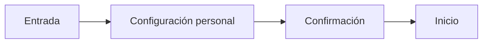

# CHG-091 · Acceso y menu de perfil
**Estado:** Cerrado
**Nivel:** S
**Modelo sugerido:** estandar
<!-- Estados y nivel se cambian SOLO con node .claude/team.mjs. Modelo: un perfil de docs/TEAM_MODELS.md -->
**Creado:** 2026-11-11 · **Aprobado:** 2026-11-11 · **Cerrado:** 2026-11-11
**Relacionado:** —

## 0. En palabras simples
Popover de cuenta accesible con perfil y cierre de sesión POST.
Comprobar: Avatar → Mi perfil / Cerrar sesión.

## 1. Resumen
Implementar el plan Primera experiencia guiada y personalización de MiSo aprobado expresamente por el usuario el 2026-11-11. Conservar datos y cambios ajenos; no publicar ni migrar datos reales.

## 2. Producto
Usuarios nuevos estudiantes y empleados. Cuentas existentes conservan comportamiento hasta personalización voluntaria. Sin proveedor externo de analítica.
Criterio: completar el recorrido sin duplicados, con datos aislados por usuario.

## 3. UX/UI
### 3.1 Experiencia
Plantilla: dashboard y ajustes existentes; guía de cinco pasos, FAB y form-dialog para creación.
```text
Avatar → Mi perfil / Cerrar sesión
[Explicación breve y estado guardado]
[Anterior] [Continuar]
```

### 3.2 Visual
Reutilizar x-ui.menu, x-ui.field, x-ui.fab, x-ui.form-dialog y tokens M3. Responsive, teclado, foco y errores visibles.
### 3.3 Escritura
Español claro; compañero motivador sin culpa. Ocultar conserva datos y recordatorios.

## 4. Diseño técnico
Usar module_settings por usuario; catálogo config/modules.php; middleware solo rutas web autenticadas. Sin cambios de API/MCP, notificaciones o reglas de juego. Transacciones y bloqueo para reintentos.

## 5. Pruebas
Pruebas PHP focalizadas, build, ui:conformance, navegador móvil/escritorio y diff check. Verificar navegación, validación, aislamiento y reanudación.

## 6. Documentación
Registrar implementación, evidencia y límites en este CHG y guía de primera experiencia.

## 7. Tareas
- [x] T1 · Implementar comportamiento aprobado y pruebas focalizadas — Resp: developer — Modelo: estandar — Archivos: app, resources, tests — Hecho cuando: recorrido funcional, aislamiento y validaciones correctas.
- [x] T2 · Verificar y documentar resultado local — Resp: developer — Modelo: estandar — Archivos: docs — Hecho cuando: evidencia y pendientes explícitos.

## 8. Bitácora de implementación

- 2026-11-11 — Implementado localmente el alcance aprobado. Formularios compartidos, preferencias con usuario explícito y guía obligatoria solo para registros nuevos; cuentas existentes preservadas. Sin migraciones nuevas ni cambios de datos reales, commits o publicación.
- Validación: 14 pruebas PHP focalizadas de registro/personalización/aislamiento y perfiles correctas; 3 recorridos completos Playwright a 390/768/1440 correctos, con comprobación axe de guía/cuenta, teclado, posición del popover antes/después de morph, creación, personalización y logout. Build correcto; git diff --check correcto.
- Regresión adicional: 48/49 pruebas correctas. HomeDashboardTest::test_dashboard_renders_all_home_sections falla por exigir md-module-shell, ausente también en las vistas de HEAD; fallo reproducido con vistas originales en storage/framework/testing/experience-baseline-views, sin restaurar ni alterar el trabajo actual.
- ui:conformance: 235 desviaciones frente a 345 inventariadas; falla por excesos existentes en day-tile-info, focus-companion, game-collection, guardian-card, checkin-sheet y task-list. Ningún archivo nuevo de esta entrega aparece entre los excesos. No se modifica la baseline ni se amplía el alcance para corregirlos.
- Evidencia local: storage/framework/testing/personal-experience-{php,regression,baseline}.json; personal-experience-conformance.txt; personal-experience-build.txt; capturas y traces en storage/framework/testing/playwright/personal-experience. Guía y protocolo: docs/first-experience.md.
- Pendiente externo: comprobación del entorno publicado y estudio con participantes. Los resultados locales no prueban retención. Se entrega En verificación, sin cierre automático de producto.


- 2026-11-11 — Variante anclada extraída al componente x-ui.popover (variant=anchored) y su capa patterns, conservando responsive como predeterminado. Se retiran overrides locales de la cuenta. Dos pruebas del contrato compartido verifican que la cuenta no usa scrim/arrastre y que los filtros conservan su hoja. Validado con 25 pruebas PHP correctas y 3 recorridos responsive, Escape/foco y anclaje tras morph correctos. Build y diff check correctos.

## 9. Preguntas abiertas, decisiones e historial
- 2026-11-11 — Usuario aprobó el plan completo y ordenó implementarlo. Sin preguntas abiertas.
- 2026-11-11 — Aprobado por el usuario (Compuerta 2)
- 2026-11-11 — Movido a in-progress/ (En desarrollo)
- 2026-11-11 — Implementación terminada → En verificación
- 2026-11-11 — Reabierto: Mover variante anclada de cuenta al patron canonico: contrato de capas CSS
- 2026-11-11 — Implementación terminada → En verificación
- 2026-11-11 — Cerrado por el usuario sin verificación: ya lo probé → done/ (desde el panel)
