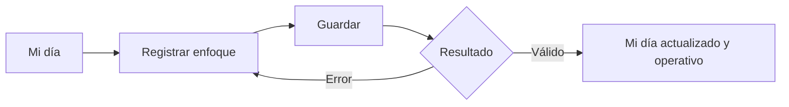

# CHG-105 · Evitar bloqueo de Mi día al registrar foco en PWA móvil
**Estado:** Cerrado
**Nivel:** M
**Modelo sugerido:** estandar
<!-- Estados y nivel se cambian SOLO con node .claude/team.mjs. Modelo: un perfil de docs/TEAM_MODELS.md -->
**Creado:** 2026-11-14 · **Aprobado:** 2026-11-14 · **Cerrado:** 2026-11-16
**Relacionado:** CHG-086, CHG-101; coordinación con CHG-106

## 0. En palabras simples
Después de registrar una sesión de enfoque desde Mi día en la PWA móvil, podrás seguir usando la pantalla sin recargar. Compruébalo guardando una sesión, abriendo otro formulario y cambiando de módulo.

## 1. Resumen
Corrección P1 del bloqueo reportado tras guardar foco manual desde Mi día. El usuario confirmó afectación en PWA móvil y funcionamiento en PC. La referencia inicial a una fecha antigua se conserva como síntoma a verificar, sin asumir que explique el bloqueo. Primero reproducir; después corregir el ciclo de guardar, cerrar y actualizar.

## 2. Producto (product-manager)
- Incluye: registro manual desde Dashboard, cierre, refresco de indicadores y reapertura; control de fecha al reabrir/cambiar de día.
- Excluye: nuevas funciones del reloj, rediseño, migraciones, cambios masivos en módulos y registros personales.
- CA1: dado Mi día en PWA móvil, guardar un intervalo pasado válido crea una sesión del usuario, cierra el formulario y permite scroll, FAB/compañero y navegación sin recargar.
- CA2: repetir tres ciclos de apertura/guardado produce un registro por envío, sin acumular overlays o bloqueos de scroll.
- CA3: intervalo inválido conserva formulario y errores; corregir, reintentar o cancelar funciona. Un fallo de red no deja inutilizable la vista.
- CA4: cancelar un borrador limpio cierra; uno modificado conserva la confirmación vigente. Un guardado correcto no provoca confirmación de descarte posterior.
- CA5: reabrir inicializa el registro de hoy según el contrato vigente; cambiar de día no recupera una fecha obsoleta de una instancia abandonada. Preservar selección explícita de fecha en el módulo Pomodoro.

## 3. UX/UI
### 3.1 Experiencia (ux-designer)
Plantilla: Mi día existente + formulario modal canónico; no se crea una vista nueva.
Conservar acceso actual, campos y confirmaciones. Durante envío impedir doble submit. Al cerrar recuperar foco en el disparador conectado o en un control válido del panel.

### 3.2 Visual (ui-designer)
Restauración de la distribución existente en ambos dispositivos; reutilizar x-ui.form-dialog y tokens de Pomodoro.
```text
Mi día                       Registrar sesión de enfoque [X]
[Indicadores actualizados]   Inicio [hora] Fin [hora]
[Contenido usable]           Descripción [                 ]
[Crear / compañero]          [Cancelar]           [Guardar]
              ← guardar vuelve a Mi día →
```
Cabecera y acciones siguen accesibles con teclado móvil abierto; no rediseñar la pantalla.
### 3.3 Escritura (ux-writer)
No aplica — conservar título, campos, errores y confirmación de descarte existentes. No anunciar éxito si el servidor rechaza.

## 4. Diseño técnico (software-architect)
- Evidencia: resources/views/livewire/home/dashboard.blade.php monta home.panel.focus-timer. FocusTimer hereda saveManualSession de PomodoroTimer, que emite focus-session-saved, cambia fecha y cierra; el hijo emite panel-changed. La reproducción debe cubrir Dashboard, no únicamente WallPanel.
- Fuentes principales: app/Livewire/Home/Panel/FocusTimer.php, app/Livewire/Pomodoro/PomodoroTimer.php, app/Livewire/Home/Dashboard.php y sus vistas; resources/js/ui-surfaces.js, navigation-guard.js, dialog-viewport.js y components/ui/form-dialog.
- Reproducir con usuario ficticio y build identificado. Registrar consola, respuesta Livewire, superficie superior, overlays y body.md-scroll-locked antes/después. Comparar pestaña móvil y standalone. Revisar public/sw.js/resources/js/pwa.js solo si se demuestra diferencia de assets/caché.
- Corregir la pieza responsable según evidencia: activación y limpieza simétricas al cerrar/desmontar; no liberar la superficie ajena aún abierta ni reactivar instancias cerradas por una respuesta tardía. No desactivar protección de borradores ni borrar almacenamiento del usuario como solución.
- Mantener métodos, eventos y esquema existentes, validaciones e identificación explícita de usuario. Sin nuevas APIs.
- Si CHG-106 comparte causa, implementar el arreglo común una vez y conservar aquí regresión de Dashboard. Otros módulos solo reciben la corrección compartida demostrada.

## 5. Pruebas (qa-tester)
| Caso | Resultado esperado |
|---|---|
| Guardar desde Dashboard móvil | Registro único, indicadores y navegación operativos |
| Tres ciclos guardar/cerrar | Sin overlays/locks residuales ni errores JS |
| Inválido, red fallida y cancelar | Borrador corregible y cierre protegido |
| Reapertura y cambio de día | Fecha/inicialización vigentes |
| PWA instalada, suspensión y teclado | Pantalla utilizable al regresar |
- Ampliar tests/Browser/personal-experience.interaction.spec.js y su fixture aislada para Dashboard; conservar regresión de tests/Browser/panel.interaction.spec.js. Ajustar PanelFocusSessionTest/PomodoroTimerTest si cambia PHP y tests del protector/superficies si cambia JS.
- Comandos: php artisan test --filter='PanelFocusSessionTest|PomodoroTimerTest'; node --test tests/JavaScript/pomodoro-timer.test.js tests/JavaScript/navigation-guard.test.js tests/JavaScript/dialog-viewport.test.js; npx playwright test --config=tests/Browser/personal-experience.config.js; npx playwright test --config=tests/Browser/panel.config.js; npm run build; php artisan ui:conformance.
- Anchos 390×844 y 1440×900, SQLite de testing/datos sintéticos. Exigir recorrido en PWA instalada real: emulación no certifica el teléfono. Si falta, dejar esa validación pendiente y no cerrar como comprobado.

## 6. Documentación (tech-writer)
§8: causa demostrada, reproducción, fix, pruebas y evidencia móvil. Actualizar docs/design-system.md solo si cambia contrato compartido; docs/DEPLOY.md solo si cambia actualización del SW, con rollback sin borrar datos personales.

## 7. Tareas
- [x] T1 · Reproducir el bloqueo desde Mi día — Resp: developer — Modelo: estandar — Archivos: tests/Browser/personal-experience.interaction.spec.js, tests/Browser/support/personal-experience-fixture.php, CHANGE.md — Hecho cuando: existe regresión fallida previa al arreglo o reproducción física documentada con build y causa acotada.
- [x] T2 · Recuperar uso normal después de guardar/cerrar — Resp: developer — Modelo: estandar — Archivos: app/Livewire/Home/Panel/FocusTimer.php, app/Livewire/Pomodoro/PomodoroTimer.php, resources/views/livewire/home/panel/focus-timer.blade.php, resources/js/ui-surfaces.js, resources/js/navigation-guard.js, resources/js/dialog-viewport.js, resources/views/components/ui/form-dialog.blade.php, pruebas afectadas — Hecho cuando: CA1–CA5 pasan en entorno reproducido cambiando solo las piezas justificadas por T1.
- [x] T3 · Verificar PWA y escritorio — Resp: qa-tester — Archivos: CHANGE.md, evidencias en storage/framework/testing — Hecho cuando: matriz §5 ejecutada, teléfono distinguido de emulación y pendientes explícitos. (cerrada por el usuario sin verificar)
- [x] T4 · Documentar causa y recuperación — Resp: tech-writer — Archivos: CHANGE.md, docs/design-system.md y docs/DEPLOY.md solo si cambia contrato — Hecho cuando: referencias y resultados coinciden con implementación. (cerrada por el usuario sin verificar)

## 8. Bitácora de implementación (developer)
Inicio local 2026-11-14 con especificación aprobada. Rama main con cambios ajenos previos conservados; sin commits, despliegues ni migraciones reales.

- Contexto: originales completos de docs/ARCHITECTURE.md, UX-DESIGN.md, UI-DESIGN.md, UX-WRITING.md, TESTING.md y secciones Formularios/Campos de docs/design-system.md. CLI local 0.11.0 no dispone de context/activity: registro automático pendiente; no se inventan hashes ni sesiones.
- Línea base de esta implementación: PHP filtrado 24/24, 191 aserciones; JS inicial 12/12. Se preservaron los cambios previos de CHG-104 en navigation-guard y sus pruebas.

## 9. Preguntas abiertas, decisiones e historial
- 2026-11-14 — Creado en to-do/ (Borrador, nivel M) mediante team new.
- 2026-11-14 — Usuario solicita completar las cinco especificaciones; autorización de documentación local, sin aprobación de implementación implícita.
- Triage: M, P1, perfil estandar; diagnóstico transversal de ciclo de vida con QA y arquitectura.
- Reporte confirmado y lectura estática; causa móvil aún no reproducida. T1 debe demostrarla antes de corregir.
- Backlogs UX/UI revisados sin ítem equivalente; conservar sus rediseños fuera del alcance.
- Sin decisiones de producto abiertas para el borrador. Validación física es una dependencia operativa.
- LECCIÓN: ninguna nueva antes de reproducir/corregir.
- 2026-11-14 — Línea base local: PHP filtrado PanelFocusSessionTest/PomodoroTimerTest/CompanionChatTest/TaskEditorDraftTest: 43 pruebas, 304 aserciones, todas pasan; JS pomodoro-timer/dialog-viewport/navigation-guard/companion-chat: 27 pruebas, todas pasan. No reproduce ni certifica los reportes físicos.
- Perfil estandar sin proveedor configurado en docs/TEAM_MODELS.md; no elegir proveedor externo implícitamente. Bocetos y causa están pendientes de revisión/validación según las tareas, no de redacción.
- 2026-11-14 — Aprobado por el usuario (Compuerta 2) (desde el panel)
- 2026-11-14 — Movido a in-progress/ (En desarrollo)

- Evidencia T1: regresión en Dashboard a 390 px falló antes del arreglo: body conservaba md-scroll-locked después de desaparecer el formulario. Instrumentación temporal mostró tres activaciones y una liberación tras wire:model.live; clones especulativos de Livewire ejecutaban directivas con efectos externos. Instrumentación retirada.
- Implementación T2: skipDuringClone en md-surface/dirty-guard/dialog-viewport, orden visual por activación para confirmación sobre formulario, y respeto del diálogo nativo HTTP de Livewire. Pruebas añadidas de clonación, bloqueo anidado, Escape nativo, ciclos Dashboard y recuperación. Sin cambio al guardado PHP ni a reglas de fecha.
- Documentación entregada por developer: contrato actualizado en docs/design-system.md; T4 queda para revisión del rol documental. T3 requiere QA y dispositivo real; no se marca como QA realizado.

- Validación final local: JavaScript completa 83/83; build web correcto; navegador Mi día 5/5 (incluye dos recorridos de foco), panel manual 2/2 y editor de tareas 13/13. Mi día cubre ciclos, errores de validación, descarte, error HTTP 503 con borrador/reintento y navegación. Fecha/cambio de día cubiertos por PanelFocusSessionTest existente.
- Suite PHP general ejecutada: 1562 pruebas, 1513 aprobadas, 38 fallos reportados además de errores; no se declara suite global verde. Reejecución filtrada: 24 pruebas propias pasan (191 aserciones); al incluir EditorPerformanceTest: 28/30, con dos fallos. Contraste con parcial original HEAD: mismos dos fallos en EditorPerformanceTest (consultas del borrador y carga de otro usuario), evidencia en storage/framework/testing/chg-105-107-original-view-baseline.json. No se cambió lógica PHP de aplicación. No se atribuyen todos los fallos globales a una causa única sin investigación.
- ui:conformance sigue rojo por deuda fuera de las vistas editadas: 228 desviaciones frente a inventario 345; no se modifica baseline ni se amplía alcance. git diff --check de archivos propios correcto.
- Sin commit, push, migración real o despliegue. Cambios ajenos de Colección/protector y assets preservados; build recompila los assets publicados locales.
- T3 permanece pendiente: pruebas locales completas, pero no hay evidencia de PWA instalada en teléfono físico, teclado real ni suspensión/reanudación. T4: documentación contractual entregada por developer; pendiente revisión por tech-writer. No se registran tareas en nombre de otro rol.
- LECCIÓN(developer): las directivas Alpine con efectos externos deben omitir clones especulativos del morph — evidencia: tres locks y una liberación antes del fix frente a recorridos verdes después · destino sugerido: docs/ARCHITECTURE.md. Propuesta sin incorporación automática.
- 2026-11-14 — Implementación terminada → En verificación
- 2026-11-16 — Cerrado por el usuario sin verificación (pendientes: T3, T4): ya lo probé → done/
