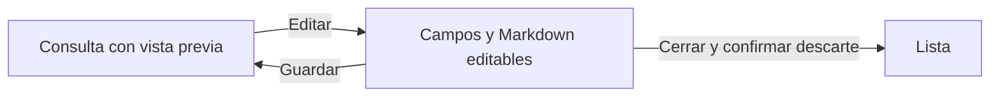

# CHG-107 · Editar tareas y Markdown con una sola acción
**Estado:** Cerrado
**Nivel:** S
**Modelo sugerido:** estandar
<!-- Estados y nivel se cambian SOLO con node .claude/team.mjs. Modelo: un perfil de docs/TEAM_MODELS.md -->
**Creado:** 2026-11-14 · **Aprobado:** 2026-11-14 · **Cerrado:** 2026-11-16
**Relacionado:** CHG-015; coordinación con CHG-108

## 0. En palabras simples
Verás el botón «Editar» en la tarea. Al tocarlo podrás escribir en los campos y la descripción Markdown sin activar un segundo modo. Abrir para consultar seguirá mostrando la descripción en vista previa.

## 1. Resumen
Mejora P2 del editor individual compartido. Hoy el lápiz solo cambia editingContent y descriptionMode sigue en preview. Cambiar ambos con una acción y etiqueta visible; también respetar accesos que solicitan edición explícita tras cargar el registro.

## 2. Producto (product-manager)
- Incluye: editor individual y entradas explícitas de edición; consulta/creación como regresión.
- Excluye: editor masivo, rediseño de propiedades, nuevas funciones Markdown y cambios al paquete externo.
- CA1: abrir para consultar conserva Markdown en preview y muestra «Editar» con lápiz decorativo.
- CA2: un toque en «Editar» habilita contenido y cambia descriptionMode a write y editor visible a edit sin alterar el texto.
- CA3: abrir con mode=edit o intención de programación que ya habilita contenido aplica escritura después de cargar; una respuesta tardía no devuelve el modo a preview ni modifica otro borrador.
- CA4: crear inicia en escritura. El usuario puede alternar Vista previa/Editar durante edición; cambiar sección o renderizar no anula esa elección.
- CA5: Guardar conserva guardado único y retorno a consulta. Cancelar/cerrar mantiene protección del borrador. Reabrir consulta vuelve a preview.

## 3. UX/UI
### 3.1 Experiencia (ux-designer)
Plantilla: editor modal de tarea existente, sin vista nueva. Consulta → Editar → contenido y Markdown editables en un toque. No forzar foco en descripción ni teclado antes de elegir campo.

### 3.2 Visual (ui-designer)
Botón de texto canónico con bi-pencil y etiqueta visible en móvil/escritorio. Mantener título, expandir y X a 360/390 px; no depender de tooltip.
```text
[icono] Editar tarea    [lápiz Editar] [Expandir] [X]
Título       [Texto editable                      ]
Descripción  [Editar] [Vista previa]
             [Texto Markdown editable             ]
[Cancelar]                                [Guardar]
```
### 3.3 Escritura (ux-writer)
Cabecera: texto visible, title y nombre accesible «Editar». Icono aria-hidden. Mantener etiquetas de modos Markdown y Guardar/Cancelar existentes. La acción se reconoce sin hover.

## 4. Diseño técnico (software-architect)
- Fuentes: resources/views/livewire/task/partials/edit-task-dialog.blade.php, resources/js/form-editor.js, resources/js/markdown-adapter.js y app/Livewire/Task/TaskEditor.php.
- La parcial comparte consumidores: limitar cabecera a editor individual con editingContent. No alterar Salud ni asumir descriptionMode en todos los usuarios de ltFormEditor.
- Centralizar entrada en edición: editingContent=true y descriptionMode='write' con $wire.$set(..., false), sin petición extra. Tras await de carga aplicar intención explícita solo si generation sigue vigente.
- Reutilizar adaptador existente: observa descriptionMode y emite markdown-editor-set-mode con editorId y mode edit/preview. No cambiar paquete ni emitir cambios sin editorId.
- No usar efecto permanente ligado a editingContent: forzaría escritura después de que la persona elija Vista previa. Sin cambios de endpoint/esquema/evento público task-editor; conservar aislamiento y guardado.

## 5. Pruebas (qa-tester)
- Ampliar tests/Browser/task-editor.interaction.spec.js: consulta preview; Editar con un toque; texto Unicode íntegro; intención edit tras carga; respuesta obsoleta; preview manual tras render; guardar/reabrir; cancelar/descarte; creación; dos editores sin interferencia.
- Ampliar TaskEditorDraftTest solo si cambia PHP; si cambia carga asíncrona asegurar caso generation obsoleto.
- Comandos: php artisan test --filter=TaskEditorDraftTest; npx playwright test tests/Browser/task-editor.interaction.spec.js --project=interaction --workers=1; npm run build; php artisan ui:conformance; git diff --check.
- Revisar 360/390×844 y 1440×900, nombres accesibles y teclado. Usar SQLite de testing y tareas ficticias. No confundir pasar tests actuales con demostrar el nuevo comportamiento.

## 6. Documentación (tech-writer)
Actualizar párrafo de Tareas en docs/design-system.md: «Editar» activa contenido y escritura Markdown; consulta conserva preview. No duplicar documentación del paquete.

## 7. Tareas
- [x] T1 · Habilitar contenido y Markdown con «Editar» — Resp: developer — Modelo: estandar — Archivos: resources/views/livewire/task/partials/edit-task-dialog.blade.php, resources/js/form-editor.js, resources/js/markdown-adapter.js solo si necesario, tests/Browser/task-editor.interaction.spec.js — Hecho cuando: CA1–CA5 pasan sin segundo clic, pérdida de texto o cambios forzados del preview elegido.
- [x] T2 · Verificar editor y actualizar contrato — Resp: developer — Modelo: estandar — Archivos: tests/Feature/TaskEditorDraftTest.php si cambia PHP, docs/design-system.md, CHANGE.md — Hecho cuando: validaciones pertinentes/build pasan, responsive revisado y fallos preexistentes separados.

## 8. Bitácora de implementación (developer)
Inicio local 2026-11-14 con especificación aprobada. Rama main con cambios ajenos previos conservados; sin commits, despliegues ni migraciones reales.

- Contexto: originales completos de docs/ARCHITECTURE.md, UX-DESIGN.md, UI-DESIGN.md, UX-WRITING.md, TESTING.md y secciones Formularios/Campos de docs/design-system.md. CLI local 0.11.0 no dispone de context/activity: registro automático pendiente; no se inventan hashes ni sesiones.
- Línea base de esta implementación: PHP filtrado 24/24, 191 aserciones; JS inicial 12/12. Se preservaron los cambios previos de CHG-104 en navigation-guard y sus pruebas.

## 9. Preguntas abiertas, decisiones e historial
- 2026-11-14 — Creado en to-do/ (Borrador, nivel S) mediante team new.
- 2026-11-14 — Usuario solicita completar especificación; sin aprobación de implementación.
- Triage: S, P2, estandar; flujo acotado a editor compartido, con aportes UX, UI, escritura, arquitectura y QA.
- Evidencia estática: botón cambia solo editingContent; adaptador ya sincroniza descriptionMode. Comprobación visual pendiente.
- Backlogs UX/UI revisados sin ítem equivalente; sin decisiones abiertas para el borrador.
- LECCIÓN: ninguna nueva antes de implementación/verificación.
- 2026-11-14 — Línea base local: PHP filtrado PanelFocusSessionTest/PomodoroTimerTest/CompanionChatTest/TaskEditorDraftTest: 43 pruebas, 304 aserciones, todas pasan; JS pomodoro-timer/dialog-viewport/navigation-guard/companion-chat: 27 pruebas, todas pasan. No reproduce ni certifica los reportes físicos.
- Perfil estandar sin proveedor configurado en docs/TEAM_MODELS.md; no elegir proveedor externo implícitamente. Bocetos y causa están pendientes de revisión/validación según las tareas, no de redacción.
- 2026-11-14 — Aprobado por el usuario (Compuerta 2) (desde el panel)
- 2026-11-14 — Movido a in-progress/ (En desarrollo)

- Implementación T1: botón de texto Editar llama beginContentEdit; sincroniza descriptionMode solo si el editor declara ese campo. Intenciones edit/schedule aplican escritura después de cargar con guardia generation. Se conserva preview manual y el adaptador existente.
- Regresión: 7 pruebas de estado de editor, incluidas respuesta tardía y consumidor sin Markdown; navegador a 360/390/1440 valida consulta, etiqueta, escritura, preview tras render, Unicode, guardar, descartar y entrada explícita. Capturas task-consult-* y task-edit-* en storage/framework/testing/playwright.
- Revisión visual: captura 360 px inspeccionada; título, Editar, expandir, X y footer visibles. No se modificó layout global. Contrato Tareas actualizado en docs/design-system.md.

- Validación final local: JavaScript completa 83/83; build web correcto; navegador Mi día 5/5 (incluye dos recorridos de foco), panel manual 2/2 y editor de tareas 13/13. Mi día cubre ciclos, errores de validación, descarte, error HTTP 503 con borrador/reintento y navegación. Fecha/cambio de día cubiertos por PanelFocusSessionTest existente.
- Suite PHP general ejecutada: 1562 pruebas, 1513 aprobadas, 38 fallos reportados además de errores; no se declara suite global verde. Reejecución filtrada: 24 pruebas propias pasan (191 aserciones); al incluir EditorPerformanceTest: 28/30, con dos fallos. Contraste con parcial original HEAD: mismos dos fallos en EditorPerformanceTest (consultas del borrador y carga de otro usuario), evidencia en storage/framework/testing/chg-105-107-original-view-baseline.json. No se cambió lógica PHP de aplicación. No se atribuyen todos los fallos globales a una causa única sin investigación.
- ui:conformance sigue rojo por deuda fuera de las vistas editadas: 228 desviaciones frente a inventario 345; no se modifica baseline ni se amplía alcance. git diff --check de archivos propios correcto.
- Sin commit, push, migración real o despliegue. Cambios ajenos de Colección/protector y assets preservados; build recompila los assets publicados locales.
- T1 y T2 verificadas localmente. Capturas 360/390/1440 revisadas por geometría y muestra visual 360 inspeccionada; consulta conserva preview y Editar habilita escritura sin forzarla tras renders. Siguiente paso: QA; no cierre automático.
- LECCIÓN: ninguna adicional a la propuesta compartida de CHG-105.
- 2026-11-14 — Implementación terminada → En verificación
- 2026-11-16 — Cerrado por el usuario (Compuerta 3) → done/
