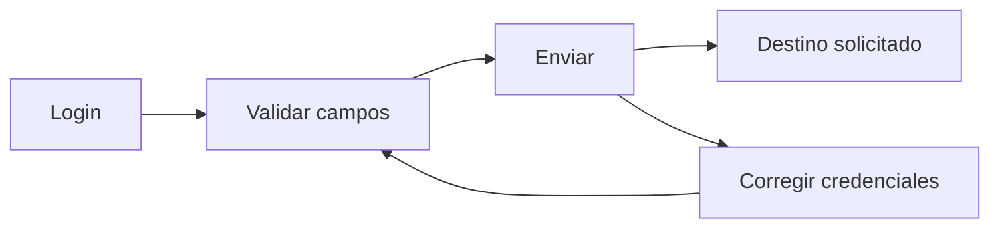

# CHG-114 · Login MiSo: Refugio vivo
**Estado:** Cerrado
**Nivel:** M
**Modelo sugerido:** estandar
**Creado:** 2026-11-15 · **Aprobado:** 2026-11-15 · **Cerrado:** 2026-11-16
**Relacionado:** Plan aprobado en esta conversación.

## 0. En palabras simples
El login se convierte en una ventana hacia un jardín que cambia con la hora. Se puede entrar con teclado, mostrar contraseña y corregir errores junto a los campos. Comprobar en /login desde móvil y escritorio.

## 1. Resumen
Implementar el plan Login MiSo: Refugio vivo, aprobado explícitamente por el usuario. Diseño directo para producción; entrega local sin despliegue.

## 2. Producto (product-manager)
Primera impresión acogedora para usuarios de MiSo. Incluye login, tres ambientes, accesibilidad y estados. Excluye registro, recuperación, personajes, variaciones semanales y cambios de autenticación. Dada una hora local, la escena corresponde a su franja; dado un error, se puede corregir y volver a entrar.

## 3. UX/UI
### 3.1 Experiencia (ux-designer)
Un formulario con correo, contraseña, Recordarme y enlace de registro. Validación al blur/envío, mensajes asociados, foco al primer error; estado de envío sin duplicados. Sin JS conserva POST HTML. Autofill, teclado y lector de pantalla compatibles.

### 3.2 Visual (ui-designer)
Nunito, tokens M3, x-ui.field, x-ui.action e icon-button. Ilustración SVG local de ventana, jardín, colinas y lámpara. Mañana 05–12, tarde 12–18, noche 18–05 según dispositivo. Decoración con transform/opacity, máximo 5 s; estática con movimiento reducido. Formulario independiente de la paleta ambiental y compatible con tema del sistema. Un layout CSS: columnas desde 768 px; cabecera compacta debajo. Safe areas y scroll natural.
```text
Escritorio
+------------------------+-------------------------+
| MiSo                   | Bienvenido a MiSo       |
| Ventana y jardín       | Correo electrónico      |
| Cielo según la hora    | [                     ] |
|                        | Contraseña              |
| Tu espacio para        | [                   o ] |
| avanzar a tu ritmo     | [ ] Recordarme          |
|                        | [ Iniciar sesión      ] |
|                        | ¿No tienes cuenta?      |
|                        | Regístrate              |
+------------------------+-------------------------+
Móvil
+-------------------------+
| MiSo · ventana y jardín |
| Tu espacio para avanzar |
| a tu ritmo              |
+-------------------------+
| Bienvenido a MiSo       |
| Correo electrónico      |
| [                     ] |
| Contraseña              |
| [                   o ] |
| [ ] Recordarme          |
| [ Iniciar sesión      ] |
| ¿No tienes cuenta?      |
| Regístrate              |
+-------------------------+
```
### 3.3 Escritura (ux-writer)
Título: Bienvenido a MiSo. Mensaje: Tu espacio para avanzar a tu ritmo. Saludos: Buenos días / Buenas tardes / Buenas noches. Campos: Correo electrónico / Contraseña. Acciones: Mostrar contraseña / Ocultar contraseña / Iniciar sesión / Iniciando sesión… / Regístrate. Error de credenciales: El correo o la contraseña no coinciden. Revisa los datos e inténtalo de nuevo. Validaciones: Ingresa tu correo electrónico / Ingresa un correo electrónico válido / Ingresa tu contraseña. Voz de tú, directa y sin humor en errores.

## 4. Diseño técnico (software-architect)
Archivos: resources/views/auth/login.blade.php; resources/views/auth/partials/refuge.blade.php; resources/css/m3/patterns/_auth.css; public/js/auth/login.js; app/Http/Controllers/Auth/LoginController.php; tests/Feature/Auth/LoginTest.php; tests/Browser/login.config.js; tests/Browser/login.interaction.spec.js; public/css/app.css y assets generados por npm run build; este CHANGE.md.
JS aislado, servido con asset() y cache busting; sin importar el bundle completo de la app. SVG decorativo oculto a tecnologías asistivas. Tema del sistema mediante CSS con tokens locales al login. Sin JS escena neutra estática y validación servidor/navegador. Conservar CSRF, sesión, remember, redirección intended y mensaje Android. No tocar rutas, BD, registro ni cambios ajenos. Build puede regenerar bundles compartidos existentes: conservar su contenido actual.

## 5. Pruebas (qa-tester)
| Caso | Tipo | Nivel | Test |
|---|---|---|---|
| Acceso, error, validación, remember, intended | Automatizada | Feature | LoginTest |
| Franjas, blur, envío, contraseña, historial, no JS | Automatizada | Browser | login.interaction.spec.js |
| 320/390/768/1440, tres franjas, ambos temas | Capturas | Browser | login.interaction.spec.js |
| Contraste, teclado, reduced motion, zoom y viewport bajo | Automatizada/visual | Browser | login.interaction.spec.js |
Comandos: php artisan test --filter=LoginTest; npx playwright test -c tests/Browser/login.config.js; npm run build; php artisan ui:conformance; git diff --check.
Vigilar consentimiento OAuth que comparte _auth.css, tema, Android y POST sin JS. Sin datos reales: pruebas Feature en SQLite en memoria; browser usa GET y POST interceptados salvo validaciones sin autenticación.

## 6. Documentación (tech-writer)
Este CHG conserva decisiones y evidencia. Falta docs/DOCUMENTATION.md; no crear gobierno documental fuera del alcance. CLI actual sin context/activity: registro manual en bitácora.

## 7. Tareas
- [x] T1 · Crear refugio responsive y formulario accesible — Resp: developer — Archivos: vistas auth, _auth.css, public/js/auth/login.js, LoginController.php — Hecho cuando: escena, campos y estados cumplen el diseño aprobado.
- [x] T2 · Verificar acceso y experiencia visual — Resp: developer — Archivos: tests/Feature/Auth/LoginTest.php, tests/Browser/login* y assets generados — Hecho cuando: pruebas afectadas, build, conformance y revisión visual completados con evidencia y límites explícitos.

## 8. Bitácora de implementación (developer)
- 2026-11-15 — T2: php artisan test --filter=LoginTest: 7 pasan, 54 aserciones. npx playwright test -c tests/Browser/login.config.js: 44 pasan (1.4 min), incluyendo 32 análisis axe sin infracciones AA, límites horarios, formulario, POST sin JS, espera/duplicados, historial y teclado. npm run build: correcto (advertencia de tamaño en bundle compartido preexistente). node --check public/js/auth/login.js: correcto. git diff --check sobre los archivos propios, incluidos nuevos por --no-index: correcto. Registro CHG validado con CLI. Comprobaciones globales no pasan por hallazgos previos detallados en §9.
- 2026-11-15 — T1: refugio SVG local con tres franjas, saludo por reloj local y actualización en límite/retorno; layout CSS responsive, formulario canónico, tema del sistema aislado al login y fallback HTML sin JS. Se preservan bridge Android, CSRF, sesión, remember e intended. JS en public/js/auth/login.js para que publish-vite-css no lo elimine al limpiar archivos .js del directorio superior.
- 2026-11-15 — Pruebas detectaron pérdida transitoria de contraste durante el fade de entrada: sustituido por desplazamiento sin reducir opacidad. Foco visible explícito en campos y enlace de marca. Atributos aria-describedby sin duplicados ante errores del servidor.
- 2026-11-15 — Errores de pruebas inicialmente debidos a inyección manual de ViewErrorBag con sesiones JSON y espera de navegación en Playwright: las pruebas finales siguen redirects reales y observan el estado antes de la navegación. No se cambió la configuración de sesiones ni se relajaron aserciones funcionales.
- 2026-11-15 — Contexto leído directamente: PRODUCT, ARCHITECTURE, UX-DESIGN, UI-DESIGN, UX-WRITING, TESTING y secciones pertinentes de design-system. CLI sin context/activity. Se preservan cambios previos CHG-111/112/113.

## 9. Preguntas abiertas, decisiones e historial
- Límites: revisión en Chromium automatizado; viewport bajo simula espacio disponible con teclado y 720 CSS px representa escritorio de 1440 al 200 %. No equivale a prueba en Android físico ni uso manual de lector de pantalla. El script bridge existente se conserva y se comprueba en HTML.
- Conformidad global: ui:conformance encuentra 213 infracciones, con exceso sobre inventario en day-tile-info, game-collection, checkin-sheet y task-list; son superficies ajenas, sin cambios por CHG-114. Login y su SVG: cero infracciones, protegido por LoginTest. CssLayerContractTest tiene dos fallos previos en dependencias de _text-fields.css hacia patterns y overrides de _game.css/_habits.css; HEAD confirma las dependencias, y los módulos ya estaban modificados al iniciar. No se amplía el alcance para corregirlos.
- Evidencia visual: storage/framework/testing/login-captures contiene 24 capturas de las tres franjas por cuatro anchos y dos temas, ocho capturas de errores y cuatro hojas de contacto. Se inspeccionaron las 32 capturas mediante hojas de contacto y vistas representativas ampliadas.
- 2026-11-15 — Usuario aprobó el plan completo y pidió implementarlo, incluyendo registro/aprobación del CHG. No se requiere nueva aprobación del mismo alcance.
- LECCIÓN: ninguna nueva para incorporar a los lineamientos.
- 2026-11-15 — Aprobado por el usuario (Compuerta 2)
- 2026-11-15 — Movido a in-progress/ (En desarrollo)
- 2026-11-15 — Implementación terminada → En verificación
- 2026-11-16 — Cerrado por el usuario (Compuerta 3) → done/
