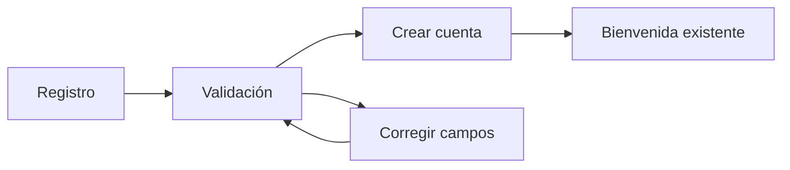

# CHG-115 · Registro MiSo: bienvenida en Refugio vivo
**Estado:** Cerrado
**Nivel:** M
**Modelo sugerido:** estandar
**Creado:** 2026-11-15 · **Aprobado:** 2026-11-15 · **Cerrado:** 2026-11-16
**Relacionado:** CHG-114

## 0. En palabras simples
El registro recibe a las personas con el mismo jardín del login, explica cómo empezar y permite corregir los datos fácilmente. Comprobar en /register y continuar a /bienvenida al crear la cuenta.

## 1. Resumen
Implementar la propuesta aprobada en conversación mediante «Sí implementa»: registro breve, acogedor y coherente con Refugio vivo, sin nuevas preguntas ni cambios de política de cuentas.

## 2. Producto (product-manager)
Primera experiencia para usuarios nuevos. Incluye nombre, correo, contraseña y confirmación; validaciones, ayuda, envío único y continuidad hacia bienvenida. Excluye modificaciones de onboarding, recuperación, verificación de correo, datos reales y despliegue. Dado un registro válido, se crea exactamente una cuenta con sus datos iniciales, se inicia sesión y se dirige a bienvenida. Dado un error, se conserva nombre/correo y se puede corregir.

## 3. UX/UI
### 3.1 Experiencia (ux-designer)
Un formulario. Validación al blur y envío; revalidación de confirmación si cambia contraseña. Errores asociados a campo; foco al primero; mostrar cada contraseña por separado. Reglas iguales al servidor (mínimo ocho caracteres). Estado Creando tu cuenta… y bloqueo de duplicados; restauración al volver. Sin JS POST nativo y servidor. No añadir campos personales propios de bienvenida.

### 3.2 Visual (ui-designer)
Reutilizar escena SVG y CSS del login, extrayendo marco Blade compartido; conservar su identidad y comportamiento. Dos columnas desde 768 px, cabecera compacta debajo. Mismos tres horarios y temas independientes del formulario, movimiento máximo cinco segundos y reduced motion. Nunito, M3 y x-ui.field/action/icon-action. El formulario largo permite scroll y safe areas.
```text
Escritorio
+-------------------------+-------------------------+
| MiSo                    | Crea tu cuenta          |
| Tu próximo pequeño paso | Nombre                  |
| empieza aquí.           | [                     ] |
|                         | Correo electrónico      |
| Ventana y jardín        | [                     ] |
| según la hora           | Contraseña        [ojo] |
|                         | Usa 8 caracteres o más. |
|                         | Confirmar         [ojo] |
|                         | [ Crear mi cuenta     ] |
|                         | ¿Ya tienes cuenta?      |
|                         | Inicia sesión           |
+-------------------------+-------------------------+
Móvil
+-------------------------+
| MiSo · escena compacta  |
| Tu próximo pequeño paso |
| empieza aquí.           |
+-------------------------+
| Crea tu cuenta          |
| Nombre / correo         |
| Contraseña / confirmar  |
| [ Crear mi cuenta     ] |
| ¿Ya tienes cuenta?      |
| Inicia sesión           |
+-------------------------+
```
### 3.3 Escritura (ux-writer)
Escena: Tu próximo pequeño paso empieza aquí. Apoyo: Hábitos, objetivos y un espacio para ti. Empieza con lo que más te importa. Formulario: Crea tu cuenta. Intro: Después te acompañamos a preparar tu espacio. Campos Nombre, Correo electrónico, Contraseña, Confirmar contraseña. Ayuda: Usa 8 caracteres o más. Acciones: Crear mi cuenta, Creando tu cuenta…, Mostrar/Ocultar contraseña y Mostrar/Ocultar confirmación de contraseña. Errores serenos, directos, en tú; señalar nombre/correo demasiado largos, correo inválido/registrado, contraseña corta y confirmación distinta, sin humor ni promesas de privacidad no verificadas.

## 4. Diseño técnico (software-architect)
Archivos: resources/views/components/auth-shell.blade.php; resources/views/auth/{login,register}.blade.php; public/js/auth/login.js; resources/css/m3/patterns/_auth.css; app/Http/Controllers/Auth/RegisterController.php; tests/Feature/Auth/RegisterTest.php; tests/Browser/register.config.js; tests/Browser/register.interaction.spec.js; assets publicados por npm run build; este CHG.
Marco compartido, sin copiar escena ni CSS. Extender mejora progresiva existente con modo registro; mantener selectores y comportamiento del login. Conservar transacción, Hash, datos iniciales aislados por usuario, Auth::login, regeneración de sesión y redirección. Cambiar solo textos de validación y validación explícita de confirmación para ubicar su error en ese campo. Sin migraciones, rutas ni cambios ajenos.

## 5. Pruebas (qa-tester)
| Caso | Tipo | Nivel | Test |
|---|---|---|---|
| Crear cuenta, datos iniciales, aislamiento y bienvenida | Automatizada | Feature | RegisterTest, PersonalExperienceTest y MultitenancySchemaTest |
| Campos inválidos, duplicado, largos y contraseñas | Automatizada | Feature/Browser | RegisterTest y register.interaction.spec.js |
| 320/390/768/1440, ambos temas, tres franjas y errores | Capturas/axe | Browser | register.interaction.spec.js |
| Teclado, envío único, no JS, mostrar contraseñas y regresión login | Automatizada | Browser | register y login.interaction.spec.js |
Comandos: php artisan test --filter='RegisterTest|LoginTest|PersonalExperienceTest|MultitenancySchemaTest'; npx playwright test -c tests/Browser/register.config.js; npx playwright test -c tests/Browser/login.config.js; npm run build; php artisan ui:conformance; git diff --check.
Browser no crea cuentas reales: POST válidos interceptados, inválidos sin escrituras y errores de duplicado en SQLite de Feature. Pruebas en Chromium; dispositivo físico y lector de pantalla manual quedan explícitos como no comprobados.

## 6. Documentación (tech-writer)
Decisiones y evidencia en este CHANGE.md; mantener referencias a CHG-114. No crear documentos generales fuera del alcance.

## 7. Tareas
- [x] T1 · Compartir el refugio y crear el formulario de registro accesible — Resp: developer — Archivos: vistas auth, auth-shell, login.js, _auth.css, RegisterController — Hecho cuando: registro funciona con ayuda, validaciones y continuidad existentes sin duplicar marco.
- [x] T2 · Verificar registro y regresión del login — Resp: developer — Archivos: tests/Feature/Auth/RegisterTest.php, tests/Browser/register*, assets publicados y CHANGE.md — Hecho cuando: validaciones afectadas completas con evidencia y límites explícitos.

## 8. Bitácora de implementación (developer)
- T2: registro 40/40 pruebas de navegador (1.4 min), regresión login 44/44 (1.3 min); 32 análisis axe AA por pantalla sin infracciones. npm run build correcto, solo advertencia preexistente de tamaño de bundles compartidos; node --check del script correcto. git diff --check correcto en archivos propios, incluidos nuevos mediante --no-index. PHP final 25/25, 233 aserciones.
- Se inspeccionaron las 32 capturas del registro mediante cuatro hojas de contacto y ampliaciones de móvil y escritorio. Evidencia en storage/framework/testing/register-captures/{ancho}-{tema}-{franja|errors}.png y contact-{ancho}.png. El login conserva su evidencia en login-captures.
- Protección adicional dentro de las validaciones: valores previos de nombre/correo solo se renderizan si son strings. Un POST con campos de tipo array devuelve los errores y conserva el formulario operativo, sin crear cuentas; protegido por RegisterTest.
- T1: extraído x-auth-shell con documento, identidad, saludo, escena, títulos y nota común; login conserva formulario y selectores. Registro usa cuatro x-ui.field, ayuda de contraseña, dos icon-actions independientes y POST nativo. No se añadieron preguntas de bienvenida.
- Mejora progresiva compartida: modo registro para mínimos y confirmación, mensajes por campo, límites Unicode sin truncar el texto, errores de servidor persistentes hasta corregir su valor, estado de envío y restauración de historial. Se conserva el comportamiento del login.
- RegisterController conserva transacción, inicialización por usuario, hash, autenticación, regeneración e ingreso a bienvenida. Validación de coincidencia aplicada en password_confirmation para asociar el error a ese campo, con la misma exigencia de igualdad; textos explícitos en español.
- Corregido un error de compilación al extraer el marco: Blade no reconocía @endif pegado al texto anterior. El marco usa expresiones simples; las pruebas finales de render y rutas pasan. Ajustado balance de líneas del título del registro solo en móvil tras inspección a 320 px.
- PHP: php artisan test --filter='RegisterTest|LoginTest|PersonalExperienceTest|MultitenancySchemaTest': 25 pasan, 233 aserciones, SQLite en memoria. Incluye rollback de cuenta y catálogos si falla la inicialización y rechazo de correo duplicado sin modificar al dueño.
- Contexto vigente reutilizado de CHG-114: PRODUCT, ARCHITECTURE, UX-DESIGN, UI-DESIGN, UX-WRITING, TESTING y design-system; CLI sin context/activity y docs/DOCUMENTATION.md ausente. Se mantienen cambios previos. No se ejecuta suite global por instrucción del repo.

## 9. Preguntas abiertas, decisiones e historial
- Conformidad global: ui:conformance encuentra 203 infracciones frente a 213 antes del registro. Continúan excesos previos en day-tile-info, game-collection, checkin-sheet y task-list; ninguna superficie fue modificada por este cambio. RegisterTest protege cero infracciones en registro y marco compartido.
- Límites: Chromium automatizado, sin prueba en Android físico ni lector de pantalla manual. Viewport bajo simula el espacio disponible con teclado, no un teclado físico; 720 px CSS representa escritorio de 1440 al 200 %. Cuentas y pruebas transaccionales solo en SQLite aislado; navegador intercepta POST válidos y no crea usuarios reales.
- 2026-11-15 — Propuesta de registro aprobada expresamente por el usuario; registro del CHG refleja ese alcance, sin solicitar nueva confirmación.
- LECCIÓN: ninguna.
- 2026-11-15 — Aprobado por el usuario (Compuerta 2)
- 2026-11-15 — Movido a in-progress/ (En desarrollo)
- 2026-11-15 — Implementación terminada → En verificación
- 2026-11-16 — Cerrado por el usuario (Compuerta 3) → done/
