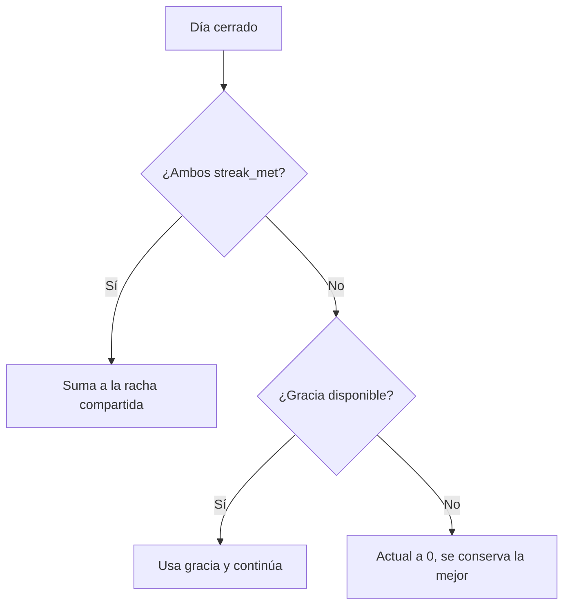

# CHG-123 · Social B: racha compartida sin castigo entre amigos
**Estado:** Cerrado
**Nivel:** M
**Modelo sugerido:** estandar
<!-- Estados y nivel se cambian SOLO con node .claude/team.mjs. Modelo: un perfil de docs/TEAM_MODELS.md -->
**Creado:** 2026-11-16 · **Aprobado:** 2026-11-16 · **Cerrado:** 2026-11-16
**Relacionado:** CHG-122

## 0. En palabras simples
- Qué vas a ver distinto: en la pantalla de cada amigo aparece una racha de los dos: los días seguidos en que ambos cumplieron su racha personal. Si un día falla, no pierdes nada: se guarda la mejor racha y solo vuelve a contar desde cero.
- Cómo comprobarlo tú: con dos cuentas amigas que cumplen su racha, mira que el contador compartido suba; deja que una falle y comprueba que la mejor racha se conserva.

## 1. Resumen
Se agrega una racha por pareja de amigos que lee el resultado ya guardado de cada día (`user_active_days.streak_met`), sin recalcular sobre datos privados. Un día cuenta cuando ambos cumplen; hay 2 días de gracia por mes compartidos y el día en curso nunca rompe. Respeta la regla del juego «ninguna ausencia resta».

## 2. Producto (product-manager)
- Problema / usuario: sostener la constancia acompañada sin culpa ni presión.
- Incluye: racha compartida actual y mejor racha por amistad aceptada; días de gracia; celebración (sin ball) en hitos 7, 30 y 100; línea opcional en Inicio.
- No incluye: ball o recompensa por hitos de pareja, castigos, pérdida de progreso, husos horarios por usuario, retos entre amigos.
- Criterios de aceptación (Dado/Cuando/Entonces):
  - Dado que ambos cumplieron ayer y hoy, cuando abro Amigos, entonces la racha compartida suma esos días.
  - Dado que uno falla un día con gracia disponible, cuando se calcula, entonces la racha continúa y se consume una gracia del mes.
  - Dado que uno falla sin gracia, cuando se calcula, entonces la actual vuelve a 0 y la mejor se conserva.
  - Dado el día en curso sin cumplir, cuando se calcula, entonces no rompe la racha.
  - Dada una amistad eliminada, bloqueada o con «visible» apagado, cuando consulto, entonces no se muestra racha compartida.
  - Dado un cambio de umbral personal, cuando se calcula, entonces el pasado no se reescribe.

## 3. UX/UI
### 3.1 Experiencia (ux-designer)
- Plantilla: tarjeta dentro de la pestaña Amigos (módulo con pestañas); sin `## Anatomía` propia en docs/UX-DESIGN.md.
- Flujo y cantidad de pasos: sin pasos nuevos; la racha aparece en la tarjeta del amigo y en el detalle (1 toque).
- Qué contiene cada pantalla y qué es lo más importante: días en curso, mejor racha, últimos 7 días de ambos y gracias restantes.
- Estados (vacío / carga / error / éxito / validaciones): sin racha aún («Empiecen hoy»), racha activa, racha reiniciada sin culpa, amigo no visible («Tu amigo no comparte su racha»).
- Información necesaria y momento de presentación: la explicación de condiciones va en ayuda contextual (patrón CHG-083), no en acordeón.
- Accesibilidad de uso (teclado, foco, errores): botón de ayuda con nombre accesible y diálogo que devuelve el foco.

### 3.2 Visual (ui-designer)
- Distribución:
```
┌──────────────────────────────┐
│ Tú y Luis        🔥 12 días  │
│ Mejor racha: 20     (?)      │
│ L M M J V S D                │
│ ● ● ● ● ○ ● ·   gracias: 1   │
└──────────────────────────────┘
```

- Componentes existentes a reutilizar (ruta): `x-game.streak-card` y `x-game.streak-line` como referencia; ayuda contextual existente; `x-ui.*`.
- Jerarquía, color, tipografía y espaciado (tokens): tokens M3; sin colores nuevos.
- Responsive y contraste: tarjeta de ancho fluido; revisar con textos largos y 0 a 100 amigos.

### 3.3 Escritura (ux-writer)
- Ubicación y estado: tarjeta de amigo, detalle y celebración.
- Textos finales (variables y variantes): «{n} días juntos», «Mejor racha: {n}», «Empiecen hoy», «Retomen cuando quieran. Su mejor racha sigue: {n}», «Tu amigo no comparte su racha».
- Reglas de docs/UX-WRITING.md aplicadas: «racha» solo con el cálculo real; sin «perdiste», «fallaste» ni «castigo».
- Criterios de aceptación de los textos: ningún texto de ruptura culpa a alguien.

## 4. Diseño técnico (software-architect)
- Archivos a crear / modificar: `app/Services/Social/SharedStreak.php`, componente `x-social.shared-streak`, integración en `app/Livewire/Social/*` y línea opcional en el Inicio; claves en `config/game.php` solo de lectura (`game.streak.grace_days_per_month`).
- Enfoque y patrones a seguir: leer `user_active_days` de ambos con `withoutGlobalScopes()->where('user_id', …)`; gracias derivadas al vuelo como en CHG-076; sin escribir al leer. Celebración vía `GameNotifier` sin pasar por `RewardGranter`.
- Riesgos y mitigación: zona horaria fija America/Bogota para ambos, documentada como limitación; rendimiento (limitar a los últimos 365 días).
- Qué NO tocar: `Streak`, `RewardGranter`, tope semanal de balls, MCP y Director.

## 5. Pruebas (qa-tester)
| Caso | Tipo | Nivel | Test |
|---|---|---|---|
| Ambos cumplen suma | Feature | Integración | `tests/Feature/Social/SharedStreakTest.php` |
| Uno falla con y sin gracia | Feature | Integración | `tests/Feature/Social/SharedStreakTest.php` |
| Ruptura conserva la mejor | Feature | Integración | `tests/Feature/Social/SharedStreakTest.php` |
| Día en curso no rompe | Feature | Integración | `tests/Feature/Social/SharedStreakTest.php` |
| Amistad eliminada o no visible oculta | Feature | Integración | `tests/Feature/Social/SharedStreakPrivacyTest.php` |
| Cambio de umbral no reescribe el pasado | Feature | Integración | `tests/Feature/Social/SharedStreakTest.php` |
- Comando para verificar: `php artisan test --filter=SharedStreak`.
- Regresión a vigilar: `tests/Feature/Game/StreakTest.php`.

## 6. Documentación (tech-writer)
- Docs a actualizar: `docs/game.md` (sección de racha compartida), `docs/UX-WRITING.md`.

## 7. Tareas
- [x] T1 · Veo cuántos días seguidos cumplimos ambos — Resp: developer — Modelo: estandar — Archivos: `app/Services/Social/SharedStreak.php` — Hecho cuando: las pruebas de suma, gracia, ruptura y día en curso pasan.
- [x] T2 · Veo la racha compartida en la tarjeta de cada amigo — Resp: developer — Modelo: estandar — Archivos: `x-social.shared-streak`, `app/Livewire/Social/*` — Hecho cuando: se muestra y `php artisan ui:conformance` pasa.
- [x] T3 · Se define dónde se avisa en 7, 30 y 100 días, sin dar balls — Resp: developer — Modelo: estandar — Archivos: `SharedStreak::milestoneReached()`, `config/game.php` — Hecho cuando: `shared_milestones` existe y devuelve el hito alcanzado; el aviso por la campana lo entrega CHG-125.
- [x] T4 · Si dejan de ser amigos o apago «visible», no se ve nada — Resp: developer — Modelo: estandar — Archivos: `SharedStreak`, pruebas de privacidad — Hecho cuando: las pruebas de privacidad pasan.
- [x] T5 · Documentación actualizada — Resp: developer — Modelo: estandar — Archivos: `docs/game.md`, `docs/UX-WRITING.md` — Hecho cuando: reflejan la regla y `git diff --check` pasa.

## 8. Bitácora de implementación (developer)
- 2026-11-16 — Implementado: `SharedStreak`, `x-social.shared-streak`, integración en `/amigos`, `game.streak.shared_milestones`, pruebas `SharedStreakTest` y `SharedStreakPrivacyTest` (`befriend()` subido a `FriendTestCase`), docs.
- Ajustes: `streak_met` es perezoso (lo fija `Streak::compute()` solo al abrir Inicio/Balls/Cierre), así que `SharedStreak` lo evalúa sin escribir con `Streak::dayStats()` y el umbral actual de cada persona; no usa `Streak::summary()`. El hito de pareja se avisa solo por la campana (CHG-125): `GameFeed` solo lee `game_events` del propio usuario y un toast habría exigido crear eventos. No hay línea de racha compartida en el Inicio. Se exige `social_visible` de ambos.
- Rendimiento: `/amigos` calcula la racha de cada amigo visible (consultas por lote, hasta 100); si pesa, cachear por petición.
- **BLOQUEADO — no verificado:** igual que CHG-122, no hay PHP 8.4; solo `php -l`. Pendiente: `php artisan test --filter=SharedStreak`, `--filter=Streak`, `--filter=Social`, `php artisan ui:conformance`, `npm run build`.

## 9. Preguntas abiertas, decisiones e historial
- 2026-11-16 — Creado en to-do/ (Borrador, nivel M)
- 2026-11-16 — Decisión: los hitos de pareja solo celebran, sin ball, para no tocar el tope semanal de `RewardGranter`. Requiere CHG-122.
- 2026-11-16 — Aprobado por el usuario (Compuerta 2)
- 2026-11-16 — Movido a in-progress/ (En desarrollo)
- 2026-11-16 — Implementación terminada → En verificación
- 2026-11-16 — Cerrado por el usuario (Compuerta 3) → done/
