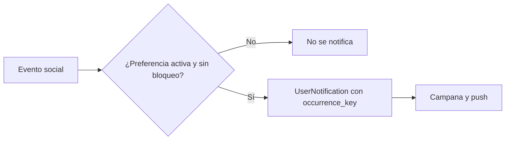

# CHG-125 · Social D: notificaciones de amistad y racha compartida
**Estado:** Cerrado
**Nivel:** M
**Modelo sugerido:** estandar
<!-- Estados y nivel se cambian SOLO con node .claude/team.mjs. Modelo: un perfil de docs/TEAM_MODELS.md -->
**Creado:** 2026-11-16 · **Aprobado:** 2026-11-16 · **Cerrado:** 2026-11-16
**Relacionado:** CHG-122

## 0. En palabras simples
- Qué vas a ver distinto: un aviso en la campana (y push si lo tienes activo) cuando alguien te envía una solicitud, la acepta o llegan a un hito de racha compartida.
- Cómo comprobarlo tú: envía una solicitud desde otra cuenta y mira el aviso; acéptala y la otra cuenta recibe el suyo.

## 1. Resumen
Se agrega un origen social a las notificaciones existentes (campana, push web y FCM) con idempotencia por ocurrencia. No hay tareas programadas nuevas: los avisos se crean al ocurrir el evento. No se expone nada social por MCP ni en el contexto del Director.

## 2. Producto (product-manager)
- Problema / usuario: enterarse a tiempo de una solicitud o un logro compartido.
- Incluye: avisos de solicitud recibida, solicitud aceptada y hito de racha compartida; preferencia por canal y opción de apagarlos.
- No incluye: recordatorios de presión («tu amigo ya cumplió»), correo, Telegram, avisos de la tabla semanal, MCP.
- Criterios de aceptación (Dado/Cuando/Entonces):
  - Dada una solicitud enviada, cuando se crea, entonces el destinatario recibe un solo aviso aunque se repita la acción.
  - Dada una solicitud aceptada, cuando se acepta, entonces quien la envió recibe un aviso.
  - Dado un hito de racha compartida, cuando se alcanza, entonces ambos reciben un aviso una sola vez.
  - Dada la preferencia apagada, cuando ocurre el evento, entonces no hay push ni aviso.
  - Dado un bloqueo, cuando ocurre una acción del bloqueado, entonces no se notifica.

## 3. UX/UI
### 3.1 Experiencia (ux-designer)
- Plantilla: campana de notificaciones existente (sin pantalla nueva); sin `## Anatomía` propia en docs/UX-DESIGN.md.
- Flujo y cantidad de pasos: el aviso aparece en la campana; tocarlo abre `/amigos` (1 toque).
- Qué contiene cada pantalla y qué es lo más importante: título breve y destino claro.
- Estados (vacío / carga / error / éxito / validaciones): leído / no leído como en la campana actual.
- Información necesaria y momento de presentación: al ocurrir el evento, sin horarios especiales.
- Accesibilidad de uso (teclado, foco, errores): igual que `NotificationBell`.

### 3.2 Visual (ui-designer)
- Distribución:
```
┌────────────────────────────────┐
│ 🔔 Ana quiere ser tu amiga     │
│ 🔔 Luis aceptó tu solicitud    │
│ 🔔 7 días juntos con Sofi      │
└────────────────────────────────┘
```

- Componentes existentes a reutilizar (ruta): `app/Livewire/Notifications/NotificationBell.php`, `app/Models/UserNotification.php`.
- Jerarquía, color, tipografía y espaciado (tokens): los de la campana actual.
- Responsive y contraste: sin cambios.

### 3.3 Escritura (ux-writer)
- Ubicación y estado: campana y push.
- Textos finales (variables y variantes): «{nombre} quiere ser tu amiga o amigo», «{nombre} aceptó tu solicitud», «{n} días juntos con {nombre}».
- Reglas de docs/UX-WRITING.md aplicadas: sin presión ni culpa.
- Criterios de aceptación de los textos: ningún aviso insinúa obligación.

## 4. Diseño técnico (software-architect)
- Archivos a crear / modificar: `app/Models/UserNotification.php` (origen `friendship` en `destination()`), productores en `app/Services/Social/Friends.php` y `SharedStreak`, preferencias en `module_settings` (módulo `notifications`), `docs/notifications.md`.
- Enfoque y patrones a seguir: `occurrence_key` único por `(user, source, type, occurrence)` para idempotencia; reutilizar `WebPushGateway` y el canal Android FCM; sin scheduler nuevo (si el hito de racha se detecta al cerrar el día, se hace al abrir Amigos o en el comando existente `notifications:generate`).
- Riesgos y mitigación: avisos duplicados (clave de ocurrencia); revelar existencia de cuentas (no se notifica a bloqueados ni a destinos inexistentes).
- Qué NO tocar: MCP, Director, `RewardGranter` y canales Telegram.

## 5. Pruebas (qa-tester)
| Caso | Tipo | Nivel | Test |
|---|---|---|---|
| Un solo aviso por solicitud repetida | Feature | Integración | `tests/Feature/Social/FriendNotificationTest.php` |
| Aviso al aceptar | Feature | Integración | `tests/Feature/Social/FriendNotificationTest.php` |
| Hito compartido avisa una vez a ambos | Feature | Integración | `tests/Feature/Social/FriendNotificationTest.php` |
| Preferencia apagada no notifica | Feature | Integración | `tests/Feature/Social/FriendNotificationTest.php` |
| Bloqueado no genera aviso | Feature | Integración | `tests/Feature/Social/FriendNotificationTest.php` |
| Si corre en `notifications:generate`, dos ejecuciones dan un efecto | Feature | Integración | `tests/Feature/Social/FriendNotificationTest.php` |
- Comando para verificar: `php artisan test --filter=FriendNotification`.
- Regresión a vigilar: notificaciones de cumpleaños, tareas y guardián.

## 6. Documentación (tech-writer)
- Docs a actualizar: `docs/notifications.md`; `docs/DEPLOY.md` solo si se agrega algo al scheduler.

## 7. Tareas
- [x] T1 · Me avisan cuando me envían o aceptan una solicitud — Resp: developer — Modelo: estandar — Archivos: `UserNotification::destination()`, `Friends` — Hecho cuando: las pruebas de aviso e idempotencia pasan.
- [x] T2 · Me avisan cuando llegamos a un hito de racha compartida — Resp: developer — Modelo: estandar — Archivos: `SharedStreak`, `notifications:generate` si aplica — Hecho cuando: ambos reciben un aviso una sola vez, incluso ejecutando dos veces.
- [x] T3 · Puedo apagar estos avisos — Resp: developer — Modelo: estandar — Archivos: preferencias del módulo `notifications` — Hecho cuando: con la preferencia apagada no hay campana ni push.
- [x] T4 · Documentación actualizada — Resp: developer — Modelo: estandar — Archivos: `docs/notifications.md`, `docs/DEPLOY.md` si aplica — Hecho cuando: `git diff --check` pasa.

## 8. Bitácora de implementación (developer)
- 2026-11-16 — Implementado: `FriendNotices`, enganches en `Friends` (solicitud, aceptación, cruzada), hito de pareja al abrir `/amigos`, registro en `UserNotification::destination()`, `NotificationPresentation`, `NotificationBell`, `NotificationPreferences`, pantalla de ajustes y `NotificationDispatcher::actions()`, `docs/notifications.md`, `FriendNotificationTest`.
- Ajustes: `source_id` es uuid y `friendships.id` numérico, así que se usa un uuid v5 del par; la preferencia de campana (`friend_notices`) vive fuera del bloque «solo con dispositivos» de ajustes porque la campana no depende de un dispositivo; el hito de racha se avisa solo por la campana (CHG-123); no se tocó `docs/DEPLOY.md` (sin scheduler nuevo).
- 2026-11-16 — Scheduler añadido: `miso:friend-milestones` (cada hora, `--dry-run`, cursor en caché y tope de 40 s) para avisar los hitos sin abrir `/amigos`; documentado en `docs/DEPLOY.md` (cinco tareas) y `docs/notifications.md`; `FriendMilestonesCommandTest` ejecuta dos veces y comprueba un solo aviso. Corrige el ajuste anterior «sin scheduler nuevo».
- **BLOQUEADO — no verificado:** sin PHP 8.4, solo `php -l`. Pendiente: `php artisan test --filter=FriendNotification`, `--filter=Notification`, `--filter=Social`, `php artisan ui:conformance`, `npm run build`.

## 9. Preguntas abiertas, decisiones e historial
- 2026-11-16 — Creado en to-do/ (Borrador, nivel M)
- 2026-11-16 — Decisión: sin MCP ni cambios al Director; sin scheduler nuevo. Requiere CHG-122 y CHG-123.
- 2026-11-16 — Aprobado por el usuario (Compuerta 2)
- 2026-11-16 — Movido a in-progress/ (En desarrollo)
- 2026-11-16 — Implementación terminada → En verificación
- 2026-11-16 — Cerrado por el usuario (Compuerta 3) → done/
