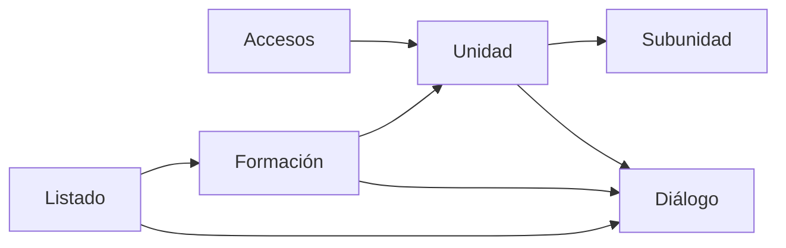

# CHG-138 · Formación base en la aplicación real
**Estado:** Cerrado
**Nivel:** M
**Modelo sugerido:** estandar
<!-- Estados y nivel se cambian SOLO con node .claude/team.mjs. Modelo: un perfil de docs/TEAM_MODELS.md -->
**Creado:** 2026-11-16 · **Aprobado:** 2026-11-16 · **Cerrado:** 2026-11-17
**Relacionado:** —

## 0. En palabras simples
- Qué vas a ver distinto: Formación permite organizar estudios reales y guardar accesos a cualquier nivel.
- Cómo comprobarlo tú: abrir /learning, crear una carrera con periodo y materia, fijar la materia y recargar.

## 1. Resumen
Primera de cuatro entregas aprobadas en conversación: base, conexiones, evaluaciones y reservas.
Este cambio implementa solo la base del mockup learning en Laravel/Livewire, con datos privados persistentes.

## 2. Producto (product-manager)
- Problema / usuario: organizar estudios de la persona sin duplicar módulos existentes.
- Incluye: seis tipos de formación, jerarquía contextual, categorías personales, formularios, orden de unidades, accesos y guardián.
- No incluye: conexiones, materiales, evaluaciones, reservas, MCP, premios ni importación del mockup.
- Criterios: crear carrera/posgrado con periodos y materias; curso con módulos/temas; ruta con etapas/cursos/temas; persistir al recargar; rechazar jerarquías inválidas y datos ajenos; eliminar solo elementos vacíos; fijar sin duplicados.

## 3. UX/UI
### 3.1 Experiencia (ux-designer)
- Plantilla: listado y detalle del prototipo learning, adaptados al shell canónico.
- Listado con búsqueda y filtros tipo/categoría/estado en URL; detalle con migas y regreso integrado. Sin pestañas de prestaciones futuras.
- Estados: vacío con guía y FAB; sin resultados con limpiar filtros; guardado/error anunciado; errores abren sección y conservan datos; cancelar descarta borrador con protección canónica.
- Teclado, foco visible y retorno al disparador; controles 44px.

### 3.2 Visual (ui-designer)
- Componentes x-module-shell, x-ui.management-card, x-ui.row-actions, x-ui.form-dialog, x-ui.fab y x-context-widget. Nunito y tokens M3; icono bi-mortarboard; acento del mockup.
- Una composición CSS: accesos antes del contenido bajo 1200px y guardián después. Menús en viewport, temas claro/oscuro.
```text
Escritorio: [Menú][Barra Formación / elemento]
                 [Ubicación/filtros/tabla] [Accesos/Guardián]
                 [FAB → formulario]
Móvil: [Barra/regreso][Accesos][Ubicación/filtros/tabla][Guardián][FAB]
Diálogo: [Información básica | Organización][Cancelar | Guardar]
```
### 3.3 Escritura (ux-writer)
- Formación, Carrera universitaria, Especialización, Maestría, Doctorado, Curso y Ruta personal.
- Estados: Pendiente, En curso, Completado. Sin categoría; Consultar; Fijar en accesos directos; Quitar de accesos directos.
- Alta: Agregar formación o Agregar {tipo}; edición: Editar {tipo}. Vacío: Aún no tienes formaciones. Organiza lo que quieres estudiar desde Agregar formación.
- Bloqueo: Este elemento tiene contenido. Retíralo antes de eliminarlo. Confirmación: ¿Eliminar «{nombre}»? Se quitará también su acceso directo.
- Tipo bloqueado: El tipo se conserva porque esta formación ya tiene contenido organizado.
- Textos en español neutro, tratamiento de tú, sin promesas ni culpa.

## 4. Diseño técnico (software-architect)
- Archivos: app/Models/Learning{Formation,Unit,Shortcut}.php, app/Services/Learning/*, app/Livewire/Learning/*, resources/views/livewire/learning/*, database/migrations/*create_learning*, tests/Feature/Learning*, tests/Browser/learning*, tests/Browser/support/learning-fixture.php, routes/web.php, config/modules.php, config/game.php, app/Support/CategoryCatalog.php, resources/css/m3/tokens/_tokens.css, resources/css/m3/modules/_learning.css, resources/css/app.css, resources/views/components/module-shell.blade.php (solo slot contextual antes del contenido si hace falta), docs/PRODUCT.md, docs/DEPLOY.md, docs/learning.md, docs/backlog/**CHG-138*/CHANGE.md y assets generados por build.
- UUID, user_id, timestamps. Formación: tipo/nombre/descripción/categoría/estado/institución/fechas. Unidad: formación/padre/tipo/nombre/descripción/estado/fechas/créditos/posición. Acceso: tipo/id destino/posición con unicidad por usuario-destino.
- Servicio de escritura con usuario explícito, validación, transacciones y bloqueo del contenedor contra carreras de alta/eliminación. Categorías reutilizan UserCategory/CategoryCatalog dominio learning, inicialmente sin categoría.
- Rutas autenticadas /learning (learning), /learning/{formation} (learning.show), /learning/{formation}/units/{unit} (learning.units.show). Datos ajenos o unidad de otra formación → 404.
- Jerarquía según childKinds del mockup; ubicación y tipo de unidad inmutables; tipo de formación bloqueado si contiene unidades. Estados manuales sin cascada. Formación nueva En curso, unidad nueva Pendiente.
- Créditos opcionales solo materias 0..100 paso 0,5; nombres hasta 160; fechas final >= inicial. Orden solo hermanos. Fijar idempotente y quitar conserva registro; eliminación vacía limpia acceso.
- Reutilizar selección de guardián real (equipo y colección), sin guardián guía textual. Registrar navegación y catálogo de preferencias sin reactivar módulos ocultos.
- Qué NO tocar: cambios en curso de Salud/CHG-137, dependencias, datos reales, mockup y otros módulos salvo integración declarada.

## 5. Pruebas (qa-tester)
| Caso | Tipo | Nivel | Test |
|---|---|---|---|
| Jerarquías, validación, propiedad y borrado | PHP | Feature | LearningDomainTest |
| CRUD, filtros, rutas y formularios | PHP | Feature | LearningModuleTest |
| Accesos, orden, categoría en uso y preferencias | PHP | Feature | LearningDomainTest / LearningModuleTest |
| Teclado, responsive, contraste y diálogos | Browser | UI | learning e2e |
- Comando para verificar: php artisan test --filter=Learning; npm run build; php artisan ui:conformance; git diff --check.
- Regresión: CategoryHierarchyTest, ModuleGuardianTest y preferencias; separar fallos preexistentes. Probar 375/768/1440px, claro/oscuro y con/sin guardián.

## 6. Documentación (tech-writer)
- Actualizar docs/PRODUCT.md, docs/DEPLOY.md y docs/learning.md: alcance, reglas, migración y comprobación.

## 7. Tareas
- [x] T1 · Guardar formación y jerarquía privadas con reglas verificadas — Resp: developer — Archivos: modelos, servicio, migración, catálogo, tests/Feature/LearningDomainTest.php — Hecho cuando: pruebas de jerarquías, propiedad, orden, accesos y eliminación pasan.
- [x] T2 · Organizar estudios desde las pantallas reales — Resp: developer — Archivos: Livewire/Learning, vistas learning, rutas, config/modules.php, tokens y CSS — Hecho cuando: crear/editar/navegar/filtrar funcionan tras recargar y las pruebas de módulo pasan.
- [x] T3 · Mostrar accesos directos y guardián contextual — Resp: developer — Archivos: vistas learning, config/game.php y CSS learning — Hecho cuando: accesos abren cualquier nivel y responsive/guardián respetan la composición aprobada.
- [x] T4 · Verificar y documentar la entrega — Resp: developer — Archivos: tests de Learning, docs/PRODUCT.md, docs/DEPLOY.md, docs/learning.md — Hecho cuando: validaciones ejecutadas con resultados y limitaciones documentados.

## 8. Bitácora de implementación (developer)
- T1: modelos, migración aditiva y servicio transaccional implementados; validación explícita por usuario, jerarquías, fechas/créditos, orden y accesos. LearningDomainTest: 8 pruebas pasan; CategoryHierarchyTest: 12 pasan. Migración aplicada únicamente a SQLite de pruebas.
- T2: rutas/Livewire/listado/detalles/formularios y categorías implementados; LearningModuleTest: 5 pruebas pasan. Ajustes preservan la selección de módulos existente.
- Build Vite aprobado. php artisan ui:conformance informa 197 ocurrencias en el inventario actual de archivos ajenos; ninguna señala Formación. Verificación visual completada; detalles al final de esta bitácora.
- Entorno: PHP 8.5 sin SQLite por defecto; se reutiliza extensión local /tmp/miso-php-ini. Las pruebas requieren permiso de puerto del plugin de Pest. No se cambiaron dependencias ni configuración global de PHP.

- Plan completo aprobado por el usuario con «Implement the plan» y «continuar». Alcance y política de borrado confirmados antes.
- CLI local 0.11.0 sin comandos context/activity: lectura directa; registro automático no disponible. docs/DOCUMENTATION.md no existe; no se inventa una guía nueva.

- T3/T4: accesos y guardián verificados en 375/768/1440px, una composición CSS. Corregidos visibilidad del guardián móvil, contraste tonal/enlaces oscuros, expresión Alpine de Consultar y foco al cerrar editor desde un menú. Capturas de escritorio/formulario móvil inspeccionadas.
- Verificación final: Learning + CategoryHierarchyTest + PersonalExperienceTest + AppShellTest → 47 pruebas / 429 aserciones pasan; navegador → 4 recorridos pasan, Axe sin violaciones de las superficies revisadas en claro/oscuro y sin errores JS; build aprobado, test:js 9 archivos aprobados, Pint y whitespace propios aprobados.
- Regresión de ModuleGuardianTest: 17/20 pasan y tres fallan; mismos tres fallos reproducidos al retirar game.module_guardians.learning de una copia temporal del test. No se alteró el algoritmo compartido ni los archivos de Salud.
- docs/PRODUCT.md, docs/DEPLOY.md y docs/learning.md actualizados. Migración solo ejecutada en bases SQLite de pruebas; base habitual y MySQL pendientes de despliegue. Sin suite completa por alcance; comprobaciones focalizadas según instrucciones del proyecto.
- CHG-138 se inició con start --force para coexistir con los CHG activos; ninguno cambió de estado. El diff general contiene whitespace anterior en artisan; no se modificó ese archivo.

## 9. Preguntas abiertas, decisiones e historial
- Sin preguntas abiertas. Implementar el plan autoriza registro/aprobación/inicio de este CHG y cambios locales reversibles.
- LECCIÓN: ninguna.
- 2026-11-16 — Aprobado por el usuario (Compuerta 2)
- 2026-11-16 — Movido a in-progress/ (En desarrollo)
- 2026-11-16 — Implementación terminada → En verificación
- 2026-11-17 — Cerrado por el usuario (Compuerta 3) → done/
