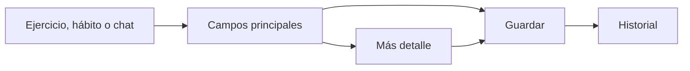

# CHG-168 · Registro de ejercicio según la actividad
**Estado:** Cerrado
**Nivel:** M
**Modelo sugerido:** estandar
<!-- Estados y nivel se cambian SOLO con node .claude/team.mjs. Modelo: un perfil de docs/TEAM_MODELS.md -->
**Creado:** 2026-11-18 · **Aprobado:** 2026-11-18 · **Cerrado:** 2026-11-18
**Relacionado:** —

## 0. En palabras simples
- Flexiones abre con repeticiones y Trotar con distancia y minutos. «Más detalle» permite anotar series, peso o calorías.
- Compruébalo completando un hábito de flexiones y registrando 5 km en 28 minutos en Ejercicio.

## 1. Resumen
Unificar el registro de Ejercicio, Hábitos, Inicio, chat y MCP con métricas automáticas según el tipo y estimaciones trazables.

## 2. Producto
- El usuario puede guardar cualquier subconjunto de métricas. El detalle de fuerza admite un bloque de series iguales.
- Mantener las acciones automáticas, el historial y el progreso por minutos.
- Criterios de aceptación: campos relevantes al abrir, ritmo con distancia y tiempo, kcal manuales prioritarias, historial editable y omisión sin desmarcar el hábito.
- Relacionado con la simplificación del formulario en UX-003.

## 3. UX/UI
### 3.1 Experiencia
Plantilla: registro sobre el listado o la pantalla actual en el diálogo canónico. Foco, errores de campo y cierre del diálogo según el sistema de diseño.

### 3.2 Visual
Reutilizar el FAB, formulario y campos canónicos. Apilar en móvil y agrupar campos relacionados en escritorio.
```text
Móvil                         Escritorio
Flexiones de pecho            Trotar
Repeticiones totales [30]     Distancia (km) [5]  Duración (min) [28]
Más detalle                  Ritmo calculado · 5:36 min/km
Omitir por esta vez Registrar Más detalle                   Registrar
```
### 3.3 Escritura
«Más detalle», «Repeticiones totales», «Repeticiones por serie», «Ritmo calculado» y «kcal estimadas». «Omitir por esta vez» conserva el hábito completado.

## 4. Diseño técnico
- Perfiles en el catálogo base por ID legado o nombre/alias normalizado. Personalizados de Fuerza usan peso y repeticiones, el resto duración.
- Reutilizar LogExercise y las columnas actuales. Añadir total_reps y calories_source nullable. Derivar el ritmo. Prioridad manual, MET por velocidad con peso del perfil y después tasa horaria. Conservar valores históricos y pasos.
- Superficies: ExerciseDaily, el diálogo compartido de hábitos, LogExerciseAction, HabitActionRunner, Blade de Ejercicio y Hábitos, chat del compañero y herramientas MCP de Ejercicio. Mantener compatibilidad e impedir duplicados en la confirmación.

## 5. Pruebas
| Caso | Tipo | Nivel | Test |
|---|---|---|---|
| Repeticiones, ritmo, kcal, edición y compatibilidad | Funcional | Feature | Exercise y MCP |
| Confirmar, omitir, automático y desmarcar | Funcional | Feature | HabitAction |
| Entrada rápida, detalle y responsive | Interacción | Navegador | Ejercicio y Hábitos |

- Comando para verificar: `php artisan test --filter='Exercise|HabitAction|CatalogFavorites'`, `php artisan ui:conformance` y `npm run build`.
- Verificar también la persistencia en MySQL de pruebas.

## 6. Documentación
Registrar reglas y referencias del cálculo en el cambio y junto a la implementación.

## 7. Tareas
- [x] T1 · Guardar métricas y estimaciones según actividad — Resp: developer — Archivos: app/Actions, app/Models, app/Support, database/migrations — Hecho cuando: el guardado conserva el historial y calcula ritmo y kcal válidos.
- [x] T2 · Usar el registro sencillo y detallado desde cada entrada — Resp: developer — Archivos: app/Livewire, app/Support/Habits, app/Mcp, resources/views, tests — Hecho cuando: Ejercicio, Hábitos, Inicio, chat y MCP usan las mismas reglas.
- [x] T3 · Verificar los criterios de aceptación — Resp: qa-tester — Hecho cuando: pasan los casos de §5.

## 8. Bitácora de implementación

- T1 · Migración aditiva, perfiles automáticos, ritmo derivado y origen de kcal. El cálculo usa el peso corporal del perfil y la velocidad media. Selecciona la referencia publicada más cercana dentro del rango y recurre a la tasa del catálogo si faltan datos.
- T2 · Formulario compartido entre Ejercicio y el aviso del hábito. El chat abre el ejercicio preseleccionado o conserva el atajo explícito por minutos. MCP admite repeticiones totales y devuelve el ritmo cuando puede calcularse.
- T3 · 45 pruebas pasaron en SQLite y 22 en MariaDB desechable. Tres flujos de navegador pasaron, incluidos 390 y 1280 px. Pasaron el build y `git diff --check`. Las infracciones adicionales del inventario de UI corresponden a cuatro vistas ajenas al cambio. Los tres fallos de fecha detectados en la selección amplia se reprodujeron con el componente anterior.
- El CLI local carece de los comandos `context` y `activity`. La verificación se registró aquí.

## 9. Preguntas abiertas, decisiones e historial
- 2026-11-18 — Plan aprobado para implementar. Perfiles automáticos, un bloque por sesión y estimación por velocidad para caminata, trote y carrera.
- Referencias: https://pacompendium.com/walking/ y https://pacompendium.com/running/
- 2026-11-18 — Aprobado por el usuario (Compuerta 2)
- 2026-11-18 — Movido a in-progress/ (En desarrollo)
- LECCIÓN: ninguna.
- 2026-11-18 — Implementación terminada → En verificación
- 2026-11-18 — Cerrado por el usuario (Compuerta 3) → done/
