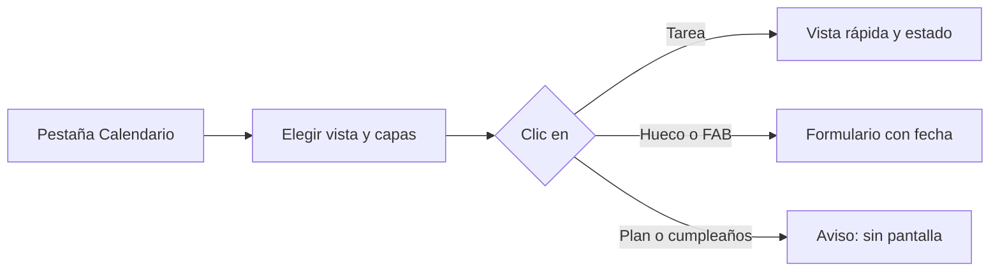

# CHG-003 · Vista de calendario en el prototipo de Tareas
**Estado:** En desarrollo
**Nivel:** S
**Modelo sugerido:** estandar
<!-- Estados y nivel se cambian SOLO con node .claude/team.mjs. Modelo: un perfil de docs/TEAM_MODELS.md -->
**Creado:** 2026-11-04 · **Aprobado:** 2026-11-04 · **Cerrado:** —
**Relacionado:** —

## 0. En palabras simples
- Qué vas a ver distinto: el prototipo de Tareas tendrá la pestaña Calendario, igual a la de la app, con las mismas 8 pestañas arriba. Podrás cambiar de vista, filtrar capas, abrir una tarea, cambiarle el estado, arrastrarla y crear otra, con datos de ejemplo. Nada se guarda al recargar y la app real no cambia.
- Cómo comprobarlo tú: abre `tasks.html`, entra a Calendario y compáralo con `/tasks/calendar` de la app, en escritorio y en móvil.

## 1. Resumen
Un calendario fiel en el prototipo permite probar mejoras sin tocar la app. Usa la misma librería y configuración que `resources/js/task-calendar.js`, con datos de ejemplo en memoria.

## 3. UX/UI

- Pestañas (orden de `config/modules.php`): Lista, Gantt, Calendario, Flujo, Kanban, Planificación, Progreso, Ajustes. Gantt, Flujo, Progreso y Ajustes no tienen pantalla: usan `data-lt-static-nav`.
- Reutiliza las macros `shell`, `tabs`, `fab` y `dialog` de `life-shell.html.jinja`.
- Eventos de ejemplo calculados desde la fecha actual, para que la vista nunca salga vacía; la capa Tareas cubre tareas con hora, de día completo, recurrentes y completadas. Hay también planes, cumpleaños y comidas.
- Referencia visual: la app real y las capturas `storage/framework/testing/calendar-*.png`.

## 4. Diseño técnico
- El motor (`build-tools/bundle.py`) rechaza el texto `fetch(` y FullCalendar lo contiene 6 veces (comprobado con un empaquetado de prueba: 535 KB, sin `import(`, `new Worker(` ni `new WebSocket(`).
- Decisión: preempaquetar FullCalendar en `project-assets/vendor/` con un script que lo regenera desde `node_modules` de la app y renombra el identificador `fetch`. No se modifica el motor compartido ni `node_modules`. El prototipo solo usa eventos locales, así que la carga remota queda inutilizada.
- Los estilos de calendario de `resources/css/m3/modules/_tasks.css` se llevan a `mockups.css` adaptados al prefijo y tokens del prototipo; `dist/` solo se regenera compilando.
- Sin store: estado en memoria dentro del controlador de la pantalla. Portar el comportamiento de `task-calendar.js`, no importarlo (depende de Alpine y Livewire).

## 5. Pruebas
- Verificación: `python ../mockup-system/build.py --project docs/mockup-system tasks`.
- Comparación visual a 1440, 768 y 390 px contra la app, sin errores en consola.
- Regresión: Lista, Kanban, Planificación y Categorías siguen abriendo y navegando.

## 7. Tareas
- [x] T1 · Aparecen las 8 pestañas y un Calendario funcional con eventos de ejemplo — Resp: dev-implementer — Modelo: estandar — Archivos: docs/mockup-system/project-assets/vendor/, docs/mockup-system/mockups/tasks/mockup.json, docs/mockup-system/mockups/tasks/screens/, docs/mockup-system/mockups/tasks/scripts/ — Hecho cuando: el build pasa y la vista Semana se ve sin errores en consola
- [x] T2 · Se ve como la app: capas, vistas Mes, Semana, Día y Agenda, Hoy, Ahora, Actualizar y barra móvil — Resp: dev-implementer — Modelo: estandar — Archivos: docs/mockup-system/project-assets/mockups.css, docs/mockup-system/mockups/tasks/screens/, docs/mockup-system/mockups/tasks/scripts/ — Hecho cuando: coincide con la app a 1440, 768 y 390 px
- [x] T3 · Se comporta como la app: vista rápida con estados, arrastrar, crear desde hueco y FAB, «Sin fecha» y aviso de recurrente; roadmap actualizado — Resp: dev-implementer — Modelo: estandar — Archivos: docs/mockup-system/mockups/tasks/screens/, docs/mockup-system/mockups/tasks/scripts/, docs/mockup-system/project-assets/mockups.css, docs/mockup-system/docs/mockup-roadmap.md — Hecho cuando: cada interacción funciona en memoria y el roadmap incluye Calendario
- [ ] T4 · Comparar prototipo y app — Resp: qa-tester — Hecho cuando: criterios de §5 cumplidos y diferencias anotadas en §8

## 8. Bitácora de implementación (dev-implementer)
- 2026-11-04 — T1: 8 pestañas, pantalla Calendario con FullCalendar preempaquetado (268 KB, regenerable con build-fullcalendar.mjs) y 8 eventos de ejemplo. Build publicado; en navegador a 1440 px: 8 eventos, 8 pestañas, 0 errores de consola. El build ya estaba desactualizado antes de empezar (--check fallaba), así que dist/tasks.html también recoge cambios previos. El motor sigue informando «4 isolated views» con 5 pantallas: no se confirmó que su chequeo cubra Calendario.
- 2026-11-04 — T2: estilos de _tasks.css llevados a mockups.css (tokens --cal-* para tertiary, error y secondary, que el prototipo no define), capas, 4 vistas, Hoy, Ahora, Actualizar y barra móvil. Probado en navegador: capas y vistas responden; capturas a 1440, 768 y 390 px.
- 2026-11-04 — T3: vista rápida con estados, editar, arrastrar, crear desde hueco y FAB, «Sin fecha» y aviso de recurrente; roadmap actualizado. Probado en navegador a 1440 px; vista rápida y estado también a 768 y 390 px; 0 errores de página. Diferencias con la app: completar una recurrente muestra el aviso sin el diálogo de confirmación previo; el formulario es reducido (título, fecha, hora), no el editor completo; las capas no se recuerdan al recargar.
- Sugerencia fuera de alcance: el shell compartido dice «Life Tracker», sin «Panel de pared», y la app dice «MiSo». Afecta a todos los prototipos.

## 9. Preguntas abiertas, decisiones e historial
- 2026-11-04 — Creado en to-do/ (Borrador, nivel S)
- 2026-11-04 — Decisiones del usuario: FullCalendar real, 8 pestañas, alcance completo, preempaquetado sin tocar el motor.
- 2026-11-04 — Aprobado por el usuario (Compuerta 2)
- 2026-11-04 — Movido a in-progress/ (En desarrollo)
