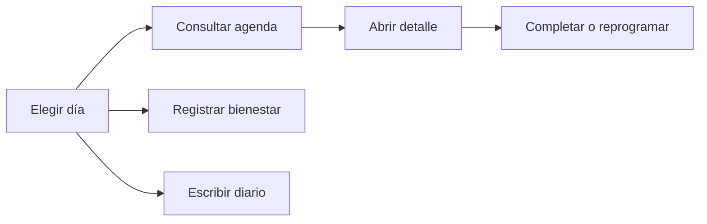

# CHG-004 · Mi día: prototipo de agenda y bienestar
**Estado:** En verificación
**Nivel:** M
**Modelo sugerido:** estandar
<!-- Estados y nivel se cambian SOLO con node .claude/team.mjs. Modelo: un perfil de docs/TEAM_MODELS.md -->
**Creado:** 2026-11-04 · **Aprobado:** 2026-11-04 · **Cerrado:** —
**Relacionado:** —

## 0. En palabras simples
Mi día tendrá una agenda diaria y registros de bienestar interactivos con datos ficticios. Abre my-day.html para consultar, completar y reprogramar tareas, registrar bienestar y escribir el diario.

## 1. Resumen
Implementar el plan completo aprobado en el chat: lista diaria de agenda y bienestar, exclusivamente en el prototipo offline existente.

## 2. Producto (product-manager)
- Usuario: persona que organiza su día y cuida su bienestar.
- Incluye tareas, comidas, planes, cumpleaños, hábitos, agua, ánimo, energía y diario.
- No incluye backend, IA, integraciones, recurrencias ni edición de planes/comidas/cumpleaños.
- Dado un día, al consultarlo aparecen todos sus elementos; al completar o registrar se actualizan sus datos; al reprogramar se conserva la duración y se ofrece ir al destino; al recargar o restablecer se reinician los ejemplos.

## 3. UX/UI (ux-designer)
- Lista cronológica y bloque Sin hora; agenda principal y bienestar secundario; diario visible.
- Reutilizar shell, fab, dialog y summary_card de life-shell.html.jinja. Creaciones desde único FAB; edición contextual.
- Estados vacíos, validaciones inline, cancelación sin cambios y confirmaciones accesibles.
- Dos columnas en escritorio, una en móvil; foco contenido y restaurado en diálogos; controles utilizables a 390, 768 y 1440 px.

## 4. Diseño técnico (software-architect)
- Archivos: docs/mockup-system/mockups/my-day/screens/daily-dashboard.html.jinja, docs/mockup-system/mockups/my-day/scripts/entry.js, docs/mockup-system/mockups/my-day/scripts/my-day.js, docs/mockup-system/project-assets/mockups.css, docs/mockup-system/dist/my-day.html, docs/mockup-system/docs/mockup-roadmap.md.
- Controlador local con estado en memoria por día, fechas relativas a hoy y registros no recurrentes. Montar junto a mountLifeShell; reset del runtime vuelve a montar. Sin store nuevo ni persistencia.
- Conservar ruta, manifiesto y salida actuales. CSS limitado al módulo. Reprogramar inicio conservando duración; hora vacía representa fecha sin hora.
- No tocar app, APIs, datos, shell compartido ni módulo Tareas; preservar cambios ajenos.

## 5. Pruebas (qa-tester)
- Comando para verificar: python ../mockup-system/build.py --project docs/mockup-system my-day
- Navegador: crear/validar/cancelar tarea, completar/reabrir, reprogramar con/sin hora a otro día, duración, contadores, diario, agua positiva, ánimo, energía 1..5, aislamiento entre días y reinicio por recarga/reset/dataset.
- Responsive 390/768/1440, teclado, foco, mensajes, scroll de diálogos y consola. Regresión de estilos de Tareas. git diff --check.

## 6. Documentación (tech-writer)
Actualizar docs/mockup-system/docs/mockup-roadmap.md con alcance y reinicio; evidencias en esta bitácora. Los documentos de gobierno y backlogs por rol aún no existen; no crearlos en este cambio.

## 7. Tareas
- [x] T1 · Mostrar agenda y bienestar — Resp: dev-implementer — Archivos: docs/mockup-system/mockups/my-day/screens/daily-dashboard.html.jinja, docs/mockup-system/project-assets/mockups.css — Hecho cuando: pantalla responsive con estados vacíos y diálogos canónicos
- [x] T2 · Activar acciones locales — Resp: dev-implementer — Archivos: docs/mockup-system/mockups/my-day/scripts/entry.js, docs/mockup-system/mockups/my-day/scripts/my-day.js — Hecho cuando: todas las interacciones aprobadas funcionan en memoria
- [x] T3 · Compilar y comprobar el prototipo — Resp: qa-tester — Archivos: docs/mockup-system/dist/my-day.html — Hecho cuando: build y verificaciones de sección 5 pasan
- [x] T4 · Documentar lo entregado — Resp: tech-writer — Archivos: docs/mockup-system/docs/mockup-roadmap.md — Hecho cuando: alcance y evidencias actualizados

## 8. Bitácora de implementación (dev-implementer)
- 2026-11-04 — T1/T2: pantalla y controlador local completos; agenda, detalles, formularios FAB, hábitos, registros y diario. Reprogramación conserva duración, distingue hora vacía y ofrece acceso al día de destino. Escape, foco contenido/restaurado y fondo inerte en diálogos. Escenarios locales Con agenda / Sin registros.
- 2026-11-04 — T3: build certificado (811342 bytes, 4 vistas aisladas del compilador). Comprobación Playwright en storage/framework/testing/my-day-check.cjs: creación/validación/cancelación, escape de texto, completar/reabrir, reprogramación entre días y a medianoche, duración de 90 minutos, sin hora, hábitos, agua positiva, ánimo, energía 1..5, diario, aislamiento por fecha, detalles solo consulta, reset/dataset/recarga. Todo pasa; consola sin errores.
- 2026-11-04 — T3: revisadas capturas finales 1440/768/390; sin overflow horizontal, botones de diálogo visibles, Tab contenido y Escape/restauración. Axe WCAG 2 A/AA y 2.1 AA: 0 infracciones en superficie y diálogo de agua con error. El CSS añadido no cambia la geometría de Tareas. php artisan ui:conformance: sin deuda visual nueva (345 inventariadas / 259 desviaciones existentes). node --check y git diff --check pasan.
- 2026-11-04 — T4: roadmap actualizado con comportamientos, escenarios y reinicio. No se ejecutan suites PHP ni npm run build: no hay cambios de aplicación, solo fuentes Jinja/JS/CSS y salida del compilador de mockups.
- 2026-11-04 — Correcciones durante QA: evitar que el shell cierre los detalles al abrirlos; restaurar foco al FAB si el activador ya no es visible; enfocar un control visible en detalles de consulta. Verificaciones repetidas tras corregir.

## 9. Preguntas abiertas, decisiones e historial
- 2026-11-04 — Creado mediante CLI. Usuario aprobó el plan completo y ordenó implementarlo; autorización de todo el lote y registro de especificación.
- 2026-11-04 — Aprobado por el usuario (Compuerta 2)
- 2026-11-04 — Movido a in-progress/ (En desarrollo)
- 2026-11-04 — start --force permite CHG-004 concurrente con CHG-003, sin alterar su estado ni sus archivos. Los cambios previos del CSS compartido se conservan; el HTML compilado incluye el estado vigente de sus dependencias. Sin commits, publicación externa ni datos reales.
- 2026-11-04 — Implementación terminada → En verificación
