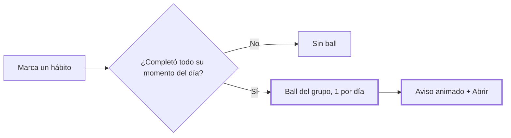

# CHG-023 · Aviso animado de ball y ball por grupo de hábitos completado
**Estado:** En verificación
**Nivel:** S
**Modelo sugerido:** estandar
<!-- Estados y nivel se cambian SOLO con node .claude/team.mjs. Modelo: un perfil de docs/TEAM_MODELS.md -->
**Creado:** 2026-11-09 · **Aprobado:** 2026-11-09 · **Cerrado:** —
**Relacionado:** CHG-019

## 0. En palabras simples
- Qué vas a ver distinto: al completar una tarea, en cualquier pantalla, aparece una ball pequeña que rebota con el mensaje "¡Ganaste una ball!" y el botón **Abrir**. Si ese día ya llegaste al máximo, no aparece nada. Los hábitos ya no dan una ball por cada uno: la dan cuando completas todos los de un momento del día (mañana, tarde, noche o en cualquier momento).
- Cómo comprobarlo tú: completa una tarea y verás la ball animada. Marca todos tus hábitos de la mañana: al marcar el último, aparece la ball. Si marcas solo uno, no aparece.

## 1. Resumen
Ajustes pedidos por Alex tras probar CHG-019: un aviso visible cuando llega una ball, en toda la app, y un cambio de regla en los hábitos, que ahora dan una ball por grupo (momento del día) completado, una vez por grupo y por día.



## 2. Producto (product-manager)
- Problema / usuario: Alex no notaba que llegaba una ball; además, una ball por cada hábito resultaba demasiado.
- Incluye: aviso global (ball animada + snackbar con el botón Abrir) cuando se concede una ball por tarea o por grupo de hábitos; regla de hábitos por grupo.
- No incluye: aviso para otras fuentes futuras; cambiar el límite diario.
- Criterios de aceptación:
  - Dado el juego activo, cuando completo una tarea en cualquier pantalla que usa el layout principal, entonces aparece el aviso con el botón Abrir, que lleva a Colección → Balls.
  - Dado el límite diario alcanzado, cuando completo una tarea, entonces no aparece ningún aviso.
  - Dados 3 hábitos de la mañana, cuando marco 2, entonces no hay ball; cuando marco el tercero, entonces se crea 1 ball con la etiqueta "Hábitos de la mañana".
  - Dado un grupo completado, cuando desmarco y vuelvo a marcar un hábito el mismo día, entonces no se crea otra ball.
  - Las balls que ya se dieron por hábitos individuales se conservan.

## 3. UX/UI
### 3.1 Experiencia (ux-designer)
- Plantilla: no aplica una plantilla de página; es un aviso flotante global en el layout.
- Flujo: completar → aparece el aviso unos 4 s → "Abrir" (opcional) lleva a /game.
- Estados: con ball (aviso) / sin ball o límite alcanzado (nada).
- Accesibilidad: el texto se anuncia con `aria-live="polite"`; el botón es accesible con teclado; con `prefers-reduced-motion` la ball aparece sin rebote.

```
                         ┌───────────────────────────────┐
     (●)  ← rebota        │ (●) ¡Ganaste una ball!  [Abrir]│
                         └───────────────────────────────┘
```

### 3.2 Visual (ui-designer)
- Distribución: snackbar inferior centrado; la ball (`.game-ball` de CHG-019) cae y rebota sobre el snackbar.
- Componentes existentes: clase `.game-ball` y los estilos de snackbar en `resources/views/components/ui/snackbar.blade.php`.
- Tokens: los del sistema; sin degradados adicionales.
- Responsive: en móvil queda por encima de la barra inferior.

### 3.3 Escritura (ux-writer)
- Textos finales: "¡Ganaste una ball!" · botón "Abrir" · etiqueta de origen para hábitos: "Hábitos de la mañana", "Hábitos de la tarde", "Hábitos de la noche", "Hábitos de cualquier momento".
- Reglas: tuteo, frases cortas, sin urgencias.
- Criterios: el aviso no muestra la especie (se revela al abrir).

## 4. Diseño técnico (software-architect)
- Archivos a crear / modificar:
  - Crear `app/Livewire/Game/BallNotifier.php` con su vista `resources/views/livewire/game/ball-notifier.blade.php`.
  - Agregar el notificador al layout: `resources/views/layouts/app.blade.php`.
  - Estilos: `resources/css/m3/modules/_game.css`.
  - Regla de hábitos: `app/Services/Game/RewardGranter.php` (`forHabitGroup`) y `app/Services/HabitGamificationService.php`.
  - Pruebas: `tests/Feature/Game/BallNotifierTest.php` y `tests/Feature/Game/RewardGranterTest.php`.
- Enfoque:
  - `BallNotifier` guarda el id de la última ball conocida (`lastSeenId`, fijado en mount).
  - Escucha los eventos de navegador que ya existen, `task-completed` y `habit-feedback` (`#[On]`), y además consulta una vez por minuto con `wire:poll.60s.visible`, para cubrir las vías que no emiten evento (editor, CalDAV, MCP).
  - Si hay balls nuevas sin abrir, muestra el aviso y actualiza `lastSeenId`.
  - Regla de hábitos: tras el toggle, si se está completando, se calcula si el momento del día de ese hábito quedó completo para esa fecha (misma lógica que `feedbackFor`, con `completedIds` del día). Si quedó completo, se llama `forHabitGroup($completion, $period)` con la clave `habit-group:{period}:{fecha}` y la etiqueta del grupo. Se elimina la ball por hábito individual.
- Riesgos: el sondeo de cada 60 s es una sola consulta indexada (`user_id, granted_at`), y solo se ejecuta con la pestaña visible.
- Qué NO tocar: la celebración de XP de tareas existente ni los mensajes de hábitos.

## 5. Pruebas (qa-tester)
| Caso | Tipo | Nivel | Test |
|---|---|---|---|
| Grupo incompleto no da ball; el último del grupo sí | Feature | Servicio | RewardGranterTest |
| Desmarcar y volver a marcar no duplica | Feature | Servicio | RewardGranterTest |
| Notificador muestra aviso tras una ball nueva | Feature | Livewire | BallNotifierTest |
| Sin ball nueva (límite) no muestra aviso | Feature | Livewire | BallNotifierTest |
- Comando para verificar: `php artisan test tests/Feature/Game tests/Unit/Game`
- Regresión a vigilar: `php artisan test --filter=Habit`

## 6. Documentación (tech-writer)
- Docs a actualizar: en `docs/game.md` (CHG-019 T5), regla de hábitos por grupo y aviso.

## 7. Tareas
- [x] T1 · Los hábitos dan ball solo al completar su momento del día — Resp: developer — Archivos: app/Services/Game/RewardGranter.php, app/Services/HabitGamificationService.php, tests/Feature/Game/RewardGranterTest.php — Hecho cuando: los tests de grupo pasan
- [x] T2 · Aviso animado "¡Ganaste una ball!" en toda la app — Resp: developer — Archivos: app/Livewire/Game/BallNotifier.php, resources/views/livewire/game/ball-notifier.blade.php, resources/views/layouts/app.blade.php, resources/css/m3/modules/_game.css, tests/Feature/Game/BallNotifierTest.php — Hecho cuando: BallNotifierTest pasa y el aviso se ve al completar una tarea
- [ ] T3 · Verificar criterios de aceptación — Resp: qa-tester — Hecho cuando: todos pasan

## 8. Bitácora de implementación (developer)
- 2026-11-09 — Inicio con `start --force` (ya había otros CHG En desarrollo; trabajo aprobado por Alex).
- 2026-11-09 — T1: `RewardGranter::forHabitGroup` (clave `habit-group:{momento}:{fecha}`, etiqueta "Hábitos de la …") reemplaza a `forHabit`. `HabitGamificationService` solo da la ball si el momento del día quedó completo (`periodIsComplete`). Tests: el grupo incompleto no da ball, el último sí; rehacer el mismo día no duplica. RewardGranterTest: 13 pasan.
- 2026-11-09 — T2: `BallNotifier` (escucha `task-completed` y `habit-feedback`, más `wire:poll.60s.visible`), en el layout dentro de `@persist`; ball que cae y rebota sobre el snackbar "¡Ganaste una ball!" con el botón Abrir; con movimiento reducido solo aparece con un fundido. `npm run build` ejecutado. Game: 34 pasan; Habit/UiConformance: verde (3 fallas ya existentes en Home/ModuleExperience, ajenas).

## 9. Preguntas abiertas, decisiones e historial
- 2026-11-09 — Creado en to-do/ (Borrador, nivel S)
- 2026-11-09 — Decisiones (Alex): grupo = momento del día; aviso = ball animada + snackbar.
- 2026-11-09 — Aprobado por el usuario (Compuerta 2)
- 2026-11-09 — Movido a in-progress/ (En desarrollo)
- LECCIÓN: ninguna
- 2026-11-09 — Implementación terminada → En verificación
