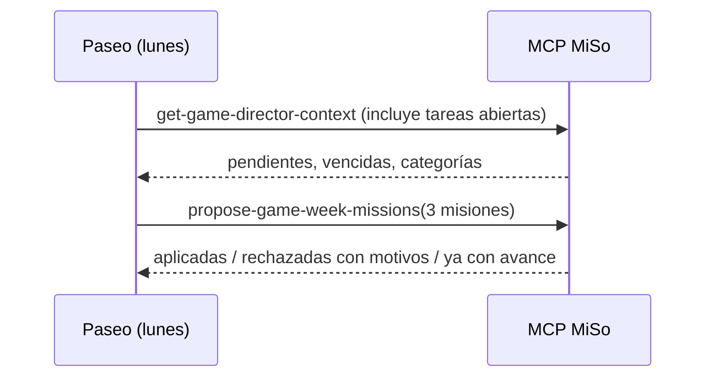

# CHG-026 · Misiones semanales contextuales propuestas por el director vía MCP
**Estado:** En verificación
**Nivel:** M
**Modelo sugerido:** razonamiento
<!-- Estados y nivel se cambian SOLO con node .claude/team.mjs. Modelo: un perfil de docs/TEAM_MODELS.md -->
**Creado:** 2026-11-09 · **Aprobado:** 2026-11-09 · **Cerrado:** —
**Relacionado:** CHG-021 (misiones), CHG-022 (director), CHG-024 (enlaces)

## 0. En palabras simples
- Qué vas a ver distinto: cada lunes, tu schedule de Paseo mira tus tareas pendientes (título, código, categoría, vencimiento) y propone las 3 misiones de la semana pensadas para ti. Por ejemplo: "Cierra 2 de estas 4 tareas vencidas de Hogar", con cada tarea enlazada y una marca cuando la completas. Si el director no propone nada válido, la semana usa las misiones automáticas de siempre. Las tareas privadas nunca se comparten.
- Cómo comprobarlo tú: ejecuta el schedule (o pídele a Claude con el conector MiSo "propón las misiones de esta semana"). Abre Colección → Semana: aparecen las misiones del director, con sus tareas enlazadas y la etiqueta "Propuesta por el director". Completa una de esas tareas y mira que la misión avance.

## 1. Resumen
Agrega un tipo de misión con tareas concretas y una herramienta MCP para que el director proponga las misiones de la semana actual. El contexto del director incluye ahora tus tareas abiertas no privadas (sin descripciones), según lo aprobó Alex. El backend valida todo y solo reemplaza las misiones automáticas si aún no tienen avance; si no, conserva las actuales. Las recompensas y la regla de no castigar no cambian.



## 2. Producto (product-manager)
- Problema / usuario: las misiones automáticas son genéricas y no ayudan a cerrar lo pendiente.
- Incluye:
  - **Contexto:** `get-game-director-context-tool` agrega `open_tasks`, con hasta 40 tareas abiertas no privadas. De cada una entrega id, código, título, categoría, vencimiento, si está vencida, tamaño, prioridad y días abierta, ordenadas por vencidas y luego por antigüedad. Nunca incluye descripción, comentarios ni tareas privadas.
  - **Nuevo tipo de misión** `specific_tasks`: "Cierra {n} de estas {m} tareas", con 2 a 6 tareas y una meta de 1 a m. Cuenta cada tarea completada una sola vez. Para las recurrentes cuenta su ocurrencia, porque se reconoce por la serie.
  - **Herramienta** `propose-game-week-missions-tool`: recibe 1 a 3 misiones para la semana actual. Cada una lleva:
    - `type` (`specific_tasks`, `category_tasks`, `habit_groups` o `variety`);
    - `title` (hasta 120 caracteres, sin palabras de castigo);
    - `target`;
    - y según el tipo, `task_ids`, `category` o `period`.
  - **Validación:**
    - Tareas propias, abiertas y no privadas.
    - Categorías y momentos existentes.
    - Metas de 2 a 5 (en `specific_tasks`, de 1 a m).
    - Sin campos desconocidos.
  - **Aplicación:**
    - Si las misiones de la semana no tienen avance ni recompensas, se reemplazan.
    - Si alguna ya tiene avance, responde "ya_con_avance" y no cambia nada (no se quita progreso).
    - Si la propuesta es inválida, se rechaza con sus motivos.
    - Cada misión guarda `source` (`auto` o `director`).
  - **Pantalla Semana:**
    - Las misiones `specific_tasks` listan sus tareas con su código, cada una enlazada (`/tasks/list?edit={id}`) y con una marca ✓ si ya está completada.
    - Las del director llevan la etiqueta "Propuesta por el director".
  - **Prompt del schedule** en `docs/game.md`, actualizado para proponer también las misiones cada lunes.
- No incluye: semanas futuras (solo la actual), editar las misiones a mano, ni que el director cree o modifique tareas.
- Criterios de aceptación:
  - El contexto incluye tareas abiertas no privadas con título y código, y no incluye privadas, completadas ni descripciones.
  - Una propuesta válida sobre una semana sin avance reemplaza las 3 misiones y quedan con `source=director`.
  - Con alguna misión con avance, responde "ya_con_avance" y las misiones no cambian.
  - Una tarea ajena, privada, completada o inexistente → se rechaza con motivo.
  - Completar una tarea de una misión `specific_tasks` suma 1; completarla de nuevo no vuelve a sumar; la ball de mitad y la de completado se dan como en CHG-021.
  - Una ocurrencia de una tarea recurrente incluida cuenta para la misión.
  - Sin propuesta, la semana conserva las misiones automáticas.
  - Solo afecta al usuario autenticado del MCP.

## 3. UX/UI
### 3.1 Experiencia (ux-designer)
- Plantilla: pestaña Semana (CHG-021 y CHG-024).
- Flujo: misión → tarea (1 clic, con el editor abierto).
- Estados: tarea completada (✓ y texto tachado o atenuado, con "Completada" para lectores); tarea borrada ("Tarea eliminada", sin enlace, y sigue contando si ya había sumado).
- Accesibilidad: lista de tareas con nombre accesible "{código} {título}, completada/pendiente".

```
Misiones de la semana
● Cierra 2 de estas 4 tareas vencidas de Hogar     1/2
  Propuesta por el director
  ✓ HOG-00012 Pagar arriendo                 (completada)
  ○ HOG-00015 Arreglar la llave del baño      [abrir →]
  ○ HOG-00018 Llevar ropa a la lavandería     [abrir →]
  ○ HOG-00021 Cambiar el filtro               [abrir →]
● Completa tus hábitos de la mañana 3 días          1/3
```

### 3.2 Visual (ui-designer)
- Componentes: `list`, `list-item`, `badge` ("Propuesta por el director"), `task-code` (componente existente para códigos), `progress`.
- Tokens: los del sistema; la tarea completada usa la variante atenuada.
- Responsive: los títulos largos se cortan con elipsis y el código siempre queda visible.

### 3.3 Escritura (ux-writer)
- Textos: "Propuesta por el director", "Completada", "Pendiente", "Tarea eliminada", "abrir"; plantilla sugerida para el director: "Cierra {n} de estas {m} tareas{ de categoría}".
- Reglas: tuteo y sin castigo. El validador rechaza títulos con "debes", "obligatorio", "atrasado", "fallaste" o "castigo".
- Criterios: ningún título generado contiene esas palabras.

## 4. Diseño técnico (software-architect)
- Archivos:
  - Migración `add_source_to_game_missions` (`source` string, por defecto `auto`).
  - Modelo `app/Models/Game/GameMission.php` (`TYPE_SPECIFIC`).
  - Servicios:
    - `app/Services/Game/MissionProposalValidator.php` (nuevo).
    - `app/Services/Game/SeasonManager.php` (`open_tasks` en el contexto y `proposeWeekMissions`).
    - `app/Services/Game/ActivityEffects.php` (tipo `specific_tasks`, con coincidencia por id o serie).
    - `app/Services/Game/RewardGranter.php` (`task_id` y `series_id` en el contexto de las tareas).
  - MCP: `app/Mcp/Tools/Game/ProposeGameWeekMissionsTool.php` (nuevo), `app/Mcp/Tools/Game/GetGameDirectorContextTool.php` (descripción actualizada) y `app/Mcp/Servers/LifeTrackerServer.php`.
  - UI: `app/Livewire/Game/GameWeekView.php` y `resources/views/livewire/game/game-week.blade.php`.
  - Pruebas: `tests/Feature/Game/WeekMissionsProposalTest.php`.
  - Docs: `docs/game.md`.
- Enfoque:
  - Los parámetros de `specific_tasks` guardan `tasks: [{id, series_id, code, title}]`. El título es una instantánea para mostrar si la tarea se borra.
  - Contribución `task:{series_id ?: id}`.
  - Reemplazo dentro de una transacción con bloqueo del usuario: se borran las misiones automáticas sin avance y se crean las nuevas.
  - Las recompensas de misión siguen idénticas.
- Riesgos:
  - Exposición de títulos: excluye privadas y descripciones (decisión de Alex); el contexto solo se entrega al usuario autenticado del MCP.
  - Pérdida de progreso: nunca se reemplaza si hay avance.
  - Tareas borradas: se usa la instantánea del título.
- Qué NO tocar: el módulo de Tareas (solo lectura y enlaces), las reglas de recompensa y las temporadas.

## 5. Pruebas (qa-tester)
| Caso | Tipo | Nivel | Test |
|---|---|---|---|
| Contexto incluye abiertas no privadas, sin descripciones | Feature | MCP | WeekMissionsProposalTest |
| Propuesta válida reemplaza misiones sin avance | Feature | MCP | WeekMissionsProposalTest |
| Con avance: ya_con_avance, nada cambia | Feature | Servicio | WeekMissionsProposalTest |
| Tareas ajenas/privadas/completadas/inexistentes y palabras de castigo → rechazo | Feature | Servicio | WeekMissionsProposalTest |
| specific_tasks avanza una vez por tarea, también recurrentes | Feature | Servicio | WeekMissionsProposalTest |
| Semana muestra tareas con enlace, ✓ y etiqueta del director | Feature | Livewire | WeekMissionsProposalTest |
| Aislamiento por usuario | Feature | MCP | WeekMissionsProposalTest |
- Comando: `php artisan test tests/Feature/Game tests/Unit/Game`
- Regresión: `php artisan test --filter=Mcp`.

## 6. Documentación (tech-writer)
- `docs/game.md`: misiones del director, qué datos ve y prompt del schedule actualizado.

## 7. Tareas
- [x] T1 · Misión de tareas concretas y su avance (también recurrentes) — Resp: developer — Archivos: database/migrations, app/Models/Game/GameMission.php, app/Services/Game/ActivityEffects.php, app/Services/Game/RewardGranter.php, tests/Feature/Game/WeekMissionsProposalTest.php — Hecho cuando: los tests de avance pasan
- [x] T2 · El director ve tus pendientes y propone las misiones por MCP, con validación — Resp: developer — Archivos: app/Services/Game/MissionProposalValidator.php, app/Services/Game/SeasonManager.php, app/Mcp/Tools/Game, app/Mcp/Servers/LifeTrackerServer.php, tests/Feature/Game/WeekMissionsProposalTest.php — Hecho cuando: los tests de contexto y propuesta pasan y la regresión MCP sigue en verde
- [x] T3 · Semana muestra las tareas de cada misión con enlace y la etiqueta del director — Resp: developer — Archivos: app/Livewire/Game/GameWeekView.php, resources/views/livewire/game/game-week.blade.php, tests/Feature/Game/WeekMissionsProposalTest.php — Hecho cuando: el test de vista pasa
- [ ] T4 · Verificar criterios de aceptación — Resp: qa-tester — Hecho cuando: todos pasan
- [x] T5 · Actualizar docs/game.md y el prompt del schedule — Resp: tech-writer — Archivos: docs/game.md — Hecho cuando: docs al día

## 8. Bitácora de implementación (developer)
- 2026-11-09 — Inicio con `start --force` (ya había otros CHG En desarrollo; trabajo aprobado por Alex).
- 2026-11-09 — T1: tipo de misión `specific_tasks`.
  - Migración `2026_11_09_000005_add_source_to_game_missions` y constantes `TYPE_SPECIFIC` / `SOURCE_*`.
  - `RewardGranter` agrega `task_id` y `series_id` al contexto de la tarea.
  - `ActivityEffects::specificTaskKey` cuenta una vez por tarea. Una recurrente se reconoce por su serie; si la serie no estaba guardada al proponer, se consulta la actual.
  - DESVIACIÓN necesaria: `app/Observers/GameTaskObserver.php` (CHG-019) ahora otorga con `DB::afterCommit`. Antes, la ocurrencia de una recurrente se otorgaba dentro de la transacción, antes de que la tarea original recibiera su serie, y no se podía reconocer. De paso, una completación revertida ya no da ball. Las 120 pruebas del juego siguen en verde.
- 2026-11-09 — T2: el director ve tus pendientes y propone misiones.
  - `MissionProposalValidator` es estricto:
    - Rechaza campos desconocidos.
    - Exige tareas propias, abiertas, no privadas y que no sean copias de historial.
    - Exige categorías y momentos existentes, y metas en rango.
    - Rechaza títulos con palabras de castigo.
    - Guarda una instantánea de código y título de cada tarea.
  - `SeasonManager::context` agrega `open_tasks` (40, primero las vencidas y luego por antigüedad, sin descripción), `habit_periods` y `current_week`.
  - `SeasonManager::proposeWeekMissions` usa bloqueo y solo reemplaza si ninguna misión tiene avance; si alguna avanzó, responde `ya_con_avance`.
  - Nueva herramienta `ProposeGameWeekMissionsTool`, registrada. Se corrigió la descripción de la herramienta de contexto: ya no dice "sin datos personales", porque ahora incluye títulos.
- 2026-11-09 — T3: Semana muestra las misiones `specific_tasks` con código y título, ✓ y "Completada" para lectores de pantalla, "Tarea eliminada" sin enlace, y "abrir" hacia `/tasks/list?edit={id}`. Las del director llevan el badge "Propuesta por el director".
- 2026-11-09 — Pruebas:
  - WeekMissionsProposalTest: 9 pasan. Total del juego: 120 en verde.
  - Regresión Task, Habit, Mcp, CalDav, Health, Relationship y UiConformance: 503 pasan y fallan las mismas 11 que ya fallaban antes.
  - Migración aplicada en local. `npm run build` ejecutado.
- 2026-11-09 — T5: docs/game.md actualizado (misiones del director, qué datos ve y prompt del schedule con el paso de misiones).

## 9. Preguntas abiertas, decisiones e historial
- 2026-11-09 — Creado en to-do/ (Borrador, nivel M)
- 2026-11-09 — Decisiones (Alex): el director ve título y código de las tareas abiertas (no privadas, sin descripción); las misiones las propone el director vía MCP, con respaldo automático; todo por MCP.
- 2026-11-09 — Supuesto: solo la semana actual y solo si sus misiones no tienen avance (nunca se quita progreso).
- 2026-11-09 — Aprobado por el usuario (Compuerta 2)
- 2026-11-09 — Movido a in-progress/ (En desarrollo)
- LECCIÓN(developer): los efectos de juego que dependen de datos escritos en la misma transacción (p. ej. la serie de una tarea recurrente) deben ejecutarse en DB::afterCommit — evidencia: la ocurrencia recurrente no se reconocía en misiones porque se otorgaba antes de asignar la serie · destino sugerido: docs/game.md (sección técnica) o docs/ARCHITECTURE.md cuando exista
- 2026-11-09 — Implementación terminada → En verificación
