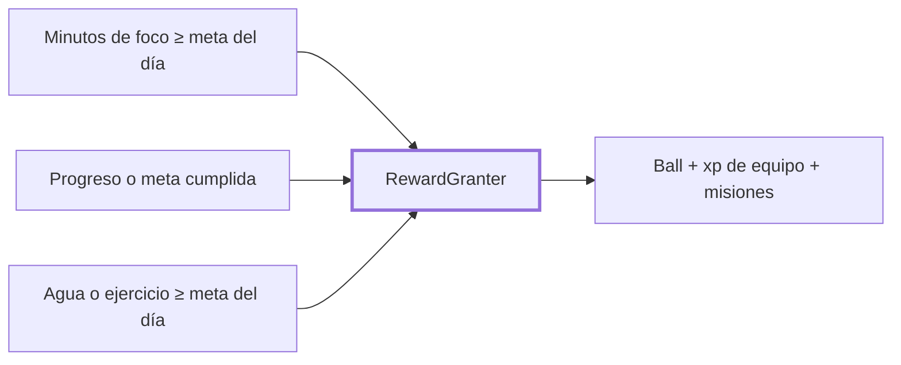

# CHG-027 · Nuevas fuentes del juego: foco, metas y salud diaria
**Estado:** En verificación
**Nivel:** M
**Modelo sugerido:** estandar
<!-- Estados y nivel se cambian SOLO con node .claude/team.mjs. Modelo: un perfil de docs/TEAM_MODELS.md -->
**Creado:** 2026-11-09 · **Aprobado:** 2026-11-09 · **Cerrado:** —
**Relacionado:** CHG-019 (otorgamiento), CHG-021 (equipo y misiones), CHG-022/026 (director)

## 0. En palabras simples
- Qué vas a ver distinto: además de tareas y hábitos, también te ganas balls por:
  - **Foco:** al cumplir tu meta diaria de minutos de pomodoro. Es una ball por día, no una por cada pomodoro, para no premiar el exceso.
  - **Metas:** al registrar progreso en una meta (máximo una ball por meta y por día) y una ball extra al marcarla como cumplida.
  - **Salud:** al cumplir tu meta diaria de agua y tu meta diaria de ejercicio, una ball por cada una y por día.
  - Funciona igual desde la app que desde el MCP.
  - Cada fuente es un ámbito propio (Foco, Metas, Salud): da xp a tu equipo, puede ser la afinidad de un integrante y cuenta en las misiones de variedad y en las que propone el director.
  - En Ajustes puedes apagar cada fuente.
- Cómo comprobarlo tú:
  - Registra agua hasta pasar tu meta del día: llega el aviso "¡Ganaste una ball!".
  - Registra progreso en una meta: otra ball.
  - En Balls aparecen con su origen ("Foco del día", "Meta: …", "Agua del día", "Ejercicio del día").

## 1. Resumen
Agrega tres fuentes al registro de eventos de CHG-019. Se engancha en los modelos (observers), así que cubre la app y el MCP. Las reglas no cambian: idempotencia por clave, límite diario, nada se revoca y nada castiga. La meta cumplida da una ball especial que no cuenta para el límite diario. Los ámbitos `focus`, `goals` y `health` se suman a las afinidades, la variedad, las misiones del director y los bonos de temporada.



## 2. Producto (product-manager)
- Problema / usuario: Alex completa pomodoros, metas y hábitos de salud que hoy no cuentan en el juego.
- Incluye:
  - **Foco:** al guardar una sesión de pomodoro completada, si los minutos del día alcanzan la meta del módulo Pomodoro (`weekday_goal_minutes` o `weekend_goal_minutes`), se da una ball. Clave `focus:{fecha}`, etiqueta "Foco del día". Si la meta es 0, no da ball.
  - **Metas, progreso:** registrar una entrada de texto o numérica da una ball. Clave `goal-progress:{meta}:{fecha}`, etiqueta "Meta: {título}".
  - **Metas, cumplida:** pasar la meta a `completed` da una ball especial, una sola vez por meta, que no cuenta para el límite diario. Clave `goal-done:{meta}`, etiqueta "Meta cumplida: {título}". Reabrirla y cerrarla de nuevo no da otra.
  - **Salud:**
    - Agua: el total del día alcanza la meta del usuario (`WaterGoal::forUser`). Clave `water:{fecha}`, etiqueta "Agua del día".
    - Ejercicio: los minutos del día alcanzan `daily_exercise_minutes` (30 por defecto). Clave `exercise:{fecha}`, etiqueta "Ejercicio del día".
  - **Ámbitos:** `focus` (Foco), `goals` (Metas) y `health` (Salud).
    - Pueden ser afinidad del equipo, con +6 xp extra.
    - Cuentan para la variedad.
    - Son válidos en `team_bonus` y en las misiones `category_tasks`, ahora llamadas "de ámbito", del director.
    - El contexto del director los incluye en `scopes`.
  - **Ajustes:** interruptores "Dar balls por foco", "Dar balls por metas" y "Dar balls por salud", activos por defecto.
- No incluye: ánimo, diario, relaciones, eventos de salud (citas) ni vehículos. No da balls por pomodoro individual.
- Criterios de aceptación:
  - Con una meta de foco de 50 min, una sesión de 25 no da ball; la segunda, que suma 50, da 1; una tercera ese día no da otra.
  - Completar un pomodoro por MCP (`log-focus-session-tool`) que cumple la meta da la ball.
  - Dos entradas de progreso en la misma meta el mismo día dan 1 ball; en dos metas distintas, 2.
  - Marcar una meta cumplida da 1 ball especial aunque se haya alcanzado el límite diario; reabrirla y cerrarla no da otra.
  - Al pasar la meta de agua del día se da 1 ball; seguir bebiendo no da más; borrar un registro no quita nada.
  - Lo mismo con el ejercicio.
  - Con la fuente apagada en Ajustes no hay ball, pero el progreso del módulo se guarda igual.
  - Un integrante con afinidad Salud recibe +9 xp al cumplir el agua (3 base + 6).
  - Aislamiento: una acción de otro usuario no afecta tu juego.

## 3. UX/UI
### 3.1 Experiencia (ux-designer)
- Plantilla: no cambia ninguna pantalla. Solo se agregan interruptores en Ajustes y etiquetas de origen en Balls.
- Flujo: completar algo en Pomodoro, Metas, Agua o Ejercicio → aviso global → Balls.
- Estados: sin cambios.

```
Ajustes · Juego
[■] Dar balls por tareas completadas
[■] Dar balls por hábitos
[■] Dar balls por foco      ← nuevo
[■] Dar balls por metas     ← nuevo
[■] Dar balls por salud     ← nuevo

Balls
 (◓)            (◓)                 (◓)
 Foco           Meta                Salud
 Foco del día   Meta: Leer 12 libros  Agua del día
```

### 3.2 Visual (ui-designer)
- Componentes: `x-ui.switch` en Ajustes y `x-game.ball` en Balls, sin cambios.
- Tokens: sin cambios.

### 3.3 Escritura (ux-writer)
- Textos: "Dar balls por foco", "Dar balls por metas", "Dar balls por salud"; ayuda de foco: "Una ball al cumplir tu meta diaria de minutos, no por cada pomodoro."; tipos de ball: "Foco", "Meta", "Salud"; orígenes: "Foco del día", "Meta: {título}", "Meta cumplida: {título}", "Agua del día", "Ejercicio del día"; ámbitos: "Foco", "Metas", "Salud".
- Reglas: tuteo, sin urgencias.

## 4. Diseño técnico (software-architect)
- Archivos:
  - Observers nuevos en `app/Observers/Game/`: `FocusSourceObserver.php` (PomodoroSession), `GoalSourceObserver.php` (Goal, GoalEntry, GoalNumericEntry) y `HealthSourceObserver.php` (DrinkLog, ExerciseLog).
  - Registro en `app/Providers/AppServiceProvider.php`, con observers y morph map para `pomodoro-session`, `goal-entry` y `goal-numeric-entry`. `goal` ya está; `drink-log` y `exercise-log`, también.
  - `app/Services/Game/RewardGranter.php`: métodos `forFocusDay`, `forGoalProgress`, `forGoalCompleted` (especial, sin límite diario) y `forHealthDay`.
  - `app/Services/Game/GameSettings.php` y `config/game.php`: fuentes `focus`, `goals` y `health`; `scopes` con etiquetas.
  - `app/Services/Game/WeekPlanner.php`: ámbitos en las afinidades.
  - `app/Services/Game/SeasonValidator.php` y `app/Services/Game/MissionProposalValidator.php`: aceptan los ámbitos.
  - `app/Services/Game/SeasonManager.php`: `scopes` en el contexto.
  - `app/Livewire/Game/GameSettingsPage.php` y su vista; `resources/views/livewire/game/game-balls.blade.php` (tipo de ball).
  - Pruebas: `tests/Feature/Game/NewSourcesTest.php`. Docs: `docs/game.md`.
- Enfoque:
  - Todos los observers otorgan en `DB::afterCommit` y pasan por `RewardGranter::safely`: un fallo del juego nunca impide guardar en el módulo.
  - Los totales del día usan las consultas existentes: `WaterProgress::totals`, `ExerciseProgress::totals` y la suma de `duration` de las sesiones completadas del día, con la meta de `ModuleSetting` del módulo pomodoro.
  - El contexto de actividad lleva `category` = ámbito, así equipo, variedad, temporadas y misiones funcionan sin cambios.
- Riesgos: las sesiones de pomodoro se guardan varias veces mientras el temporizador corre, pero la idempotencia por día lo evita. Las metas cumplidas de golpe en bloque quedan acotadas por la clave por meta.
- Qué NO tocar: la lógica de los módulos Pomodoro, Metas, Agua y Ejercicio, que solo se observan.

## 5. Pruebas (qa-tester)
| Caso | Tipo | Nivel | Test |
|---|---|---|---|
| Foco: ball solo al cumplir la meta del día, una vez | Feature | Servicio | NewSourcesTest |
| Foco por MCP (log-focus-session-tool) | Feature | MCP | NewSourcesTest |
| Metas: 1 por meta y día; distinta meta suma | Feature | Servicio | NewSourcesTest |
| Meta cumplida: especial sin límite, una vez | Feature | Servicio | NewSourcesTest |
| Agua y ejercicio: al cruzar la meta, una vez; borrar no quita | Feature | Servicio | NewSourcesTest |
| Fuente apagada: sin ball, el módulo guarda | Feature | Servicio | NewSourcesTest |
| Afinidad Salud +9 xp; variedad cuenta el ámbito | Feature | Servicio | NewSourcesTest |
| Director acepta los ámbitos en bonos y misiones | Feature | Servicio | NewSourcesTest |
| Aislamiento por usuario | Feature | Servicio | NewSourcesTest |
- Comando: `php artisan test tests/Feature/Game tests/Unit/Game`
- Regresión: `php artisan test --filter="Pomodoro|Goal|Water|Exercise|Mcp"`

## 6. Documentación (tech-writer)
- `docs/game.md`: tabla de fuentes, ámbitos y ajustes.

## 7. Tareas
- [x] T1 · Fuentes, ámbitos y ajustes nuevos en la configuración del juego — Resp: developer — Archivos: config/game.php, app/Services/Game/GameSettings.php, app/Services/Game/WeekPlanner.php, app/Services/Game/SeasonValidator.php, app/Services/Game/MissionProposalValidator.php, app/Services/Game/SeasonManager.php, app/Livewire/Game/GameSettingsPage.php, resources/views/livewire/game/game-settings.blade.php — Hecho cuando: las pruebas del juego siguen en verde
- [x] T2 · Balls por foco, metas, agua y ejercicio desde la app y el MCP — Resp: developer — Archivos: app/Observers/Game, app/Providers/AppServiceProvider.php, app/Services/Game/RewardGranter.php, resources/views/livewire/game/game-balls.blade.php, tests/Feature/Game/NewSourcesTest.php — Hecho cuando: NewSourcesTest pasa y la regresión de los módulos sigue igual
- [ ] T3 · Verificar criterios de aceptación — Resp: qa-tester — Hecho cuando: todos pasan
- [x] T4 · Actualizar docs/game.md — Resp: tech-writer — Archivos: docs/game.md — Hecho cuando: docs al día

## 8. Bitácora de implementación (developer)
- 2026-11-09 — Inicio con `start --force` (ya había otros CHG En desarrollo; trabajo aprobado por Alex).
- 2026-11-09 — T1: fuentes y ámbitos nuevos.
  - Fuentes `focus`, `goals` y `health` en config/GameSettings, y `config('game.scopes')` con Hábitos, Foco, Metas y Salud.
  - WeekPlanner ofrece esos ámbitos como afinidad.
  - SeasonValidator los acepta en `team_bonus`; MissionProposalValidator, en `category_tasks` (excepto `habits`, que usa `habit_groups`).
  - El contexto del director incluye `scopes`.
  - Ajustes tiene tres interruptores nuevos.
  - WeekPlannerTest se ajustó al nuevo conjunto de afinidades.
- 2026-11-09 — T2: otorgamiento y observers.
  - `RewardGranter`:
    - `grant(..., $special)`: la ball especial no se limita ni cuenta en el cupo diario (`whereNull('effect->special')`).
    - Métodos `forFocusDay`, `forGoalProgress`, `forGoalCompleted` y `forHealthDay`.
  - Observers en `app/Observers/Game/`: `FocusSourceObserver` (suma de `duration` en segundos frente a la meta del día de ModuleSetting pomodoro), `GoalSourceObserver` (entradas y meta cumplida) y `HealthSourceObserver` (agua con `WaterGoal::forUser`, ejercicio con `daily_exercise_minutes`). Todos con `DB::afterCommit`.
  - Registro y morph map en AppServiceProvider (`pomodoro-session`, `goal-entry`, `goal-numeric-entry`).
  - Balls muestra el tipo (Foco, Meta, Salud).
- 2026-11-09 — Pruebas:
  - NewSourcesTest: 11 pasan, incluido foco vía MCP con `log-focus-session-tool`.
  - Total del juego: 131 en verde.
  - Regresión Pomodoro, Goal, Water, Exercise, Drink, Mcp, DailyLog, Focus y UiConformance: 272 pasan y 2 fallan. Son los calendarios de agua y ejercicio, que ya fallaban desde el inicio porque dependen de la fecha.
  - `npm run build` ejecutado.
- 2026-11-09 — T4: docs/game.md, con la tabla de fuentes y los ámbitos.

## 9. Preguntas abiertas, decisiones e historial
- 2026-11-09 — Creado en to-do/ (Borrador, nivel M)
- 2026-11-09 — Decisiones (Alex): fuentes nuevas Pomodoros, Metas y Salud (solo metas diarias cumplidas de agua y ejercicio); cuentan como ámbitos propios para el equipo y las misiones.
- 2026-11-09 — Supuestos: foco = una ball al cumplir la meta diaria (no por pomodoro); meta cumplida = ball especial fuera del límite diario; relaciones, ánimo, diario y citas de salud quedan fuera.
- 2026-11-09 — Aprobado por el usuario (Compuerta 2)
- 2026-11-09 — Movido a in-progress/ (En desarrollo)
- LECCIÓN: ninguna nueva (se aplicó la de CHG-026: otorgar en DB::afterCommit).
- 2026-11-09 — Implementación terminada → En verificación
