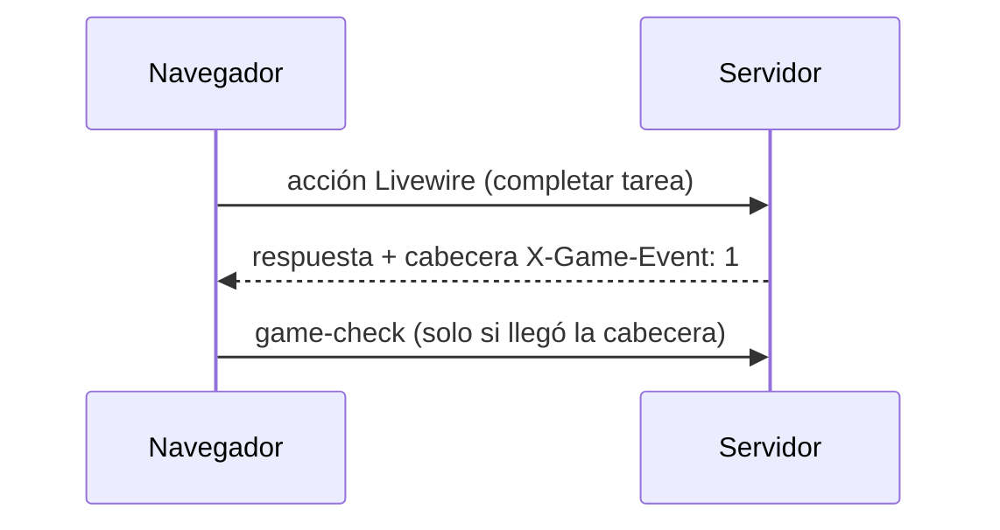

# CHG-041 · Avisos del juego sin consultas extra
**Estado:** En verificación
**Nivel:** S
**Modelo sugerido:** estandar
<!-- Estados y nivel se cambian SOLO con node .claude/team.mjs. Modelo: un perfil de docs/TEAM_MODELS.md -->
**Creado:** 2026-11-09 · **Aprobado:** 2026-11-09 · **Cerrado:** —
**Relacionado:** —

## 0. En palabras simples
- Qué vas a ver distinto: nada en pantalla; los avisos del juego siguen saliendo al instante, pero la app deja de hacer una segunda llamada al servidor después de cada clic que no dio experiencia ni ball.
- Cómo comprobarlo tú: con la Debug Bar abierta, edita una tarea sin completarla → solo aparece 1 petición. Completa una tarea → aparece el aviso igual que hoy.

## 1. Resumen
Hoy `game-celebrations.js` dispara `game-check` (otra petición Livewire) tras **cada** commit exitoso. La mayoría no generan eventos del juego. El servidor marcará en la respuesta si se creó algún `GameEvent` del usuario, y el cliente solo consultará en ese caso. El poll de 60 s ya usa `.visible` y se mantiene para lo que llega por MCP.

## 4. Diseño técnico

- Marca por petición: un singleton liviano `App\Support\Game\RequestGameActivity` (bandera `touched`). Se enciende en el evento `created` de `GameEvent` (observer o `booted()` del modelo) solo si `user_id` es el usuario autenticado.
- Middleware `AddGameEventHeader` (grupo `web`, incluye la ruta de update de Livewire) que añade `X-Game-Event: 1` si la bandera está encendida.
- Cliente: en `registerGameCelebrations` reemplazar el hook `commit` por `Livewire.hook('request', ({ respond }) => respond(({ response }) => …))`. Si la cabecera viene y el componente no es el notificador, despacha `game-check` con el mismo debounce de 400 ms.
- Las otras vías que hoy despiertan el notificador (eventos de tareas/hábitos, poll 60 s visible) no cambian.
- Índices: `game_events` ya tiene `unique(user_id, idempotency_key)`, que sirve para `where user_id … and id > ?`. No se agregan índices. En `GameNotifier::mount` el `max('id')` debe filtrarse por usuario (hoy es global).
- Riesgo: si alguna vía crea eventos tras `afterCommit` fuera del ciclo de la petición (colas), no hay cabecera; el poll de 60 s lo cubre igual que hoy.
- Archivos: `app/Support/Game/RequestGameActivity.php` (nuevo), `app/Http/Middleware/AddGameEventHeader.php` (nuevo), `bootstrap/app.php`, `app/Models/GameEvent.php`, `app/Livewire/Game/GameNotifier.php`, `resources/js/game-celebrations.js`.

## 5. Pruebas
- Feature: una acción Livewire que completa una tarea responde con `X-Game-Event: 1`; una que solo edita el título no la incluye; un evento de otro usuario no enciende la bandera.
- Feature: `GameNotifier` arranca con el último id **del usuario**.
- Regresión: `php artisan test tests/Feature/Game tests/Unit/Game`.
- Manual: Debug Bar, contar peticiones antes/después.

## 7. Tareas
- [x] T1 · El servidor avisa en la respuesta cuando hubo novedad del juego — Resp: developer — Archivos: app/Support/Game/RequestGameActivity.php, app/Http/Middleware/AddGameEventHeader.php, bootstrap/app.php, app/Models/GameEvent.php, app/Livewire/Game/GameNotifier.php, tests/Feature/Game/GameEventHeaderTest.php — Hecho cuando: los tests de cabecera y del último id por usuario pasan
- [x] T2 · El navegador solo pregunta por novedades si hubo una — Resp: developer — Archivos: resources/js/game-celebrations.js — Hecho cuando: editar una tarea genera 1 petición y completarla sigue mostrando el aviso
- [ ] T3 · Verificar criterios y regresión del juego — Resp: qa-tester — Hecho cuando: suite Game en verde y conteo manual confirmado
- [x] T4 · Actualizar "Cuándo se entera" en docs/game.md — Resp: tech-writer — Archivos: docs/game.md — Hecho cuando: describe la cabecera y el poll visible

## 8. Bitácora de implementación (developer)
- 2026-11-10 — Inicio (start --force aprobado por Alex: CHG-003/015/016/017 seguían En desarrollo). Línea base: 1 falla previa ajena (NewSourcesTest::test_director_accepts_the_new_scopes, misiones del director/CHG-040).
- T1 — `RequestGameActivity` (#[Scoped]), `GameEvent::booted` la enciende al crear un evento del usuario autenticado, `AddGameEventHeader` en el grupo web. `GameNotifier::mount` ya filtraba por usuario vía `BelongsToUser`: sin cambio de código, solo test. tests/Feature/Game/GameEventHeaderTest.php → 4 pasan.
- T2 — `game-celebrations.js`: hook `request`/`respond` lee `X-Game-Event` y solo entonces despacha `game-check` (debounce 400 ms). `npm run build` OK.
- T4 — docs/game.md "Cuándo se entera" actualizado.
- Suite Game+Unit: 175/176; la única falla es la previa ajena.

## 9. Preguntas abiertas, decisiones e historial
- LECCIÓN: ninguna
- 2026-11-09 — Creado en to-do/ (Borrador, nivel S)
- 2026-11-09 — Decisión (Alex): game-check solo cuando la acción generó xp/ball.
- 2026-11-09 — Aprobado por el usuario (Compuerta 2)
- 2026-11-09 — Movido a in-progress/ (En desarrollo)
- 2026-11-10 — Implementación terminada → En verificación
