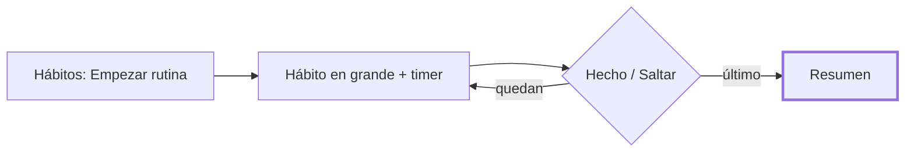
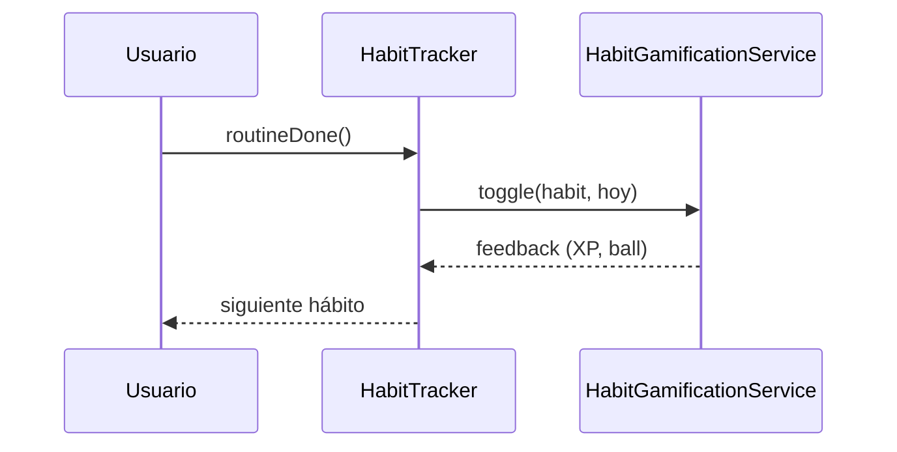

# CHG-046 · Modo rutina inmersivo de habitos
**Estado:** En verificación
**Nivel:** M
**Modelo sugerido:** estandar
<!-- Estados y nivel se cambian SOLO con node .claude/team.mjs. Modelo: un perfil de docs/TEAM_MODELS.md -->
**Creado:** 2026-11-09 · **Aprobado:** 2026-11-10 · **Cerrado:** —
**Relacionado:** CHG-023 (ball por grupo), CHG-021 (equipo semanal)

## 0. En palabras simples
- Qué vas a ver distinto: en Hábitos, cada franja (Mañana, Tarde, Noche…) con pendientes de hoy tiene un botón «Empezar rutina». Abre una pantalla completa con un hábito a la vez, en grande, con cuenta atrás si tiene duración y un Pokémon de tu equipo acompañándote. Marcas «Hecho» o «Saltar» y pasa al siguiente. Al final ves cuántos hiciste.
- Cómo comprobarlo tú: en la noche abre Hábitos → «Empezar rutina» en Noche → «Lavarme los dientes» muestra 02:00 → «Hecho» → al completar toda la franja aparece la ball como siempre.

## 1. Resumen
Modo rutina inmersivo: recorre los hábitos pendientes de hoy de una franja (`time_of_day`), uno por pantalla, con timer de `goal_duration`. Completar reutiliza `toggleHabit` → `HabitGamificationService::toggle`, así que XP, balls, avisos y acciones del hábito funcionan igual. Complementa la gamificación; no la reemplaza.



## 2. Producto (product-manager)
- Problema / usuario: Alex abandona rutinas (p. ej. la de la noche) en el momento de ejecutarlas; la lista no guía paso a paso.
- Incluye: botón por franja con pendientes de hoy; pantalla completa paso a paso; timer cuenta atrás con pausa; Hecho/Saltar; Pokémon acompañante (primer integrante del equipo semanal); resumen final.
- No incluye: rutinas personalizadas, reordenar, auto-completar al terminar el timer, sonido (CHG-044), fechas distintas de hoy.
- Criterios de aceptación:
  - Dado hábitos de Noche pendientes hoy, cuando toco «Empezar rutina» en Noche, entonces veo el primero pendiente (orden `base_time`) a pantalla completa con «1 de N».
  - Dado un hábito con `goal_duration` «2 min», entonces veo 02:00 en cuenta atrás; al llegar a 0 se resalta «Hecho» y no se completa solo.
  - Cuando toco «Hecho», el hábito queda completado igual que desde la lista (mismos premios y avisos) y paso al siguiente.
  - Cuando toco «Saltar», no se registra nada y paso al siguiente.
  - Al terminar, veo «Hiciste X de N».
  - Si tengo equipo semanal veo a mi Pokémon; si no, la rutina funciona sin él.

## 3. UX/UI
### 3.1 Experiencia (ux-designer)
- Plantilla: pantalla de enfoque superpuesta (overlay a pantalla completa sobre Hábitos); el repo no tiene anatomía documentada.
- Flujo y cantidad de pasos: 1 clic para entrar; 1 clic por hábito; «×» o Esc cierra en cualquier momento (lo hecho queda guardado).
- Qué contiene cada pantalla y qué es lo más importante: franja y «n de N»; icono y nombre grandes (lo principal); timer si aplica; Pokémon con nombre; botones Saltar / Pausar / Hecho.
- Estados: sin pendientes en la franja → no hay botón; timer en 0 → «¡Tiempo!» y Hecho resaltado; final → resumen con «Cerrar».
- Información necesaria y momento de presentación: premios por el aviso existente `habit-feedback` al marcar Hecho; resumen al final.
- Accesibilidad de uso: `role="dialog" aria-modal="true"`, foco inicial en «Hecho», Esc cierra, aviso de tiempo con `aria-live="polite"`.

### 3.2 Visual (ui-designer)
```
┌───────────────────────────────┐
│ 🌙 Noche · 2 de 5         [×] │
│                               │
│             🪥                │
│      Lavarme los dientes      │
│            01:42              │
│   [img] Pikachu te acompaña   │
│                               │
│ [Saltar] [⏸ Pausar] [✔ Hecho] │
└───────────────────────────────┘

Resumen
┌───────────────────────────────┐
│      🌙 Rutina terminada      │
│       Hiciste 4 de 5          │
│           [Cerrar]            │
└───────────────────────────────┘
```
- Distribución: overlay fijo 100dvh, contenido en columna centrada (máx. 480px); botones abajo, al alcance del pulgar.
- Componentes existentes a reutilizar: `md-btn-*`, colores de franja (`$timeLabels` en `habit-tracker.blade.php`), imagen vía `App\Services\Game\SpeciesImageProvider::url`.
- Jerarquía, color, tipografía y espaciado: fondo `--md-sys-color-surface`; nombre `md-headline-medium`; timer `md-display-large` con cifras tabulares; icono de franja con su color.
- Responsive y contraste: mismo layout móvil/escritorio; texto on-surface sobre surface.

### 3.3 Escritura (ux-writer)
- Ubicación y estado: botón en cabecera de cada franja; overlay; resumen.
- Textos finales: «Empezar rutina»; «{Franja} · {n} de {N}»; «Hecho»; «Saltar»; «Pausar» / «Seguir»; aria del ×: «Cerrar rutina»; en 0: «¡Tiempo! Márcalo cuando termines»; «{Pokémon} te acompaña»; «Rutina terminada»; «Hiciste {x} de {N}»; «Cerrar».
- Reglas aplicadas: tuteo, frases cortas, sin culpa al saltar (no hay docs/UX-WRITING.md).
- Criterios: ningún texto castiga o juzga; todo en español.

## 4. Diseño técnico (software-architect)
- Archivos a crear / modificar: `app/Livewire/Habit/HabitTracker.php`, `resources/views/livewire/habit/habit-tracker.blade.php`, nuevo `resources/views/livewire/habit/partials/routine-overlay.blade.php`, nuevo `tests/Feature/HabitRoutineTest.php`.
- Enfoque: propiedad `?array $routine` (period, queue de IDs, index, done, skipped). `startRoutine($period)` arma la cola de pendientes de hoy por `base_time`; `routineDone()` llama al `toggleHabit` existente y avanza; `routineSkip()` avanza; `closeRoutine()` limpia. Duración: `routineSeconds(?string)` parsea «N min»/«N h»; timer en Alpine en el cliente. Acompañante: primer `GameTeamMember` por `slot` de la semana actual (`WeekPlanner::forWeek`) + `SpeciesImageProvider`, en try/catch.
- Riesgos y mitigación: el prompt de acción del hábito puede abrirse durante la rutina → se muestra encima, sin bloquear; `goal_duration` es texto libre → si no parsea, sin timer.
- Qué NO tocar: `HabitGamificationService`, migraciones, MCP.



## 5. Pruebas (qa-tester)
| Caso | Tipo | Nivel | Test |
|---|---|---|---|
| Inicia con pendientes de la franja en orden | Feature | Livewire | HabitRoutineTest |
| Hecho completa y avanza | Feature | Livewire | HabitRoutineTest |
| Saltar no registra | Feature | Livewire | HabitRoutineTest |
| Termina en resumen con conteo | Feature | Livewire | HabitRoutineTest |
| Parseo de goal_duration | Unit | PHP | HabitRoutineTest |
- Comando para verificar: `php artisan test --filter=Habit`
- Regresión a vigilar: toggle normal, acordeón de franjas, ball por grupo.

## 6. Documentación (tech-writer)
- Docs a actualizar: No aplica — no hay guía de usuario de Hábitos; basta la bitácora.

## 7. Tareas
- [x] T1 · Botón «Empezar rutina» y pantalla paso a paso con Hecho/Saltar y resumen — Resp: developer — Archivos: app/Livewire/Habit/HabitTracker.php, resources/views/livewire/habit/habit-tracker.blade.php, resources/views/livewire/habit/partials/routine-overlay.blade.php, tests/Feature/HabitRoutineTest.php — Hecho cuando: tests de inicio, hecho, saltar y resumen pasan
- [x] T2 · Cuenta atrás con pausa y aviso en 0 — Resp: developer — Archivos: app/Livewire/Habit/HabitTracker.php, resources/views/livewire/habit/partials/routine-overlay.blade.php, tests/Feature/HabitRoutineTest.php — Hecho cuando: «2 min» muestra 02:00 y el test de parseo pasa
- [x] T3 · Pokémon acompañante del equipo semanal — Resp: developer — Archivos: app/Livewire/Habit/HabitTracker.php, resources/views/livewire/habit/partials/routine-overlay.blade.php — Hecho cuando: con equipo se ven imagen y nombre; sin equipo no falla
- [x] T5 · Los botones no quedan tapados por el menú inferior del celular — Resp: developer — Archivos: resources/views/livewire/habit/partials/routine-overlay.blade.php, resources/css/m3/modules/_habits.css — Hecho cuando: en 390×844 los botones quedan sobre la barra inferior
- [x] T6 · El Pokémon acompaña dentro del anillo del timer y habla con un globo que cambia — Resp: developer — Archivos: resources/views/livewire/habit/partials/routine-overlay.blade.php, resources/css/m3/modules/_habits.css, tests/Feature/HabitRoutineTest.php — Hecho cuando: el anillo avanza, la frase cambia y el Pokémon salta al tocar Hecho
- [x] T7 · Volver a hábitos saltados (‹, puntos tocables, «Retomar saltados») — Resp: developer — Archivos: app/Livewire/Habit/HabitTracker.php, resources/views/livewire/habit/partials/routine-overlay.blade.php, tests/Feature/HabitRoutineTest.php — Hecho cuando: test de saltados pasa
- [x] T8 · Fondo con paisaje ilustrado según la franja (amanecer, cielo de tarde, noche estrellada) — Resp: developer — Archivos: resources/views/livewire/habit/partials/routine-overlay.blade.php, resources/css/m3/modules/_habits.css — Hecho cuando: cada franja muestra su escena, el texto se lee y sin animación con reduced-motion
- [ ] T4 · Verificar criterios de aceptación — Resp: qa-tester — Hecho cuando: todos pasan en móvil y escritorio

## 8. Bitácora de implementación (developer)
- 2026-11-10 — Inicio (start --force: otros CHG en desarrollo en paralelo). Base: `--filter=Habit` 56/56.
- 2026-11-10 — T1: `startRoutine/routineDone/routineSkip/closeRoutine` en HabitTracker (Hecho reutiliza `toggleHabit`, no descompleta si ya estaba hecho); botón «Empezar rutina» solo hoy y con pendientes; overlay `partials/routine-overlay.blade.php` con resumen. Tests HabitRoutineTest ✔.
- 2026-11-10 — T2: `routineSeconds()` (min/h/s; sin unidad = min); cuenta atrás Alpine con Pausar/Seguir, aviso en 0 y «Hecho» pulsante (respeta reduced-motion). Test de parseo ✔.
- 2026-11-10 — T3: acompañante = primer integrante por `slot` del equipo semanal (`WeekPlanner::forWeek` + `SpeciesImageProvider`), en try/catch. Test con especie de prueba ✔.
- 2026-11-10 — DESVIACIÓN menor: estilos en `resources/css/m3/modules/_habits.css` (no listado en §4, necesario para §3.2). Colores por franja como clases (no inline) y botones con `x-ui.action`/`x-ui.icon-action` para cumplir contratos de UI.
- 2026-11-10 — Verificación: `--filter=Habit` 61/61 ✔; `npm run build` ✔. Suite completa: 34 fallos ajenos a este cambio (Tasks, Relationships, Plans, CSS de otros módulos, UiCatalog…; ninguno menciona hábitos/rutina), coinciden con trabajo paralelo de CHG-042/043 y deuda previa.

- 2026-11-10 — T5: el overlay se teletransporta a body con `x-teleport`, z-index 1150 (por debajo de los diálogos 1200, para que el prompt de acción del hábito siga encima) y padding inferior extra.
- 2026-11-10 — T6: anillo SVG del timer con el Pokémon dentro (flota mientras corre el timer y salta al tocar Hecho; respeta reduced-motion), globo con frases según el tiempo restante y el icono del hábito como chip junto al nombre. Sin Pokémon se ve el icono del hábito dentro del anillo.
- 2026-11-10 — T7: `routine.status` por hábito, `routineGoTo`, `routinePrevious`, `routineRetrySkipped`; el resumen cuenta sobre todos los hábitos de la franja. `--filter=Habit` 63/63 ✔; build ✔; sin infracciones de contrato UI nuevas.
- 2026-11-10 — Bug (Alex): tras tocar un punto la pantalla quedaba congelada. Causa: el wire:key de la raíz teletransportada cambiaba con cada paso, Livewire reemplazaba el nodo y el clon visible en body perdía el enlace. Fix: raíz estable `habit-routine-root` y paso con key dinámica dentro (`.habit-routine__step`, display: contents). Tests 7/7 ✔, build ✔. No se pudo probar en navegador (requiere sesión).
- 2026-11-10 — T8: escena decorativa (`aria-hidden`) con cielo degradado, sol o luna, nubes o estrellas y colinas SVG por franja; la noche redefine localmente tokens de color para texto claro. Los colores de la escena son ilustrativos (hex), sin tokens del sistema. Animaciones lentas desactivadas con reduced-motion. Tests ✔; build ✔; sin infracciones UI nuevas.

- 2026-11-10 — Fix: la luna (degradado radial) se veía como un aro cortado; ahora es una luna creciente hecha con box-shadow sobre un círculo vacío.

## 9. Preguntas abiertas, decisiones e historial
- 2026-11-09 — Creado en to-do/ (Borrador, nivel M)
- 2026-11-10 — Reabierto por la prueba en celular. Decisiones: anillo con Pokémon + globo de frases; volver con ‹, puntos tocables y «Retomar saltados».
- Textos nuevos: «Hábito anterior», «Ir a {hábito}, {hecho|saltado|pendiente}», globo «¡Vamos con {hábito}!» / «¡Ya vas por la mitad!» / «¡Casi!» / «¡Tiempo! Márcalo cuando termines» / «¡Bien hecho!», «Retomar saltados ({n})».
LECCIÓN(developer): en `x-teleport` la raíz teletransportada debe tener wire:key fijo; las keys dinámicas van en un hijo — evidencia: CHG-046 congelado al navegar · destino sugerido: docs/UI-DESIGN.md
LECCIÓN(developer): las pantallas completas dentro de x-module-shell se teletransportan a body (x-teleport) — un z-index alto no basta porque el shell crea un stacking context y la barra inferior del celular las tapa · destino sugerido: docs/UI-DESIGN.md
- 2026-11-09 — Decisiones: rutina por franja; timer manual; Pokémon acompañante.
- 2026-11-10 — Aprobado por el usuario (Compuerta 2)
- 2026-11-10 — Movido a in-progress/ (En desarrollo)
- 2026-11-10 — Implementación terminada → En verificación
- 2026-11-10 — Reabierto: Prueba en celular: barra inferior tapa botones, Pokémon desintegrado, no se puede volver a saltados
- 2026-11-10 — Implementación terminada → En verificación
- 2026-11-10 — Reabierto: Bug: tras navegar (punto/Hecho) el overlay teletransportado queda congelado
- 2026-11-10 — Implementación terminada → En verificación
- 2026-11-10 — Reabierto: T8: fondo temático ilustrado por franja
- 2026-11-10 — Implementación terminada → En verificación
- 2026-11-10 — Reabierto: Luna de la noche se ve cortada
- 2026-11-10 — Implementación terminada → En verificación
