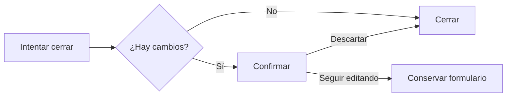

# CHG-047 · Bebidas con buscador y cierre protegido
**Estado:** En verificación
**Nivel:** S
**Modelo sugerido:** estandar
<!-- Estados y nivel se cambian SOLO con node .claude/team.mjs. Modelo: un perfil de docs/TEAM_MODELS.md -->
**Creado:** 2026-11-09 · **Aprobado:** 2026-11-09 · **Cerrado:** —
**Relacionado:** —

## 0. En palabras simples
Buscar bebidas al registrar o editar y confirmar antes de perder cambios al cerrar.
Comprobar buscando una bebida, modificando cantidad y pulsando fuera: elegir seguir editando o descartar.

## 1. Resumen
Plan aprobado por el usuario en el chat. Nivel S, alcance exclusivo del registro de consumo.
Sin migraciones, cambios de permisos, catálogos ni guardado automático.

## 3. UX/UI
Formulario modal canónico sobre el registro diario; selector compartido y confirmación dentro de la misma superficie para mantener el foco.
```
Nueva bebida                         [X]
Tipo de bebida [Buscar bebida…        ▾]
Cantidad (ml) [250]   Hora [14:30]
[Cantidades habituales]
[Cancelar]                    [Guardar]

¿Descartar los cambios?
Tienes cambios sin guardar. Si sales, se perderán.
[Seguir editando] [Descartar cambios]
```

Comparar bebida, cantidad y hora iniciales. Cerrar sin aviso si no cambian o se restauran; buscar sin elegir no modifica datos. Escape cierra primero el buscador. Todos los cierres pasan por la misma protección. Guardado exitoso cierra; errores conservan datos.

## 4. Diseño técnico
Archivos: resources/views/livewire/water/water-daily.blade.php, resources/views/components/ui/form-dialog.blade.php, app/Livewire/Water/WaterDaily.php; tests/Feature/WaterDrinkCatalogTest.php; tests/Browser/water-form.interaction.spec.js; tests/Browser/support/water-form-fixture.php; docs/design-system.md.
Reutilizar combobox y form-dialog. Añadir acción de cierre cliente opcional y slot de acciones al formulario canónico, preservando valores por defecto. Estado Alpine local por apertura; comparar valores actuales normalizados. Confirmación inline conserva una sola trampa de foco. Limpiar errores al abrir/cerrar. No tocar otros módulos, estilos ni reglas de persistencia.

## 5. Pruebas
PHP de WaterDrinkCatalogTest y WaterDailyProgressTest. Browser aislado SQLite a 375/768/1280: búsqueda, teclado, cierres, restauración, validaciones, guardado y edición, foco y accesibilidad. npm run build, php artisan ui:conformance y git diff --check.

## 7. Tareas
- [x] T1 · Buscar bebidas y proteger cambios al cerrar — Resp: developer — Archivos: los de §4 — Hecho cuando: selector y todos los cierres respetan el plan.
- [x] T2 · Verificar registro y edición en tres tamaños — Resp: developer — Archivos: tests de §4 — Hecho cuando: pruebas afectadas y verificaciones pasan.

## 8. Bitácora de implementación (developer)
- 2026-11-09 — Inicio: checkout sin cambios; CHG aprobado y arrancado con --force para coexistir con CHGs independientes ya en desarrollo, sin modificarlos.
- T1: registro y edición usan combobox compartido y form-dialog. Snapshot local por apertura, confirmación inline de los cuatro cierres, foco en Seguir editando y retorno al control anterior. Cerrar limpia datos y errores; guardar mantiene las reglas existentes.
- Se añadieron closeExpression y actions opcionales al componente canónico; el footer declara role=presentation para evitar un segundo landmark contentinfo. Los consumidores actuales conservan sus valores predeterminados.
- PHP: WaterDrinkCatalogTest y UiPrimitivesTest, 32 pruebas / 130 aserciones aprobadas. npm run build y php artisan ui:conformance aprobados, sin deuda visual nueva. git diff --check correcto.
- Fallo preexistente, reproducido antes y después del cambio: WaterDailyProgressTest::test_calendar_navigates_months_and_marks_days_without_data espera calendarMonth=2026-09 pero recibe 2026-11. La ejecución conjunta original pasó 10 de 11 pruebas. No se modificó calendario ni esa prueba.

- T2: Playwright en SQLite exclusiva: escenarios completos aprobados a 375 y 768 px; repetición específica a 1280 px aprobada tras corregir el localizador de Editar para la tabla compacta. Búsqueda sin tildes, teclado/toque, no coincidencias, todos los cierres, foco de confirmación, Escape para continuar, restaurar hora/cantidad, errores, descarte, creación y actualización. Axe sin infracciones en formulario ni confirmación; capturas revisadas y footer accesible en los tres tamaños. Sin errores JavaScript. Capturas en storage/framework/testing/water-form-{375,768,1280}.png.
- Validación final: build aprobado, 32 pruebas PHP / 130 aserciones aprobadas, conformidad sin deuda nueva, diff --check y validate CHG-047 aprobados. No commits, despliegues ni escrituras en datos reales.

## 9. Preguntas abiertas, decisiones e historial
- 2026-11-09 — Usuario aprobó plan y ejecución explícitamente. Alcance cerrado; todos los cierres protegidos.
- Lineamientos PRODUCT, ARCHITECTURE, UX-DESIGN, UI-DESIGN, UX-WRITING, TESTING y DOCUMENTATION referenciados por AGENTS no existen en este checkout; se sigue docs/design-system.md y componentes vigentes.
- 2026-11-09 — Aprobado por el usuario (Compuerta 2)
- 2026-11-09 — Movido a in-progress/ (En desarrollo)

- LECCIÓN: ninguna; se aplicaron los patrones vigentes y se documentó la extensión mínima del formulario canónico.
- 2026-11-09 — Implementación terminada → En verificación
