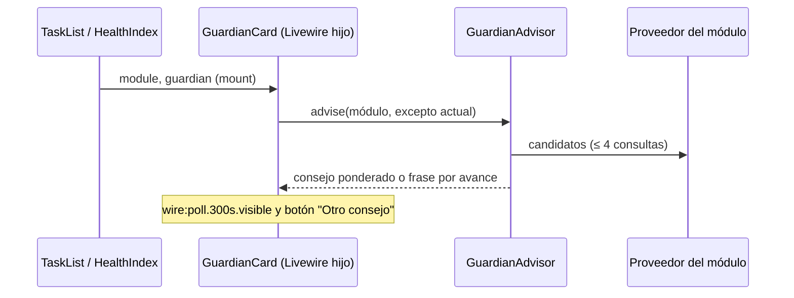

# CHG-057 · Consejos contextuales del guardián
**Estado:** En verificación
**Nivel:** M
**Modelo sugerido:** estandar
<!-- Estados y nivel se cambian SOLO con node .claude/team.mjs. Modelo: un perfil de docs/TEAM_MODELS.md -->
**Creado:** 2026-11-10 · **Aprobado:** 2026-11-10 · **Cerrado:** —
**Relacionado:** CHG-055 (guardianes de módulo), CHG-049 ("Otra frase" del panel)

## 0. En palabras simples
- Qué vas a ver distinto: el guardián de Tareas y de Salud deja de decir frases genéricas y te da consejos sacados de tus datos de hoy: tu próxima tarea, cuánto tienes planificado contra las horas que quedan, vencidas viejas de una categoría, seguimientos de salud pendientes o cómo vas frente a tus días parecidos. Junto al globo hay un botoncito para pedir otro consejo, y el consejo se renueva solo cada 5 minutos sin recargar la lista.
- Cómo comprobarlo tú: abre Tareas con una tarea agendada más tarde → el guardián puede decirte "Tu próxima es … a las …". Toca el botón de recargar → cambia a otro consejo distinto. Deja la pestaña abierta 5 minutos → se actualiza solo. En Salud, con una gripa en seguimiento sin registros recientes → te sugiere anotar cómo sigue.

## 1. Resumen
Motor de consejos por reglas (sin IA) con un proveedor por módulo que consulta los datos actuales y propone candidatos; el guardián pasa a ser un componente Livewire hijo aislado con botón "Otro consejo" y refresco cada 5 min, para no re-renderizar la lista. Si no hay ningún consejo aplicable, se mantiene la frase por avance de CHG-055.

## 2. Producto (product-manager)
- Problema / usuario: la frase del guardián es estática y no aporta. Alex quiere consejos útiles a partir de lo que ya hay en el sistema.
- Incluye: 4 familias de consejo (qué hacer ahora, alertas cálidas, patrones y logros, carga del día) en Tareas y Salud; botón "Otro consejo"; refresco automático cada 5 min solo con la pestaña visible; fallback a la frase por avance.
- No incluye: IA; otros módulos (va en un cambio posterior); consejos que modifiquen datos o acciones directas desde el globo; configuración de reglas por el usuario.
- Criterios de aceptación (Dado/Cuando/Entonces):
  1. Dado que tengo una tarea pendiente hoy con hora de inicio futura, entonces un candidato es "Tu próxima es {tarea} a las {hora}".
  2. Dado que tengo tareas pendientes de hoy con tiempo estimado mayor que las horas que quedan hasta las 23:59, entonces un candidato es el de sobrecarga con ambas cifras.
  3. Dado que tengo ≥ 3 vencidas de una misma categoría con más de 7 días, entonces un candidato nombra la categoría y la cantidad.
  4. Dado que completé hoy más tareas que mi promedio del mismo día de la semana en las 4 semanas anteriores (y al menos 2), entonces un candidato lo celebra.
  5. Dado que todas las tareas pendientes de hoy son de una sola categoría raíz (≥ 3), entonces un candidato sugiere variar.
  6. Salud: con un evento en seguimiento, candidatos "seguimiento de {evento} (día {n})" y, si su último registro tiene ≥ 3 días (o no tiene), "Llevas {n} días sin anotar cómo sigue {evento}"; con un evento futuro en ≤ 2 días, "Próximo cuidado: {evento} {cuándo}"; comparativa del mes actual con el mes con más eventos del año si este va más tranquilo.
  7. "Otro consejo" muestra un consejo distinto al actual cuando hay más de uno; con uno solo, lo mantiene.
  8. El consejo se renueva cada 5 minutos con la pestaña visible, sin cambiar el Pokémon ni re-renderizar la lista.
  9. Sin candidatos, se ve la frase por avance de CHG-055.

## 3. UX/UI
### 3.1 Experiencia (ux-designer)
- Plantilla: lista + panel lateral existente (franja de CHG-055, sin cambios de página).
- Flujo y cantidad de pasos: 0 pasos para ver el consejo; 1 clic para otro.
- Qué contiene cada pantalla y qué es lo más importante: el consejo es lo principal; los nombres de tareas/eventos van en negrita.
- Estados (vacío / carga / error / éxito / validaciones): con consejo; sin candidatos (frase por avance); durante el cambio, el botón se deshabilita y el texto hace un fundido corto. Juego apagado / sin ejemplares: oculto como hoy.
- Información necesaria y momento de presentación: ninguna adicional.
- Accesibilidad de uso (teclado, foco, errores): botón con `aria-label="Otro consejo"` y foco visible; el globo mantiene `aria-live="polite"`.

```
┌─ ⚡ Hoy ────────────────────────────┐
│░ (◕‿◕)  Ralts · Nv 4               ░│
│░  ╱▔▔╲ ◂ "Tu próxima es Daily      ░│
│░          Producto a las 10:30."   ░│
│░                              [↻]  ░│  ← "Otro consejo", icono pequeño
│ 4  de 11 planificadas hoy           │
└─────────────────────────────────────┘
```

### 3.2 Visual (ui-designer)
- Distribución: misma franja; botón de icono pequeño alineado a la derecha bajo el globo.
- Componentes existentes a reutilizar (ruta): `x-ui.icon-action` (size sm, icono `bi-arrow-repeat`), estilos `.game-guardian*` de resources/css/m3/modules/_game.css.
- Jerarquía, color, tipografía y espaciado (tokens): botón blanco semitransparente sobre el escenario (fondo `rgb(255 255 255 / .2)`, icono blanco); nombres en `<strong>` dentro del globo; fundido 150 ms solo con `prefers-reduced-motion: no-preference`.
- Responsive y contraste: igual que CHG-055; el botón mantiene 32 px de área táctil.

### 3.3 Escritura (ux-writer)
- Ubicación y estado: globo del guardián en Tareas y Salud.
- Textos finales (config `game.guardian_advice`, variables entre llaves):
  - tasks.next: "Tu próxima es {task} a las {time}."
  - tasks.overload: "Tienes {planned} planificadas y quedan {left} de día: mueve algo."
  - tasks.stale: "{count} vencidas de {category} llevan más de 7 días: ¿cerramos o movemos una?"
  - tasks.streak: "Ya cerraste {count} hoy, más que tus {weekday} de costumbre."
  - tasks.single: "Hoy todo es {category}; ¿cabe algo distinto?"
  - health.followup: "Hoy toca seguimiento de {event} (día {day})."
  - health.unlogged: "Llevas {days} días sin anotar cómo sigue {event}."
  - health.next: "Próximo cuidado: {event} {when}."
  - health.calm: "{month} va con {count} eventos; {peak} tuvo {peak_count}."
  - Botón: aria-label y tooltip "Otro consejo".
- Reglas de docs/UX-WRITING.md aplicadas: tuteo, cálido, sin culpa; ≤ 90 caracteres con variables típicas; sin palabras de `MissionProposalValidator::penaltyWord`.
- Criterios de aceptación de los textos: test que valida plantillas (sin palabras prohibidas, ≤ 90 caracteres con valores de ejemplo).

## 4. Diseño técnico (software-architect)

- Archivos a crear / modificar:
  - `app/Livewire/Game/GuardianCard.php` + `resources/views/livewire/game/guardian-card.blade.php` (nuevo): props `module`, `variant` (`top`|`rail`); elige el ejemplar en `mount` con `ModuleGuardian::pick`; propiedades `advice` y `adviceKey`; métodos `another()` y `refreshAdvice()`; vista con `wire:poll.300s.visible="refreshAdvice"` y botón.
  - `app/Services/Game/Guardian/GuardianAdvisor.php` (nuevo): resuelve el proveedor por módulo, elige al azar ponderado excluyendo `adviceKey` actual, fallback a `ModuleGuardian::line`.
  - `app/Services/Game/Guardian/TaskAdvice.php`, `HealthAdvice.php` (nuevos): devuelven `list<array{key, text, weight}>`; textos desde `config('game.guardian_advice')` con reemplazo de variables escapadas (`e()`), nombres en `<strong>`.
  - `config/game.php`: `guardian_advice`.
  - `resources/views/components/game/module-guardian.blade.php`: se elimina (lo reemplaza GuardianCard).
  - `app/Livewire/Task/TaskList.php`, `app/Livewire/Health/HealthIndex.php` y sus vistas: quitar `$guardian`/`guardianLine` y usar `<livewire:game.guardian-card module="tasks" variant="top|rail" />` en los dos lugares actuales.
  - `resources/css/m3/modules/_game.css`: botón y fundido.
- Enfoque y patrones a seguir: componente hijo aislado para que el poll no toque la lista (patrón de refresco del panel de pared). Consultas agregadas con `selectRaw`/`count`, todas con el alcance del usuario (global scopes existentes). Reglas puras y testeables con datos en BD de prueba.
- Riesgos y mitigación: costo del poll → ≤ 4 consultas por proveedor, solo con pestaña visible; XSS por nombres de tareas → escapar variables antes de envolver en `<strong>`; dos instancias (top/rail) en la página → solo la visible hace poll (`.visible`).
- Qué NO tocar: selección del ejemplar (`ModuleGuardian::pick`), recompensas, panel de pared.

## 5. Pruebas (qa-tester)
| Caso | Tipo | Nivel | Test |
|---|---|---|---|
| Cada regla de Tareas (criterios 1-5) produce su candidato y no aparece sin datos | Feature | Alto | tests/Feature/Game/GuardianAdviceTest.php |
| Reglas de Salud (criterio 6) | Feature | Alto | GuardianAdviceTest |
| "Otro consejo" excluye el actual; con uno solo lo mantiene; fallback sin candidatos | Feature | Alto | GuardianAdviceTest |
| Nombres con HTML se escapan | Feature | Alto | GuardianAdviceTest |
| Plantillas sin palabras prohibidas y ≤ 90 caracteres | Feature | Bajo | GuardianAdviceTest |
| GuardianCard: refreshAdvice/another no cambian el ejemplar; poll presente; oculto con juego apagado | Feature | Medio | tests/Feature/Game/ModuleGuardianTest.php |
- Comando para verificar: `php artisan test tests/Feature/Game/GuardianAdviceTest.php tests/Feature/Game/ModuleGuardianTest.php`
- Regresión a vigilar: Tareas y Salud (HealthModuleTest, TaskViewsTest; sus 2 fallas previas conocidas).

## 6. Documentación (tech-writer)
- Docs a actualizar: `docs/game.md` → "Guardianes de módulo": reglas de consejo por módulo, refresco y cómo agregar un proveedor.

## 7. Tareas
- [x] T1 · El guardián sabe dar consejos de Tareas a partir de tus datos — Resp: developer — Archivos: config/game.php, app/Services/Game/Guardian/GuardianAdvisor.php, app/Services/Game/Guardian/TaskAdvice.php, tests/Feature/Game/GuardianAdviceTest.php — Hecho cuando: criterios 1-5, 7 y 9 pasan en tests del motor
- [x] T2 · El guardián sabe dar consejos de Salud — Resp: developer — Archivos: app/Services/Game/Guardian/HealthAdvice.php, config/game.php, tests/Feature/Game/GuardianAdviceTest.php — Hecho cuando: criterio 6 pasa
- [x] T3 · Botón "Otro consejo" y renovación cada 5 minutos sin recargar la lista — Resp: developer — Archivos: app/Livewire/Game/GuardianCard.php, resources/views/livewire/game/guardian-card.blade.php, resources/views/components/game/module-guardian.blade.php, app/Livewire/Task/TaskList.php, resources/views/livewire/task/task-list.blade.php, app/Livewire/Health/HealthIndex.php, resources/views/livewire/health/health-index.blade.php, resources/css/m3/modules/_game.css, tests/Feature/Game/ModuleGuardianTest.php — Hecho cuando: criterios 7 y 8 pasan y el build compila
- [ ] T4 · Verificar criterios de aceptación — Resp: qa-tester — Hecho cuando: los 9 criterios pasan y las suites están en verde (salvo fallas previas conocidas)
- [x] T5 · Actualizar documentación — Resp: tech-writer — Archivos: docs/game.md — Hecho cuando: docs al día

## 8. Bitácora de implementación (developer)
- 2026-11-10 — Inicio (start --force: había otros CHG En desarrollo).
- T1/T2 — `guardian_advice` en config; `Guardian\Advice` (plantillas con escape y `<strong>`), `TaskAdvice` (3 consultas), `HealthAdvice` (3 consultas), `GuardianAdvisor` (ponderado sin repetir, fallback a `ModuleGuardian::line`).
- T3 — `Livewire\Game\GuardianCard` + vista con `wire:poll.300s.visible` y botón "Otro consejo" (`x-ui.icon-action`); escucha `task-records-changed`. TaskList/HealthIndex ya no calculan el guardián; se eliminó `x-game.module-guardian`. CSS del botón y fundido. Build OK.
- T5 — docs/game.md: "Consejos del guardián".
- Tests: GuardianAdviceTest 10 + ModuleGuardianTest 9 → 19/19. Game + Task* + Health: 393/397; las 4 fallas son las previas conocidas.
- Nota: la frase por avance de Salud con evento en seguimiento casi no se verá: ahora el consejo de seguimiento la reemplaza (esperado).

## 9. Preguntas abiertas, decisiones e historial
- LECCIÓN: ninguna
- 2026-11-10 — Decisiones (Alex): consejos por reglas sin IA; las 4 familias (qué hacer ahora, alertas cálidas, patrones y logros, carga del día); botón sutil para otro consejo; refresco cada ~5 min; la carga del día se mide contra las horas que quedan hasta las 23:59; otros módulos en un cambio posterior.
- 2026-11-10 — Creado en to-do/ (Borrador, nivel M)
- 2026-11-10 — Aprobado por el usuario (Compuerta 2)
- 2026-11-10 — Movido a in-progress/ (En desarrollo)
- 2026-11-10 — Implementación terminada → En verificación
