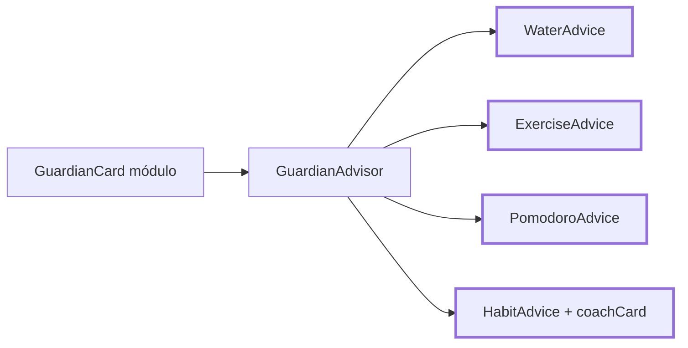

# CHG-058 · Guardián con consejos en Hábitos, Hidratación, Ejercicio y Pomodoro
**Estado:** En verificación
**Nivel:** M
**Modelo sugerido:** estandar
<!-- Estados y nivel se cambian SOLO con node .claude/team.mjs. Modelo: un perfil de docs/TEAM_MODELS.md -->
**Creado:** 2026-11-10 · **Aprobado:** 2026-11-10 · **Cerrado:** —
**Relacionado:** CHG-055 (guardianes de módulo), CHG-057 (consejos contextuales)

## 0. En palabras simples
- Qué vas a ver distinto: Hidratación, Ejercicio y Pomodoro ganan un guardián en la tarjeta "Objetivo/Meta de hoy" del panel derecho, con consejos sacados de tus datos (cuánto te falta, tu ritmo frente a otros días, rachas, lo que más haces o más olvidas). En Hábitos, la tarjeta coach sale de arriba y pasa al panel derecho como la franja del guardián (igual que en los demás módulos): el mensaje que ya daba pasa a ser uno de sus consejos y se mantiene "Ir al hábito sugerido". Todos tienen el botón de otro consejo y se renuevan solos cada 5 minutos.
- Cómo comprobarlo tú: abre cada módulo → ves al guardián del tipo afín (Hábitos: fuego/planta, Hidratación: agua/hielo, Ejercicio: lucha/roca, Pomodoro: eléctrico/psíquico). Registra un vaso de agua o un ejercicio → al refrescar el consejo, cambia. En Hábitos, el botón "Ir al hábito sugerido" sigue llevándote al hábito.

## 1. Resumen
Se agregan 4 proveedores de consejos al motor de CHG-057 (`GuardianAdvisor`) y el `GuardianCard` se coloca en el panel de cada módulo (y arriba en pantallas angostas). En Hábitos, el guardián reemplaza la tarjeta coach (se mueve al panel derecho, en la tarjeta "Constancia", que pasa a ser la primera) y reutiliza su mensaje (`HabitGamificationService::coachCard`) como un candidato más.

## 2. Producto (product-manager)
- Problema / usuario: Alex quiere a los guardianes integrados en los módulos diarios con consejos útiles, sin dos voces compitiendo en Hábitos.
- Incluye: guardián en Hábitos, Hidratación, Ejercicio y Pomodoro; afinidad de tipos; proveedores de consejos por módulo; reemplazo de la tarjeta coach de Hábitos conservando su mensaje y la acción "Ir al hábito sugerido".
- No incluye: nuevos módulos fuera de estos 4; cambios en metas, rachas o recompensas; consejos para días distintos de hoy (si navegas a otra fecha, el consejo sigue siendo de hoy).
- Criterios de aceptación (Dado/Cuando/Entonces):
  1. Cada módulo muestra al ejemplar de mayor nivel de sus tipos afines (Hábitos fuego/planta; Hidratación agua/hielo; Ejercicio lucha/roca; Pomodoro eléctrico/psíquico); sin afinidad, el de mayor nivel.
  2. Hidratación: "faltan {ml} para tu meta" si no la alcanzaste; ritmo: si a esta hora llevas menos que tu promedio a la misma hora en los 7 días previos, lo dice con ambas cifras; si llevas ≥ 3 h sin registrar (entre 7:00 y 22:00), lo sugiere; racha de días seguidos con meta cumplida (≥ 2).
  3. Ejercicio: minutos que faltan para la meta; días desde el último registro si son ≥ 2; tipo que no haces hace ≥ 14 días pero hiciste ≥ 3 veces en los 60 días previos; semana actual vs la anterior en minutos si vas por encima.
  4. Pomodoro: minutos de foco que faltan para la meta (entre semana / fin de semana); tarea con más foco en los últimos 7 días; tu franja con más foco (mañana/tarde/noche) en 14 días si estás en ella; si hay una tarea agendada para la hora actual sin sesión de foco hoy, sugiere un bloque para ella.
  5. Hábitos: el mensaje del coach actual es un candidato (con su acción "Ir al hábito sugerido"); pendientes del momento del día actual; hábito con racha ≥ 3 días aún sin completar hoy (racha en riesgo); hábito más olvidado del mes (≥ 5 días sin completar).
  6. En Hábitos ya no aparece la tarjeta coach antigua; la acción "Ir al hábito sugerido" solo se muestra cuando el consejo visible la trae.
  7. "Otro consejo", refresco cada 5 min y fallback a la frase por avance funcionan igual que en CHG-057 en los 4 módulos.
  8. Con el juego apagado o sin ejemplares, el guardián no aparece; en Hábitos vuelve a verse la tarjeta coach antigua.

## 3. UX/UI
### 3.1 Experiencia (ux-designer)
- Plantilla: módulo con panel contextual (rail) existente; sin cambios de página.
- Flujo y cantidad de pasos: 0 pasos para ver el consejo; 1 clic para otro; 1 clic en "Ir al hábito sugerido" cuando aparece.
- Qué contiene cada pantalla y qué es lo más importante: el consejo; el dato de meta de la tarjeta se mantiene debajo.
- Estados (vacío / carga / error / éxito / validaciones): con consejo; sin candidatos (frase por avance); juego apagado/sin ejemplares (oculto; en Hábitos, coach antiguo).
- Información necesaria y momento de presentación: ninguna adicional.
- Accesibilidad de uso (teclado, foco, errores): igual que CHG-057; "Ir al hábito sugerido" es un botón que mueve el foco al hábito.

Hidratación / Ejercicio / Pomodoro (panel derecho, primera tarjeta):
```
┌─ 💧 Objetivo de hoy ──────────────────┐
│░ (◕‿◕)  Squirtle · Nv 6              ░│
│░        "Vas 0,8 L; a esta hora      ░│
│░         sueles llevar 1,2 L."  [↻]  ░│
│ 0,8 L / 2,5 L                  32 %   │
│ ███████░░░░░░░░░░░░░░░                │
└───────────────────────────────────────┘
```
Hábitos (sin tarjeta coach arriba; el guardián va en el panel derecho, en "Constancia", que sube a ser la primera tarjeta):
```
┌─ 🔥 Constancia ───────────────────────┐
│░ (◕‿◕)  Charmander · Nv 7            ░│
│░        "Te faltan 2 de la mañana;   ░│
│░         Caminar es el más corto."   ░│
│░        Ir al hábito sugerido ↓ [↻]  ░│
│ Mejor racha activa           5 días   │
│ Progreso de hoy                 3/8   │
└───────────────────────────────────────┘
┌─ noviembre 2026 ──────────────────────┐
│ (calendario del mes, sin cambios)     │
```

### 3.2 Visual (ui-designer)
- Distribución: en los rails, la franja va como primer contenido de la primera `x-context-widget` (variant `rail`) y arriba del contenido principal en < 1200 px (variant `top`), igual que Tareas. En Hábitos, igual que los demás: `rail` dentro de la `x-context-widget` "Constancia" (que se mueve antes del calendario del mes) y `top` arriba del contenido en < 1200 px; se quita `habit-coach-card` de arriba cuando hay guardián.
- Componentes existentes a reutilizar (ruta): `livewire:game.guardian-card` (CHG-057), `x-context-widget`, estilos `.game-guardian*` (resources/css/m3/modules/_game.css).
- Jerarquía, color, tipografía y espaciado (tokens): igual que CHG-057; la acción "Ir al hábito sugerido" como botón de texto blanco sobre el escenario.
- Responsive y contraste: igual que CHG-055/057 (arte de 72 px en < 768 px); contraste AA.

### 3.3 Escritura (ux-writer)
- Ubicación y estado: globo del guardián en los 4 módulos.
- Textos finales (config `game.guardian_advice`, variables entre llaves):
  - water.left: "Te faltan {left} para tu meta de hoy."
  - water.pace: "Vas {now}; a esta hora sueles llevar {usual}."
  - water.gap: "Llevas {hours} h sin tomar agua; un vaso ahora ayuda."
  - water.streak: "{days} días seguidos cumpliendo tu meta de agua."
  - exercise.left: "Te faltan {minutes} min de movimiento para tu meta."
  - exercise.idle: "Llevas {days} días sin moverte; ¿algo corto hoy?"
  - exercise.forgotten: "Hace {days} días no haces {type}; antes era de tus favoritos."
  - exercise.week: "Esta semana llevas {now} min, más que los {last} de la anterior."
  - pomodoro.left: "Te faltan {minutes} min de foco para tu meta."
  - pomodoro.top: "Tu tarea con más foco esta semana: {task} ({minutes} min)."
  - pomodoro.slot: "La {slot} es tu mejor franja de foco: aprovéchala."
  - pomodoro.now: "Ahora toca {task}; ¿un bloque de foco?"
  - habits.coach: (el mensaje actual del coach, sin cambios)
  - habits.moment: "Te faltan {count} de la {moment}; {habit} es el más corto."
  - habits.risk: "{habit} lleva {days} días seguidos; hoy mantiene la racha."
  - habits.forgotten: "{habit} se ha quedado {days} días este mes; ¿lo retomamos?"
  - Acción: "Ir al hábito sugerido" (existente).
- Reglas de docs/UX-WRITING.md aplicadas: tuteo, cálido, sin culpa; ≤ 90 caracteres con valores típicos; sin palabras de `MissionProposalValidator::penaltyWord`.
- Criterios de aceptación de los textos: el test de plantillas de CHG-057 cubre los 4 módulos nuevos.

## 4. Diseño técnico (software-architect)

- Archivos a crear / modificar:
  - `config/game.php`: `module_guardians` (habits fuego/planta, water agua/hielo, exercise lucha/roca, pomodoro electrico/psiquico) y `guardian_advice.{water,exercise,pomodoro,habits}`.
  - `app/Services/Game/Guardian/WaterAdvice.php` (`DrinkLog`, `hydration_value`, meta `WaterGoal::forUser`), `ExerciseAdvice.php` (`ExerciseLog` `date`/`duration`/`exercise_type_id`, meta `daily_exercise_minutes` o `ExerciseProgress::DEFAULT_DAILY_MINUTES`), `PomodoroAdvice.php` (`PomodoroSession` `task_id`/`task_title`/`start_time`/`duration`, meta entre semana/fin de semana como `PomodoroTimer::goalFor`; extraer esa lógica a un método estático reutilizable si es privada), `HabitAdvice.php` (`HabitDefinition`, `HabitCompletion`, y `HabitGamificationService::coachCard` para el candidato `coach`). Cada uno ≤ 4 consultas.
  - `app/Services/Game/Guardian/GuardianAdvisor.php`: registrar los 4 proveedores; el candidato puede traer `action` opcional (`{label, target}`) que la tarjeta muestra.
  - `app/Livewire/Game/GuardianCard.php` + vista: soportar la acción opcional; `progress()` por módulo para la frase por avance (meta del día).
  - Vistas: `resources/views/livewire/water/water-daily.blade.php`, `exercise/exercise-daily.blade.php`, `pomodoro/pomodoro-timer.blade.php` (tarjeta en la primera `x-context-widget` + variant `top` arriba); `habit/habit-tracker.blade.php` (guardián `rail` en "Constancia", que pasa antes del calendario, y `top`; `habit-coach-card` se mantiene arriba solo si el guardián no se muestra).
  - `resources/css/m3/modules/_game.css`: estilo de la acción.
- Enfoque y patrones a seguir: mismo contrato `candidates(CarbonInterface $now)` y trait `Advice` de CHG-057; consultas agregadas con el alcance del usuario.
- Riesgos y mitigación: Hábitos depende de `coachCard()` (recibe hábitos y completados) → construir sus argumentos dentro de `HabitAdvice` con las mismas consultas que `HabitTracker`, sin tocar el servicio; ocultar la tarjeta coach solo cuando el guardián existe (el componente expone si se mostró vía `GuardianCard::visibleFor($userId)` en el padre, sin consulta extra relevante).
- Qué NO tocar: cálculos de metas, rachas y XP; `HabitGamificationService` (solo se consume); Tareas y Salud.

## 5. Pruebas (qa-tester)
| Caso | Tipo | Nivel | Test |
|---|---|---|---|
| Reglas de Hidratación (criterio 2) | Feature | Alto | tests/Feature/Game/GuardianAdviceTest.php |
| Reglas de Ejercicio (criterio 3) | Feature | Alto | GuardianAdviceTest |
| Reglas de Pomodoro (criterio 4) | Feature | Alto | GuardianAdviceTest |
| Reglas de Hábitos incl. candidato coach con acción (criterio 5) | Feature | Alto | GuardianAdviceTest |
| Afinidad de tipos por módulo (criterio 1) | Feature | Medio | tests/Feature/Game/ModuleGuardianTest.php |
| Hábitos: coach antiguo oculto con guardián y visible sin él (criterios 6, 8) | Feature | Alto | ModuleGuardianTest |
| Las 4 páginas montan GuardianCard (criterio 7) | Feature | Medio | ModuleGuardianTest |
| Plantillas nuevas ≤ 90 y sin palabras prohibidas | Feature | Bajo | GuardianAdviceTest |
- Comando para verificar: `php artisan test tests/Feature/Game/GuardianAdviceTest.php tests/Feature/Game/ModuleGuardianTest.php`
- Regresión a vigilar: tests de Hábitos (HabitRoutineTest y relacionados), Hidratación, Ejercicio y Pomodoro.

## 6. Documentación (tech-writer)
- Docs a actualizar: `docs/game.md` → "Consejos del guardián": módulos, afinidades y reglas nuevas; reemplazo del coach en Hábitos.

## 7. Tareas
- [x] T1 · El guardián de Hidratación y Ejercicio da consejos con tus registros y aparece en su panel — Resp: developer — Archivos: config/game.php, app/Services/Game/Guardian/WaterAdvice.php, app/Services/Game/Guardian/ExerciseAdvice.php, app/Services/Game/Guardian/GuardianAdvisor.php, app/Livewire/Game/GuardianCard.php, resources/views/livewire/water/water-daily.blade.php, resources/views/livewire/exercise/exercise-daily.blade.php, tests/Feature/Game/GuardianAdviceTest.php, tests/Feature/Game/ModuleGuardianTest.php — Hecho cuando: criterios 1-3 y 7 pasan en esos módulos
- [x] T2 · El guardián de Pomodoro da consejos de foco y aparece en su panel — Resp: developer — Archivos: config/game.php, app/Services/Game/Guardian/PomodoroAdvice.php, app/Livewire/Pomodoro/PomodoroTimer.php, app/Livewire/Game/GuardianCard.php, resources/views/livewire/pomodoro/pomodoro-timer.blade.php, tests/Feature/Game/GuardianAdviceTest.php — Hecho cuando: criterio 4 pasa
- [x] T3 · En Hábitos el guardián reemplaza la tarjeta coach conservando su mensaje y acción — Resp: developer — Archivos: config/game.php, app/Services/Game/Guardian/HabitAdvice.php, app/Livewire/Game/GuardianCard.php, resources/views/livewire/game/guardian-card.blade.php, resources/views/livewire/habit/habit-tracker.blade.php, app/Livewire/Habit/HabitTracker.php, resources/css/m3/modules/_game.css, tests/Feature/Game/GuardianAdviceTest.php, tests/Feature/Game/ModuleGuardianTest.php — Hecho cuando: criterios 5, 6 y 8 pasan y el build compila
- [ ] T4 · Verificar criterios de aceptación — Resp: qa-tester — Hecho cuando: los 8 criterios pasan y las suites de los 4 módulos están en verde (salvo fallas previas conocidas)
- [x] T5 · Actualizar documentación — Resp: tech-writer — Archivos: docs/game.md — Hecho cuando: docs al día

## 8. Bitácora de implementación (developer)
- 2026-11-10 — Inicio (start --force: había otros CHG En desarrollo).
- T1 — `WaterAdvice` (1 consulta; usa `time` H:i de `DrinkLog`, no `timestamp`), `ExerciseAdvice` (2 consultas), afinidades y textos en config, proveedores registrados en `GuardianAdvisor` (el candidato puede traer `action`). `GuardianCard`: frase por avance según la meta de cada módulo. Guardián `rail` en "Objetivo de hoy" y `top` tras los controles en Hidratación y Ejercicio.
- T2 — `PomodoroAdvice` (3 consultas) con `goalFor()` estático que lee la misma configuración que el temporizador; `PomodoroTimer.php` no se tocó (no fue necesario). Guardián en "Meta de hoy" + `top`.
- T3 — `HabitAdvice` (2 consultas + `coachCard` consumido sin cambios) con candidato `coach` y su acción. `GuardianCard` muestra la acción ("Ir al hábito sugerido", enfoca `habit-item-{id}`). Hábitos: `hasGuardian` (`GuardianCard::visibleFor`); con guardián, sin tarjeta coach arriba, `top` en su lugar y `rail` en "Constancia", que pasa antes del calendario; sin guardián, todo como antes. CSS de la acción. Build OK.
- T5 — docs/game.md: módulos, reglas y afinidades nuevas.
- Tests: GuardianAdviceTest 14 + ModuleGuardianTest 12 → 26/26. Game + Habit/Water/Exercise/Pomodoro/Task/Health: 480/486; las 6 fallas existen igual sin este cambio (NewSources, ExerciseDailyProgress y WaterDailyProgress del calendario de meses, HealthModule, TaskBulkEditor, TaskViews).
- 2026-11-10 — Reabierto (Alex: "en Hábitos no quedó ningún panel"). Causa: Hábitos no tenía `'rail' => true` en `config/modules.php`, así que su panel lateral existía en la vista pero el shell lo ocultaba; al quitar el coach de arriba, el guardián solo se veía < 1200 px. DESVIACIÓN resuelta: se activa el rail solo en el registro diario (`rail_routes => ['habits']`) — archivo no listado en §4, cambio de 2 líneas imprescindible para cumplir el boceto aprobado. Tests ModuleGuardian + Hábitos 53/53; ModuleExperience/ProtectedScreenContract mantienen solo sus fallas previas (Vehículos, Tareas). Build OK.
- Nota: con guardián, el coach pierde su estado visual de celebración (tono, icono, título); su mensaje sigue como consejo. Es lo decidido.

## 9. Preguntas abiertas, decisiones e historial
- LECCIÓN(developer): antes de colocar algo en `<x-slot:rail>`, comprobar que el módulo tiene `rail => true` en config/modules.php; si no, el rail se renderiza pero el shell lo oculta — evidencia: guardián invisible en Hábitos (CHG-058) · destino sugerido: docs/game.md (cómo agregar un guardián a otro módulo).
- 2026-11-10 — Decisiones (Alex): en Hábitos el guardián reemplaza la tarjeta coach y su mensaje pasa a ser un consejo; afinidades Hábitos fuego/planta, Hidratación agua/hielo, Ejercicio lucha/roca, Pomodoro eléctrico/psíquico; consejos en los 4 módulos con las familias de CHG-057.
- 2026-11-10 — Ajuste (Alex): en Hábitos el coach se mueve al panel derecho para que quede uniforme con los demás módulos.
- 2026-11-10 — Creado en to-do/ (Borrador, nivel M)
- 2026-11-10 — Aprobado por el usuario (Compuerta 2)
- 2026-11-10 — Movido a in-progress/ (En desarrollo)
- 2026-11-10 — Implementación terminada → En verificación
- 2026-11-10 — Reabierto: Hábitos no tiene panel lateral activo: el guardián no se ve en escritorio
- 2026-11-10 — Implementación terminada → En verificación
