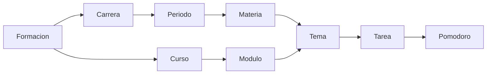

# CHG-096 · Prototipo de Aprendizaje y reservas con compañeros
**Estado:** En verificación
**Nivel:** M
**Modelo sugerido:** estandar
**Creado:** 2026-11-12 · **Aprobado:** 2026-11-12 · **Cerrado:** —

## 0. En palabras simples
- Qué vas a ver distinto: recorrido interactivo de Aprendizaje con reservas y Pokémon fieles a MiSo.
- Cómo comprobarlo tú: abrir learning.html servido por HTTP y alternar universidad, inglés y sin equipo.

## 1. Resumen
Implementar el plan aprobado en conversación. Solo prototipos offline con datos ficticios.

## 2. Producto (product-manager)
- Problema / usuario: organizar formación y reservar tiempo sin duplicar tareas.
- Incluye: jerarquía contextual de formación, evaluaciones opcionales por unidad, conexiones y reservas independientes. Corrección aprobada tras revisión del primer prototipo.
- No incluye: backend, migraciones, datos reales, rediseño de Colección o proyección de tareas recurrentes.
- Criterios: al mover o cancelar una reserva las tareas conservan fechas y estado; notas pendientes no son cero; foco no completa hábitos.

## 3. UX/UI
### 3.1 Experiencia (ux-designer)
- Formación clasifica registros por tipo y categoría, sin convertir categorías en contenedores.
- Carrera/posgrado → periodo → materia → tema; materias directas opcionales. Curso → módulo → tema. Ruta personal → etapa → curso o tema.
- Acciones según nivel; evaluaciones en su unidad o curso, nunca en la raíz del módulo. Contexto heredado en los formularios.
- Módulos independientes desde el lateral; conexiones mediante enlaces y asociaciones contextuales.
- Vacío con guía del compañero; presencia contextual discreta al tener registros. Integración de favorito CHG-097 conservada.

### 3.2 Visual (ui-designer)
- Tablas y `row_split` canónicos; FAB dividido con tipos concretos en la raíz y acciones válidas dentro del detalle.
- Formularios `dialog` con secciones laterales, desplegables para tipo/categoría y editor compartido de tarea.
- Referencias inspeccionadas: design-system.md, life-shell y detalles de Objetivos, vistas reales de Tareas/Hábitos y componentes de juego.
```text
Escritorio: [lateral de módulos] [Formación / carrera / periodo / materia]
                                [Contenido | Tareas | Materiales | Evaluaciones | ...]
                                [tabla: nombre | tipo | estado | split Consultar]
                                [FAB contextual dividido]
Móvil: [barra] [ubicación] [pestañas del contenido] [tabla desplazable]
       [FAB compacto] [navegación inferior]
Modal: [secciones colapsables | campos de la sección] [Cancelar | Guardar]
Vacío: [compañero + guía para comenzar] [FAB con tipos de formación]
```
### 3.3 Escritura (ux-writer)
- «Agregar formación», «Agregar carrera universitaria», «Agregar maestría» y «Agregar curso» según elección.
- Tipo y categoría se distinguen de periodos/materias/módulos; el contexto se explica con nombres concretos.
- «Nota pendiente», «Resultado provisional» y explicación del alcance de los cambios en reservas.

## 4. Diseño técnico (software-architect)
- Fuentes docs/mockup-system; módulo learning creado con new.py y compilado con build.py.
- Estado local por transacciones del store, escenarios reiniciables y rutas internas de un HTML.
- Assets Pokémon locales; no solicitudes de red en ejecución.
- No tocar app, migraciones, pokemon.json ni cambios ajenos de CHG-095.

## 5. Pruebas (qa-tester)
| Caso | Tipo | Nivel | Test |
|---|---|---|---|
| Reserva individual/serie y conservación de tareas | Browser | Integración | recorridos Playwright |
| Notas, ruta, asociaciones y foco | Browser | Integración | recorridos Playwright |
| Shell, móvil, teclado y sin equipo | Browser | UI | capturas y verificaciones |
- Comando: build.py --project docs/mockup-system --all; script de aceptación del módulo; git diff --check.
- Regresión: consumidores del shell compartido.

## 6. Documentación (tech-writer)
- Guía de revisión del prototipo y registro de evidencia local.

## 7. Tareas
- [x] T1 · Alinear shell y compañeros — Resp: developer — Modelo: estandar — Archivos: docs/mockup-system — Hecho cuando: macros y assets locales reutilizados.
- [x] T2 · Construir recorrido Aprendizaje y reservas — Resp: developer — Modelo: estandar — Archivos: docs/mockup-system — Hecho cuando: escenarios y conexiones interactivos.
- [x] T3 · Verificar y documentar — Resp: developer — Modelo: estandar — Archivos: docs — Hecho cuando: compilación y aceptación pasan.

## 8. Bitácora de implementación (developer)
- 2026-11-12: plan aprobado explícitamente por el usuario; implementación limitada a docs.

- Compilación completa: 80 comprobaciones aisladas; compilación final de learning: 4. Aceptación: 14 vistas y recorridos aprobados. Axe: 4 vistas móviles sin violaciones.
- Capturas y resultados: docs/mockup-system/dist/learning-review (artefactos locales ignorados). Guía: docs/mockup-system/docs/learning-prototype.md.
- ui:conformance señala 228 desviaciones preexistentes de Blade; vistas de producción intactas. git diff --check aprobado.
- CHG-096 iniciado concurrentemente mediante la opción del CLI --force: trabajo limitado a docs y sin cambiar el estado ni los archivos de CHG-095.
- Pendiente revisión visual del usuario; no se declara equivalencia píxel a píxel con una sesión autenticada.

- Revisión de jerarquía completada: tipos concretos, categorías independientes, ubicación navegable, acciones por nivel, tablas con row_split y formularios con secciones.
- Verificación final de la revisión: 20 HTML/80 comprobaciones del motor; aceptación de cuatro recorridos desde cero, 14 vistas y cinco auditorías Axe sin violaciones. Prueba de favorito CHG-097 aprobada.
- El observador de compilación existente se conservó. Se verificó una copia temporal aislada y se publicaron exclusivamente artefactos generados por el motor, evitando colisiones sobre dist/candidate.
- Capturas revisadas: vacío, detalle, menú por fila y formulario con secciones en escritorio y móvil. Se retiró la tabla vacía duplicada del estado inicial.
- ui:conformance mantiene 228 desviaciones ajenas de producción; sintaxis JS y diff --check aprobados. Guía actualizada con recorridos y límites.

## 9. Preguntas abiertas, decisiones e historial
- Sin preguntas bloqueantes. Reservas con superposición permitida, hábitos manuales y notas opcionales.
- 2026-11-12 — Aprobado por el usuario (Compuerta 2)
- 2026-11-12 — Movido a in-progress/ (En desarrollo)
- 2026-11-12 — Implementación terminada → En verificación
- 2026-11-12 — Reabierto: Corrección de jerarquía y UX aprobada por el usuario

- Corrección aprobada: retirar pestañas globales, usar tipos concretos en el FAB, desplegables, secciones laterales y split por fila; orientar el vacío con el compañero.
- 2026-11-12 — Implementación terminada → En verificación
