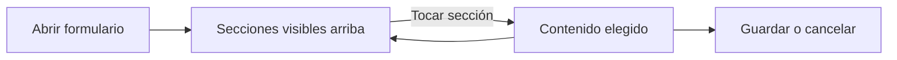

# CHG-108 · Secciones de formularios visibles en móvil
**Estado:** En desarrollo
**Nivel:** M
**Modelo sugerido:** estandar
<!-- Estados y nivel se cambian SOLO con node .claude/team.mjs. Modelo: un perfil de docs/TEAM_MODELS.md -->
**Creado:** 2026-11-14 · **Aprobado:** 2026-11-16 · **Cerrado:** —
**Relacionado:** CHG-015, CHG-101; coordinación con CHG-107

## 0. En palabras simples
En el celular verás las secciones del formulario debajo de la cabecera. Podrás tocar Información básica, Privacidad o Programación sin abrir un menú. Si no caben, deslizarás la franja. En escritorio se conserva el panel lateral.

## 1. Resumen
Mejora P2 transversal de x-ui.form-dialog. Hoy navCollapsed inicia en true en móvil y elegir sección la oculta otra vez; el CSS presenta navegación superpuesta. Sustituirla en móvil por franja superior siempre visible, conservando formulario, selección y borrador. Actualizar la regla vigente del design system como parte del cambio.

## 2. Producto (product-manager)
- Incluye: formularios canónicos que declaran sections; navegación, selección y errores. Tareas individual/masivo y Hábitos/Objetivos como regresión.
- Excluye: tabs de módulos, rail del shell, rediseño de campos, modales sin secciones y mockups.
- CA1: bajo 768 px, secciones visibles al abrir, debajo de cabecera y encima de cuerpo; no necesitan menú para descubrirse.
- CA2: seleccionar sección mantiene franja visible y valores; no duplica campos ni formulario.
- CA3: desde 768 px se conserva rail colapsable actual. Redimensionar ida/vuelta conserva sección y borrador; móvil muestra franja aunque escritorio estuviese colapsado.
- CA4: muchas secciones/etiquetas largas desplazan en horizontal en una sola fila, sin overflow de página ni truncar etiquetas esenciales; selección activa visible al elegirla o recibir errores.
- CA5: conservar indicador de error y selección/foco del primer inválido. Cabecera, franja y footer alcanzables con teclado abierto.
- CA6: sin sections no aparece franja ni espacio reservado.

## 3. UX/UI
### 3.1 Experiencia (ux-designer)
Plantilla: formulario modal canónico existente con secciones; no es wizard ni vista nueva.
Orden declarado y acceso directo a cualquier sección. Mantener nav, aria-current, botones, Tab/Shift+Tab y Enter/Espacio. No añadir role=tablist sin su contrato de teclado completo. Navegación fuera del scroll vertical del cuerpo.

### 3.2 Visual (ui-designer)
```text
Escritorio                       Móvil
[Título Secciones Expandir X]    [Título      Expandir X]
[Básica]       [Contenido]       [Información básica][Privacidad] →
[Privacidad]   [         ]       [Contenido de sección           ]
[Programación][         ]       [cuerpo con scroll               ]
[Cancelar]        [Guardar]      [Cancelar]              [Guardar]
```
Franja móvil de botones con icono/etiqueta, min-height 44 px, tokens activos/error existentes. Dejar asomar siguiente opción con overflow; no envolver en varias filas. Cabecera y footer fuera del scroll vertical; franja con scroll horizontal local. Conservar visualViewport, safe areas y expandir/restaurar. Ocultar por CSS el botón colapsar en móvil; escritorio conserva control/rail.
### 3.3 Escritura (ux-writer)
Mantener etiquetas reales, «Secciones del formulario» y «Contiene errores». No abreviar Información básica/Programación para encajarlas. Nombres completos accesibles; sin instrucciones técnicas nuevas.

## 4. Diseño técnico (software-architect)
- Principales: resources/views/components/ui/form-dialog.blade.php y resources/css/m3/patterns/_dialogs.css. Evidencia: matchMedia inicializa/resetea navCollapsed y @click contrae; CSS móvil usa position:absolute para superponer nav.
- Un único DOM; CSS decide franja <768 frente a rail >=768. navCollapsed queda como estado de escritorio: quitar inicialización/reseteo dependiente de móvil y contracción automática al elegir sección. El CSS de colapso nunca oculta franja móvil.
- Reemplazar panel absoluto móvil por fila propia de md-form-dialog__main. Mantener min-height:0/min-width:0 y presupuesto de cuerpo para no empujar footer. No duplicar campos, navegación ni teleport independiente.
- Hacer visible sección activa con desplazamiento limitado al eje horizontal, sin mover viewport al abrir y respetando movimiento reducido. Conservar sección inicial, sectionEvent y focusErrors, también programación/validación externa.
- API: props sections/state/sectionEvent/focusErrors y claves sin cambios. Conservar protectChanges/handlesDiscard y pila de superficies. No modificar ui-surfaces para resolver layout salvo defecto demostrado vinculado a CHG-105/106.
- Coordinar con CHG-107 para conservar «Editar» y validar juntos. No requiere migración general ni anatomía nueva para esta vista existente.

## 5. Pruebas (qa-tester)
| Caso | Resultado |
|---|---|
| 360/390 px, 1/3/6 secciones, etiquetas largas | Franja visible, overflow solo horizontal local |
| Cambiar sección y volver | Valores y franja conservados |
| Error en sección fuera de pantalla | Activa visible y primer inválido enfocado |
| Teclado, expandir y rotación | Cierre/footer accesibles y cuerpo desplazable |
| 767 → 768 → 1440 → 390 con rail colapsado | Sección retenida y franja móvil visible |
| Sin sections; tareas individual/masivo; Hábitos/Objetivos | Sin huecos ni regresión de guardado/descarte |
- Ampliar catálogo y fixtures aisladas solo para variantes necesarias; usar Hábitos (habit-dialog) y Objetivos (goal-dialog), ambos con sections, y anotar resultados. No actualizar snapshots globalmente.
- Comandos: npm run build; php artisan ui:conformance; npx playwright test tests/Browser/interaction.spec.js --project=interaction; npx playwright test tests/Browser/responsive.spec.js --project=responsive; npx playwright test tests/Browser/task-editor.interaction.spec.js --project=interaction --workers=1; npx playwright test tests/Browser/accessibility.spec.js --project=accessibility; git diff --check. Filtrar casos afectados en suites de catálogo.
- Capturas escritorio/móvil y teclado, axe y revisión de gesto horizontal/altura en PWA/Android físicos. Emulación no certifica teclado físico; indicar pendiente si falta teléfono.

## 6. Documentación (tech-writer)
Actualizar docs/design-system.md, Formularios: móvil deja de arrancar contraído/superpuesto; escritorio conserva colapso. Actualizar regla del componente en docs/UI-DESIGN.md sin ampliar a layouts del shell.

## 7. Tareas
- [x] T1 · Mostrar secciones arriba en móvil y rail en escritorio — Resp: developer — Modelo: estandar — Archivos: resources/views/components/ui/form-dialog.blade.php, resources/css/m3/patterns/_dialogs.css, tests/Browser/responsive.spec.js — Hecho cuando: CA1–CA4 y CA6 pasan con un solo DOM responsive.
- [x] T2 · Conservar selección, errores y teclado — Resp: developer — Modelo: estandar — Archivos: resources/views/components/ui/form-dialog.blade.php, tests/Browser/interaction.spec.js, tests/Browser/task-editor.interaction.spec.js, tests/Browser/accessibility.spec.js — Hecho cuando: CA5 pasa y regresión cubre borrador, foco y cambio de breakpoint.
- [ ] T3 · Revisar formularios representativos y capturas — Resp: qa-tester — Archivos: CHANGE.md, evidencias en storage/framework/testing — Hecho cuando: matriz §5 ejecutada, Hábitos/Objetivos verificados y limitaciones físicas explícitas.
- [x] T4 · Actualizar contrato responsive — Resp: tech-writer — Archivos: docs/design-system.md, docs/UI-DESIGN.md, CHANGE.md — Hecho cuando: regla vigente coincide con comportamiento y referencias válidas.

## 8. Bitácora de implementación (developer)
- 2026-11-16 — Implementado solo para móvil (< 768 px); escritorio queda igual (rail colapsable). `form-dialog.blade.php`: `navCollapsed` inicia en false y ya no depende de matchMedia ni se contrae al elegir sección; el nav centra la sección activa solo en el eje horizontal (respeta movimiento reducido); el botón de colapso lleva la clase `md-form-dialog__nav-toggle`. `_dialogs.css`: en móvil el nav es una franja flex (una fila, overflow-x local, items de 44 px) en la fila superior de `__main`, y el botón de colapso se oculta por CSS. Tests de navegador existentes dejan de pulsar el menú móvil; nuevas regresiones en `task-editor.interaction.spec.js` (franja visible 360/390 y control de colapso en 1440). `docs/design-system.md` actualizado.
- **Sin ejecutar:** Playwright, `npm run build` y `ui:conformance` no corrieron (el entorno cloud no tiene PHP 8.4 ni `vendor/`). T3 (QA, capturas y teléfono físico) queda pendiente.

## 9. Preguntas abiertas, decisiones e historial
- 2026-11-14 — Creado en to-do/ (Borrador, nivel M) mediante team new.
- 2026-11-14 — Usuario solicita completar especificación; no aprueba implementación implícitamente.
- Triage: M, P2, estandar; componente transversal con UX/UI, escritura, arquitectura y QA.
- Evidencia estática confirmada; propuesta de franja superior pendiente de revisión de boceto y validación visual.
- Backlogs UX/UI revisados sin ítem equivalente. No sustituye UX-002 del rail contextual.
- Sin decisiones abiertas para redactar borrador; revisión/aprobación del contenido es el siguiente paso.
- LECCIÓN: ninguna nueva antes de implementación/verificación.
- 2026-11-14 — Línea base local: PHP filtrado PanelFocusSessionTest/PomodoroTimerTest/CompanionChatTest/TaskEditorDraftTest: 43 pruebas, 304 aserciones, todas pasan; JS pomodoro-timer/dialog-viewport/navigation-guard/companion-chat: 27 pruebas, todas pasan. No reproduce ni certifica los reportes físicos.
- Perfil estandar sin proveedor configurado en docs/TEAM_MODELS.md; no elegir proveedor externo implícitamente. Bocetos y causa están pendientes de revisión/validación según las tareas, no de redacción.
- 2026-11-16 — Aprobado por el usuario (Compuerta 2)
- 2026-11-16 — Movido a in-progress/ (En desarrollo)
