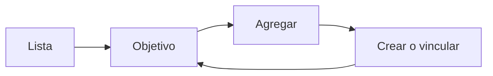

# CHG-111 · Objetivos conectados con tareas y hábitos
**Estado:** En verificación
**Nivel:** M
**Modelo sugerido:** estandar
<!-- Estados y nivel se cambian SOLO con node .claude/team.mjs. Modelo: un perfil de docs/TEAM_MODELS.md -->
**Creado:** 2026-11-15 · **Aprobado:** 2026-11-15 · **Cerrado:** —
**Relacionado:** —

## 0. En palabras simples
Podrás abrir cada objetivo y organizar las tareas y hábitos que lo apoyan. El resultado sigue teniendo su propia medición. Comprueba filtros, Pokémon y crear/vincular/desvincular sin salir del detalle.

## 1. Resumen
Plan presentado y aprobado en conversación; el usuario pidió Implementar y confirmó el cambio de modo. Nivel M confirmado. Corregir acceso y superficies web/PWA y conectar acciones sin automatizar el resultado.

## 2. Producto (product-manager)
Incluye lista y detalle, filtros web/PWA, chat, tareas existentes/nuevas y hábitos positivos existentes/nuevos. Excluye Android nativo, IA, despliegue y migraciones sobre datos personales.
CA: entrar por título; filtrar por estado y limpiar a Todos; crear/vincular/desvincular registros propios sin duplicados; compartir una acción entre objetivos; conservar registros al desvincular; mostrar hoy y últimos siete días de hábitos; no alterar KPI ni completar objetivo por acciones.

## 3. UX/UI
### 3.1 Experiencia (ux-designer)
Plantilla: lista + detalle, formularios canónicos sobre la pantalla. Selección múltiple con búsqueda y guardado explícito. Vacío orienta; error conserva selección; éxito actualiza relaciones. Desvincular no elimina historial. Teclado, Escape y retorno de foco.

### 3.2 Visual (ui-designer)
Boceto presentado y aprobado. Reutilizar shell, form-dialog, componentes x-ui, identidad del módulo y CSS responsive único. No añadir rail contextual.
```text
Escritorio                        Móvil
[Volver / Título / Editar]         [Volver / Título / Editar]
[Resultado y mediciones]          [Resultado y mediciones]
[Tareas] [Hábitos]                [Tareas]
[Avances e hitos]                 [Hábitos]
                 [Pokémon / +]   [Avances e hitos] [Pokémon / +]
```
### 3.3 Escritura (ux-writer)
Acciones: Crear tarea, Vincular tareas, Crear hábito, Vincular hábitos, Desvincular, Guardar vínculos, Ir a Hábitos. Estados: Hecho hoy / Pendiente hoy; {n} de 7 días. Vacíos: Aún no hay tareas vinculadas. / Aún no hay hábitos vinculados. Ayuda: Las acciones apoyan tu objetivo; el resultado se registra por separado. Confirmación: Se quitará el vínculo. El registro y su historial se conservan. Español neutro, tuteo y errores claros según UX-WRITING.

## 4. Diseño técnico (software-architect)
Archivos: app/Livewire/Goal/*, resources/views/livewire/goal/*, app/Models/Goal.php, app/Models/HabitDefinition.php, app/Models/GoalHabit.php, database/migrations/*create_goal_habits_table.php, app/Livewire/Habit/HabitSettings.php, app/Livewire/Habit/HabitEditor.php, resources/views/livewire/habit/habit-editor.blade.php, app/Livewire/Task/TaskEditor.php, resources/views/components/ui/{fab,companion-chat,popover,management-card}.blade.php, resources/js/companion-chat.js, resources/css/m3/modules/_goals.css, tests/Feature/{GoalDetailTest,GoalRelationsTest,CompanionVoiceTest}.php, tests/JavaScript/companion-chat.test.js, tests/Support/verify-goal-habits-mysql.php, tests/Browser/goals*, tests/Browser/support/goals*, docs/companion-chat.md, docs/DEPLOY.md.
Reutilizar TaskAssociation y TaskEditor; hábito reutiliza persistencia/formulario de HabitSettings mediante editor embebido y punto de extensión transaccional. Contexto de objetivo bloqueado en servidor. Pivot con goal UUID, habit bigint, user_id y unique; comprobar propiedad en modelo, consultas y mutaciones incluso sin auth. Relación no modifica acciones de hábitos ni KPI. Medir días completed=true distintos en ventana hoy-6 a hoy. Resolver causa demostrada de superficies, conservar chat/FAB tradicional y probar módulos compartidos. No endpoints públicos nuevos.

## 5. Pruebas (qa-tester)
PHP: GoalDetailTest, GoalRelationsTest, TaskAssociationsTest, TaskEditorTest y HabitSettingsTest afectados. Cubrir dos usuarios, IDs manipulados, duplicados, cancelación, limpieza por borrado, relaciones múltiples, límite temporal y KPI inalterado.
Navegador: 375/768/1280, lista-detalle-lista, filtros y limpieza, crear y vincular, cerrar y reabrir chat, sin capas invisibles; accesibilidad y foco.
Comandos: php artisan test --filter='GoalDetailTest|GoalRelationsTest|TaskAssociationsTest|TaskEditorTest|HabitSettingsTest'; node --test tests/JavaScript/companion-chat.test.js; npm run build; php artisan ui:conformance; git diff --check. MySQL desechable para migración si disponible. Reportar bloqueos y fallos previos sin ampliar alcance.

## 6. Documentación (tech-writer)
Actualizar contrato de chat si cambia y nota de migración en DEPLOY. No existe DOCUMENTATION.md; no crear guía general en este cambio. CLI instalado no ofrece context ni activity: registrar evidencia manualmente.

## 7. Tareas
- [x] T1 · Recuperar acceso y superficies de objetivos — Resp: developer — Archivos: vistas de objetivos, componentes de superficies y chat, pruebas afectadas — Hecho cuando: lista abre detalle y filtros/chat funcionan en móvil y escritorio.
- [x] T2 · Relacionar tareas y hábitos propios — Resp: developer — Archivos: modelos, migración, GoalDetail, pruebas — Hecho cuando: crear y vincular es atómico y seguro y desvincular conserva registros.
- [x] T3 · Mostrar acciones y seguimiento en el detalle — Resp: developer — Archivos: vistas y editores compartidos, CSS, pruebas — Hecho cuando: distribución aprobada y seguimiento hoy/7 días funcionan.
- [x] T4 · Validar y documentar el recorrido completo — Resp: developer — Archivos: pruebas, docs/DEPLOY.md, docs/companion-chat.md — Hecho cuando: validaciones razonables y pendientes registrados con evidencia.

## 8. Bitácora de implementación (developer)
- T1: enlace de lista al show, limpieza coherente a Todos y portal opt-in del filtro. Reproducción: la barra móvil interceptaba Filtrar. Chat usa referencia explícita al dueño, host estable por ID y limpieza al navegar. JavaScript: 18 pruebas pasan; regresión de chat: 7 pruebas de navegador pasan.
- T2: pivot con dos FKs compuestas de propiedad, pareja única, limpieza de vínculos y comprobación de ownership sin auth. Crear tareas y hábitos usa editores compartidos y vinculación en su transacción. MySQL 8.4 desechable: migración, unicidad, rechazo de propietario ajeno, cascada y rollback pasan; instancia apagada. No migración sobre datos personales.
- T3: resultado primero, tarjetas de tareas/hábitos juntas en escritorio y apiladas en móvil, estado hoy y siete días, selección buscable y desvinculación conservadora. Capturas 375/768/1280 inspeccionadas; corregido el ancho del bloque sin KPI en móvil. La captura de tablet espera a que termine la transición del rail, y se revalidó. Creación de ambos tipos y retorno por Livewire verificados. Axe del detalle sin violaciones.
- T4: suite PHP afectada 59/59 y 332 aserciones; prueba adicional de dominio sin auth incluida en GoalRelationsTest: 7/7 y 54 aserciones (60 pruebas únicas verificadas). Navegador de Objetivos: tres viewports pasan y creación compartida/navegación pasa en corrida dirigida; corrida conjunta final: 4/4 pasan en 1 minuto. La espera visual de tablet se verificó adicionalmente: 1/1. Regresión del chat 7/7. Build aprobado, diff --check limpio. ui:conformance mantiene 228 desviaciones ajenas; ninguna nueva en esta superficie. No se ejecutó suite global según AGENTS.md.
- Documentados despliegue/migración pendiente y contrato del chat. Ajustada CompanionVoiceTest para comprobar rechazo de manipulación de goalId bloqueado, preservando el control de propiedad.

## 9. Preguntas abiertas, decisiones e historial
- 2026-11-15 — Plan y boceto aprobados; Implementar autoriza el registro del alcance y su ejecución local. Sin commits, despliegue ni datos personales.
- LECCIÓN(arquitectura): las acciones de un host movido fuera de Livewire deben usar su referencia explícita al propietario; el render puede perder el contexto de ruta. Evidencia: chat de Objetivos y prueba de host duplicado. Destino propuesto: docs/ARCHITECTURE.md; no incorporada automáticamente.
- 2026-11-15 — Aprobado por el usuario (Compuerta 2)
- 2026-11-15 — Movido a in-progress/ (En desarrollo)

- Diagnóstico web: barra inferior intercepta Filtrar a 375 px. Portal opt-in del popover escapa el stacking context; escritorio conserva anclaje mediante coordenadas y CSS responsive.
- 2026-11-15 — Implementación terminada → En verificación
