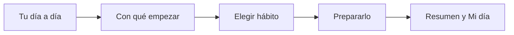
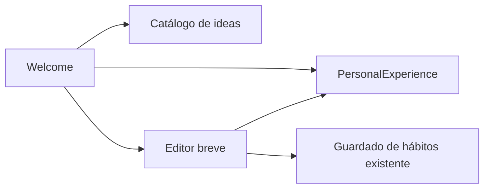

# CHG-116 · Bienvenida guiada con un primer hábito cotidiano
**Estado:** En verificación
**Nivel:** M
**Modelo sugerido:** estandar
<!-- Estados y nivel se cambian SOLO con node .claude/team.mjs. Modelo: un perfil de docs/TEAM_MODELS.md -->
**Creado:** 2026-11-15 · **Aprobado:** 2026-11-15 · **Cerrado:** —
**Relacionado:** —

## 0. En palabras simples
<!-- Para el usuario: sin jerga. Si no se entiende en 30 segundos, reescríbelo. -->

La bienvenida ofrece contexto combinable, una necesidad guiada y tres ideas de hábito diario. El FAB abre un formulario breve (nombre y momento); el resumen explica dónde marcarlo. Ya no exige escribir una intención ni configurar módulos u objetivos.
Comprobar registrando una cuenta ficticia y recorriendo los cuatro pasos sin escribir texto libre.

## 1. Resumen
Entendimiento y propuesta completa aprobados en conversación el 2026-11-15. Nivel M: cambia flujo y preferencias, sin migraciones. Reutilizar escenario, componentes y guardado existente. Cuentas existentes pueden salir y reutilizar un hábito.
<!-- Qué se cambia y por qué (3-5 líneas). Entendimiento aprobado por el usuario. -->

## 2. Producto (product-manager)
Como persona nueva sin una intención definida quiero elegir ejemplos para preparar una práctica diaria pequeña.
Incluye contexto trabajo/estudio/cuidados/ninguna, necesidad única, más ideas, creación propia, reanudación, reutilización y resumen. No incluye registro visual CHG-115, objetivos, notificaciones, IA ni frecuencia configurable.
Aceptación: opciones combinables salvo ninguna; ninguna caja abierta obligatoria en pasos 1–2; hábito diario con nombre/momento; guardado sin cumplimiento ni premios; datos aislados, reintentos sin duplicar; compatibilidad sin borrar preferencias o registros.

## 3. UX/UI
<!-- Sin pantallas: escribe "No aplica — motivo" en cada parte. Con UI, approve exige un boceto ASCII en un bloque de código. Si hay flujo, agrega un diagrama en un bloque mermaid. -->
### 3.1 Experiencia (ux-designer)
Plantilla: asistente enfocado de cuatro pasos (extensión del patrón existente, propuesta aprobada; UX-DESIGN.md aún no tiene Anatomía).
Contexto → necesidad → hábito y diálogo → resumen → Mi día. Contexto solo ordena ejemplos. Anterior conserva elecciones confirmadas y hábito. Cuentas voluntarias muestran Volver a Mi día; selector de hábitos propios en paso 3. Cuenta, perfil y cierre de sesión disponibles.
Errores inline con foco; confirmaciones de guardado accesibles; teclado, Escape y protección de borrador mediante diálogo canónico. Bloquear doble envío durante carga.

```text
1 TU DÍA A DÍA                  2 CON QUÉ EMPEZAR
[ ] Trabajo [ ] Estudio         ( ) Cuidarme ( ) Organizar mi día
[ ] Cuidados                   ( ) Aprender ( ) Algo personal
[ ] Ninguna de estas           ( ) Todavía no sé
                 [Continuar]   [Anterior] [Continuar]

3 UN HÁBITO PEQUEÑO             DIÁLOGO: PREPARAR MI HÁBITO [X]
( ) Idea 1 ( ) Idea 2           Nombre: [Tomar agua           ]
( ) Idea 3                     Momento: [Mañana              v]
[Ver más ideas]                Todos los días.
Hábito propio: [Seleccionar]    Puedes ajustar este hábito después.
[Anterior] [+ Preparar hábito]  [Cancelar] [Guardar hábito]

4 YA TIENES POR DÓNDE EMPEZAR
Tomar agua · Todos los días · Mañana
Lo encontrarás en Hábitos y en Mi día.
Márcalo cuando lo hayas hecho.
[Anterior] [Empezar mi día]
```

### 3.2 Visual (ui-designer)
Conservar escenario de aventura lateral en escritorio y compacto arriba en móvil; mapa de cuatro paradas. Tarjetas nativas con radio/checkbox, tokens actuales, x-ui.action/field/select/fab/form-dialog. Un layout CSS, sin rail nuevo. Acciones visibles, foco y contraste, objetivos táctiles 44 px; revisar 390/768/1440 px, temas y movimiento reducido.

### 3.3 Escritura (ux-writer)
Textos finales: ¿Cómo es tu día a día? / Puedes elegir varias opciones.; Trabajo, Estudio, Cuido del hogar o de otras personas, Ninguna de estas. ¿Con qué te gustaría empezar? / Elige una opción. Después puedes explorar las demás.; Cuidarme en lo cotidiano, Organizar mi día, Aprender o estudiar, Avanzar en algo personal, Todavía no sé.
Un hábito pequeño / Elige algo que puedas repetir cada día.; Ver más ideas; Crear el mío; Preparar hábito; Guardar hábito; Todos los días. Puedes ajustar este hábito después.; Ya tienes por dónde empezar; Empezar mi día. Resumen: Lo encontrarás en Hábitos y en Mi día. Márcalo cuando lo hayas hecho.
Ideas: agua, pausa, descanso; pendientes, preparar mañana, ordenar espacio; lectura, repaso, habilidad; proyecto, actividad disfrutada, siguiente paso. Todavía no sé mezcla agua, pendientes y lectura. Variantes ordenadas por contexto sin restringir.
Errores: Elige al menos una opción.; Elige con qué te gustaría empezar.; Prepara o elige un hábito para continuar. Mantener tuteo, voz cálida y humor discreto, sin prometer progreso ni resultados de salud.

## 4. Diseño técnico (software-architect)
Archivos permitidos: app/Livewire/Onboarding/{Welcome,HabitEditor}.php, app/Services/Experience/{PersonalExperience,OnboardingChoices}.php, resources/views/livewire/onboarding/{welcome,habit-editor}.blade.php, resources/css/m3/modules/_experience.css, tests/Feature/PersonalExperienceTest.php, tests/Browser/personal-experience.interaction.spec.js, tests/Browser/support/personal-experience-fixture.php, docs/first-experience.md, docs/UX-DESIGN.md, artefactos publicados por npm run build y este CHG.
Estado versionado en module_settings existente: contexts array y need; conservar context legado derivado para informe, intention y eventos históricos. Adaptar al abrir bienvenida, no migración masiva: estudio/trabajo/ambos/otro a contexto múltiple; pendiente antiguo desde paso 2 solicita necesidad y conserva habit_id; completos siguen completos. Nuevos pasos usan eventos versionados para no mezclar significados históricos.
Catálogo determinista validado en servidor; contexto prioriza, no filtra. Selección de sugerencia no escribe hábitos; FAB despacha propuesta al editor. Editor breve hereda guardado existente; capturar ID con afterHabitSaved, nunca por nombre. Revalidar usuario e ID dentro del bloqueo por usuario; preservar acción/configuración de hábito reutilizado. Distinguir editar hábito vinculado de Crear el mío; este último prepara nueva elección y no sobrescribe un hábito previo.
No tocar HabitSettings compartido ni datos reales, relaciones objetivo/hábito, autenticación, rutas, Android, ajustes de módulos ni otros CHG. Configuración inicial de módulos permanece vigente; no activar módulos por ocupación.


## 5. Pruebas (qa-tester)
Casos: combinaciones/ninguna/contexto inválido; necesidad requerida; todas las ideas y más ejemplos; nombre propio y momento; reintentos y doble envío; rechazo ID ajeno y paso incorrecto; reutilización preserva acciones; continuidad antigua y completados; preferencias intactas; sin cumplimientos/recompensas; informe privado compatible.
PHP: php artisan test --filter=PersonalExperienceTest. Browser: npx playwright test -c tests/Browser/personal-experience.config.js --grep "new user journey|guided|existing". Build: npm run build. UI: php artisan ui:conformance, registrar deuda preexistente sin modificar baseline. Capturas y axe 390/768/1440, teclado y retorno de foco. git diff --check limitado al cambio. No suite completa por instrucción del repo.
| Caso | Tipo | Nivel | Test |
|---|---|---|---|
| Contexto, legado, guardado, aislamiento e idempotencia | Feature | Alto | PersonalExperienceTest |
| Recorrido nuevo 390/768/1440, cuenta existente y accesibilidad | Browser | Alto | personal-experience.interaction.spec.js |

## 6. Documentación (tech-writer)
Actualizar docs/first-experience.md para nuevo recorrido, compatibilidad y evidencia; añadir anatomía mínima aprobada a docs/UX-DESIGN.md. No crear mapa documental general ausente. CLI local sin context/activity: documentar lectura directa y bitácora manual; no actualizar CLI.

## 7. Tareas
- [x] T1 · Preparar elecciones guiadas y conservar el progreso anterior — Resp: developer — Archivos: app/Services/Experience/OnboardingChoices.php, app/Services/Experience/PersonalExperience.php, tests/Feature/PersonalExperienceTest.php — Hecho cuando: catálogo y adaptación versionada conservan registros y preferencias con pruebas focalizadas correctas.
- [x] T2 · Construir el recorrido y formulario breve — Resp: developer — Archivos: app/Livewire/Onboarding/Welcome.php, app/Livewire/Onboarding/HabitEditor.php, resources/views/livewire/onboarding/welcome.blade.php, resources/views/livewire/onboarding/habit-editor.blade.php, resources/css/m3/modules/_experience.css, tests/Feature/PersonalExperienceTest.php — Hecho cuando: guía, creación, reutilización y salida funcionan con aislamiento y reintentos probados.
- [x] T3 · Comprobar la experiencia y publicar assets locales — Resp: developer — Archivos: tests/Browser/personal-experience.interaction.spec.js, tests/Browser/support/personal-experience-fixture.php, public/css/app.css, public/js — Hecho cuando: build y recorridos responsive con axe/teclado correctos, capturas revisadas y conformidad sin regresiones propias.
- [x] T4 · Documentar el nuevo recorrido y sus comprobaciones — Resp: developer — Archivos: docs/first-experience.md, docs/UX-DESIGN.md — Hecho cuando: documentación coincide con implementación y evidencia real, referencias y diff check correctos.


## 8. Bitácora de implementación (developer)
- 2026-11-15 — T1/T2: catálogo y guía v2, adaptación por usuario, formulario breve, reutilización sin modificar acciones. PersonalExperienceTest: 13/13, 165 assertions. La edición de hábitos previos actualiza únicamente nombre/momento para preservar incluso acciones desconocidas; creación nueva usa guardado compartido.
- 2026-11-15 — Build correcto. Conformidad: 203 desviaciones, falla por excesos en day-tile-info, game-collection, checkin-sheet y task-list, todos ajenos al cambio. Sin hallazgos en onboarding. Browser focalizado final 4/4 (1.9 min), incluyendo 390/768/1440 px, cuenta existente, axe, nombre largo, Escape y retorno de foco; capturas inspeccionadas. Sin errores JS en recorridos nuevos.
- 2026-11-15 — Validación PHP final: 14/14, 170 assertions; caso adicional de reintento desde editor antiguo sin duplicación. Pint focalizado correcto. Build final correcto tras consolidar CSS.
- 2026-11-15 — T4: guía first-experience y anatomía actualizadas; referencias locales y diff check correctos. Sin migraciones nuevas, datos reales, commit ni despliegue.
- CLI local sin context/activity: lectura directa de guías y bitácora manual; no se actualizó el CLI.
Base antes de editar: PersonalExperienceTest 6/6, 91 assertions. Cambios ajenos presentes, incluyendo HabitSettings; conservarlos.

## 9. Preguntas abiertas, decisiones e historial
- 2026-11-15 — Alex aprueba propuesta completa y paso a implementación en conversación. Sin preguntas de producto pendientes. LECCIÓN: ninguna adicional; las decisiones locales quedan en esta especificación.
- 2026-11-15 — Creado en to-do/ (Borrador, nivel M)
- 2026-11-15 — Aprobado por el usuario (Compuerta 2)
- 2026-11-15 — Movido a in-progress/ (En desarrollo)
- 2026-11-15 — Implementación terminada → En verificación
