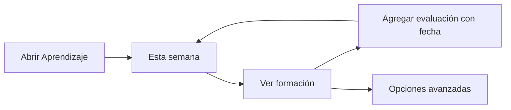

# CHG-121 · Aprendizaje simple: horario, fechas límite y vista Esta semana
**Estado:** En desarrollo
**Nivel:** M
**Modelo sugerido:** estandar
<!-- Estados y nivel se cambian SOLO con node .claude/team.mjs. Modelo: un perfil de docs/TEAM_MODELS.md -->
**Creado:** 2026-11-16 · **Aprobado:** 2026-11-16 · **Cerrado:** —
**Relacionado:** CHG-096, CHG-097

## 0. En palabras simples
- Qué vas a ver distinto: al abrir Aprendizaje ves primero «Esta semana»: tus clases o sesiones de hoy y mañana, y lo que se viene (parciales, entregas, exámenes). Anotar quién la da, cuándo es y dónde es opcional. Lo avanzado (series de reservas, niveles extra, foco, vínculos) queda escondido en «Opciones avanzadas».
- Cómo comprobarlo tú: abrir `learning.html` por HTTP, probar los escenarios universidad, inglés y guitarra, y comprobar que sin profesor ni salón todo se ve bien.

## 1. Resumen
Ajuste del prototipo offline de Aprendizaje (solo mockup, sin backend). Hoy organiza la formación pero no responde lo que más se busca: cuándo tengo clase y qué fecha límite viene. Las evaluaciones no tienen fecha, así que no aparecen en el calendario. Se agregan fecha y marca «importante» a las evaluaciones, datos opcionales de horario y responsable, una vista de entrada «Esta semana» y se esconde lo avanzado. Decisiones del usuario (2026-11-16): el horario fijo vive en Aprendizaje; lo avanzado se esconde, no se elimina. Los apuntes no se toman en MiSo: los materiales son enlaces.

## 2. Producto (product-manager)
- Problema / usuario: cualquier persona que estudia (universitaria, de curso, de idiomas, de música) y quiere saber su horario y sus fechas límite sin enredarse. No todas son universitarias: las etiquetas deben ser neutrales.
- Incluye:
  - Fecha opcional y marca «importante» en cada evaluación; peso y nota siguen opcionales.
  - Responsable («Profesor o instructor»), horario semanal fijo y lugar o enlace, todos opcionales, por formación o unidad.
  - Vista «Esta semana» como entrada del módulo.
  - Evaluaciones con fecha visibles en el calendario de Aprendizaje.
  - Materiales como enlaces (sin texto de apuntes).
  - «Opciones avanzadas» que agrupa niveles extra (módulo, etapa), reservas en serie, foco y vínculos con hábitos y objetivos.
- No incluye: backend, flashcards, repaso espaciado, dominio por tema, apuntes, cruces con Diario o Ánimo, juego, herramientas MCP, ni quitar lo ya diseñado en CHG-096.
- Criterios de aceptación (Dado/Cuando/Entonces):
  - Dado un curso sin profesor ni salón, cuando abro «Esta semana», entonces veo mis sesiones sin campos vacíos ni etiquetas sobrantes.
  - Dado un parcial con fecha dentro de 5 días, cuando abro «Esta semana», entonces aparece entre las próximas fechas límite y en el calendario.
  - Dada una evaluación sin fecha, cuando la guardo, entonces es válida y no aparece en «Esta semana».
  - Dado un usuario nuevo, cuando crea una formación, entonces no ve módulos, etapas ni series salvo que abra «Opciones avanzadas».

## 3. UX/UI
### 3.1 Experiencia (ux-designer)
- Plantilla: listado existente de Aprendizaje (`learning-list`) con bloque «Esta semana» arriba y panel lateral de accesos directos y guardián sin cambios; no hay pantalla nueva.
- Flujo y cantidad de pasos: abrir Aprendizaje → ver «Esta semana» (0 toques). Agregar fecha a una evaluación: 3 toques desde la unidad. Los datos de horario se llenan una vez.
- Qué contiene cada pantalla y qué es lo más importante: primero «Hoy y mañana», luego «Próximas fechas límite», luego «Mis formaciones». Lo más importante es lo que viene, no la estructura.
- Estados (vacío / carga / error / éxito / validaciones):
  - Vacío: guía inicial con «Agregar formación». Sin sesiones: «No tienes clases próximas». Sin fechas límite: «Nada pendiente por ahora».
  - Validación: la fecha es opcional; si se escribe un horario, hora de fin posterior a la de inicio.
- Información necesaria y momento de presentación: responsable, lugar y horario solo se muestran si existen. Lo avanzado se muestra al abrir «Opciones avanzadas».
- Accesibilidad de uso (teclado, foco, errores): sección avanzada colapsable con teclado y estado anunciado; los errores abren la sección que necesita corrección (patrón existente).

```text
┌ Aprendizaje ─────────────────────── [+ Agregar] ┐
│ Esta semana                                      │
│  Hoy      10:00 Cálculo · Aula 3 · Prof. Ruiz    │
│  Mañana   16:00 Inglés B1 · enlace de la clase   │
│                                                  │
│ Próximas fechas límite                           │
│  ★ Jue 20  Parcial de Cálculo                    │
│    Lun 24  Entrega: ensayo final                 │
│                                                  │
│ Mis formaciones                                  │
│  Ingeniería · Inglés B1 · Guitarra               │
│                                                  │
│ ▸ Opciones avanzadas                             │
└──────────────────────────────────────────────────┘
```



### 3.2 Visual (ui-designer)
- Distribución: bloque «Esta semana» arriba, ancho completo; accesos directos y guardián como hasta ahora en el lateral (por debajo de 1200 px, antes y después del contenido según CHG-096).
- Componentes existentes a reutilizar (ruta): `docs/mockup-system/components/learning-frame.html.jinja`, FAB dividido, formularios con secciones laterales, diálogo compartido de tareas.
- Jerarquía, color, tipografía y espaciado (tokens): los de `docs/UI-DESIGN.md`; la marca «importante» usa icono y texto, no solo color.
- Responsive y contraste: 1440×1000 y 375×812; contraste AA; sin desbordes.

### 3.3 Escritura (ux-writer)
- Ubicación y estado: encabezados de «Esta semana» y de la sección avanzada.
- Textos finales (variables y variantes): «Esta semana», «Hoy», «Mañana», «Próximas fechas límite», «Opciones avanzadas», «Profesor o instructor», «Lugar o enlace», «Fecha límite», «Importante». Estados vacíos: «No tienes clases próximas», «Nada pendiente por ahora».
- Reglas de docs/UX-WRITING.md aplicadas: tuteo, sin jerga, etiquetas neutrales (clase o sesión, no solo «materia»).
- Criterios de aceptación de los textos: se entienden igual para universidad, idiomas y música; ninguna etiqueta obligatoria supone un contexto universitario.

## 4. Diseño técnico (software-architect)
- Archivos a crear / modificar: `docs/mockup-system/mockups/learning/scripts/domain.js` (campos `date` e `important` en `grades`; `teacher`, `place` y `schedule` en formaciones y unidades; función de próximos eventos), `scripts/entry.js`, `screens/learning-list.html.jinja`, `screens/learning-calendar.html.jinja`, `components/learning-frame.html.jinja`, `docs/mockup-system/docs/learning-prototype.md`, pruebas en `mockups/learning/tests/`. Dist solo con el compilador.
- Enfoque y patrones a seguir: estado ficticio en memoria como hoy; horario fijo separado de las reservas; reutilizar `occurrences()` para expandir el horario semanal; datos de escenarios con y sin profesor.
- Riesgos y mitigación: romper pruebas de CHG-096/097 → actualizar expectativas y mantener lo avanzado accesible; confusión entre horario y reservas → etiquetas distintas y guía del guardián.
- Qué NO tocar: backend, `config/modules.php`, vistas Blade de producción, el compañero favorito (CHG-097).

## 5. Pruebas (qa-tester)
| Caso | Tipo | Nivel | Test |
|---|---|---|---|
| Evaluación con fecha aparece en «Esta semana» y calendario | Aceptación | Mockup | `acceptance.mjs` |
| Evaluación sin fecha es válida y no aparece | Aceptación | Mockup | `acceptance.mjs` |
| Formación sin profesor ni lugar no muestra campos vacíos | Aceptación | Mockup | `acceptance.mjs` |
| Opciones avanzadas ocultas por defecto y accesibles con teclado | Accesibilidad | Mockup | `acceptance.mjs` + Axe |
| Escenarios universidad, inglés, guitarra y sin formaciones | Aceptación | Mockup | `acceptance.mjs` |
| Accesos directos, favorito y creación de tareas sin regresión | Regresión | Mockup | `shortcuts.mjs`, `favorite.mjs`, `task-creation.mjs` |
- Comando para verificar: `python docs/mockup-system/mockups/learning/tests/build-isolated.py --all` y los cuatro `.mjs` con `node`.
- Regresión a vigilar: jerarquía de CHG-096, reservas en serie, foco y compañero favorito.

## 6. Documentación (tech-writer)
- Docs a actualizar: `docs/mockup-system/docs/learning-prototype.md` (recorridos de «Esta semana», fechas y opciones avanzadas).

## 7. Tareas
- [x] T1 · Poner fecha e importancia a las evaluaciones y mostrarlas en el calendario — Resp: developer — Modelo: estandar — Archivos: docs/mockup-system/mockups/learning — Hecho cuando: una evaluación con fecha sale en el calendario y sin fecha sigue siendo válida.
- [x] T2 · Anotar profesor, horario y lugar (opcionales) — Resp: developer — Modelo: estandar — Archivos: docs/mockup-system/mockups/learning — Hecho cuando: se guardan y no aparecen si están vacíos.
- [x] T3 · Nueva entrada «Esta semana» — Resp: developer — Modelo: estandar — Archivos: docs/mockup-system/mockups/learning, components/learning-frame.html.jinja — Hecho cuando: muestra hoy, mañana y próximas fechas límite en los tres escenarios.
- [x] T4 · Esconder lo avanzado y pasar materiales a enlaces — Resp: developer — Modelo: estandar — Archivos: docs/mockup-system/mockups/learning — Hecho cuando: módulo, etapa, series, foco y vínculos solo se ven en «Opciones avanzadas».
- [ ] T5 · Actualizar pruebas y guía, y revisar tamaños — Resp: developer — Modelo: estandar — Archivos: docs/mockup-system, CHANGE.md — Hecho cuando: build, pruebas y Axe pasan y las capturas se revisaron.

## 8. Bitácora de implementación (developer)
- 2026-11-16 — Implementado en `domain.js`, `entry.js`, `learning-frame.html.jinja`, `mockups.css` y la guía. Fechas e «Importante» en evaluaciones (ya existía el campo fecha del formulario; ahora se muestra en tabla, calendario y «Esta semana»). Sección «Clases» con profesor, lugar y días con hora en formación y contenido; se guarda como un horario fijo semanal (`kind:'class'`) separado de las reservas. «Esta semana» (`weekAgenda`) y botón «Opciones avanzadas» (estado `advanced`, cerrado por defecto) que muestra Reservas, Seguimiento, acciones de reservar y vincular, y la sección Relaciones. Materiales pasan a enlace.
- Decisiones de alcance: los niveles de la jerarquía (periodo, módulo, etapa) NO se esconden, porque forman la estructura de cada tipo de formación (un curso solo admite módulos). La ponderación de las evaluaciones sigue siendo obligatoria (por defecto 30), no se volvió opcional.
- Verificado: `node --check` de `entry.js` y `domain.js`, parseo Jinja de `learning-frame.html.jinja` y `tests/week.mjs` (lógica de «Esta semana», escenario vacío y sin profesor) aprobados. `acceptance.mjs` actualizado para abrir «Opciones avanzadas» antes de reservar.
- NO verificado: el compilador `../mockup-system/build.py` no existe en este entorno, así que no se pudo compilar `dist/learning.html` ni ejecutar `acceptance.mjs`, `shortcuts.mjs`, `favorite.mjs`, `task-creation.mjs`, Axe ni capturas responsive. Eso es lo que queda de T5 y requiere el entorno local del usuario (`build-isolated.py --all` y los cuatro `.mjs`).

## 9. Preguntas abiertas, decisiones e historial
- 2026-11-16 — Creado en to-do/ (Borrador, nivel M)
- 2026-11-16 — Decisión del usuario: el horario fijo vive en Aprendizaje (no en el calendario de Tareas).
- 2026-11-16 — Decisión del usuario: lo avanzado se esconde tras «Opciones avanzadas», no se elimina.
- 2026-11-16 — Criterio del usuario: no todas las personas son universitarias; etiquetas neutrales. Los apuntes no se toman en MiSo.
- 2026-11-16 — Aprobado por el usuario (Compuerta 2)
- 2026-11-16 — Movido a in-progress/ (En desarrollo)
