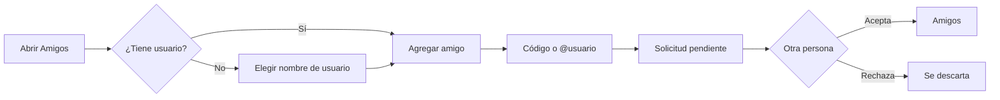

# CHG-121 · Social A: perfil social y amistades por código o usuario
**Estado:** En desarrollo
**Nivel:** M
**Modelo sugerido:** estandar
<!-- Estados y nivel se cambian SOLO con node .claude/team.mjs. Modelo: un perfil de docs/TEAM_MODELS.md -->
**Creado:** 2026-11-16 · **Aprobado:** 2026-11-16 · **Cerrado:** —
**Relacionado:** CHG-122, CHG-123, CHG-124

## 0. En palabras simples
- Qué vas a ver distinto: una pantalla «Amigos» donde compartes tu código o enlace, agregas a otra persona de MiSo y aceptas o rechazas solicitudes. Puedes enlazar a un amigo con una ficha de tu módulo Personas.
- Cómo comprobarlo tú: con dos cuentas, comparte el código de una, agrégala desde la otra, acepta la solicitud y mira que ambas se vean en su lista de amigos. Tus datos siguen siendo solo tuyos.

## 1. Resumen
Hoy MiSo no tiene ninguna relación entre cuentas. Se agrega un nombre de usuario y un código de invitación por cuenta, y una tabla de amistades con estados (pendiente, aceptada, bloqueada). Un amigo solo ve el nombre visible y el avatar; ningún dato de hábitos, tareas, diario, salud ni contactos. Es la base de las rachas compartidas (CHG-122), la tabla semanal (CHG-123) y los avisos (CHG-124).

## 2. Producto (product-manager)
- Problema / usuario: quien usa MiSo quiere constancia acompañada, estilo Duolingo, con personas que ya usan la app, sin exponer su vida privada.
- Incluye:
  - Nombre de usuario único (opcional, 3 a 20 caracteres) y código de invitación regenerable.
  - Enviar solicitud por código/enlace o por nombre de usuario exacto; aceptar, rechazar, eliminar y bloquear.
  - Vínculo opcional amigo ↔ ficha de Personas (`relationships.friend_user_id`).
  - Ajuste «Visible para mis amigos» (`social_visible`, apagado por defecto).
  - Máximo 100 amigos por cuenta.
- No incluye: buscador o listado público, racha compartida (CHG-122), tabla semanal (CHG-123), notificaciones (CHG-124), chat, exposición por MCP ni cambios al Director del juego.
- Criterios de aceptación (Dado/Cuando/Entonces):
  - Dado un código válido, cuando lo uso, entonces se crea una solicitud pendiente; si ya existía una (incluso cruzada), no se duplica.
  - Dado un código o usuario inexistente, cuando lo uso, entonces recibo exactamente la misma respuesta que con uno válido que no puedo agregar (sin revelar si la cuenta existe).
  - Dada una amistad bloqueada o eliminada, cuando el otro consulta, entonces no ve nada mío.
  - Dado un tercero sin amistad, cuando consulta mi perfil social, entonces no obtiene nada.
  - Dada la ficha de Personas vinculada, cuando mi amigo me ve, entonces no ve ninguna nota ni dato de esa ficha.

## 3. UX/UI
### 3.1 Experiencia (ux-designer)
- Plantilla: módulo con pestañas (patrón de `config/modules.php`); no hay plantilla propia en `## Anatomía` de docs/UX-DESIGN.md.
- Flujo y cantidad de pasos: Amigos → botón «Agregar amigo» (FAB) → diálogo con un campo (código o @usuario) → «Enviar solicitud» (2 pasos). Aceptar o rechazar: 1 toque desde «Solicitudes».
- Qué contiene cada pantalla y qué es lo más importante: `/amigos` muestra primero las solicitudes pendientes, luego la lista de amigos; arriba «Mi código» con copiar y compartir enlace.
- Estados (vacío / carga / error / éxito / validaciones): vacío invita a compartir el código; error de usuario inválido o límite de 100 con mensaje claro; éxito con aviso breve; nombre de usuario ya tomado se valida al guardar.
- Información necesaria y momento de presentación: el nombre de usuario se pide la primera vez que se abre Amigos, no en el registro.
- Accesibilidad de uso (teclado, foco, errores): diálogo canónico con foco al abrir y al cerrar, errores asociados al campo, botones con nombre accesible.

### 3.2 Visual (ui-designer)
- Distribución:
```
┌────────────────────────────────────────┐
│ Amigos                                 │
│ Mi código: MISO-7K2Q   [Copiar][Enlace]│
│ Solicitudes (1)                        │
│  ○ @ana   [Aceptar] [Rechazar]         │
│ Mis amigos (2)                         │
│  ○ Luis  @luis                    ⋮    │
│  ○ Sofi  @sofi                    ⋮    │
│                                  (+)   │
└────────────────────────────────────────┘
```

- Componentes existentes a reutilizar (ruta): `x-ui.fab`, `x-ui.form-dialog`, shell de módulo y tokens en `resources/views/components/ui` y `resources/css/m3`; registro en `config/modules.php`.
- Jerarquía, color, tipografía y espaciado (tokens): tokens M3 existentes; sin colores nuevos.
- Responsive y contraste: una columna en móvil, lista a dos columnas en escritorio ancho; revisar con 0, 1 y 100 amigos y nombres largos.

### 3.3 Escritura (ux-writer)
- Ubicación y estado: pantalla Amigos, diálogo y avisos.
- Textos finales (variables y variantes): «Agregar amigo», «Código o @usuario», «Enviar solicitud», «Solicitud enviada», «Aceptar», «Rechazar», «Mi código», «Visible para mis amigos», «Aún no tienes amigos. Comparte tu código.», «No encontramos a esa persona o no se puede agregar.».
- Reglas de docs/UX-WRITING.md aplicadas: tono cercano, sin culpa, sin jerga técnica; «racha» solo donde corresponda al cálculo real.
- Criterios de aceptación de los textos: el mensaje de error no distingue entre cuenta inexistente y no agregable.

## 4. Diseño técnico (software-architect)
- Archivos a crear / modificar:
  - Migraciones: `users.username` (único, nullable) y `users.friend_code` (único); tabla `friendships` (`requester_id`, `addressee_id`, `status`, `responded_at`, par ordenado único con nombre corto de índice); `relationships.friend_user_id` nullable con FK.
  - `app/Models/Friendship.php` (scope propio, sin `BelongsToUser`), `app/Services/Social/Friends.php`, `app/Services/Social/FriendSnapshot.php`.
  - `app/Livewire/Social/*` y vista, ruta en `routes/web.php`, entrada en `config/modules.php`, acción de vínculo en la ficha de Personas.
  - Ajuste `social_visible` en `module_settings` (módulo `social`).
- Enfoque y patrones a seguir: la fila de amistad pertenece a dos usuarios; toda lectura cruzada va por servicios en `app/Services/Social/` con `withoutGlobalScopes()->where('user_id', …)` y devuelve un DTO mínimo (usuario, nombre visible, avatar). Throttle en alta por código y por usuario. Respuestas idénticas ante cuenta existente o no.
- Riesgos y mitigación: enumeración de cuentas (respuesta uniforme, throttle); fuga de datos (DTO mínimo, pruebas de tercero); índice largo en MySQL (nombre corto explícito).
- Qué NO tocar: scope `BelongsToUser`, `Streak`, `RewardGranter`, herramientas MCP y Director.

## 5. Pruebas (qa-tester)
| Caso | Tipo | Nivel | Test |
|---|---|---|---|
| Aislamiento entre tres usuarios | Feature | Integración | `tests/Feature/Social/FriendIsolationTest.php` |
| Solicitud duplicada y cruzada | Feature | Integración | `tests/Feature/Social/FriendRequestTest.php` |
| Bloquear y eliminar cortan la lectura | Feature | Integración | `tests/Feature/Social/FriendBlockTest.php` |
| Respuesta uniforme (sin enumerar) y throttle | Feature | Integración | `tests/Feature/Social/FriendLookupTest.php` |
| Límite de 100 amigos | Feature | Integración | `tests/Feature/Social/FriendLimitTest.php` |
| Cascada al borrar cuenta y esquema | Feature | Integración | `tests/Feature/MultitenancySchemaTest.php` |
| Diálogo accesible, móvil y escritorio | UI | Manual/Playwright | `php artisan ui:conformance` |
- Comando para verificar: `php artisan test --filter=Social` y `php artisan test --filter=MultitenancySchema`.
- Regresión a vigilar: registro, onboarding y ficha de Personas.

## 6. Documentación (tech-writer)
- Docs a actualizar: `docs/PRODUCT.md` (alcance social y privacidad), `docs/UX-WRITING.md` (vocabulario «amigo»).

## 7. Tareas
- [x] T1 · Tengo un nombre de usuario y un código para compartir — Resp: developer — Modelo: estandar — Archivos: migraciones de `users`, `app/Models/User.php` — Hecho cuando: el usuario puede guardar un @usuario único y regenerar su código, con pruebas.
- [x] T2 · Puedo agregar, aceptar, rechazar, eliminar y bloquear amigos — Resp: developer — Modelo: estandar — Archivos: `app/Models/Friendship.php`, `app/Services/Social/Friends.php`, migración `friendships` — Hecho cuando: las pruebas de duplicado, cruce, bloqueo, límite y respuesta uniforme pasan.
- [x] T3 · Veo la pantalla Amigos con mi código y mis solicitudes — Resp: developer — Modelo: estandar — Archivos: `app/Livewire/Social/*`, vistas, `routes/web.php`, `config/modules.php` — Hecho cuando: `/amigos` funciona en móvil y escritorio y `php artisan ui:conformance` pasa.
- [x] T4 · Puedo enlazar un amigo con una persona de mi agenda — Resp: developer — Modelo: estandar — Archivos: migración `relationships.friend_user_id`, ficha de Personas — Hecho cuando: el vínculo se guarda y no se expone ningún dato de la ficha al amigo.
- [x] T5 · Mis datos solo los veo yo salvo lo que decido mostrar — Resp: developer — Modelo: estandar — Archivos: `app/Services/Social/FriendSnapshot.php`, ajuste `social_visible` — Hecho cuando: un tercero, un bloqueado o alguien con «visible» apagado no obtiene nada.
- [x] T6 · Documentación actualizada — Resp: developer — Modelo: estandar — Archivos: `docs/PRODUCT.md`, `docs/UX-WRITING.md` — Hecho cuando: los docs reflejan el alcance y `git diff --check` pasa.

## 8. Bitácora de implementación (developer)
- 2026-11-16 — Implementado: migraciones (`users.username`/`friend_code`, `friendships`, `relationships.friend_user_id`), `Friendship`, `Friends`, `SocialSettings`, `FriendSnapshot`, `Username`, `FriendsIndex` (`/amigos`), módulo `social` en `config/modules.php`, vínculo en `RelationshipShow`, pruebas en `tests/Feature/Social/`, docs.
- Ajustes frente a la spec: el módulo existente se llama «Relaciones», no «Personas»; el @usuario se elige desde una fila de la pantalla (opcional), no en un diálogo forzado; la solicitud devuelve siempre el mismo mensaje exista o no la cuenta («Si esa persona existe, le llegó tu solicitud»), en lugar de «No encontramos a esa persona»; el @usuario exige el prefijo «@» y sin él se interpreta como código.
- Usuarios que ya hicieron el onboarding con módulos elegidos no verán «Amigos» en el menú hasta activarlo en sus preferencias (comportamiento de `PersonalExperience`).
- **BLOQUEADO — no verificado:** no se pudo ejecutar `php artisan test` ni `ui:conformance`. El lock de Composer instala Symfony 8 (property hooks, PHP 8.4) y el entorno solo tiene PHP 8.3.6; el proxy bloquea el PPA para instalar 8.4. Solo se comprobó `php -l` en todos los archivos PHP. Falta correr: `php artisan test --filter=Social`, `--filter=MultitenancySchema`, `--filter=Relationship`, `--filter=PersonalExperience`, `--filter=ProtectedScreenContract`, `php artisan ui:conformance`, `npm run build`.

## 9. Preguntas abiertas, decisiones e historial
- 2026-11-16 — Creado en to-do/ (Borrador, nivel M)
- 2026-11-16 — Pendiente: ampliar `MultitenancySchemaTest` con la cascada de cuentas (hoy cubierta en `FriendIsolationTest`).
- 2026-11-16 — Decisión: máximo 100 amigos por cuenta; el avatar visible es el `avatar_url` actual, sin foto social propia; el vínculo con Personas es opcional.
- 2026-11-16 — Aprobado por el usuario (Compuerta 2)
- 2026-11-16 — Movido a in-progress/ (En desarrollo)
