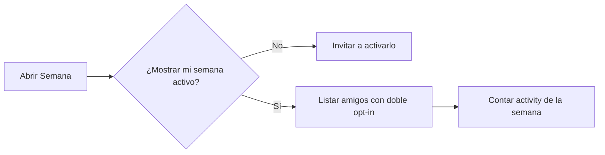

# CHG-124 · Social C: tabla semanal de amigos con doble opt-in
**Estado:** En desarrollo
**Nivel:** M
**Modelo sugerido:** estandar
<!-- Estados y nivel se cambian SOLO con node .claude/team.mjs. Modelo: un perfil de docs/TEAM_MODELS.md -->
**Creado:** 2026-11-16 · **Aprobado:** 2026-11-16 · **Cerrado:** —
**Relacionado:** CHG-122

## 0. En palabras simples
- Qué vas a ver distinto: una tabla suave de la semana con cuántas acciones hizo cada amigo, solo entre quienes activaron la opción.
- Cómo comprobarlo tú: activa «Mostrar mi semana» en dos cuentas amigas y mira que ambas aparezcan; apaga la opción en una y comprueba que desaparece.

## 1. Resumen
Tabla semanal (lunes a domingo, hora de Bogotá) con el número de acciones del juego de cada amigo, leído de `game_events`. Exige doble opt-in: `social_visible` y `social_leaderboard`. Solo se comparte un número; nunca el origen ni el contenido de las acciones. La semana empieza en cero, sin arrastre.

## 2. Producto (product-manager)
- Problema / usuario: un empujón amistoso sin exponer qué hace cada quien.
- Incluye: tabla de la semana, ajuste «Mostrar mi semana», tope de 100 filas, destacar el avance propio.
- No incluye: historial de semanas, posiciones humillantes («último lugar»), premios, desglose por tipo de acción.
- Criterios de aceptación (Dado/Cuando/Entonces):
  - Dado un amigo con ambos ajustes activos, cuando abro la tabla, entonces veo su número de acciones de la semana.
  - Dado un amigo sin alguno de los ajustes, cuando abro la tabla, entonces no aparece.
  - Dado yo sin el ajuste, cuando abro la tabla, entonces no veo a nadie y se me invita a activarlo.
  - Dado un amigo eliminado o bloqueado, cuando abro la tabla, entonces no aparece.
  - Dada una nueva semana, cuando abro la tabla, entonces todos parten de cero.

## 3. UX/UI
### 3.1 Experiencia (ux-designer)
- Plantilla: pestaña del módulo Amigos (lista); sin `## Anatomía` propia en docs/UX-DESIGN.md.
- Flujo y cantidad de pasos: pestaña «Semana» en Amigos (1 toque); activar el ajuste en 1 interruptor.
- Qué contiene cada pantalla y qué es lo más importante: lista con avatar, nombre y acciones; tu fila resaltada.
- Estados (vacío / carga / error / éxito / validaciones): vacío («Invita a un amigo»), sin opt-in, semana en cero («Semana nueva, empiecen cuando quieran»).
- Información necesaria y momento de presentación: aviso de qué se comparte al activar el ajuste.
- Accesibilidad de uso (teclado, foco, errores): lista semántica, orden anunciado sin juicios.

### 3.2 Visual (ui-designer)
- Distribución:
```
┌──────────────────────────────┐
│ Esta semana        [Mostrar]│
│ ● Tú      14 acciones        │
│ ○ Sofi    11                 │
│ ○ Luis     6                 │
└──────────────────────────────┘
```

- Componentes existentes a reutilizar (ruta): `x-ui.*`, tarjetas y listas del design system; tabs del módulo en `config/modules.php`.
- Jerarquía, color, tipografía y espaciado (tokens): tokens M3; tu fila con énfasis, sin colores de ranking.
- Responsive y contraste: lista en una columna; revisar 1 y 100 filas y nombres largos.

### 3.3 Escritura (ux-writer)
- Ubicación y estado: pestaña Semana.
- Textos finales (variables y variantes): «Esta semana», «{n} acciones», «Mostrar mi semana», «Tus amigos verán solo cuántas acciones hiciste, nada más.», «Semana nueva, empiecen cuando quieran».
- Reglas de docs/UX-WRITING.md aplicadas: sin lenguaje competitivo ni de culpa.
- Criterios de aceptación de los textos: ninguno compara negativamente a la persona.

## 4. Diseño técnico (software-architect)
- Archivos a crear / modificar: `app/Livewire/Social/WeeklyBoard.php` y vista, `FriendSnapshot::weekly()`, ajuste `social_leaderboard` en `module_settings` (módulo `social`), tab en `config/modules.php`.
- Enfoque y patrones a seguir: contar eventos `activity` por usuario en la semana con una consulta agregada (`withoutGlobalScopes()`), un solo `COUNT` por amigo; semana según `WeekPlanner` (lunes a domingo, America/Bogota).
- Riesgos y mitigación: N+1 (consulta agregada con `whereIn`); fuga de origen (solo el conteo sale del servicio).
- Qué NO tocar: `game_events`, `RewardGranter`, MCP y Director.

## 5. Pruebas (qa-tester)
| Caso | Tipo | Nivel | Test |
|---|---|---|---|
| Aparece solo con doble opt-in | Feature | Integración | `tests/Feature/Social/WeeklyBoardTest.php` |
| Conteo con eventos de varios orígenes | Feature | Integración | `tests/Feature/Social/WeeklyBoardTest.php` |
| Amigo eliminado o bloqueado no aparece | Feature | Integración | `tests/Feature/Social/WeeklyBoardPrivacyTest.php` |
| Semana nueva parte de cero | Feature | Integración | `tests/Feature/Social/WeeklyBoardTest.php` |
| Sin N+1 con 100 amigos | Feature | Integración | `tests/Feature/Social/WeeklyBoardTest.php` |
- Comando para verificar: `php artisan test --filter=WeeklyBoard`.
- Regresión a vigilar: pestañas de Amigos y `GameFeed`.

## 6. Documentación (tech-writer)
- Docs a actualizar: `docs/game.md`, `docs/PRODUCT.md`, `docs/UX-WRITING.md`.

## 7. Tareas
- [x] T1 · Puedo decidir si muestro mi semana — Resp: developer — Modelo: estandar — Archivos: ajustes del módulo `social` — Hecho cuando: el interruptor se guarda y por defecto está apagado.
- [x] T2 · Veo cuántas acciones hizo cada amigo esta semana — Resp: developer — Modelo: estandar — Archivos: `FriendSnapshot::weekly()`, `WeeklyBoard` — Hecho cuando: las pruebas de doble opt-in, conteo y semana nueva pasan.
- [x] T3 · Nadie ve mi semana si no lo permito o si ya no somos amigos — Resp: developer — Modelo: estandar — Archivos: pruebas de privacidad — Hecho cuando: las pruebas pasan.
- [x] T4 · La pestaña se ve bien en móvil y escritorio — Resp: developer — Modelo: estandar — Archivos: vista y `config/modules.php` — Hecho cuando: `php artisan ui:conformance` pasa.
- [x] T5 · Documentación actualizada — Resp: developer — Modelo: estandar — Archivos: `docs/game.md`, `docs/PRODUCT.md`, `docs/UX-WRITING.md` — Hecho cuando: `git diff --check` pasa.

## 8. Bitácora de implementación (developer)
- 2026-11-16 — Implementado: `SocialSettings::leaderboard()/setLeaderboard()`, `FriendSnapshot::weekly()`, `WeeklyBoard` (`/amigos/semana`, `social.week`), pestañas Amigos y Semana en `config/modules.php`, pruebas `WeeklyBoardTest` y `WeeklyBoardPrivacyTest`, docs.
- Ajustes: `FriendSnapshot::for()` no cambia (un test fija sus claves). El conteo es un `COUNT` agrupado de `activity` sin el antifarmeo de la racha. «Mostrar mi semana» exige «Visible para mis amigos» (el interruptor se deshabilita sin él).
- **BLOQUEADO — no verificado:** sin PHP 8.4, solo `php -l`. Pendiente: `php artisan test --filter=WeeklyBoard`, `--filter=Social`, `php artisan ui:conformance`, `npm run build`, revisión móvil/escritorio con 1 y 100 filas.

## 9. Preguntas abiertas, decisiones e historial
- 2026-11-16 — Creado en to-do/ (Borrador, nivel M)
- 2026-11-16 — Decisión: máximo 100 filas y solo conteo de acciones. Requiere CHG-122.
- 2026-11-16 — Aprobado por el usuario (Compuerta 2)
- 2026-11-16 — Movido a in-progress/ (En desarrollo)
