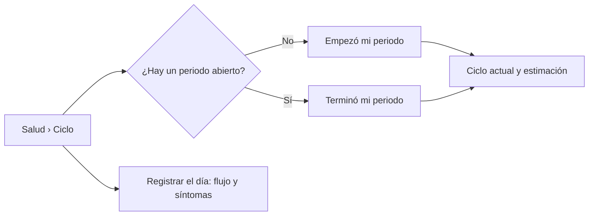

# CHG-126 · Salud: ciclo menstrual
**Estado:** En verificación
**Nivel:** L
**Modelo sugerido:** razonamiento
<!-- Estados y nivel se cambian SOLO con node .claude/team.mjs. Modelo: un perfil de docs/TEAM_MODELS.md -->
**Creado:** 2026-11-16 · **Aprobado:** 2026-11-16 · **Cerrado:** —
**Relacionado:** CHG-122 (base)

## 0. En palabras simples
- Qué vas a ver distinto: en Salud aparece una pestaña «Ciclo». Con un toque marcas «Empezó mi periodo» y, cuando termina, «Terminó mi periodo». Puedes anotar cada día el flujo y los síntomas. MiSo te muestra en qué día del ciclo vas, un calendario del mes y, cuando ya hay varios ciclos registrados, una estimación del próximo periodo. Todo es privado por defecto: el asistente solo lo ve si se lo pides expresamente. El asistente también puede registrar «me llegó el periodo».
- Cómo comprobarlo tú: registra el inicio de tres periodos (por ejemplo 20 sep, 18 oct y 15 nov) y verás «tiende a empezar entre el 12 y el 16 de diciembre». Pregunta al asistente «¿cuándo me toca el periodo?»: te dirá que ese dato es privado hasta que lo autorices.

## 1. Resumen
Agrega el seguimiento del ciclo menstrual como módulo propio dentro de Salud: inicio y fin de cada periodo, registro diario de flujo y síntomas, calendario, duración promedio del ciclo y estimación cautelosa del próximo periodo («tiende a»). Es el dato más sensible de la serie: todo se marca sensible por defecto (el asistente solo lo consulta con `include_sensitive=true`), las notas y los síntomas se guardan cifrados, y no hay recordatorios ni avisos. La estimación es informativa: no es un método anticonceptivo ni un diagnóstico, y MiSo no es un dispositivo médico.

## 2. Producto (product-manager)
- Problema / usuario: quien tiene ciclo menstrual quiere llevar su registro, ver su regularidad y anticipar el siguiente periodo sin depender de otra app.
- Incluye:
  - «Empezó mi periodo» / «Terminó mi periodo» (hoy o con otra fecha) y corrección de fechas.
  - Registro diario: flujo (ninguno, manchado, ligero, medio, abundante), síntomas (cólicos, dolor de cabeza, hinchazón, cambios de ánimo, cansancio, sensibilidad en los senos, acné, náuseas, dolor de espalda, otro) y notas.
  - Tarjeta «Ciclo actual» (día del ciclo, periodo en curso), calendario del mes con periodo, días registrados y ventana estimada.
  - Promedios de duración del ciclo y del periodo y estimación del próximo inicio con una ventana de ±2 días.
  - Historial de ciclos con duración.
  - MCP: `log-cycle-tool` (iniciar, terminar, registrar un día) y `list-cycle-tool`; borrado con `DeleteEntryTool`.
- No incluye: recordatorios o avisos, predicción de ovulación o fertilidad, uso como anticonceptivo, importación desde otras apps, gráficas (CHG-128), compartir con terceros.
- Criterios de aceptación (Dado/Cuando/Entonces):
  - CA1. Dado un usuario, cuando marca «Empezó mi periodo», entonces se crea un ciclo abierto con esa fecha; si ya hay un periodo abierto o la fecha cae dentro de otro periodo, se rechaza con un mensaje claro.
  - CA2. Dado un periodo abierto, cuando marca «Terminó», entonces se guarda su fin (no anterior al inicio ni más de 14 días después).
  - CA3. Dado un día, cuando registra flujo y síntomas, entonces se guardan una sola vez por día (volver a guardar actualiza).
  - CA4. Dado menos de tres inicios registrados, cuando ve «Ciclo», entonces no hay estimación y se explica por qué; con tres o más, muestra la duración promedio y «tiende a empezar entre {fecha} y {fecha}», aclarando que es una estimación.
  - CA5. Dado cualquier registro, cuando se guarda, entonces queda marcado como sensible por defecto, y las notas y los síntomas se almacenan cifrados.
  - CA6. Dado el asistente vía MCP, cuando consulta sin `include_sensitive=true`, entonces no recibe datos (solo cuántos se ocultaron); con `include_sensitive=true` recibe ciclos, promedios y la estimación.
  - CA7. Dado el asistente vía MCP, cuando registra el inicio, fin o un día, entonces aplica las mismas reglas que la pantalla.
  - CA8. Dado otro usuario, cuando consulta por pantalla o MCP, entonces nunca ve estos datos.

## 3. UX/UI
### 3.1 Experiencia (ux-designer)
- Plantilla: pestaña nueva «Ciclo» del módulo Salud (patrón de módulo con pestañas de `config/modules.php`, como Mediciones, Medicamentos y Sueño; no existe plantilla específica en `## Anatomía` de docs/UX-DESIGN.md).
- Flujo y cantidad de pasos: el caso más común es 1 toque («Empezó mi periodo» / «Terminó mi periodo» con la fecha de hoy). Otra fecha o el registro del día abre un diálogo corto. Flujo, síntomas y notas del día van en un diálogo con «Más detalle» plegado.
- Orden: «Ciclo actual» → «Próximo periodo (estimación)» → calendario del mes → historial de ciclos. Móvil: igual.
- Estados: sin registros («Aún no has registrado ningún periodo»), estimación no disponible (faltan ciclos), periodo en curso, error al guardar (conserva lo escrito).
- Accesibilidad: el calendario es una tabla con encabezados por día de la semana; cada celda dice en texto («Periodo», «Registrado», «Estimado») y no depende del color.



```
┌ Salud ▸ … | Sueño | Ciclo ───────────────────────────────────────────────┐
│ MiSo registra tu ciclo y muestra su evolución. No es un dispositivo      │
│ médico ni un método anticonceptivo. Tus datos de ciclo son privados.     │
│ ┌ Ciclo actual ───────────────────────────────────────────────┐          │
│ │ Día 3 del ciclo · periodo en curso desde el 15 nov           │          │
│ │ [Terminó mi periodo]  [Registrar el día]                     │          │
│ └──────────────────────────────────────────────────────────────┘          │
│ ┌ Próximo periodo (estimación) ───────────────────────────────┐          │
│ │ Tiende a empezar entre el 12 y el 16 dic (según 3 ciclos)    │          │
│ │ Ciclo promedio 28 días · periodo promedio 5 días             │          │
│ └──────────────────────────────────────────────────────────────┘          │
│ ┌ noviembre 2026 ◂ ▸ ──────────────────────────────────────────┐          │
│ │ L  M  X  J  V  S  D                                           │          │
│ │ 9 10 11 12 13 14 15●  ← ● periodo · ◦ registrado · ~ estimado │          │
│ └──────────────────────────────────────────────────────────────┘          │
│ ┌ Historial de ciclos (3) ──────────────────────────────────────┐        │
│ │ Inicio    Fin      Periodo  Ciclo                         ⋮    │        │
│ └────────────────────────────────────────────────────────────────┘        │
└────────────────────────────────────────────────────────────────────────────┘
```

### 3.2 Visual (ui-designer)
- Distribución y componentes (ruta): `x-module-shell module="health"`, `x-ui.section`, `x-ui.management-card` y `x-ui.form-dialog`, como `resources/views/livewire/health/health-measurements.blade.php`. El calendario es una tabla semántica sin estilos en línea; marcas con texto y un ícono de `bootstrap-icons`. Acento del módulo desde `config/modules.php`. Contraste AA; objetivos táctiles de 44 px.

### 3.3 Escritura (ux-writer)
- Textos: aviso «MiSo registra tu ciclo y muestra su evolución. No es un dispositivo médico ni un método anticonceptivo. Tus datos de ciclo son privados.»; «Día {n} del ciclo»; «Periodo en curso desde el {fecha}»; estimación «Tiende a empezar entre el {a} y el {b} (según {n} ciclos). Es una estimación: tu ciclo puede variar.»; sin datos «Con tres inicios registrados podremos estimar tu próximo periodo.»; errores «Ya tienes un periodo en curso. Márcalo como terminado o corrige su fecha.», «Esa fecha cae dentro de otro periodo registrado.», «La fecha no puede ser futura.», «El fin del periodo no puede ser anterior al inicio ni durar más de 14 días.»; eliminar «Se eliminará el periodo que empezó el {fecha} y sus registros diarios.».
- Reglas de docs/UX-WRITING.md: tuteo neutro; tono respetuoso y sin humor; sin juicios sobre el cuerpo ni sobre la regularidad («irregular», «anormal»); lenguaje cauto («tiende a»), como CHG-071.
- Criterios de aceptación de los textos: ningún texto diagnostica, promete fertilidad o anticoncepción, ni sugiere tratamientos.

## 4. Diseño técnico (software-architect)
- Archivos a crear / modificar: migración `menstrual_cycles` (`uuid id`, `user_id`, `started_on`, `ended_on` nullable, `notes` cifrada, `is_sensitive` default **true**, `source`; único corto `mc_user_start_unique`) y `cycle_day_logs` (`uuid id`, `user_id`, `date`, `flow`, `symptoms` cifrado, `notes` cifrada, `is_sensitive` default true; único `cd_user_date_unique`); modelos `MenstrualCycle` y `CycleDayLog` (casts `encrypted`/`encrypted:array`); relaciones en `User` y morph map; `app/Actions/LogCycle.php` (iniciar, terminar, registrar día, validaciones); `app/Support/CycleProgress.php` (día del ciclo, promedios, estimación y calendario del mes, lógica pura); `app/Livewire/Health/Cycle.php` + vista; ruta `health.cycle` y pestaña; `app/Mcp/Tools/Health/LogCycleTool.php` y `ListCycleTool.php`; `LifeTrackerServer` y `DeleteEntryTool` (tipos `menstrual_cycle` y `cycle_day`).
- Enfoque y patrones a seguir: `Sleep` / `LogSleep` / `SleepProgress` (CHG-125); `Relationship.document_number` (`'encrypted'`) para el cifrado; patrón `is_sensitive` + `include_sensitive`.
- Riesgos y mitigación: datos de salud íntimos (cifrado de texto libre, sensibles por defecto, sin avisos ni push, sin enviarlos a terceros); la estimación mal interpretada como anticonceptivo (aviso fijo y texto cauto); fechas en la zona `America/Bogota`.
- Qué NO tocar: avisos y notificaciones (no hay recordatorios), `health_events`, mediciones y sueño.

## 5. Pruebas (qa-tester)
| Caso | Tipo | Nivel | Test |
|---|---|---|---|
| Iniciar y terminar, cruces y límites (CA1, CA2) | Feature | Pantalla y acción | `CycleModuleTest` |
| Registro diario único por día (CA3) | Feature | Pantalla | `CycleModuleTest` |
| Promedios y estimación (CA4) | Unitaria | Support | `CycleProgressTest` |
| Sensibles por defecto y cifrado en base (CA5) | Feature | Modelo | `CycleModuleTest` |
| MCP: gating de sensibles y reglas (CA6, CA7) | Feature | MCP | `LifeTrackerCycleMcpTest` |
| Aislamiento (CA8) | Feature | Pantalla y MCP | ambos |
- Comando para verificar: `php artisan test --filter=Cycle`, `php artisan ui:conformance`.
- Regresión a vigilar: pruebas de salud y de herramientas MCP.

## 6. Documentación (tech-writer)
- Docs a actualizar: `docs/UX-WRITING.md` (textos del ciclo) y `docs/PRODUCT.md` (módulo de salud y privacidad del ciclo).

## 7. Tareas
- [x] T1 · Marcar cuándo empieza y termina mi periodo y ver mi ciclo actual — Resp: developer — Modelo: razonamiento — Archivos: migraciones, `MenstrualCycle`, `LogCycle`, `CycleProgress`, `Health\Cycle`, vista, ruta, `config/modules.php` — Hecho cuando: CA1, CA2 y CA8 pasan en pruebas.
- [x] T2 · Anotar flujo y síntomas de cada día y ver el calendario — Resp: developer — Modelo: razonamiento — Archivos: `CycleDayLog`, `LogCycle`, `Health\Cycle` y vista — Hecho cuando: CA3 pasa en pruebas y el calendario marca periodo, día registrado y ventana estimada.
- [x] T3 · Ver el promedio de mi ciclo y la estimación del próximo periodo — Resp: developer — Modelo: razonamiento — Archivos: `CycleProgress`, vista — Hecho cuando: CA4 pasa en pruebas con 0, 2 y 3 o más inicios.
- [x] T4 · Mantener mis datos de ciclo privados y cifrados — Resp: developer — Modelo: razonamiento — Archivos: modelos, migraciones — Hecho cuando: CA5 pasa en pruebas (valores cifrados en la base y sensibles por defecto).
- [x] T5 · El asistente registra y consulta mi ciclo solo con mi autorización — Resp: developer — Modelo: razonamiento — Archivos: `app/Mcp/Tools/Health/*`, `LifeTrackerServer`, `DeleteEntryTool` — Hecho cuando: CA6 y CA7 pasan en pruebas.
- [x] T6 · Pruebas, documentación y verificación — Resp: developer — Modelo: razonamiento — Archivos: `tests/Feature/*`, `docs/UX-WRITING.md`, `docs/PRODUCT.md` — Hecho cuando: los comandos de §5 pasan y no hay fallas nuevas en la suite.

## 8. Bitácora de implementación (developer)
- 2026-11-16 — T1/T2/T3: migraciones `menstrual_cycles` y `cycle_day_logs` (únicos cortos `mc_user_start_unique` y `cd_user_date_unique`), modelos `MenstrualCycle` y `CycleDayLog`, acción `LogCycle` (iniciar, terminar, corregir y registrar el día; un solo periodo abierto, sin fechas futuras ni cruces, máximo 14 días; repetir el mismo inicio devuelve el existente), `CycleProgress` (día del ciclo, promedios, estimación y calendario, lógica pura) y página `Health\Cycle` con «Ciclo actual», estimación, calendario del mes navegable (tabla accesible; cada día dice en texto periodo, registro o ventana estimada), registros del mes e historial de ciclos con duración. El botón principal alterna entre «Empezó mi periodo» y «Terminó mi periodo» (1 toque); «Registrar el día» y las fechas distintas salen del mismo botón.
- 2026-11-16 — T3 (estimación): solo con 3 o más inicios; promedio de los intervalos de 15 a 60 días (los demás se descartan como registro faltante); ventana de ±2 días; texto «Tiende a empezar entre…» con aviso de que es una estimación. Sin ovulación ni fertilidad.
- 2026-11-16 — T4: todo se guarda `is_sensitive = true` por defecto; `notes` (ciclo y día) y `symptoms` usan los casts `encrypted` y `encrypted:array`, y una prueba comprueba que en la base no queda el texto en claro. Fechas y flujo sin cifrar para poder calcular y ordenar. Sin notificaciones ni push del ciclo.
- 2026-11-16 — T5: `log-cycle-tool` (start, end, day) y `list-cycle-tool`: sin `include_sensitive=true` no devuelve datos, solo `hidden_sensitive` con cuántos hay; con la bandera devuelve periodos, promedios, días del ciclo y la estimación con su nota. Registrados en `LifeTrackerServer` con la guía de privacidad; tipos `menstrual_cycle` y `cycle_day` en `DeleteEntryTool`; morph map `menstrual-cycle` y `cycle-day-log`.
- 2026-11-16 — T6: `CycleProgressTest` (5), `CycleModuleTest` (11) y `LifeTrackerCycleMcpTest` (6) pasan. Suite completa: 1740 pruebas, 46 fallas idénticas a la base (entorno).
- Desviación: eliminar un periodo conserva los registros diarios (no están enlazados a un periodo, solo a una fecha); el texto de confirmación lo dice. Los textos de fecha usan `translatedFormat` como el resto de la app; el `.env.example` trae `APP_LOCALE=en` (producción debe usar `es`), por eso las pruebas del ciclo fijan el español.
- No verificado: revisión visual del calendario en móvil y escritorio (tabla de 7 columnas), ni el comportamiento con muchos ciclos.

## 9. Preguntas abiertas, decisiones e historial
- 2026-11-16 — Creado en to-do/ (Borrador, nivel L)
- Decidido 2026-11-16: privacidad del ciclo. Todo se guarda como sensible por defecto (el asistente solo lo consulta con `include_sensitive=true`), `notes` y `symptoms` se cifran con el cast `encrypted` de Laravel; las fechas y el flujo no se cifran para poder ordenar y calcular promedios en SQL. Responde la pregunta abierta de cifrado de CHG-122 para los datos más íntimos.
- Decidido 2026-11-16: sin recordatorios ni notificaciones del ciclo. Estimación solo con tres o más inicios registrados, con ventana de ±2 días y lenguaje cauto; sin ovulación ni fertilidad.
- Nota: el validador recomienda dividir los CHG de nivel L; se mantiene como uno solo porque las seis tareas comparten modelo y pantalla y se verifican juntas.
- 2026-11-16 — Aprobado por el usuario (Compuerta 2)
- 2026-11-16 — Movido a in-progress/ (En desarrollo)
- 2026-11-16 — Implementación terminada → En verificación
