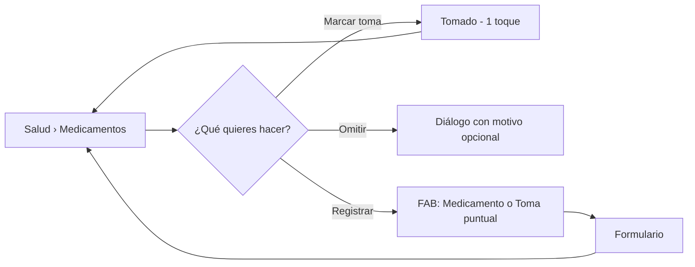

# CHG-129 · Salud: medicamentos tomados y por tomar (con MCP)
**Estado:** En verificación
**Nivel:** M
**Modelo sugerido:** estandar
<!-- Estados y nivel se cambian SOLO con node .claude/team.mjs. Modelo: un perfil de docs/TEAM_MODELS.md -->
**Creado:** 2026-11-16 · **Aprobado:** 2026-11-16 · **Cerrado:** —
**Relacionado:** CHG-122 (aviso «no es dispositivo médico» y criterios de privacidad), CHG-130 (recordatorios)

## 0. En palabras simples
- Qué vas a ver distinto: en Salud aparece «Medicamentos». Registras cada medicamento que debes tomar (nombre, dosis, cada cuánto y desde cuándo hasta cuándo) y marcas cada toma como «tomado» u «omitido». También puedes anotar un medicamento que tomaste sin tenerlo programado. Ves qué te toca hoy y qué ya tomaste. Todo esto también se puede registrar y consultar desde el asistente (MCP).
- Cómo comprobarlo tú: crea «Losartán 50 mg, 1 vez al día, mañana», verás una toma pendiente hoy; márcala como tomada y revisa que pase al historial. Pide al asistente «¿qué medicamentos me faltan hoy?» y «registra que tomé ibuprofeno 400 mg».

## 1. Resumen
Hoy MiSo no tiene medicamentos. Este CHG agrega dos conceptos: el **medicamento programado** (qué debo tomar y con qué frecuencia) y la **toma** (lo que realmente tomé u omití, con o sin programación). Con ellos se responde «¿qué he consumido?» y «¿qué debo consumir?». Se expone por UI y por MCP con la misma Action. Los recordatorios se especifican aparte en CHG-130, que depende de este y reutiliza el cron existente. MiSo no es un dispositivo médico y no recomienda dosis ni detecta interacciones.

## 2. Producto (product-manager)
- Problema / usuario: la persona toma medicamentos (tratamientos crónicos o cortos) y hoy no tiene dónde llevar qué tomó y qué le falta; esto también ayuda a explicar síntomas o energía.
- Incluye:
  - Alta, edición y baja (finalizar) de medicamentos programados: nombre, dosis y unidad, frecuencia, horarios sugeridos, fecha de inicio, fecha de fin opcional, indicaciones y notas.
  - Registro de tomas: tomado (con hora real), omitido (con motivo opcional) o toma puntual no programada.
  - Vista «Hoy»: pendientes, tomados y omitidos, y atrasados del día.
  - Historial con filtro por fecha y por medicamento.
  - MCP: registrar medicamento, registrar toma, consultar pendientes del día y consultar historial/consumo.
- No incluye: recordatorios o notificaciones (van en CHG-130), alertas de interacciones o dosis máximas, inventario/compra de medicamentos, recetas médicas adjuntas, integración con el inventario del módulo de alimentación.
- Criterios de aceptación (Dado/Cuando/Entonces):
  - CA1. Dado un medicamento «1 vez al día», cuando abro «Hoy», entonces veo una toma pendiente y, al marcarla tomada, pasa al historial con su hora.
  - CA2. Dado un medicamento con fecha de fin pasada o finalizado, cuando abro «Hoy», entonces no genera tomas pendientes, pero su historial se conserva.
  - CA3. Dado un medicamento no programado, cuando registro una toma puntual, entonces queda en el historial sin afectar los pendientes.
  - CA4. Dado el asistente vía MCP, cuando pregunta por los pendientes de hoy, entonces recibe la misma lista que la UI.
  - CA5. Dado el asistente vía MCP, cuando registra una toma con medicamento y dosis, entonces se crea igual que desde la UI (mismo Action) y devuelve confirmación con el estado de las pendientes.
  - CA6. Dado otro usuario, cuando consulta por UI o MCP, entonces nunca ve estos datos.
  - CA8. Dado un medicamento o toma sensible, cuando el asistente consulta por MCP sin pedirlo expresamente, entonces no se devuelven; con `include_sensitive=true` sí.
  - CA7. Dado un registro repetido (mismo medicamento y misma toma programada), cuando se reintenta, entonces no duplica (idempotente por clave de operación).

## 3. UX/UI
<!-- Sin pantallas: escribe "No aplica — motivo" en cada parte. Con UI, approve exige un boceto ASCII en un bloque de código. Si hay flujo, agrega un diagrama en un bloque mermaid. -->
### 3.1 Experiencia (ux-designer)
- Plantilla: pestaña nueva «Medicamentos» del módulo Salud (patrón de módulo con pestañas de `config/modules.php`). No existe una plantilla específica en `## Anatomía` de docs/UX-DESIGN.md.
- Flujo y cantidad de pasos:
  - Marcar una toma: Salud → «Medicamentos» → botón «Tomado» en la tarjeta de la toma: **1 toque** (UX-001). «Omitir» abre un diálogo corto con motivo opcional.
  - Crear un medicamento: FAB «Registrar» → opciones «Medicamento» y «Toma puntual» (mismo FAB, `'create' => true`). Medicamento: nombre, dosis, frecuencia y horarios, inicio; fin, indicaciones, notas y evento de salud van en «Más detalle».
  - Editar o finalizar: toque en el medicamento. «Finalizar» conserva el historial.
- Qué contiene cada pantalla y qué es lo más importante: orden `Hoy` (pendientes, atrasadas, hechas) → «Mis medicamentos» (activos, con su siguiente toma) → «Historial». Lo más importante es qué falta tomar hoy; en móvil las pendientes van primero (UX-002).
- Estados (vacío / carga / error / éxito / validaciones):
  - Sin medicamentos: invitación a registrar el primero. Nada pendiente hoy: «No tienes tomas pendientes hoy.» Todo tomado: confirmación sin celebración excesiva.
  - Toma atrasada: se marca «Atrasada» con la hora esperada; se puede registrar igual con la hora real.
  - Error al guardar: el formulario conserva lo escrito. Validaciones en el servidor.
  - Éxito de «Tomado»: la tarjeta pasa a «Tomada a las {hora}» con opción de deshacer durante unos segundos.
- Información necesaria y momento de presentación: dosis y hora visibles en cada toma; el aviso «MiSo no sustituye la indicación de tu profesional de salud» una vez, bajo el título; las indicaciones («con comida») se muestran en la tarjeta si existen.
- Accesibilidad de uso (teclado, foco, errores): «Tomado» es un botón con nombre accesible completo («Marcar Losartán 50 mg de las 8:00 como tomado»); al marcarla el foco pasa a la siguiente toma; el estado no depende solo del color (ícono + texto); resultado anunciado con `aria-live`.



Boceto escritorio:

```
┌ Salud ▸ Registro | Vista del cuerpo | Mediciones | Medicamentos ───────┐
│ MiSo no sustituye la indicación de tu profesional de salud.            │
│ ┌ Hoy · lunes 16 de noviembre ─────────────── 2 de 4 tomadas ┐        │
│ │ ⚠ 08:00 Losartán 50 mg · con comida   Atrasada   [Tomado][Omitir]│  │
│ │ ◷ 14:00 Metformina 850 mg                         [Tomado][Omitir]│  │
│ │ ✔ 07:00 Vitamina D 1000 UI            Tomada 07:12          ↶      │  │
│ │ ✔ 07:00 Omeprazol 20 mg               Tomada 07:12          ↶      │  │
│ └────────────────────────────────────────────────────────────────┘     │
│ ┌ Mis medicamentos (3) ─ [Buscar] [Filtros ▾] ───────────────────┐     │
│ │ Losartán 50 mg    1 vez al día · 08:00     desde 1 ago   ⋮     │     │
│ │ Metformina 850 mg 2 veces al día · 08/20   desde 3 sep   ⋮     │     │
│ └────────────────────────────────────────────────────────────────┘     │
│ ┌ Historial ─ [Medicamento ▾] [Fecha ▾] ─────────────────────────┐     │
│ │ 16 nov 07:12  Omeprazol 20 mg   Tomada                         │     │
│ │ 15 nov 20:05  Metformina 850 mg Omitida · Se me olvidó         │     │
│ └────────────────────────────────────────────────────────────────┘     │
│                                                              (＋ FAB)  │
└────────────────────────────────────────────────────────────────────────┘
```

Boceto móvil:

```
┌ Medicamentos ───────────┐   ┌ Registrar medicamento ─── ✕ ┐
│ Hoy · 2 de 4 tomadas    │   │ Nombre     [Losartán      ] │
│ ⚠ 08:00 Losartán 50 mg  │   │ Dosis [50] Unidad [mg ▾]    │
│   Atrasada              │   │ Frecuencia [1 vez al día ▾] │
│   [  Tomado  ] [Omitir] │   │ Horarios   [08:00] (＋hora) │
│ ◷ 14:00 Metformina      │   │ Desde      [16 nov 2026 ▾]  │
│   [  Tomado  ] [Omitir] │   │ ▸ Más detalle               │
│ ✔ 07:00 Omeprazol       │   │ [Cancelar]        [Guardar] │
│   Tomada 07:12   ↶      │   └─────────────────────────────┘
│ Mis medicamentos        │
│ Historial         (＋)  │
└─────────────────────────┘
```

### 3.2 Visual (ui-designer)
- Distribución: `x-module-shell module="health"`; tarjeta «Hoy» con filas de toma como acción principal, luego dos `x-ui.management-card` («Mis medicamentos» e «Historial») con el patrón de `water-daily.blade.php`.
- Componentes existentes a reutilizar (ruta): `x-module-actions` con `quick` de tipo `tap` para «Tomado» desde el chat del compañero, `x-ui.management-card`, `x-ui.form-dialog`, `x-ui.field`, `x-ui.select`, `x-ui.action`, `DataState`.
- Jerarquía, color, tipografía y espaciado (tokens): la toma atrasada usa tono de advertencia suave con ícono y texto, no error; las tomadas bajan de jerarquía (texto secundario, ícono de check). Acento de módulo desde `config/modules.php`. Sin tonos ni íconos a mano.
- Responsive y contraste: bajo 1200 px no hay panel lateral; las filas de toma ocupan todo el ancho con botones de 44 px. Contraste AA en claro y oscuro. Validar con 0, 1 y 10+ medicamentos y con nombres largos.

### 3.3 Escritura (ux-writer)
- Ubicación y estado: aviso bajo el título; estado de cada toma en su fila.
- Textos finales (variables y variantes):
  - Aviso: «MiSo no sustituye la indicación de tu profesional de salud.»
  - Botones: «Tomado», «Omitir», «Deshacer». Estados: «Pendiente», «Atrasada», «Tomada a las {hora}», «Omitida».
  - Resumen: «{n} de {total} tomadas hoy.» Sin pendientes: «No tienes tomas pendientes hoy.»
  - Motivo de omisión (opcional): «¿Quieres anotar el motivo?» con ejemplos en la ayuda del campo.
  - Vacío: «Aún no tienes medicamentos. Registra el primero con el botón +.»
  - Finalizar: «Se finalizará “{nombre}”. Su historial de tomas se conserva.» Eliminar una toma: «Se eliminará la toma de “{nombre}” del {fecha}.»
  - Guardado: «Toma registrada.» Error: «No pudimos guardar la toma. Inténtalo de nuevo.»
- Reglas de docs/UX-WRITING.md aplicadas: tuteo neutro; salud sin humor; omitir no se presenta como falta («Omitida», sin culpar); acciones con verbo concreto; confirmaciones que nombran el elemento y sus consecuencias.
- Criterios de aceptación de los textos: ningún texto recomienda dosis, horarios ni suspender un medicamento; el aviso al profesional de salud aparece una vez por pantalla; los textos de omisión no usan lenguaje de culpa.

## 4. Diseño técnico (software-architect)
- Archivos a crear / modificar:
  - Migración `medications`: `uuid id`, `user_id`, `name`, `dose_amount` decimal, `dose_unit`, `form` (tableta, jarabe, inyección…), `frequency_type` (diaria, cada N horas, días de la semana, solo si es necesario), `times` json (horarios sugeridos HH:MM), `starts_on`, `ends_on` nullable, `instructions`, `notes`, `health_event_id` nullable (FK compuesta con `user_id`, para ligarlo a una enfermedad o cita), `is_active`. Índice `[user_id, is_active, starts_on]` con nombre corto.
  - Migración `medication_intakes`: `uuid id`, `user_id`, `medication_id` nullable (FK compuesta; null = toma puntual), `name` (copia para tomas puntuales o si se borra el medicamento), `dose_amount`, `dose_unit`, `scheduled_for` nullable (fecha-hora esperada), `taken_at` nullable, `status` (`taken`/`skipped`), `skip_reason`, `notes`, `source`, `operation_key`. `unique [user_id, operation_key]` y `unique [medication_id, scheduled_for]` para idempotencia.
  - Modelos `Medication` y `MedicationIntake` (`BelongsToUser`, `HasUuids`); relaciones en `User`; morph map en `AppServiceProvider`.
  - `app/Support/MedicationSchedule.php`: calcula las tomas esperadas de un día a partir de la frecuencia (lógica pura y testeable). Las tomas esperadas no se guardan por adelantado: se derivan y solo se persiste lo que ocurre.
  - `app/Actions/LogMedicationIntake.php`, compartida por UI y MCP.
  - `app/Livewire/Health/Medications.php` y vista; ruta en `routes/web.php`; pestaña en `config/modules.php` (módulo `health`).
  - MCP en `app/Mcp/Tools/Health/`: `LogMedicationTool` (alta/edición), `LogMedicationIntakeTool`, `ListMedicationsTool` (pendientes de hoy, activos, historial con `DateWindow`). Registro en `LifeTrackerServer` (y su texto de instrucciones), `ToolCatalog::MODULES`, `DeleteEntryTool`, `GetRecentActivityTool` y `GetHealthContextTool` (medicamentos activos y pendientes).
- Enfoque y patrones a seguir: `LogDrink` + `LogWaterIntakeTool` para la Action compartida y la confirmación; `operation_key` estable como en compras/comidas; tareas programadas no aplican.
- Riesgos y mitigación:
  - Zona horaria y «día» de la toma: usar la zona del usuario y probar el cambio de día.
  - Frecuencias complejas (cada 8 h, ciclos): limitar a diaria, N veces al día con horarios, cada N horas y días de la semana; lo demás, a CHG posterior.
  - Borrar un medicamento no debe perder el historial: la toma conserva su nombre.
  - Datos sensibles: sin cifrado en esta versión; columna `is_sensitive` (default false) en `medications` y `medication_intakes`; las consultas amplias de MCP la excluyen salvo `include_sensitive=true` (decisión de CHG-122).
- Qué NO tocar: `health_events`/`health_logs`, inventario y compras.

## 5. Pruebas (qa-tester)
| Caso | Tipo | Nivel | Test |
|---|---|---|---|
| Pendientes del día según frecuencia (CA1, CA2) | Unitaria | Support | `MedicationScheduleTest` |
| Marcar tomada/omitida y toma puntual (CA1, CA3) | Feature | Livewire | `MedicationsModuleTest` |
| Paridad UI/MCP y pendientes (CA4, CA5) | Feature | MCP | `LifeTrackerMedicationMcpTest` |
| Sensibles ocultos en MCP salvo `include_sensitive` (CA8) | Feature | MCP | `LifeTrackerMedicationMcpTest` |
| Aislamiento entre usuarios (CA6) | Feature | Livewire + MCP | ambos |
| Idempotencia por `operation_key` (CA7) | Feature | MCP | `LifeTrackerMedicationMcpTest` |
| Cambio de día y zona horaria | Unitaria | Support | `MedicationScheduleTest` |
| Esquema por usuario | Feature | Esquema | `MultitenancySchemaTest` |
- Comando para verificar: `php artisan test --filter=Medication`, `php artisan ui:conformance`, `npm run build`.
- Regresión a vigilar: `HealthModuleTest`, `LifeTrackerContextMcpTest`, `LifeTrackerMcpTest` (lista de herramientas).

## 6. Documentación (tech-writer)
- Docs a actualizar: `docs/PRODUCT.md` (módulo de salud), `docs/UX-WRITING.md` (textos de omisión y aviso), `docs/mockup-system/mockups/health/`.

## 7. Tareas
- [x] T1 · Crear medicamentos y ver qué toca hoy — Resp: developer — Modelo: estandar — Archivos: migraciones, `Medication`, `MedicationSchedule`, `Medications`, vista, ruta, `config/modules.php` — Hecho cuando: CA1 y CA2 pasan en pruebas.
- [x] T2 · Marcar tomas (tomado/omitido) y registrar tomas puntuales — Resp: developer — Modelo: estandar — Archivos: `MedicationIntake`, `LogMedicationIntake`, componente Livewire — Hecho cuando: CA3 pasa en pruebas.
- [x] T3 · Registrar y consultar medicamentos desde el asistente (MCP) — Resp: developer — Modelo: estandar — Archivos: `app/Mcp/Tools/Health/*`, `LifeTrackerServer`, `ToolCatalog`, `DeleteEntryTool`, `GetRecentActivityTool`, `GetHealthContextTool` — Hecho cuando: CA4, CA5 y CA7 pasan en pruebas.
- [x] T4 · Aislamiento, esquema y verificación en móvil y escritorio — Resp: developer — Modelo: estandar — Archivos: `tests/Feature/*` — Hecho cuando: CA6 y los comandos de §5 pasan.

## 8. Bitácora de implementación (developer)
- 2026-11-16 — T1: migraciones `medications` y `medication_intakes`, modelos `Medication` y `MedicationIntake`, `MedicationSchedule` (frecuencias diaria, cada N horas y por días de la semana en `America/Bogota`), acción `SaveMedication` y página `Health\Medications` (tarjeta «Hoy», «Mis medicamentos», historial), ruta `health.medications` y pestaña «Medicamentos».
- 2026-11-16 — T2: `LogMedicationIntake` (tomada, omitida, puntual y deshacer), idempotente por medicamento y hora esperada y por `operation_key`. «Omitir» abre un diálogo con motivo opcional.
- 2026-11-16 — T3: herramientas `log-medication-tool` (crear, editar, finalizar, reanudar), `log-medication-intake-tool` y `list-medications-tool` (`today`, `active`, `history`), registradas en `LifeTrackerServer` con su guía de uso; tipos `medication` y `medication_intake` en `DeleteEntryTool`; morph map `medication` y `medication-intake`. Las tomas pendientes se informan en la respuesta de cada registro. Lo sensible se omite salvo `include_sensitive=true`.
- 2026-11-16 — T4: `MedicationScheduleTest` (10), `LifeTrackerMedicationMcpTest` (12) y `MedicationsModuleTest` (9) pasan. Suite completa: 1660 pruebas, 46 fallas idénticas a las de la base sin estos cambios (entorno); `ui:conformance` no marca los archivos nuevos.
- Desviaciones de §4: sin FK compuesta entre `medication_intakes` y `medications` (no admite `nullOnDelete`); el modelo `Medication` pone `medication_id` en null al borrar, así la toma conserva nombre y dosis. `health_event_id` queda como columna nullable sin FK y **sin campo en la pantalla ni en MCP**: el enlace opcional con un evento de salud no se implementó en esta entrega. No se tocaron `GetHealthContextTool` ni `GetRecentActivityTool`.
- Horarios: la pantalla pide los horarios como texto «HH:MM, HH:MM» (con ayuda y validación) en lugar de un selector de horas.
- No verificado: revisión visual con captura en móvil y escritorio (no hay servidor web ni assets compilados en este entorno); las pruebas Livewire cubren render, estados vacío, con datos y filtrado. Los recordatorios no existen todavía (CHG-130).
- Entorno: PHP 8.3 no ejecuta las versiones bloqueadas de Symfony; las pruebas se corrieron con un `vendor` resuelto aparte y `composer.lock` no se modificó. Inicio con `start --force` autorizado por el usuario (CHG-106 y CHG-108 siguen En desarrollo).

## 9. Preguntas abiertas, decisiones e historial
- 2026-11-16 — Creado en to-do/ (Borrador, nivel M) a pedido del usuario: registrar lo consumido y lo que se debe consumir, con registro y consulta por MCP.
- Decidido 2026-11-16: el usuario quiere recordatorios con el cron existente. Se especifican en CHG-130 para mantener este CHG en nivel M.
- Decidido 2026-11-16: frecuencias de la primera versión: diaria con horarios, cada N horas y días de la semana.
- Decidido 2026-11-16: el medicamento puede ligarse opcionalmente a un evento de salud (en «Más detalle»).
- Decidido 2026-11-16: privacidad según CHG-122: sin cifrado, `is_sensitive` en medicamentos y tomas, ocultos en MCP salvo `include_sensitive=true`.
- Si crece, dividir en: (1) medicamentos y tomas por UI, (2) MCP.
- 2026-11-16 — Aprobado por el usuario (Compuerta 2)
- 2026-11-16 — Movido a in-progress/ (En desarrollo)
- 2026-11-16 — Implementación terminada → En verificación
