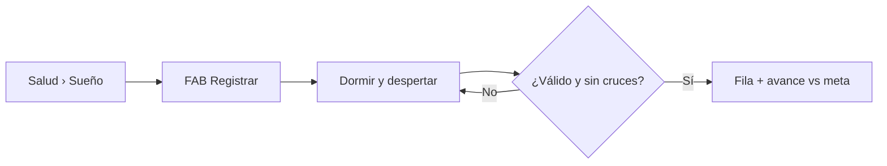

# CHG-129 · Salud: seguimiento del sueño
**Estado:** En verificación
**Nivel:** M
**Modelo sugerido:** estandar
<!-- Estados y nivel se cambian SOLO con node .claude/team.mjs. Modelo: un perfil de docs/TEAM_MODELS.md -->
**Creado:** 2026-11-16 · **Aprobado:** 2026-11-16 · **Cerrado:** —
**Relacionado:** CHG-126 (base)

## 0. En palabras simples
- Qué vas a ver distinto: en Salud aparece una pestaña «Sueño». Registras a qué hora te dormiste y a qué hora despertaste (y, si quieres, cómo dormiste del 1 al 5). MiSo calcula cuánto dormiste, lo compara con tu meta de horas (8 h por defecto, la puedes cambiar) y te muestra el promedio de los últimos 7 días. El asistente también puede registrar y consultar tu sueño.
- Cómo comprobarlo tú: registra una noche de 23:00 a 06:30 y verás «7 h 30 min». Cambia tu meta a 7 h y verás que esa noche cumple la meta. Pregúntale al asistente «¿cómo he dormido esta semana?».

## 1. Resumen
Agrega el seguimiento del sueño como módulo propio dentro de Salud, porque cada registro tiene inicio y fin (no encaja en la tabla genérica de mediciones). Incluye registro, historial con filtro de periodo, meta de horas, promedio semanal y herramientas MCP. MiSo registra y muestra tendencias; no diagnostica ni da consejos clínicos sobre el sueño.

## 2. Producto (product-manager)
- Problema / usuario: la persona quiere saber cuánto duerme y si cumple su meta, y cruzarlo con energía y ánimo. Hoy solo existe texto libre.
- Incluye:
  - Registrar, editar y eliminar una noche (o una siesta): hora de dormir, hora de despertar, calidad 1–5 opcional, notas, sensible.
  - Duración calculada, meta de horas por persona (`users.daily_sleep_hours`, 8 por defecto) y avance frente a la meta.
  - Tarjeta «Última noche», promedio de los últimos 7 días y noches que cumplieron la meta.
  - Historial con filtro de periodo y orden.
  - MCP: `log-sleep-tool` y `list-sleep-tool`; borrado con `DeleteEntryTool`.
- No incluye: fases del sueño, datos de relojes o apps, recordatorios para dormir, gráficas (CHG-132), consejos o diagnósticos.
- Criterios de aceptación (Dado/Cuando/Entonces):
  - CA1. Dado 23:00 a 06:30, cuando guardo, entonces se registra una duración de 7 h 30 min.
  - CA2. Dado despertar anterior o igual a dormir, o una duración mayor de 24 h o menor de 10 min, cuando guardo, entonces se rechaza con un mensaje que indica qué corregir.
  - CA3. Dado un registro que se cruza con otro, cuando guardo, entonces se rechaza sin guardar.
  - CA4. Dado una meta de 8 h y una noche de 7 h 30 min, cuando veo la tarjeta, entonces muestra «Faltaron 30 min para tu meta» (sin juicio).
  - CA5. Dado 7 noches registradas, cuando veo el resumen, entonces muestra el promedio y cuántas cumplieron la meta.
  - CA6. Dado el asistente vía MCP, cuando registra o consulta, entonces usa las mismas reglas que la pantalla y repetir el mismo registro no lo duplica.
  - CA7. Dado un registro sensible, cuando el asistente consulta sin pedirlo expresamente, entonces no se devuelve; con `include_sensitive=true` sí.
  - CA8. Dado otro usuario, cuando consulta por pantalla o MCP, entonces nunca ve estos datos.

## 3. UX/UI
### 3.1 Experiencia (ux-designer)
- Plantilla: pestaña nueva «Sueño» del módulo Salud (patrón de módulo con pestañas de `config/modules.php`, como Mediciones y Medicamentos; no existe plantilla específica en `## Anatomía` de docs/UX-DESIGN.md).
- Flujo y cantidad de pasos: Salud → Sueño → FAB «Registrar» → diálogo (dormir, despertar; ya vienen precargados con tu meta) → «Guardar»: 2 pasos. Calidad, notas y «sensible» van en «Más detalle». Editar: toque en la fila. La meta se cambia con «Meta de horas» (diálogo corto).
- Orden: «Última noche» con avance vs meta → promedio de 7 días → historial. Móvil: el mismo orden.
- Estados: vacío («Aún no tienes registros de sueño»), vacío por filtro, error al guardar (conserva lo escrito), éxito (aparece la fila). Validaciones en el servidor.
- Accesibilidad: el avance es texto además de barra (`x-ui.progress` con `valueText`); errores asociados al campo.



```
┌ Salud ▸ Registro | Cuerpo | Mediciones | Medicamentos | Sueño ──────────┐
│ MiSo registra tu sueño y muestra su evolución. No es un dispositivo     │
│ médico ni reemplaza a tu profesional de salud.                          │
│ ┌ Última noche ──────────────────────────── Meta: 8 h [Cambiar] ┐       │
│ │ 🌙 7 h 30 min · 23:00 → 06:30 · calidad 4/5                    │       │
│ │ ▓▓▓▓▓▓▓▓▓░ 94 % de tu meta · Faltaron 30 min                   │       │
│ └────────────────────────────────────────────────────────────────┘       │
│ ┌ Últimos 7 días ───────────────────────────────────────────────┐        │
│ │ Promedio 7 h 12 min · 3 de 7 noches cumplieron tu meta         │        │
│ └────────────────────────────────────────────────────────────────┘        │
│ ┌ Historial (12) ─ [Orden ▾] [Filtros ▾] ───────────────────────┐        │
│ │ Fecha   Dormí  Desperté  Duración  Calidad                 ⋮   │        │
│ │ Hoy     23:00  06:30     7 h 30    4/5                     ⋮   │        │
│ └────────────────────────────────────────────────────────────────┘        │
│                                                              (＋ FAB)     │
└─────────────────────────────────────────────────────────────────────────┘
```

### 3.2 Visual (ui-designer)
- Distribución y componentes (ruta): `x-module-shell module="health"`, `x-ui.section`, `x-ui.progress`, `x-ui.management-card` y `x-ui.form-dialog`, como `resources/views/livewire/health/health-measurements.blade.php`. Acento del módulo desde `config/modules.php`; sin tonos ni íconos a mano. Tabla `md-table--stack` en móvil. Contraste AA; objetivos táctiles de 44 px.

### 3.3 Escritura (ux-writer)
- Textos: aviso «MiSo registra tu sueño y muestra su evolución. No es un dispositivo médico ni reemplaza a tu profesional de salud.»; «Dormiste {h} h {min} min»; «Faltaron {min} para tu meta» / «Superaste tu meta por {min}» / «Alcanzaste tu meta»; vacío «Aún no tienes registros de sueño. Registra la primera noche con el botón +.»; errores «La hora de despertar debe ser posterior a la hora de dormir.», «Ese horario se cruza con otro registro de sueño.», «La duración debe estar entre 10 minutos y 24 horas.»; eliminar «Se eliminará el registro de sueño del {fecha} ({duración}).».
- Reglas de docs/UX-WRITING.md: tuteo neutro; tono respetuoso y sin humor en salud; sin juzgar el cuerpo ni culpar («Faltaron» describe, no califica); validaciones sin culpar.
- Criterios de aceptación de los textos: ningún texto da consejos clínicos ni diagnósticos («insomnio», «privación»).

## 4. Diseño técnico (software-architect)
- Archivos a crear / modificar: migración `sleep_logs` (`uuid id`, `user_id`, `slept_at`, `woke_at`, `quality` tinyint nullable, `notes`, `is_sensitive`, `source`, `source_key`; índice corto `sl_user_woke_idx`; único `sl_id_user_unique`) y migración `users.daily_sleep_hours` (decimal 3,1, default 8); `app/Models/SleepLog.php`; relación `sleepLogs()` en `User`; morph map `sleep-log`; `app/Actions/LogSleep.php` (validate/handle/update con cruce y duplicado idempotente); `app/Support/SleepProgress.php` (duración, meta, promedio y noches que cumplen); `app/Livewire/Health/Sleep.php` + vista; ruta `health.sleep` y pestaña en `config/modules.php`; `app/Mcp/Tools/Health/LogSleepTool.php` y `ListSleepTool.php`; `LifeTrackerServer` (use, tools y guía); `DeleteEntryTool` (tipo `sleep`).
- Enfoque y patrones a seguir: `HealthMeasurements`, `LogHealthMeasurement` y sus pruebas; meta por persona como `users.daily_water_goal`/`WaterGoal`.
- Riesgos y mitigación: noches que cruzan la medianoche (la «noche» se identifica por `woke_at`); zona horaria fija `America/Bogota`; cruce entre registros (validación en servidor, no en base).
- Qué NO tocar: `health_events`, mediciones y la tabla de energía.

## 5. Pruebas (qa-tester)
| Caso | Tipo | Nivel | Test |
|---|---|---|---|
| Duración y límites (CA1, CA2) | Feature | Acción y pantalla | `SleepModuleTest` |
| Cruces y duplicado (CA3, CA6) | Feature | Acción y MCP | `SleepModuleTest`, `LifeTrackerSleepMcpTest` |
| Meta y promedio (CA4, CA5) | Unitaria | Support | `SleepProgressTest` |
| Sensibles y aislamiento (CA7, CA8) | Feature | Pantalla y MCP | ambos |
- Comando para verificar: `php artisan test --filter=Sleep`, `php artisan ui:conformance`.
- Regresión a vigilar: `HealthMeasurementsTest`, `LifeTrackerMcpTest`.

## 6. Documentación (tech-writer)
- Docs a actualizar: `docs/UX-WRITING.md` (textos de sueño) y `docs/PRODUCT.md` (módulo de salud).

## 7. Tareas
- [x] T1 · Registrar mi sueño y ver cuánto dormí frente a mi meta — Resp: developer — Modelo: estandar — Archivos: migraciones, `SleepLog`, `LogSleep`, `SleepProgress`, `Health\Sleep`, vista, ruta, `config/modules.php` — Hecho cuando: CA1 a CA5 y CA8 pasan en pruebas.
- [x] T2 · Cambiar mi meta de horas de sueño — Resp: developer — Modelo: estandar — Archivos: `Health\Sleep`, migración `daily_sleep_hours` — Hecho cuando: la meta se guarda por persona (entre 4 y 14 h) y el avance usa la nueva meta.
- [x] T3 · El asistente registra y consulta mi sueño — Resp: developer — Modelo: estandar — Archivos: `app/Mcp/Tools/Health/*`, `LifeTrackerServer`, `DeleteEntryTool` — Hecho cuando: CA6 y CA7 pasan en pruebas.
- [x] T4 · Pruebas, documentación y verificación — Resp: developer — Modelo: estandar — Archivos: `tests/Feature/*`, `docs/UX-WRITING.md` — Hecho cuando: los comandos de §5 pasan y no hay fallas nuevas en la suite.

## 8. Bitácora de implementación (developer)
- 2026-11-16 — T1: migración `sleep_logs` (índice corto `sl_user_woke_idx`), modelo `SleepLog` (duración y texto «7 h 30 min»), acción `LogSleep` (valida despertar posterior, duración de 10 min a 24 h y cruces; repetir el registro idéntico devuelve el existente), `SleepProgress` (meta, mensaje neutro, últimos 7 días, promedio y registros que cumplen), página `Health\Sleep` («Última noche» con barra y texto, «Últimos 7 días», historial con periodo y orden), ruta `health.sleep` y pestaña «Sueño». El formulario abre precargado: despertar ahora y dormir la meta de horas antes.
- 2026-11-16 — T2: `users.daily_sleep_hours` (decimal 3,1, 8 por defecto) con diálogo «Meta de horas» (4–14 h, en pasos de 0,5), accesible desde el menú de acciones y desde la tarjeta.
- 2026-11-16 — T3: `log-sleep-tool` y `list-sleep-tool` (resumen con meta, promedio y registros que cumplen; sensibles ocultos salvo `include_sensitive=true`), registrados en `LifeTrackerServer` con su guía; tipo `sleep` en `DeleteEntryTool`; morph map `sleep-log`.
- 2026-11-16 — T4: `SleepModuleTest` (13) y `LifeTrackerSleepMcpTest` (5) pasan. Suite completa: 1717 pruebas, 46 fallas idénticas a la base (entorno).
- Decisión: una «noche» se identifica por la fecha en que despertó; las siestas son registros normales; la meta se redondea a medias horas.
- No se hizo: el aviso fijo de CHG-126 solo está en el texto de la pantalla; no hay gráfica (CHG-132). No verificado: revisión visual con captura en móvil y escritorio.

## 9. Preguntas abiertas, decisiones e historial
- 2026-11-16 — Creado en to-do/ (Borrador, nivel M)
- Decidido 2026-11-16: tabla propia (`sleep_logs`) porque cada registro tiene inicio y fin; las siestas son registros normales. Meta de horas por persona en `users.daily_sleep_hours` (8 por defecto), como la meta de agua.
- Decidido 2026-11-16: sin cifrado y con `is_sensitive` opcional, como en CHG-126.
- 2026-11-16 — Aprobado por el usuario (Compuerta 2)
- 2026-11-16 — Movido a in-progress/ (En desarrollo)
- 2026-11-16 — Implementación terminada → En verificación
- 2026-11-16 — Renumerado de CHG-125 a CHG-129 (choque con los CHG sociales CHG-122 a CHG-125 que ya estaban en main).
