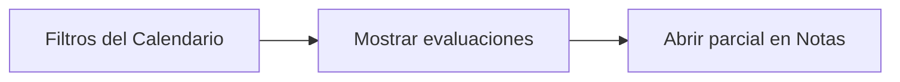

# CHG-167 · Evaluaciones académicas en Calendario
**Estado:** En desarrollo
**Nivel:** M
**Modelo sugerido:** estandar
<!-- Estados y nivel se cambian SOLO con node .claude/team.mjs. Modelo: un perfil de docs/TEAM_MODELS.md -->
**Creado:** 2026-11-17 · **Aprobado:** 2026-11-17 · **Cerrado:** —
**Relacionado:** —

## 0. En palabras simples
- Qué vas a ver distinto: Los parciales con fecha propia aparecen en la capa Evaluaciones de Calendario.
- Cómo comprobarlo tú: Activa o desactiva Evaluaciones y abre un parcial.

## 1. Resumen
Los parciales con fecha propia aparecen en la capa Evaluaciones de Calendario. Forma parte del plan Mi estudio aprobado por Edwin, con entrega integrada.

## 2. Producto (product-manager)
- Problema / usuario: estudiantes de pregrado y posgrado necesitan gestionar sus compromisos y resultados.
- Incluye: Capa con preferencia por cuenta, rango visible y enlaces a notas; deduplicación de tareas.
- Criterios de aceptación: Los eventos se filtran y abren la materia, y las entregas aparecen una sola vez.

## 3. UX/UI
### 3.1 Experiencia (ux-designer)
- Plantilla: lista y detalle dentro del shell.
- Flujo: Calendario → Filtros → Evaluaciones → Notas de la materia.
- Mostrar estados inicial, cargando, vacío, error recuperable y éxito. Conservar el foco y proporcionar errores por campo.



### 3.2 Visual (ui-designer)
- Usar componentes canónicos y tokens Material 3. En móvil, apilar el contenido y conservar accesos de 44 px. Revisar tema claro y oscuro.

```text
Calendario · Filtros
[x] Tareas  [x] Evaluaciones
Jueves · Parcial de Cálculo
```

### 3.3 Escritura (ux-writer)
- Usar títulos descriptivos, etiquetas concretas y mensajes neutrales en español colombiano.

## 4. Diseño técnico (software-architect)
- Archivos: Servicio de agenda, TaskCalendar, vista de Calendario, JS, CSS, assets publicados y pruebas.
- Enfoque: conservar la jerarquía actual, verificar el dueño al leer y escribir, y mantener consultas acotadas.
- Compatibilidad: se conservan los contratos vigentes de reservas, salud, hábitos y cursos.

## 5. Pruebas (qa-tester)
| Caso | Tipo | Nivel | Test |
|---|---|---|---|
| Los eventos se filtran y abren la materia, y las entregas aparecen una sola vez. | Funcional | Aplicación | Learning y Calendario |
- Comando: php artisan test --filter='Learning|TaskCalendar|PersonalCalendar'; npm run build; php artisan ui:conformance.
- Validar persistencia en MySQL y revisar interacción a 390, 768 y 1440 px.

## 6. Documentación (tech-writer)
- Actualizar docs/learning.md y, para la capa, docs/design-system.md.

## 7. Tareas
- [ ] T1 · Los parciales con fecha propia aparecen en la capa Evaluaciones de Calendario. — Resp: developer — Modelo: estandar — Archivos: Servicio de agenda, TaskCalendar, vista de Calendario, JS, CSS, assets publicados y pruebas. — Hecho cuando: Los eventos se filtran y abren la materia, y las entregas aparecen una sola vez.

## 8. Bitácora de implementación (developer)

- 2026-11-17 — Agregada la capa Evaluaciones al filtro del Calendario. Se verificaron rango, propietario, ocultar y restaurar la capa entre recargas, abrir un parcial por teclado y evitar duplicados. El menú general de tareas tuvo un fallo intermitente de teclado, reproducido también en el código base.

## 9. Preguntas abiertas, decisiones e historial
- Alcance confirmado en la conversación y ejecución solicitada con «Implement the plan».
- 2026-11-17 — Aprobado por el usuario (Compuerta 2)
- 2026-11-17 — Movido a in-progress/ (En desarrollo)
- LECCIÓN: ninguna.
