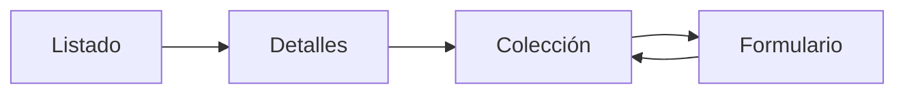

# CHG-180 · Pestañas del detalle de un plan
**Estado:** En verificación
**Nivel:** M
**Modelo sugerido:** estandar
<!-- Estados y nivel se cambian SOLO con node .claude/team.mjs. Modelo: un perfil de docs/TEAM_MODELS.md -->
**Creado:** 2026-11-18 · **Aprobado:** 2026-11-18 · **Cerrado:** —
**Relacionado:** —

## 0. En palabras simples
- Abre un plan y cambia entre sus detalles, visitas, tareas, personas y enlaces. Puedes crear o vincular tareas desde allí.
- Prueba un plan vacío, agrega información y comprueba los contadores y el panel Datos del plan.

## 1. Resumen
El detalle usa pestañas propias con URLs y conserva las acciones del plan. El usuario confirmó el flujo y pidió implementar el plan presentado.

## 2. Producto (product-manager)
Cada plan tiene cinco pestañas permanentes. Las cuatro colecciones muestran su total, incluido cero, y sus formularios. Tareas admite crear, vincular y desvincular sin borrar la tarea. El listado general conserva su navegación.

## 3. UX/UI
### 3.1 Experiencia (ux-designer)
Plantilla: detalle con pestañas y contexto lateral.
Detalles abre por defecto. Mover galería y notas a Detalles, visitas a Historial y las colecciones de personas y enlaces a sus pestañas. El FAB y los estados vacíos abren formularios sobre la pestaña actual.



### 3.2 Visual (ui-designer)
Reutilizar shell, pestañas, panel y FAB. En móvil, desplazar las pestañas y apilar el panel debajo del contenido.

```text
←  Detalles | Historial (0) | Tareas (0) | Personas (0) | Enlaces (0)
Sección activa                              Datos del plan ⋮
FAB
```

### 3.3 Escritura (ux-writer)
Usar Datos del plan, los cinco nombres del boceto y acciones en infinitivo. Cada colección indica cuándo está vacía.

## 4. Diseño técnico (software-architect)
- Rutas de detalle en routes/web.php y config/modules.php, componente app/Livewire/Plan/PlanShow.php, vista y parciales de Planes, estilos de Planes.
- Reutilizar TaskAssociation, el alias plan, TaskEditor y sus eventos, con controles de propiedad y limpieza de vínculos al borrar el plan. Cambios en app/Models/Plan.php y app/Livewire/Task/TaskEditor.php. Sin migración.

## 5. Pruebas (qa-tester)
| Caso | Tipo | Nivel | Test |
|---|---|---|---|
| Pestañas, contadores, propiedad y ciclo de vínculos | Automatizada | Feature | Pruebas de Planes |
| Navegación, modales y panel en móvil y escritorio | Automatizada | Navegador | plans.interaction.spec.js |

Comando para verificar: php artisan test --filter=Plan; php artisan ui:conformance; Playwright de Planes; npm run build si cambian assets.

## 6. Documentación (tech-writer)
El CHG registra el flujo y sus criterios.

## 7. Tareas
- [x] T1 · Navegar por las secciones del plan y gestionar sus tareas — Resp: developer — Modelo: estandar — Archivos: los indicados en §4 y las pruebas de §5 — Hecho cuando: las cinco pestañas, el panel y las acciones pasan las verificaciones.
- [ ] T2 · Verificar el detalle en escritorio y móvil — Resp: qa-tester — Modelo: estandar — Archivos: pruebas de §5 — Hecho cuando: se comprueban los criterios del cambio.

## 8. Bitácora de implementación (developer)
- T1 completada. El detalle tiene cinco rutas y conserva Datos del plan en todas ellas. Tareas usa el editor común y las asociaciones existentes.
- Playwright pasó los tres casos del detalle a 1440, 390 y 320 px. El test del calendario selecciona Semana explícitamente para comprobar la vista de horas.
- PHP pasó 59 de 63 pruebas. Los cuatro fallos de PlanModuleTest se reprodujeron en HEAD limpio. La conformidad de UI conserva las tres infracciones preexistentes reportadas en Juego e Inicio.
- Compilación de assets y comprobación de whitespace correctas.

- Corrección tras la revisión visual. El FAB vuelve a renderizar al pasar sus atributos como variables Blade. Pasaron tres pruebas PHP y tres de navegador, incluida la apertura de Registrar visita y Crear tarea desde el FAB.

## 9. Preguntas abiertas, decisiones e historial
- Flujo confirmado con rutas propias, panel apilado en móvil y creación y vinculación de tareas.
- 2026-11-18 — Aprobado por el usuario (Compuerta 2)
- 2026-11-18 — Movido a in-progress/ (En desarrollo)
- 2026-11-18 — Implementación terminada → En verificación
- 2026-11-18 — Reabierto: El FAB del detalle muestra texto de Blade y no renderiza Registrar visita.
- 2026-11-18 — Implementación terminada → En verificación
